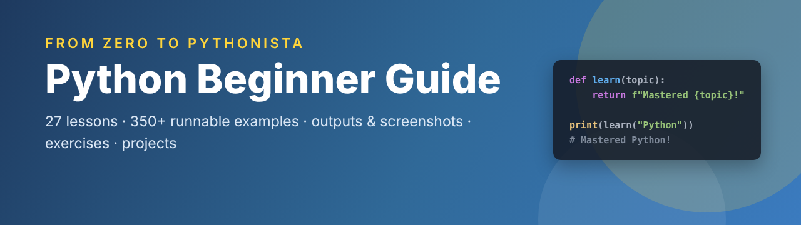
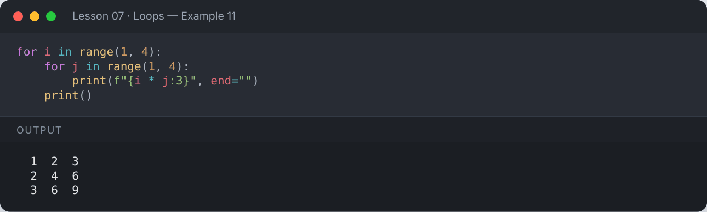
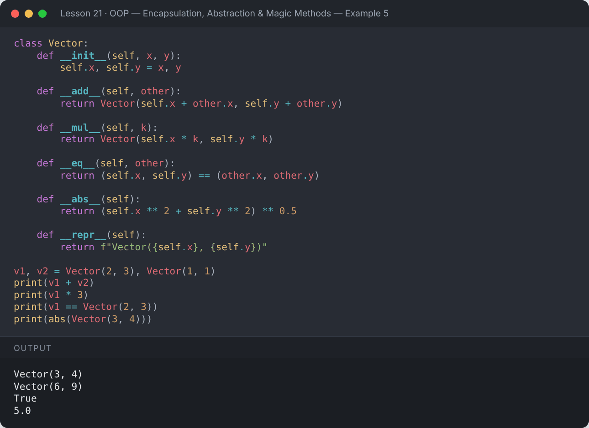

<div align="center">



# 🐍 Python Beginner Guide

**A complete, hands-on Python course — from your first `print()` to OOP, generators, decorators and async.**

[](https://www.python.org/)
[](https://jupyter.org/)
[](#-course-curriculum)
[](LICENSE)
[](CONTRIBUTING.md)

</div>

---

## 📖 About

This repository is a beginner-friendly, structured path to learning **Python 3**. Every lesson contains:

- 📘 **Clear explanations** with tables and diagrams
- 💻 **Runnable code examples** — every example has been executed
- 🖨️ **The real output** shown right under each example
- 📸 **A screenshot** of every example and its output
- ✍️ **Exercises with solutions** to practise what you learned
- 📓 **Jupyter notebooks** you can run locally or in Google Colab with one click

Whether you are a complete beginner or brushing up on the fundamentals, follow the lessons in order — each one builds on the previous.

## 📸 Preview

<div align="center">


</div>

## 🗺️ Course Curriculum

### 🟢 Beginner — Python Fundamentals

| # | Lesson | What you'll learn | Notebook |
|:--:|---|---|:--:|
| 01 | [**Introduction to Python**](lessons/01-introduction/README.md) | What programming is, why Python, how to set it up, and your very first program. | [](https://colab.research.google.com/github/MehvishKiani/Python-beginner-guide/blob/main/lessons/01-introduction/lesson.ipynb) |
| 02 | [**Variables & Data Types**](lessons/02-variables-and-data-types/README.md) | Store values in named variables and learn Python's built-in data types. | [](https://colab.research.google.com/github/MehvishKiani/Python-beginner-guide/blob/main/lessons/02-variables-and-data-types/lesson.ipynb) |
| 03 | [**Input, Output & Type Casting**](lessons/03-input-output-and-type-casting/README.md) | Read input from the user, convert between types, and format output beautifully. | [](https://colab.research.google.com/github/MehvishKiani/Python-beginner-guide/blob/main/lessons/03-input-output-and-type-casting/lesson.ipynb) |
| 04 | [**Operators & Tokens**](lessons/04-operators/README.md) | Arithmetic, comparison, logical, assignment, bitwise, identity and membership operators — plus Python tokens. | [](https://colab.research.google.com/github/MehvishKiani/Python-beginner-guide/blob/main/lessons/04-operators/lesson.ipynb) |
| 05 | [**Strings**](lessons/05-strings/README.md) | Create, index, slice, format and transform text with Python's powerful string methods. | [](https://colab.research.google.com/github/MehvishKiani/Python-beginner-guide/blob/main/lessons/05-strings/lesson.ipynb) |
| 06 | [**Conditional Statements**](lessons/06-conditional-statements/README.md) | Make decisions in code with if, elif, else, nested conditions, the ternary operator and match-case. | [](https://colab.research.google.com/github/MehvishKiani/Python-beginner-guide/blob/main/lessons/06-conditional-statements/lesson.ipynb) |
| 07 | [**Loops**](lessons/07-loops/README.md) | Repeat work with for and while loops, range(), break, continue, else, nested loops, enumerate() and zip(). | [](https://colab.research.google.com/github/MehvishKiani/Python-beginner-guide/blob/main/lessons/07-loops/lesson.ipynb) |

### 🔵 Data Structures

| # | Lesson | What you'll learn | Notebook |
|:--:|---|---|:--:|
| 08 | [**Lists**](lessons/08-lists/README.md) | Ordered, mutable collections — create, access, modify, sort and copy lists. | [](https://colab.research.google.com/github/MehvishKiani/Python-beginner-guide/blob/main/lessons/08-lists/lesson.ipynb) |
| 09 | [**Tuples**](lessons/09-tuples/README.md) | Ordered, immutable collections — when and why to use tuples, packing and unpacking. | [](https://colab.research.google.com/github/MehvishKiani/Python-beginner-guide/blob/main/lessons/09-tuples/lesson.ipynb) |
| 10 | [**Sets**](lessons/10-sets/README.md) | Unordered collections of unique items and powerful set operations like union and intersection. | [](https://colab.research.google.com/github/MehvishKiani/Python-beginner-guide/blob/main/lessons/10-sets/lesson.ipynb) |
| 11 | [**Dictionaries**](lessons/11-dictionaries/README.md) | Store data as key-value pairs — access, update, loop through and nest dictionaries. | [](https://colab.research.google.com/github/MehvishKiani/Python-beginner-guide/blob/main/lessons/11-dictionaries/lesson.ipynb) |
| 12 | [**Comprehensions**](lessons/12-comprehensions/README.md) | Build lists, sets and dictionaries in a single, readable line. | [](https://colab.research.google.com/github/MehvishKiani/Python-beginner-guide/blob/main/lessons/12-comprehensions/lesson.ipynb) |

### 🟣 Functions & Modular Code

| # | Lesson | What you'll learn | Notebook |
|:--:|---|---|:--:|
| 13 | [**Functions**](lessons/13-functions/README.md) | Write reusable blocks of code with parameters, return values, default and keyword arguments, *args, **kwargs and scope. | [](https://colab.research.google.com/github/MehvishKiani/Python-beginner-guide/blob/main/lessons/13-functions/lesson.ipynb) |
| 14 | [**Lambda, map, filter & reduce**](lessons/14-lambda-map-filter-reduce/README.md) | Small anonymous functions and the functional tools that work with them. | [](https://colab.research.google.com/github/MehvishKiani/Python-beginner-guide/blob/main/lessons/14-lambda-map-filter-reduce/lesson.ipynb) |
| 15 | [**Recursion**](lessons/15-recursion/README.md) | Functions that call themselves — base cases, recursive cases and when to use them. | [](https://colab.research.google.com/github/MehvishKiani/Python-beginner-guide/blob/main/lessons/15-recursion/lesson.ipynb) |
| 16 | [**Modules & Packages**](lessons/16-modules-and-packages/README.md) | Organise code into modules, import from the standard library, create your own module and install packages with pip. | [](https://colab.research.google.com/github/MehvishKiani/Python-beginner-guide/blob/main/lessons/16-modules-and-packages/lesson.ipynb) |

### 🟠 Errors & Files

| # | Lesson | What you'll learn | Notebook |
|:--:|---|---|:--:|
| 17 | [**Exception Handling**](lessons/17-exception-handling/README.md) | Handle errors gracefully with try, except, else and finally — and raise your own exceptions. | [](https://colab.research.google.com/github/MehvishKiani/Python-beginner-guide/blob/main/lessons/17-exception-handling/lesson.ipynb) |
| 18 | [**File Handling**](lessons/18-file-handling/README.md) | Read and write text, CSV and JSON files safely with open(), the with statement and pathlib. | [](https://colab.research.google.com/github/MehvishKiani/Python-beginner-guide/blob/main/lessons/18-file-handling/lesson.ipynb) |

### 🔴 Object-Oriented Programming

| # | Lesson | What you'll learn | Notebook |
|:--:|---|---|:--:|
| 19 | [**OOP — Classes & Objects**](lessons/19-oop-classes-and-objects/README.md) | Model real-world things with classes: attributes, methods, constructors and the self keyword. | [](https://colab.research.google.com/github/MehvishKiani/Python-beginner-guide/blob/main/lessons/19-oop-classes-and-objects/lesson.ipynb) |
| 20 | [**OOP — Inheritance & Polymorphism**](lessons/20-oop-inheritance-and-polymorphism/README.md) | Reuse code with inheritance, extend it with super(), and write flexible code with polymorphism. | [](https://colab.research.google.com/github/MehvishKiani/Python-beginner-guide/blob/main/lessons/20-oop-inheritance-and-polymorphism/lesson.ipynb) |
| 21 | [**OOP — Encapsulation, Abstraction & Magic Methods**](lessons/21-oop-advanced/README.md) | Protect data, design abstract classes, use @property, class/static methods, dunder methods and dataclasses. | [](https://colab.research.google.com/github/MehvishKiani/Python-beginner-guide/blob/main/lessons/21-oop-advanced/lesson.ipynb) |

### ⚫ Advanced Python

| # | Lesson | What you'll learn | Notebook |
|:--:|---|---|:--:|
| 22 | [**Iterators & Generators**](lessons/22-iterators-and-generators/README.md) | How for-loops really work, building your own iterators, and memory-efficient generators with yield. | [](https://colab.research.google.com/github/MehvishKiani/Python-beginner-guide/blob/main/lessons/22-iterators-and-generators/lesson.ipynb) |
| 23 | [**Decorators & Context Managers**](lessons/23-decorators-and-context-managers/README.md) | Wrap functions with extra behaviour using decorators, and manage resources cleanly with the with statement. | [](https://colab.research.google.com/github/MehvishKiani/Python-beginner-guide/blob/main/lessons/23-decorators-and-context-managers/lesson.ipynb) |
| 24 | [**Regular Expressions**](lessons/24-regular-expressions/README.md) | Search, validate and extract text patterns with Python's re module. | [](https://colab.research.google.com/github/MehvishKiani/Python-beginner-guide/blob/main/lessons/24-regular-expressions/lesson.ipynb) |
| 25 | [**Pythonic Code & Best Practices**](lessons/25-pythonic-code-and-best-practices/README.md) | Type hints, PEP 8, handy built-ins, unpacking, the walrus operator, debugging and testing basics. | [](https://colab.research.google.com/github/MehvishKiani/Python-beginner-guide/blob/main/lessons/25-pythonic-code-and-best-practices/lesson.ipynb) |
| 26 | [**Concurrency Basics — Threads & Async**](lessons/26-concurrency-basics/README.md) | Do several things at once with threading, concurrent.futures and asyncio. | [](https://colab.research.google.com/github/MehvishKiani/Python-beginner-guide/blob/main/lessons/26-concurrency-basics/lesson.ipynb) |

### 🏆 Projects

| # | Lesson | What you'll learn | Notebook |
|:--:|---|---|:--:|
| 27 | [**Mini Projects**](lessons/27-mini-projects/README.md) | Put everything together — five beginner-friendly projects that combine the concepts from all lessons. | [](https://colab.research.google.com/github/MehvishKiani/Python-beginner-guide/blob/main/lessons/27-mini-projects/lesson.ipynb) |

## 🚀 Getting Started

### Option 1 — Run in the browser (no installation)

Click any **Open in Colab** badge above. That's it! ☁️

### Option 2 — Run on your computer

```bash
# 1. Clone the repository
git clone https://github.com/MehvishKiani/Python-beginner-guide.git
cd Python-beginner-guide

# 2. Create and activate a virtual environment
python -m venv .venv
# Windows:      .venv\Scripts\activate
# macOS/Linux:  source .venv/bin/activate

# 3. Install Jupyter
pip install -r requirements.txt

# 4. Launch the notebooks
jupyter notebook
```

### Run a project script

```bash
python projects/calculator.py
python projects/guessing_game.py
```

## 📁 Repository Structure

```
Python-beginner-guide/
├── lessons/
│   ├── 01-introduction/
│   │   ├── README.md          ← lesson notes + code + output + screenshots
│   │   ├── lesson.ipynb       ← runnable notebook with outputs
│   │   ├── exercises.ipynb    ← practice problems with solutions
│   │   └── screenshots/       ← image of every example and its output
│   ├── 02-variables-and-data-types/
│   └── ...                    ← 27 lessons in total
├── projects/                  ← standalone mini-project scripts
├── CHEATSHEET.md              ← one-page Python quick reference
├── CONTRIBUTING.md
├── requirements.txt
└── LICENSE
```

## 🧭 How to Use This Guide

1. 📖 Read the lesson `README.md` (or open `lesson.ipynb`).
2. ⌨️ Type the examples yourself — don't just copy-paste.
3. 🔁 Change values and predict the output before running.
4. ✍️ Solve the exercises **before** opening the solutions.
5. 🏆 Finish with the [mini projects](lessons/27-mini-projects/README.md) and build your own.

Need a quick reminder of the syntax? See the **[Python Cheat Sheet](CHEATSHEET.md)**.

## 🤝 Contributing

Contributions are welcome — fix a typo, improve an explanation, or add an exercise. See [CONTRIBUTING.md](CONTRIBUTING.md).

## ⭐ Support

If this guide helped you, please give it a **star** ⭐ — it helps other learners find it!

## 📄 License

This project is licensed under the [MIT License](LICENSE). Feel free to use and modify it.

<div align="center">

Made with ❤️ and 🐍 by **[Mehvish Kiani](https://github.com/MehvishKiani)**

</div>
