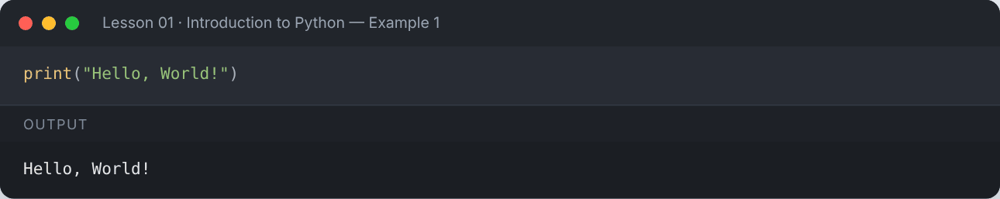
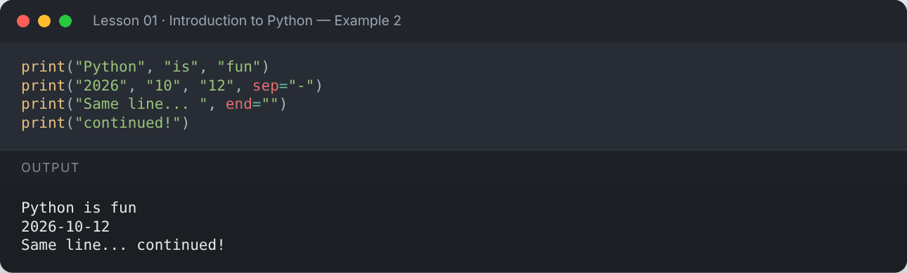
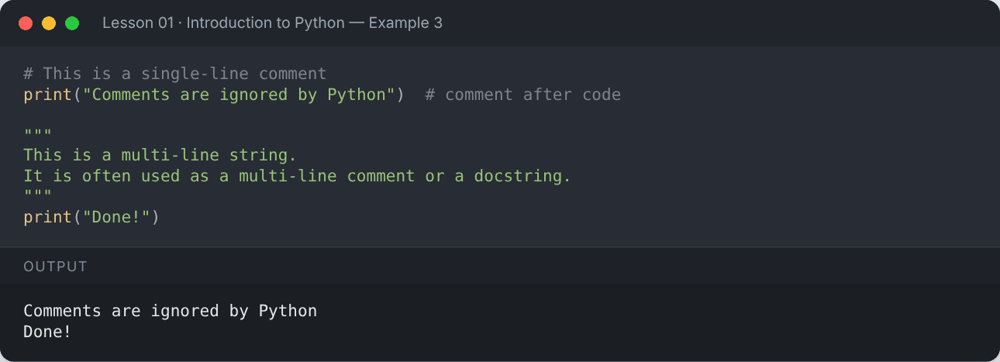
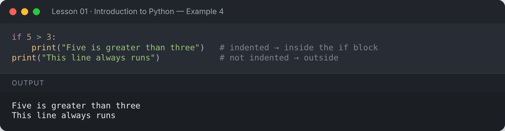
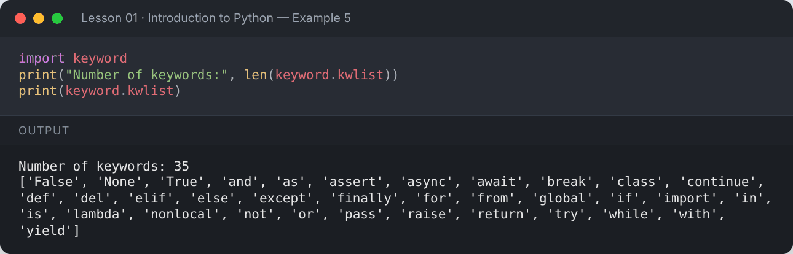
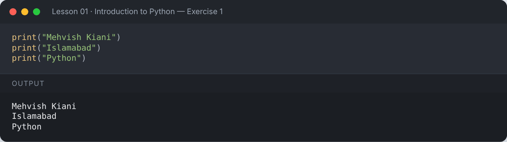
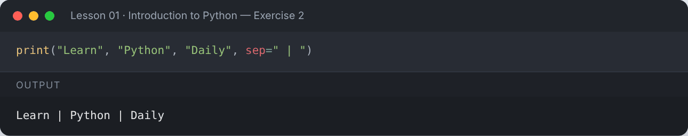
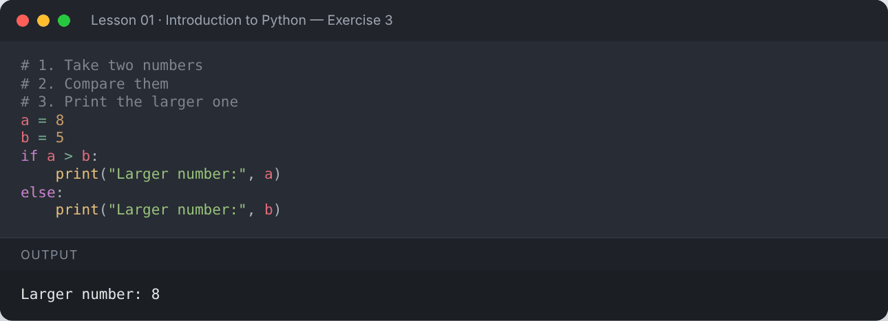

# Lesson 01 — Introduction to Python

> What programming is, why Python, how to set it up, and your very first program.

[](https://colab.research.google.com/github/MehvishKiani/Python-beginner-guide/blob/main/lessons/01-introduction/lesson.ipynb) &nbsp; 📓 [lesson.ipynb](lesson.ipynb) &nbsp; ✍️ [exercises.ipynb](exercises.ipynb)

[🏠 All lessons](../../README.md) · [Variables & Data Types ➡️](../02-variables-and-data-types/README.md)

---

## 🎯 Learning Objectives

- Understand what programming is and why it matters
- Know where Python is used in the real world
- Install Python and run code (script, REPL, Jupyter, Colab)
- Write your first program using `print()` and comments
- Understand Python's indentation rule

## 💡 What is Programming?

**Programming** is the process of giving a computer step-by-step instructions to perform a task.
A set of such instructions written in a programming language is called a **program**.

Before writing code, programmers think in **algorithms** — a clear, finite sequence of steps to solve a problem.

**Example algorithm — making tea:**

1. Boil water
2. Add tea leaves
3. Add milk and sugar
4. Pour into a cup

### Why is programming important?

- Automates repetitive tasks
- Solves problems quickly and accurately
- Builds software, mobile apps and websites
- Powers AI, Data Science, IoT, cybersecurity and more

## 🐍 Why Python?

| Feature | Why it helps |
|---|---|
| Simple, readable syntax | Code looks close to plain English |
| Interpreted | Run code line by line — no compile step |
| Huge standard library | "Batteries included" for files, math, dates, web… |
| Massive community | Tutorials, packages and help everywhere |
| Cross-platform | Same code runs on Windows, macOS and Linux |

### Applications of Python

- **Web Development** — Django, Flask, FastAPI
- **Data Science** — Pandas, NumPy, Matplotlib
- **Machine Learning & AI** — scikit-learn, TensorFlow, PyTorch
- **Automation & Scripting** — bots, file handling, web scraping
- **Game Development** — Pygame

## ⚙️ Setting Up Python

1. Download Python 3 from [python.org/downloads](https://www.python.org/downloads/) (tick **"Add Python to PATH"** on Windows).
2. Check the installation in a terminal:

```bash
python --version      # or: python3 --version
```

3. Ways to run Python code:

| Method | How |
|---|---|
| Script file | Save as `hello.py`, run `python hello.py` |
| Interactive shell (REPL) | Type `python` and press Enter |
| Jupyter Notebook | `pip install notebook` then `jupyter notebook` |
| Google Colab | Use the **Open in Colab** badge on any lesson — no install needed |

## 👋 Your First Program

The `print()` function displays output on the screen.

```python
print("Hello, World!")
```

**Output:**

```text
Hello, World!
```

<details><summary>📸 Screenshot</summary>



</details>

`print()` can take several values separated by commas. It adds a space between them by default — change that with `sep`, and change the line ending with `end`.

```python
print("Python", "is", "fun")
print("2026", "10", "12", sep="-")
print("Same line... ", end="")
print("continued!")
```

**Output:**

```text
Python is fun
2026-10-12
Same line... continued!
```

<details><summary>📸 Screenshot</summary>



</details>

## 📝 Comments

Comments are notes for humans. Python ignores them.

- Single-line comments start with `#`
- Multi-line notes are often written as a triple-quoted string (docstring)

```python
# This is a single-line comment
print("Comments are ignored by Python")  # comment after code

"""
This is a multi-line string.
It is often used as a multi-line comment or a docstring.
"""
print("Done!")
```

**Output:**

```text
Comments are ignored by Python
Done!
```

<details><summary>📸 Screenshot</summary>



</details>

## 📐 Indentation

Python uses **indentation** (spaces at the start of a line) to group code into blocks.
Other languages use `{ }` — Python uses 4 spaces. Wrong indentation causes an `IndentationError`.

```python
if 5 > 3:
    print("Five is greater than three")   # indented → inside the if block
print("This line always runs")            # not indented → outside
```

**Output:**

```text
Five is greater than three
This line always runs
```

<details><summary>📸 Screenshot</summary>



</details>

## 🔑 Keywords

Keywords are reserved words with special meaning. You cannot use them as variable names.

```python
import keyword
print("Number of keywords:", len(keyword.kwlist))
print(keyword.kwlist)
```

**Output:**

```text
Number of keywords: 35
['False', 'None', 'True', 'and', 'as', 'assert', 'async', 'await', 'break', 'class', 'continue', 'def', 'del', 'elif', 'else', 'except', 'finally', 'for', 'from', 'global', 'if', 'import', 'in', 'is', 'lambda', 'nonlocal', 'not', 'or', 'pass', 'raise', 'return', 'try', 'while', 'with', 'yield']
```

<details><summary>📸 Screenshot</summary>



</details>

## 📌 Summary

- A program is a set of instructions; an algorithm is the plan behind it.
- Python is simple, readable and used everywhere.
- `print()` shows output; `#` starts a comment.
- Indentation defines code blocks in Python.

---

## ✍️ Exercises

Try each one yourself first, then expand the solution.

**Exercise 1 — Print your name, your city and your favourite programming language on three separate lines.**

<details><summary>✅ Solution</summary>

```python
print("Mehvish Kiani")
print("Islamabad")
print("Python")
```

**Output:**

```text
Mehvish Kiani
Islamabad
Python
```



</details>

**Exercise 2 — Print the words `Learn`, `Python`, `Daily` on one line separated by ` | `.**

<details><summary>✅ Solution</summary>

```python
print("Learn", "Python", "Daily", sep=" | ")
```

**Output:**

```text
Learn | Python | Daily
```



</details>

**Exercise 3 — Write an algorithm (as comments) to find the larger of two numbers, then print the answer for 8 and 5.**

<details><summary>✅ Solution</summary>

```python
# 1. Take two numbers
# 2. Compare them
# 3. Print the larger one
a = 8
b = 5
if a > b:
    print("Larger number:", a)
else:
    print("Larger number:", b)
```

**Output:**

```text
Larger number: 8
```



</details>

---

[🏠 All lessons](../../README.md) · [Variables & Data Types ➡️](../02-variables-and-data-types/README.md)
