# Lesson 02 — Variables & Data Types

> Store values in named variables and learn Python's built-in data types.

[](https://colab.research.google.com/github/MehvishKiani/Python-beginner-guide/blob/main/lessons/02-variables-and-data-types/lesson.ipynb) &nbsp; 📓 [lesson.ipynb](lesson.ipynb) &nbsp; ✍️ [exercises.ipynb](exercises.ipynb)

[⬅️ Introduction to Python](../01-introduction/README.md) · [🏠 All lessons](../../README.md) · [Input, Output & Type Casting ➡️](../03-input-output-and-type-casting/README.md)

---

## 🎯 Learning Objectives

- Create and update variables
- Follow the naming rules and conventions
- Know Python's built-in data types: `int`, `float`, `complex`, `str`, `bool`, `NoneType`
- Check a value's type with `type()` and `isinstance()`

## 📦 What is a Variable?

A **variable** is a name that refers to a value stored in memory. Think of it as a labelled box.
Python creates the variable the moment you assign a value with `=` — no declaration needed.

```python
employee_name = "John"
print(employee_name)

employee_name = "Sam"      # re-assigning replaces the old value
print(employee_name)
```

**Output:**

```text
John
Sam
```

<details><summary>📸 Screenshot</summary>

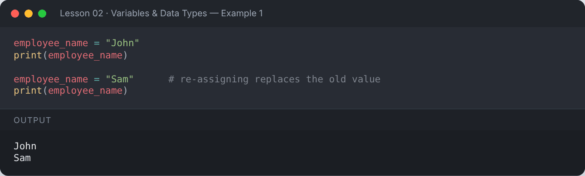

</details>

### Multiple assignment

```python
x, y, z = 10, 20, 30          # assign several variables in one line
a = b = c = 0                 # same value to many variables
print(x, y, z)
print(a, b, c)

# swap two values — the Pythonic way
x, y = y, x
print("After swap:", x, y)
```

**Output:**

```text
10 20 30
0 0 0
After swap: 20 10
```

<details><summary>📸 Screenshot</summary>

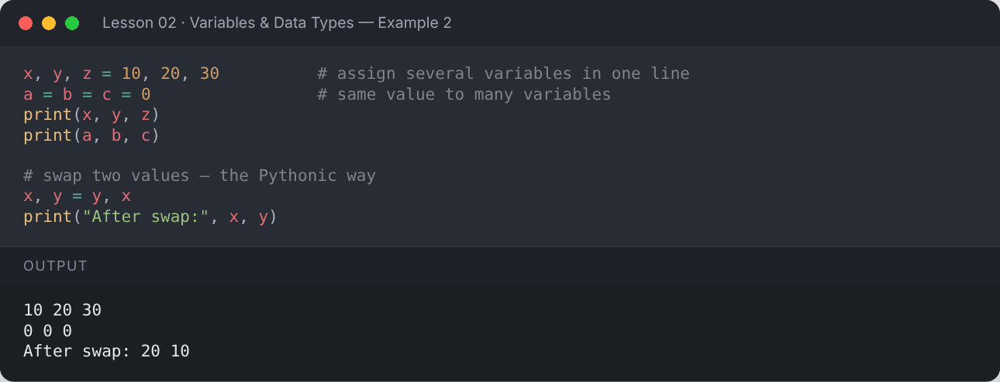

</details>

## 📏 Rules for Variable Names

| ✅ Allowed | ❌ Not allowed |
|---|---|
| Letters, digits, underscore: `age_1`, `_count` | Starting with a digit: `1name` |
| Case-sensitive: `Age` ≠ `age` | Special characters: `a-b`, `@mail`, `total%` |
| Any length | Keywords: `for`, `class`, `if` |

**Convention (PEP 8):** use `snake_case` for variables — e.g. `student_name`, `total_marks`.

```python
student_name = "Ali"
Student_Name = "Sara"     # different variable — names are case-sensitive
print(student_name, Student_Name)

import keyword
print("Is 'for' a keyword?", keyword.iskeyword("for"))
print("Is 'age_1' a valid name?", "age_1".isidentifier())
print("Is '1name' a valid name?", "1name".isidentifier())
```

**Output:**

```text
Ali Sara
Is 'for' a keyword? True
Is 'age_1' a valid name? True
Is '1name' a valid name? False
```

<details><summary>📸 Screenshot</summary>

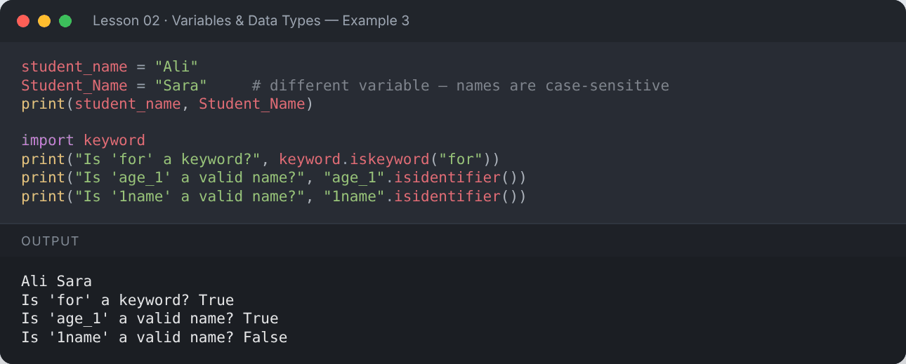

</details>

## 🧱 Built-in Data Types

| Category | Types |
|---|---|
| Numeric | `int`, `float`, `complex` |
| Text | `str` |
| Boolean | `bool` |
| Sequence | `list`, `tuple`, `range` |
| Mapping | `dict` |
| Set | `set`, `frozenset` |
| None | `NoneType` |

Every value has a type. Use `type()` to check it.

### Integer (`int`)
Whole numbers, positive or negative, with unlimited size.

```python
a = 100
print("This is an integer:", a)
print(type(a))
big = 2 ** 100
print("Python ints can be huge:", big)
```

**Output:**

```text
This is an integer: 100
<class 'int'>
Python ints can be huge: 1267650600228229401496703205376
```

<details><summary>📸 Screenshot</summary>

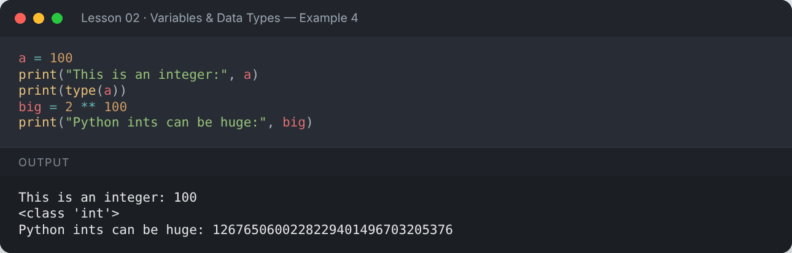

</details>

### Float (`float`)
Numbers with a decimal point.

```python
price = 21.23
print("This is a float:", price)
print(type(price))
print(0.1 + 0.2)          # floats are approximate!
print(round(0.1 + 0.2, 2))
```

**Output:**

```text
This is a float: 21.23
<class 'float'>
0.30000000000000004
0.3
```

<details><summary>📸 Screenshot</summary>

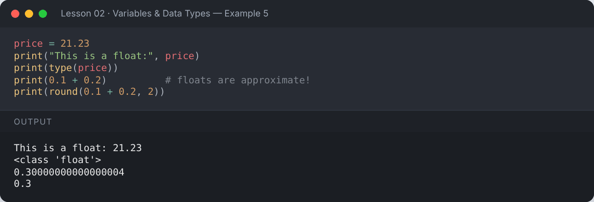

</details>

### Complex (`complex`)
Numbers with a real and imaginary part (`j`).

```python
z = 3 + 6j
print("This is a complex number:", z)
print("Real:", z.real, "Imaginary:", z.imag)
print(type(z))
```

**Output:**

```text
This is a complex number: (3+6j)
Real: 3.0 Imaginary: 6.0
<class 'complex'>
```

<details><summary>📸 Screenshot</summary>

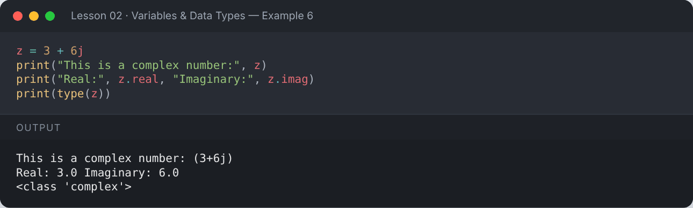

</details>

### String (`str`)
Text inside single `' '`, double `" "` or triple `""" """` quotes.

```python
name = "Mehvish Kiani"
message = 'Python is fun'
poem = """Roses are red,
Python is great."""
print(name)
print(message)
print(poem)
print(type(name))
```

**Output:**

```text
Mehvish Kiani
Python is fun
Roses are red,
Python is great.
<class 'str'>
```

<details><summary>📸 Screenshot</summary>

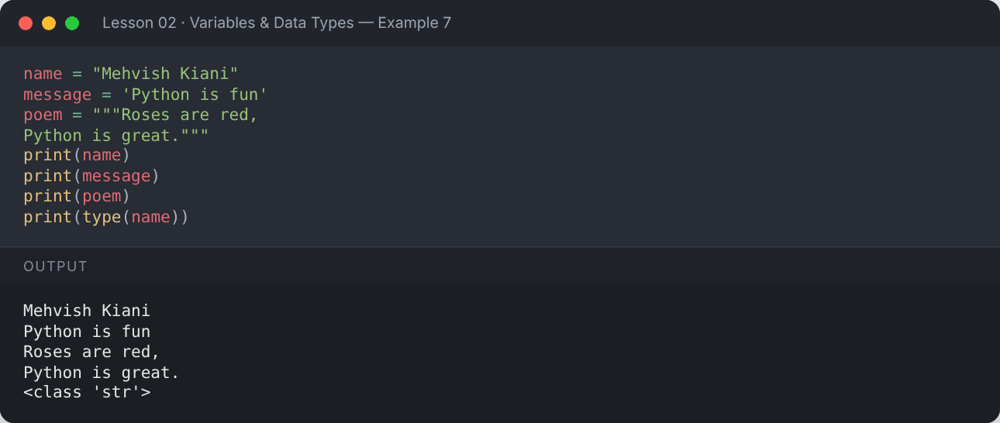

</details>

### Boolean (`bool`)
Only two values: `True` or `False`. Used in conditions.

```python
is_student = True
has_job = False
print(is_student, has_job)
print(type(is_student))
print(10 > 5)        # comparisons produce booleans
```

**Output:**

```text
True False
<class 'bool'>
True
```

<details><summary>📸 Screenshot</summary>

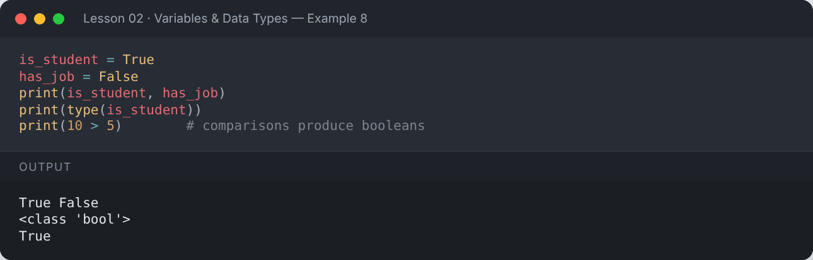

</details>

### None (`NoneType`)
`None` means "no value".

```python
result = None
print(result)
print(type(result))
```

**Output:**

```text
None
<class 'NoneType'>
```

<details><summary>📸 Screenshot</summary>

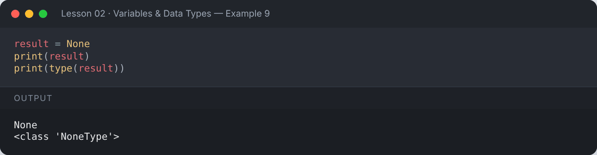

</details>

## 🔍 Checking Types

`isinstance(value, type)` returns `True` if the value is of that type.

```python
age = 22
print(isinstance(age, int))
print(isinstance(age, float))
print(isinstance(age, (int, float)))   # check against several types
```

**Output:**

```text
True
False
True
```

<details><summary>📸 Screenshot</summary>

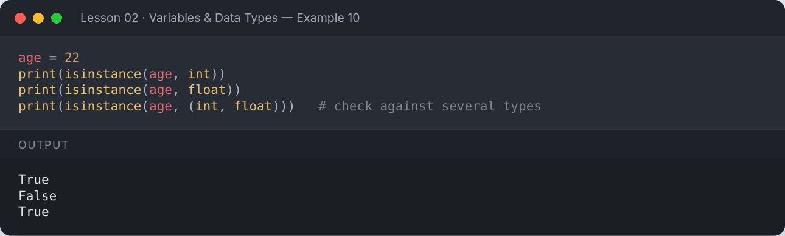

</details>

## 🧠 Dynamic Typing

Python is **dynamically typed**: the same variable can hold different types over time.

```python
data = 42
print(data, type(data))
data = "forty-two"
print(data, type(data))
```

**Output:**

```text
42 <class 'int'>
forty-two <class 'str'>
```

<details><summary>📸 Screenshot</summary>

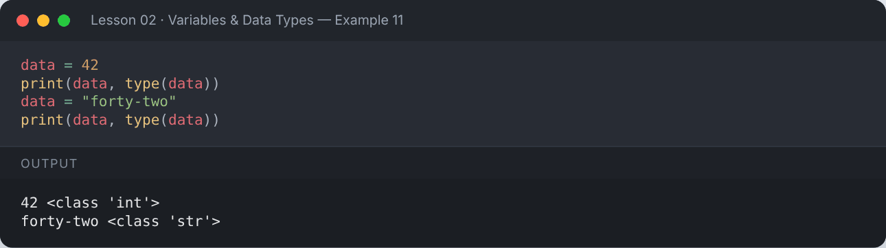

</details>

## 📌 Summary

- Variables are created by assignment: `name = value`.
- Use `snake_case` and avoid keywords.
- Core types: `int`, `float`, `complex`, `str`, `bool`, `None`.
- `type()` tells you the type; `isinstance()` checks it.

---

## ✍️ Exercises

Try each one yourself first, then expand the solution.

**Exercise 1 — Create variables for your name, age, and height and print them in one sentence.**

<details><summary>✅ Solution</summary>

```python
name = "Mehvish"
age = 22
height = 5.4
print(f"My name is {name}, I am {age} years old and {height} feet tall.")
```

**Output:**

```text
My name is Mehvish, I am 22 years old and 5.4 feet tall.
```

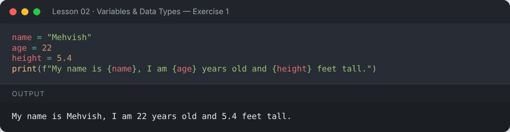

</details>

**Exercise 2 — Create variables for your name, age, GPA and degree name. Print them.**

<details><summary>✅ Solution</summary>

```python
name = "Mehvish Kiani"
age = 22
gpa = 3.44
degree = "BS Computer Science"

print(name)
print(age)
print(gpa)
print(degree)
```

**Output:**

```text
Mehvish Kiani
22
3.44
BS Computer Science
```

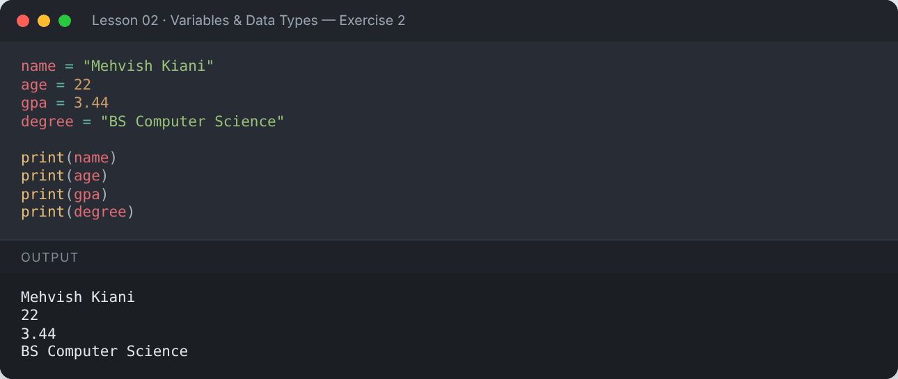

</details>

**Exercise 3 — Create two numbers, add them, and print the result.**

<details><summary>✅ Solution</summary>

```python
a = 10.5
b = 10
print("Adding two numbers:", a + b)
```

**Output:**

```text
Adding two numbers: 20.5
```

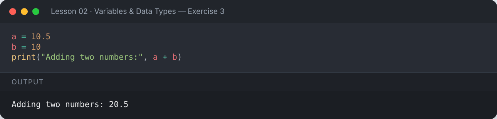

</details>

**Exercise 4 — Check the type of these values: `"123"`, `123`, `12.3`, `True`.**

<details><summary>✅ Solution</summary>

```python
print(type("123"))
print(type(123))
print(type(12.3))
print(type(True))
```

**Output:**

```text
<class 'str'>
<class 'int'>
<class 'float'>
<class 'bool'>
```

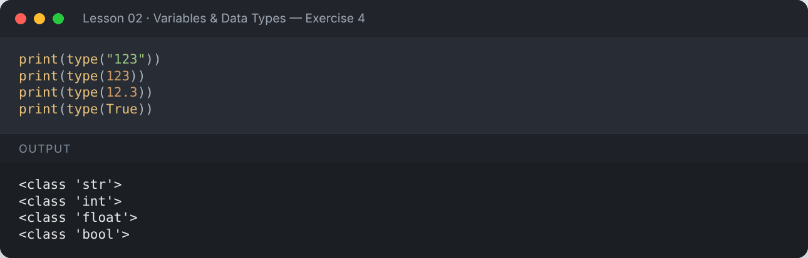

</details>

**Exercise 5 — Swap the values of two variables without using a third variable.**

<details><summary>✅ Solution</summary>

```python
p, q = "left", "right"
p, q = q, p
print("p =", p, "| q =", q)
```

**Output:**

```text
p = right | q = left
```

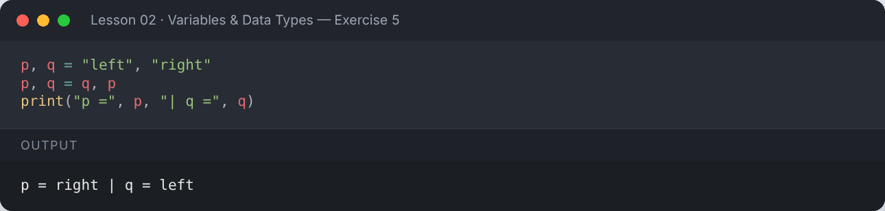

</details>

---

[⬅️ Introduction to Python](../01-introduction/README.md) · [🏠 All lessons](../../README.md) · [Input, Output & Type Casting ➡️](../03-input-output-and-type-casting/README.md)
