# Lesson 03 — Input, Output & Type Casting

> Read input from the user, convert between types, and format output beautifully.

[](https://colab.research.google.com/github/MehvishKiani/Python-beginner-guide/blob/main/lessons/03-input-output-and-type-casting/lesson.ipynb) &nbsp; 📓 [lesson.ipynb](lesson.ipynb) &nbsp; ✍️ [exercises.ipynb](exercises.ipynb)

[⬅️ Variables & Data Types](../02-variables-and-data-types/README.md) · [🏠 All lessons](../../README.md) · [Operators & Tokens ➡️](../04-operators/README.md)

---

## 🎯 Learning Objectives

- Take user input with `input()`
- Convert values with `int()`, `float()`, `str()`, `bool()`
- Read multiple values in one line
- Format output with f-strings, `format()` and `%`

## ⌨️ Taking Input — `input()`

`input()` pauses the program, shows a prompt and waits for the user to type something.

> ⚠️ `input()` **always returns a string (`str`)** — even if the user types a number.

*(In the outputs below, the text after the prompt is what the user typed.)*

```python
name = input("Enter your name: ")
print("Hello,", name)
print(type(name))
```

**Output:**

```text
Enter your name: Mehvish
Hello, Mehvish
<class 'str'>
```

<details><summary>📸 Screenshot</summary>

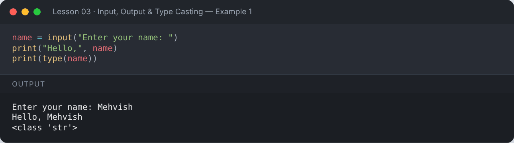

</details>

```python
age = input("Enter your age: ")
print(age, type(age))      # still a string!
```

**Output:**

```text
Enter your age: 22
22 <class 'str'>
```

<details><summary>📸 Screenshot</summary>

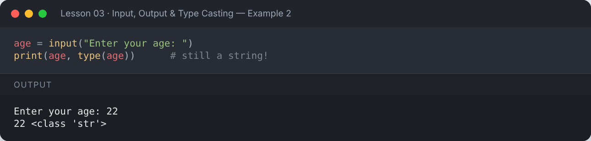

</details>

## 🔄 Type Casting (Type Conversion)

Convert a value from one type to another.

| Function | Converts to | Example |
|---|---|---|
| `int()` | integer | `int("25")` → `25` |
| `float()` | decimal | `float("3.5")` → `3.5` |
| `str()` | string | `str(10)` → `"10"` |
| `bool()` | boolean | `bool(0)` → `False` |

```python
age = int(input("Enter the age: "))
print(age, type(age))
print("Next year you will be", age + 1)
```

**Output:**

```text
Enter the age: 22
22 <class 'int'>
Next year you will be 23
```

<details><summary>📸 Screenshot</summary>

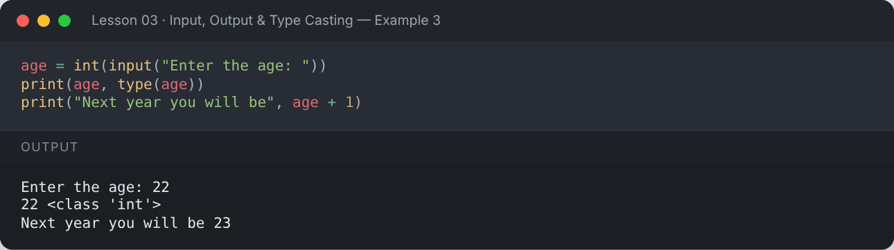

</details>

```python
print(int("25") + 5)
print(float("3.5") * 2)
print(str(100) + " points")
print(int(9.99))           # int() cuts off the decimal part (no rounding)
print(bool(0), bool(1), bool(""), bool("hi"))
```

**Output:**

```text
30
7.0
100 points
9
False True False True
```

<details><summary>📸 Screenshot</summary>

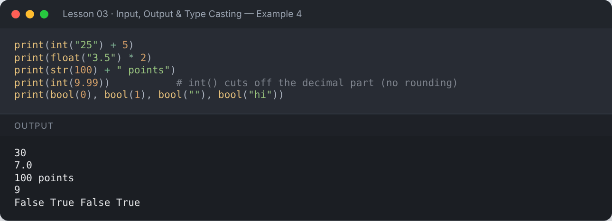

</details>

### Implicit conversion
Python converts automatically when it is safe, e.g. `int` + `float` → `float`.

```python
result = 5 + 2.5
print(result, type(result))
```

**Output:**

```text
7.5 <class 'float'>
```

<details><summary>📸 Screenshot</summary>

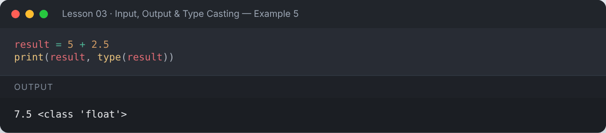

</details>

### Invalid conversion raises an error

```python
number = int("hello")
```

**Output:**

```text
Traceback (most recent call last):
  ...
ValueError: invalid literal for int() with base 10: 'hello'
```

<details><summary>📸 Screenshot</summary>

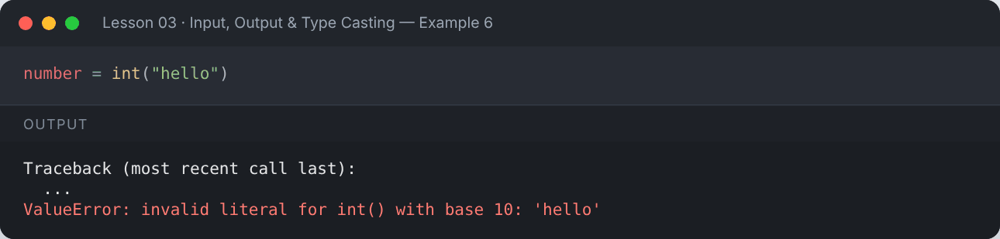

</details>

## 🔢 Multiple Inputs in One Line

Use `split()` to break the input into parts, and `map()` to convert each part.

```python
a, b = input("Enter two numbers: ").split()
print("Sum:", int(a) + int(b))
```

**Output:**

```text
Enter two numbers: 10 20
Sum: 30
```

<details><summary>📸 Screenshot</summary>

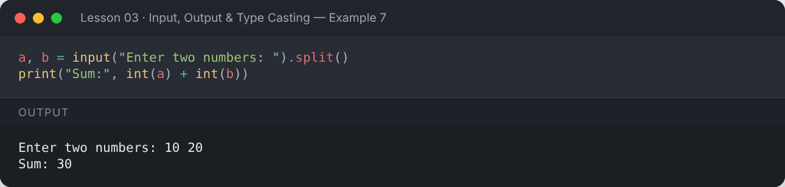

</details>

```python
numbers = list(map(int, input("Enter numbers separated by space: ").split()))
print(numbers)
print("Total:", sum(numbers))
```

**Output:**

```text
Enter numbers separated by space: 4 8 15 16
[4, 8, 15, 16]
Total: 43
```

<details><summary>📸 Screenshot</summary>

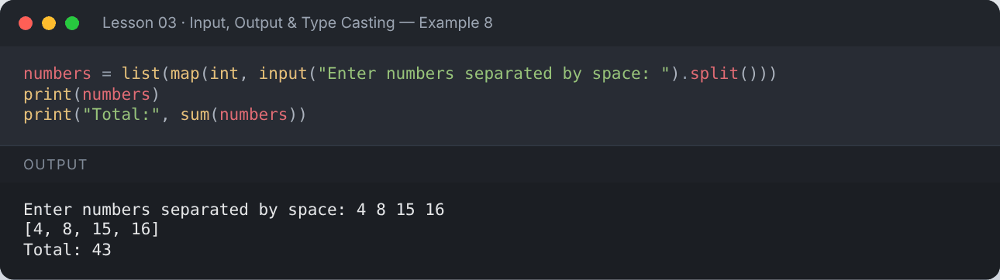

</details>

## 🖨️ Formatting Output

### 1. f-strings (recommended, Python 3.6+)

```python
name = "Mehvish"
age = 22
gpa = 3.4567
print(f"Name: {name}, Age: {age}")
print(f"GPA rounded: {gpa:.2f}")
print(f"Next year: {age + 1}")
print(f"{'left':<10}|{'center':^10}|{'right':>10}")
print(f"Big number: {1234567:,}")
print(f"Percentage: {0.875:.1%}")
```

**Output:**

```text
Name: Mehvish, Age: 22
GPA rounded: 3.46
Next year: 23
left      |  center  |     right
Big number: 1,234,567
Percentage: 87.5%
```

<details><summary>📸 Screenshot</summary>

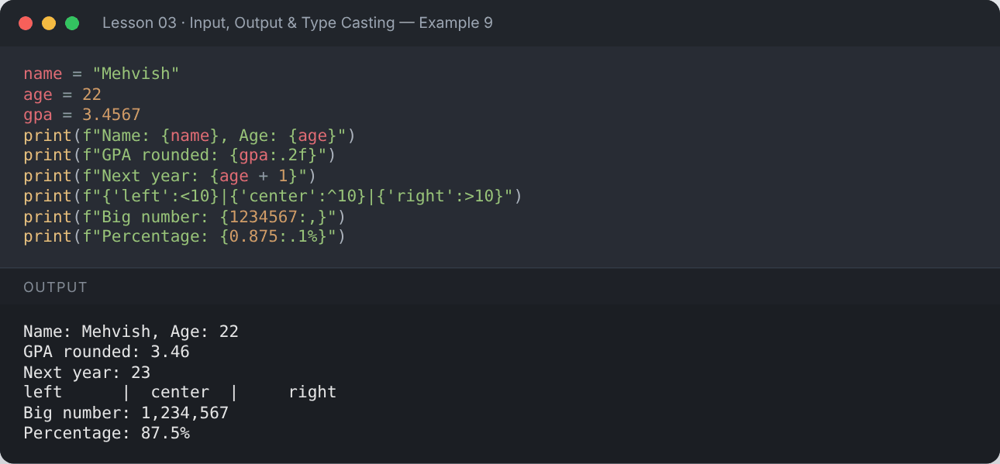

</details>

### 2. `str.format()` and 3. `%` formatting (older styles)

```python
print("Name: {}, Age: {}".format("Ali", 25))
print("Name: {n}, Age: {a}".format(n="Sara", a=30))
print("Name: %s, Age: %d, GPA: %.1f" % ("Zain", 21, 3.75))
```

**Output:**

```text
Name: Ali, Age: 25
Name: Sara, Age: 30
Name: Zain, Age: 21, GPA: 3.8
```

<details><summary>📸 Screenshot</summary>

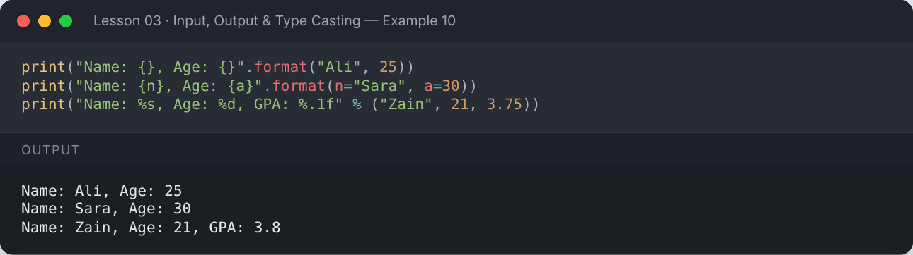

</details>

### Escape characters
| Escape | Meaning |
|---|---|
| `\n` | new line |
| `\t` | tab |
| `\\` | backslash |
| `\"` | double quote |

```python
print("Line 1\nLine 2")
print("Name:\tMehvish")
print("She said \"Hello!\"")
print("C:\\Users\\Python")
```

**Output:**

```text
Line 1
Line 2
Name:	Mehvish
She said "Hello!"
C:\Users\Python
```

<details><summary>📸 Screenshot</summary>

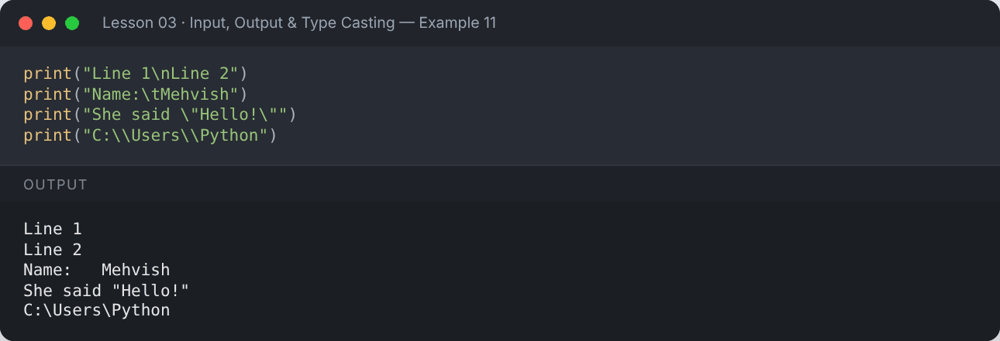

</details>

## 📌 Summary

- `input()` returns a string — convert it with `int()`/`float()`.
- `split()` + `map()` read many values at once.
- Prefer **f-strings** for formatting: `f"{value:.2f}"`.

---

## ✍️ Exercises

Try each one yourself first, then expand the solution.

**Exercise 1 — Take the user's name as input and print: `Hello <name>, welcome to Python!`**

<details><summary>✅ Solution</summary>

```python
name = input("Enter your name: ")
print(f"Hello {name}, welcome to Python!")
```

**Output:**

```text
Enter your name: Mehvish
Hello Mehvish, welcome to Python!
```

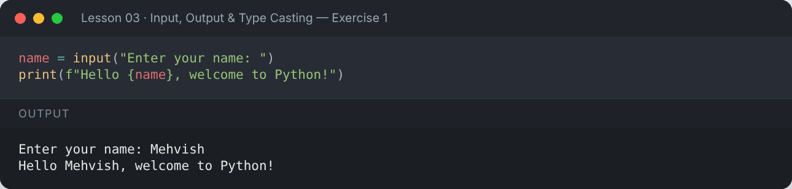

</details>

**Exercise 2 — Ask the user for 2 numbers and print their sum.**

<details><summary>✅ Solution</summary>

```python
a = int(input("Enter first number: "))
b = int(input("Enter second number: "))
print("Sum of two numbers:", a + b)
```

**Output:**

```text
Enter first number: 12
Enter second number: 30
Sum of two numbers: 42
```

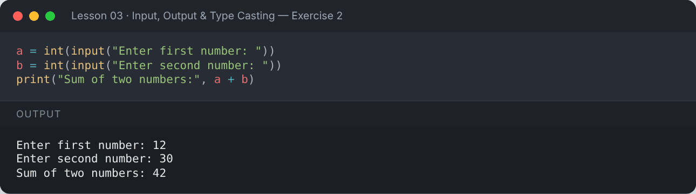

</details>

**Exercise 3 — Ask the user for a temperature in Celsius and convert it to Fahrenheit.**

<details><summary>✅ Solution</summary>

```python
celsius = float(input("Enter temperature in Celsius: "))
fahrenheit = (celsius * 9 / 5) + 32
print(f"Temperature in Fahrenheit: {fahrenheit:.1f}")
```

**Output:**

```text
Enter temperature in Celsius: 37
Temperature in Fahrenheit: 98.6
```

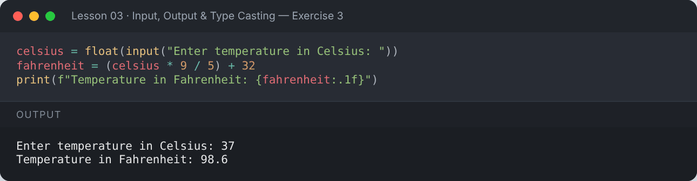

</details>

**Exercise 4 — Read the length and width of a rectangle in one line and print its area and perimeter.**

<details><summary>✅ Solution</summary>

```python
length, width = map(float, input("Enter length and width: ").split())
print(f"Area: {length * width}")
print(f"Perimeter: {2 * (length + width)}")
```

**Output:**

```text
Enter length and width: 5 3.5
Area: 17.5
Perimeter: 17.0
```

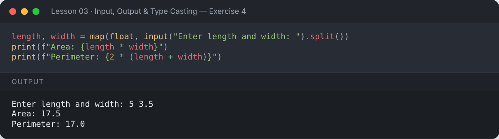

</details>

---

[⬅️ Variables & Data Types](../02-variables-and-data-types/README.md) · [🏠 All lessons](../../README.md) · [Operators & Tokens ➡️](../04-operators/README.md)
