# Lesson 04 — Operators & Tokens

> Arithmetic, comparison, logical, assignment, bitwise, identity and membership operators — plus Python tokens.

[](https://colab.research.google.com/github/MehvishKiani/Python-beginner-guide/blob/main/lessons/04-operators/lesson.ipynb) &nbsp; 📓 [lesson.ipynb](lesson.ipynb) &nbsp; ✍️ [exercises.ipynb](exercises.ipynb)

[⬅️ Input, Output & Type Casting](../03-input-output-and-type-casting/README.md) · [🏠 All lessons](../../README.md) · [Strings ➡️](../05-strings/README.md)

---

## 🎯 Learning Objectives

- Use all 7 groups of Python operators
- Understand operator precedence
- Identify the tokens of a Python program

## ➕ 1. Arithmetic Operators

| Operator | Meaning | Example |
|---|---|---|
| `+` | Addition | `10 + 3` → `13` |
| `-` | Subtraction | `10 - 3` → `7` |
| `*` | Multiplication | `10 * 3` → `30` |
| `/` | Division (always float) | `10 / 3` → `3.333…` |
| `//` | Floor division | `10 // 3` → `3` |
| `%` | Modulus (remainder) | `10 % 3` → `1` |
| `**` | Exponent (power) | `10 ** 3` → `1000` |

```python
a = 10
b = 3
print("Addition       :", a + b)
print("Subtraction    :", a - b)
print("Multiplication :", a * b)
print("Division       :", a / b)
print("Floor division :", a // b)
print("Modulus        :", a % b)
print("Exponent       :", a ** b)
```

**Output:**

```text
Addition       : 13
Subtraction    : 7
Multiplication : 30
Division       : 3.3333333333333335
Floor division : 3
Modulus        : 1
Exponent       : 1000
```

<details><summary>📸 Screenshot</summary>

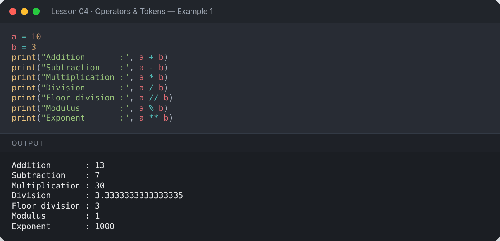

</details>

## ⚖️ 2. Comparison (Relational) Operators

They compare two values and return `True` or `False`.

```python
x = 10
y = 5
print("x == y :", x == y)   # equal to
print("x != y :", x != y)   # not equal to
print("x >  y :", x > y)
print("x <  y :", x < y)
print("x >= y :", x >= y)
print("x <= y :", x <= y)
print("Chained 1 < x < 20 :", 1 < x < 20)
```

**Output:**

```text
x == y : False
x != y : True
x >  y : True
x <  y : False
x >= y : True
x <= y : False
Chained 1 < x < 20 : True
```

<details><summary>📸 Screenshot</summary>

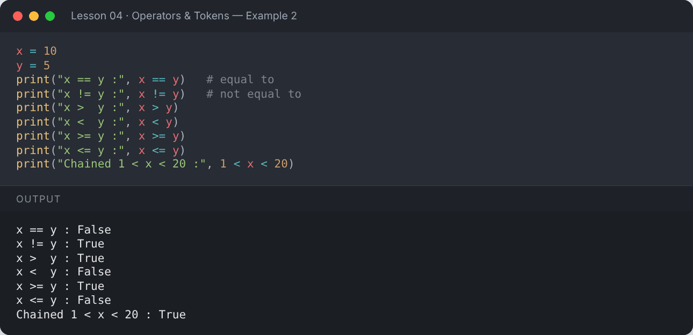

</details>

## 🔗 3. Logical Operators

| Operator | Result is `True` when… |
|---|---|
| `and` | **both** conditions are true |
| `or` | **at least one** condition is true |
| `not` | reverses the result |

```python
x = 5
print(x > 3 and x < 10)
print(x > 10 or x == 5)
print(not (x == 5))
```

**Output:**

```text
True
True
False
```

<details><summary>📸 Screenshot</summary>

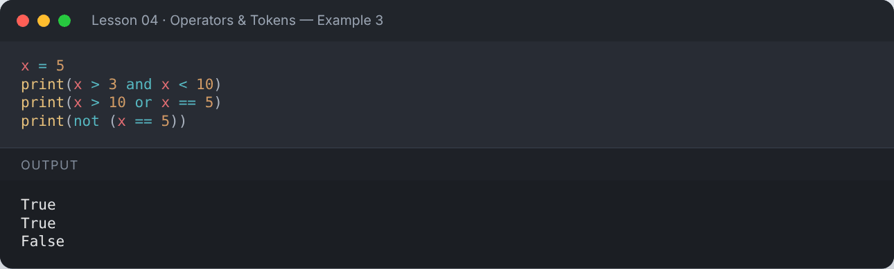

</details>

### Truth table

```python
for p in (True, False):
    for q in (True, False):
        print(f"{p!s:<5} and {q!s:<5} = {p and q!s:<5} | {p!s:<5} or {q!s:<5} = {p or q}")
```

**Output:**

```text
True  and True  = True  | True  or True  = True
True  and False = False | True  or False = True
False and True  = False | False or True  = True
False and False = False | False or False = False
```

<details><summary>📸 Screenshot</summary>

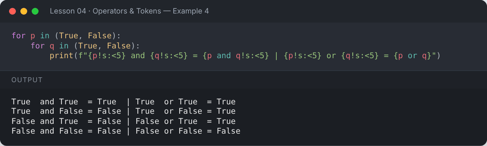

</details>

## 📝 4. Assignment Operators

```python
n = 10
n += 5;  print("n += 5  ->", n)
n -= 3;  print("n -= 3  ->", n)
n *= 2;  print("n *= 2  ->", n)
n /= 4;  print("n /= 4  ->", n)
n //= 2; print("n //= 2 ->", n)
n **= 3; print("n **= 3 ->", n)
n %= 5;  print("n %= 5  ->", n)
```

**Output:**

```text
n += 5  -> 15
n -= 3  -> 12
n *= 2  -> 24
n /= 4  -> 6.0
n //= 2 -> 3.0
n **= 3 -> 27.0
n %= 5  -> 2.0
```

<details><summary>📸 Screenshot</summary>

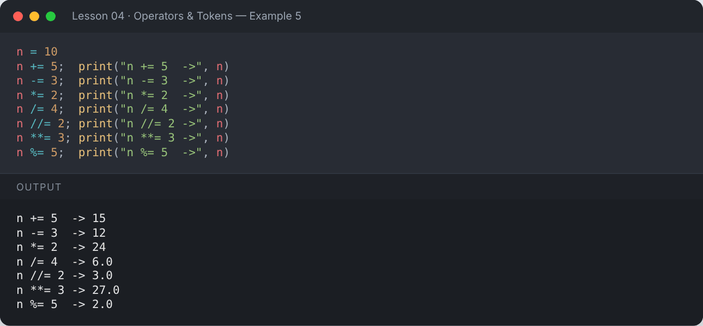

</details>

## 🧮 5. Bitwise Operators

Work on the binary (bit) representation of integers.

| Operator | Name |
|---|---|
| `&` | AND |
| `\|` | OR |
| `^` | XOR |
| `~` | NOT |
| `<<` | Left shift |
| `>>` | Right shift |

```python
a, b = 6, 3          # 6 = 110, 3 = 011
print(f"a = {a:03b}, b = {b:03b}")
print("a & b  =", a & b)    # 010 -> 2
print("a | b  =", a | b)    # 111 -> 7
print("a ^ b  =", a ^ b)    # 101 -> 5
print("~a     =", ~a)       # -(a+1)
print("a << 1 =", a << 1)   # 1100 -> 12
print("a >> 1 =", a >> 1)   # 11 -> 3
```

**Output:**

```text
a = 110, b = 011
a & b  = 2
a | b  = 7
a ^ b  = 5
~a     = -7
a << 1 = 12
a >> 1 = 3
```

<details><summary>📸 Screenshot</summary>

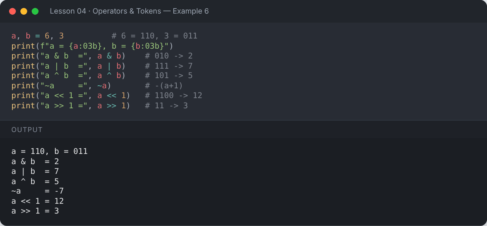

</details>

`&` and `|` also work on booleans:

```python
t, f = True, False
print("True & False :", t & f)
print("True | False :", t | f)
```

**Output:**

```text
True & False : False
True | False : True
```

<details><summary>📸 Screenshot</summary>

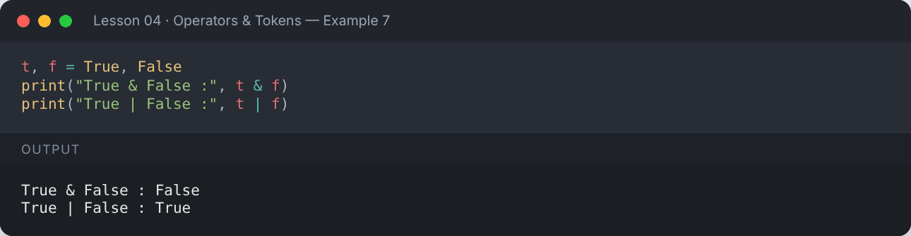

</details>

## 🪪 6. Identity Operators — `is`, `is not`

`is` checks whether two names point to the **same object** in memory; `==` checks whether the **values** are equal.

```python
list1 = [1, 2, 3]
list2 = [1, 2, 3]
list3 = list1
print("list1 == list2 :", list1 == list2)   # same values
print("list1 is list2 :", list1 is list2)   # different objects
print("list1 is list3 :", list1 is list3)   # same object
value = None
print("value is None  :", value is None)
```

**Output:**

```text
list1 == list2 : True
list1 is list2 : False
list1 is list3 : True
value is None  : True
```

<details><summary>📸 Screenshot</summary>

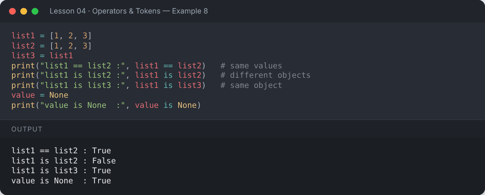

</details>

## 📥 7. Membership Operators — `in`, `not in`

```python
fruits = ["apple", "banana", "cherry"]
print("apple" in fruits)
print("mango" not in fruits)
print("Py" in "Python")
```

**Output:**

```text
True
True
True
```

<details><summary>📸 Screenshot</summary>

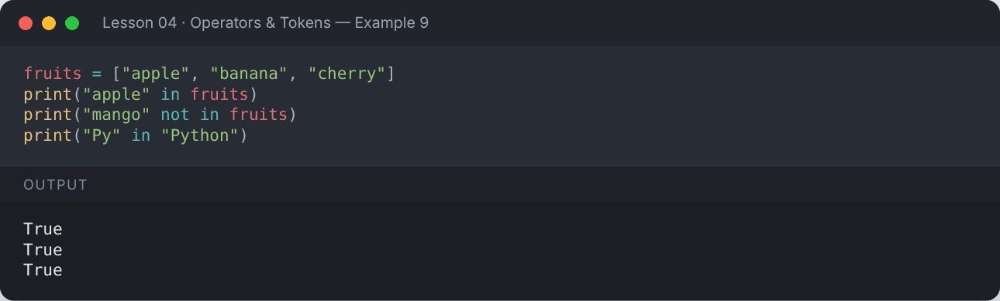

</details>

## 🏆 Operator Precedence (highest → lowest)

1. `()` parentheses
2. `**` exponent
3. `+x`, `-x`, `~x` (unary)
4. `*`, `/`, `//`, `%`
5. `+`, `-`
6. `<<`, `>>`
7. `&` → `^` → `|`
8. Comparisons `==`, `!=`, `>`, `<`, `is`, `in` …
9. `not` → `and` → `or`

```python
print(2 + 3 * 4)        # * before +
print((2 + 3) * 4)      # parentheses first
print(2 ** 3 ** 2)      # ** is right-to-left: 2 ** 9
print(10 - 4 - 3)       # left-to-right
```

**Output:**

```text
14
20
512
3
```

<details><summary>📸 Screenshot</summary>

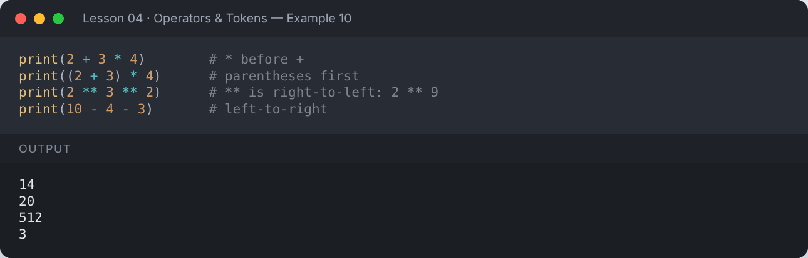

</details>

## 🧩 Tokens in Python

**Tokens** are the smallest units of a program:

1. **Keywords** — reserved words: `if`, `else`, `for`, `while`, `def` …
2. **Identifiers** — names of variables/functions. Valid: `name`, `age_1`, `_count`. Invalid: `1name`, `for`, `a-b`
3. **Literals** — constant values: `10`, `"Hello"`, `3.14`, `True`
4. **Operators** — symbols: `+ - * / == and`
5. **Punctuators (delimiters)** — `: , ( ) [ ] { } .`

```python
import io, tokenize
code = 'if total > 10: print("big")'
for tok in tokenize.generate_tokens(io.StringIO(code).readline):
    if tok.string.strip():
        print(f"{tokenize.tok_name[tok.type]:<8} {tok.string}")
```

**Output:**

```text
NAME     if
NAME     total
OP       >
NUMBER   10
OP       :
NAME     print
OP       (
STRING   "big"
OP       )
```

<details><summary>📸 Screenshot</summary>

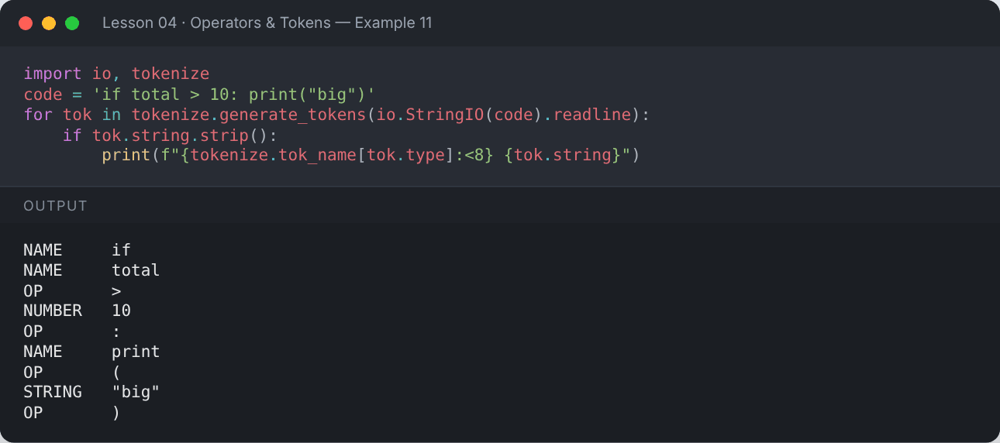

</details>

## 📌 Summary

- 7 operator groups: arithmetic, comparison, logical, assignment, bitwise, identity, membership.
- `/` always returns a float; `//` floors; `%` gives the remainder.
- Use `is` only for identity checks like `x is None`; use `==` for values.
- When in doubt about precedence, use parentheses.

---

## ✍️ Exercises

Try each one yourself first, then expand the solution.

**Exercise 1 — Check if a number is divisible by both 2 and 3.**

<details><summary>✅ Solution</summary>

```python
num = int(input("Enter a number: "))
if num % 2 == 0 and num % 3 == 0:
    print("Divisible by both 2 and 3")
else:
    print("Not divisible by both")
```

**Output:**

```text
Enter a number: 12
Divisible by both 2 and 3
```

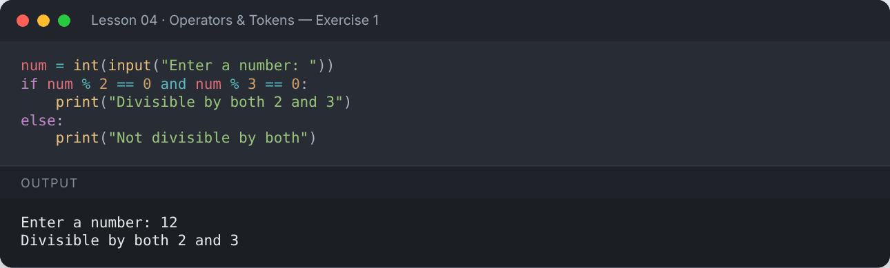

</details>

**Exercise 2 — Ask the user for two numbers and compare them (greater, smaller, equal).**

<details><summary>✅ Solution</summary>

```python
a = int(input("Enter first: "))
b = int(input("Enter second: "))
if a > b:
    print("a is greater")
elif a < b:
    print("b is greater")
else:
    print("Both equal")
```

**Output:**

```text
Enter first: 7
Enter second: 15
b is greater
```

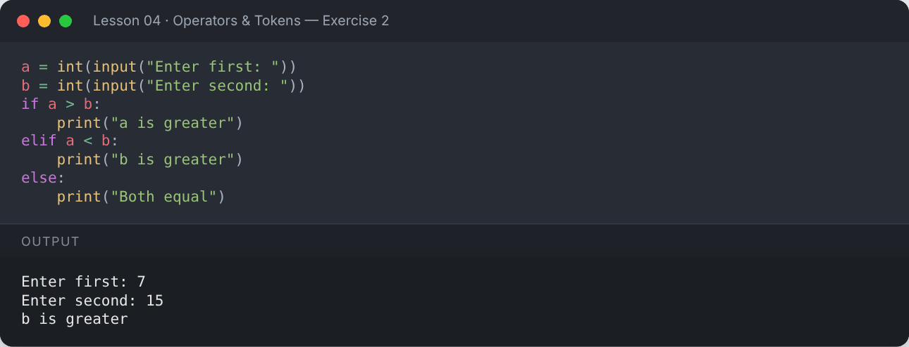

</details>

**Exercise 3 — Demonstrate `and`, `or`, `not` using conditions.**

<details><summary>✅ Solution</summary>

```python
x = 5
print(x > 3 and x < 10)
print(x > 10 or x == 5)
print(not (x == 5))
```

**Output:**

```text
True
True
False
```

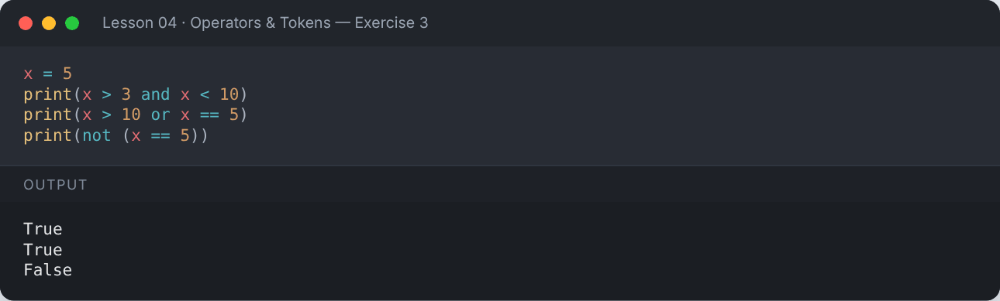

</details>

**Exercise 4 — Write a program using literals, operators and punctuators.**

<details><summary>✅ Solution</summary>

```python
x = 10          # literal
y = 20
z = x + y       # operator
print("Sum:", z)  # punctuators ( ) ,
```

**Output:**

```text
Sum: 30
```

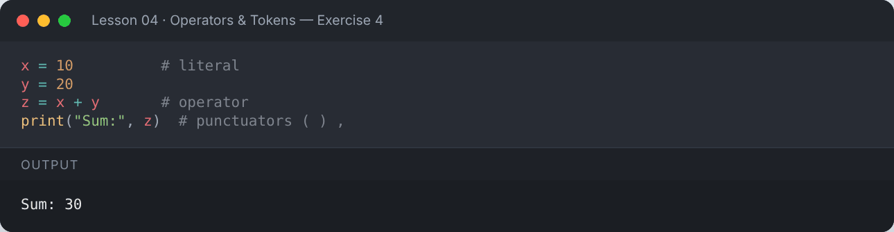

</details>

**Exercise 5 — Find the quotient and remainder of 47 divided by 5 using `//` and `%`, then verify with `divmod()`.**

<details><summary>✅ Solution</summary>

```python
print("Quotient:", 47 // 5, "Remainder:", 47 % 5)
print("divmod:", divmod(47, 5))
```

**Output:**

```text
Quotient: 9 Remainder: 2
divmod: (9, 2)
```

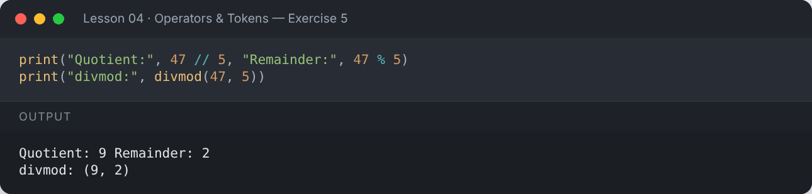

</details>

---

[⬅️ Input, Output & Type Casting](../03-input-output-and-type-casting/README.md) · [🏠 All lessons](../../README.md) · [Strings ➡️](../05-strings/README.md)
