# Lesson 05 — Strings

> Create, index, slice, format and transform text with Python's powerful string methods.

[](https://colab.research.google.com/github/MehvishKiani/Python-beginner-guide/blob/main/lessons/05-strings/lesson.ipynb) &nbsp; 📓 [lesson.ipynb](lesson.ipynb) &nbsp; ✍️ [exercises.ipynb](exercises.ipynb)

[⬅️ Operators & Tokens](../04-operators/README.md) · [🏠 All lessons](../../README.md) · [Conditional Statements ➡️](../06-conditional-statements/README.md)

---

## 🎯 Learning Objectives

- Create strings and understand immutability
- Use indexing and slicing (including negative indexes and steps)
- Apply common string methods
- Concatenate, repeat and loop over strings

## 🔤 What is a String?

A **string** is a sequence of characters enclosed in quotes (`' '`, `" "` or `""" """`).
Strings are **immutable** — once created, they cannot be changed in place.

```python
s = " Hello world"
print(s)
print(type(s))

digits = "123"       # numbers inside quotes are text
print(digits, type(digits))
```

**Output:**

```text
 Hello world
<class 'str'>
123 <class 'str'>
```

<details><summary>📸 Screenshot</summary>

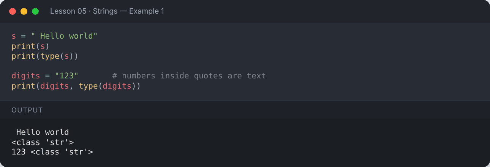

</details>

## 📍 Indexing

Each character has a position (index). Indexes start at **0**; negative indexes count from the end.

```
 M  y     n  a  m  e
 0  1  2  3  4  5  6     ← positive index
-7 -6 -5 -4 -3 -2 -1     ← negative index
```

```python
s1 = "My name is Mehvish Kiani"
print("First character:", s1[0])
print("Last character :", s1[-1])
print("Length         :", len(s1))
```

**Output:**

```text
First character: M
Last character : i
Length         : 24
```

<details><summary>📸 Screenshot</summary>

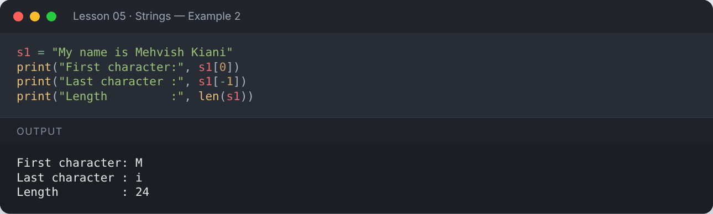

</details>

## ✂️ Slicing — `string[start:stop:step]`

`stop` is **not included**.

```python
s1 = "My name is Mehvish Kiani"
print(s1[3:7])       # characters 3 to 6
print(s1[:7])        # from start
print(s1[11:])       # to the end
print(s1[::2])       # every 2nd character
print(s1[::-1])      # reversed
```

**Output:**

```text
name
My name
Mehvish Kiani
M aei evs in
inaiK hsivheM si eman yM
```

<details><summary>📸 Screenshot</summary>

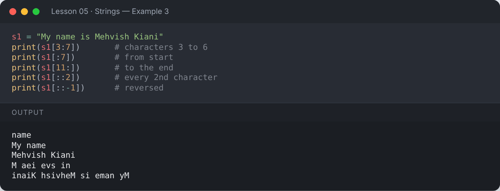

</details>

## 🔒 Immutability

```python
word = "Python"
word[0] = "J"
```

**Output:**

```text
Traceback (most recent call last):
  ...
TypeError: 'str' object does not support item assignment
```

<details><summary>📸 Screenshot</summary>

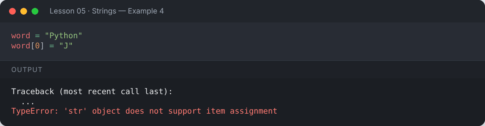

</details>

To "change" a string, create a new one:

```python
word = "Python"
new_word = "J" + word[1:]
print(new_word)
```

**Output:**

```text
Jython
```

<details><summary>📸 Screenshot</summary>

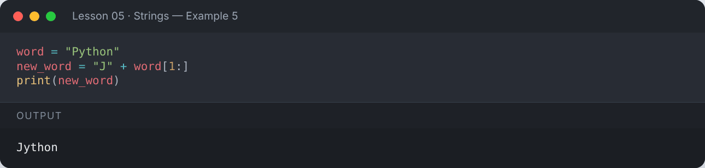

</details>

## ➕ Concatenation & Repetition

```python
first = "Hello"
second = "World"
print(first + " " + second)
print("Hi! " * 3)
print("-" * 20)
```

**Output:**

```text
Hello World
Hi! Hi! Hi! 
--------------------
```

<details><summary>📸 Screenshot</summary>

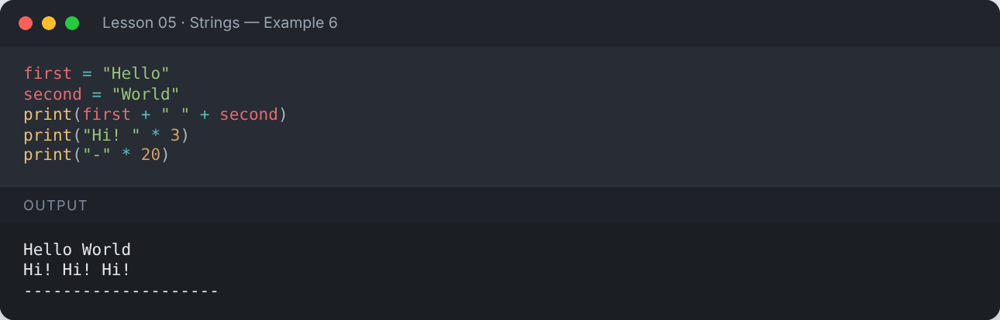

</details>

## 🛠️ Common String Methods

| Method | What it does |
|---|---|
| `upper()`, `lower()`, `title()`, `capitalize()`, `swapcase()` | Change case |
| `strip()`, `lstrip()`, `rstrip()` | Remove whitespace |
| `replace(old, new)` | Replace a substring |
| `find(x)`, `index(x)` | Position of a substring |
| `count(x)` | Number of occurrences |
| `split(sep)`, `join(list)` | Break apart / glue together |
| `startswith()`, `endswith()` | Check beginning/end |
| `isdigit()`, `isalpha()`, `isalnum()`, `isspace()` | Check content |

```python
s1 = "My name is Mehvish Kiani"
print(s1.upper())
print(s1.lower())
print(s1.title())
print(s1.swapcase())
print("python guide".capitalize())
```

**Output:**

```text
MY NAME IS MEHVISH KIANI
my name is mehvish kiani
My Name Is Mehvish Kiani
mY NAME IS mEHVISH kIANI
Python guide
```

<details><summary>📸 Screenshot</summary>

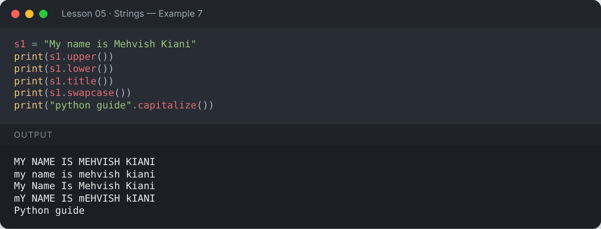

</details>

```python
s1 = "My name is Mehvish Kiani"
print(s1.replace("Kiani", "Khan"))
print("Count of 'i'     :", s1.count("i"))
print("Index of 'h'     :", s1.find("h"))
print("find missing     :", s1.find("z"))     # -1 when not found
print(s1.split())                             # split on spaces
print("a,b,c".split(","))
```

**Output:**

```text
My name is Mehvish Khan
Count of 'i'     : 4
Index of 'h'     : 13
find missing     : -1
['My', 'name', 'is', 'Mehvish', 'Kiani']
['a', 'b', 'c']
```

<details><summary>📸 Screenshot</summary>

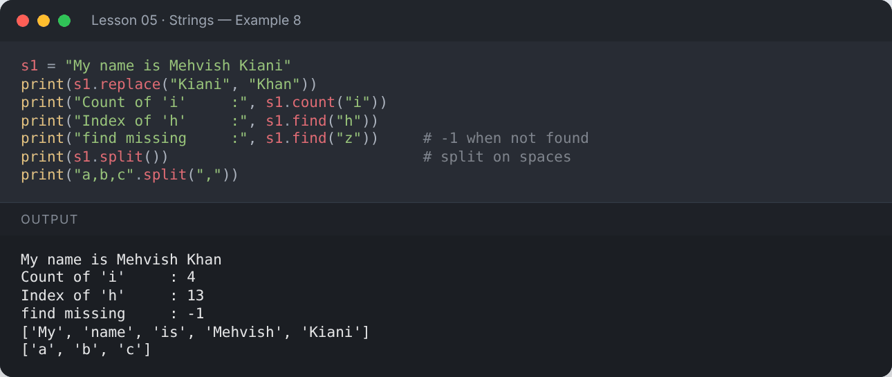

</details>

```python
messy = "   lots of spaces   "
print(f"[{messy.strip()}]")
print(f"[{messy.lstrip()}]")
print(f"[{messy.rstrip()}]")

words = ["Python", "is", "awesome"]
print(" ".join(words))
print("-".join("ABC"))
```

**Output:**

```text
[lots of spaces]
[lots of spaces   ]
[   lots of spaces]
Python is awesome
A-B-C
```

<details><summary>📸 Screenshot</summary>

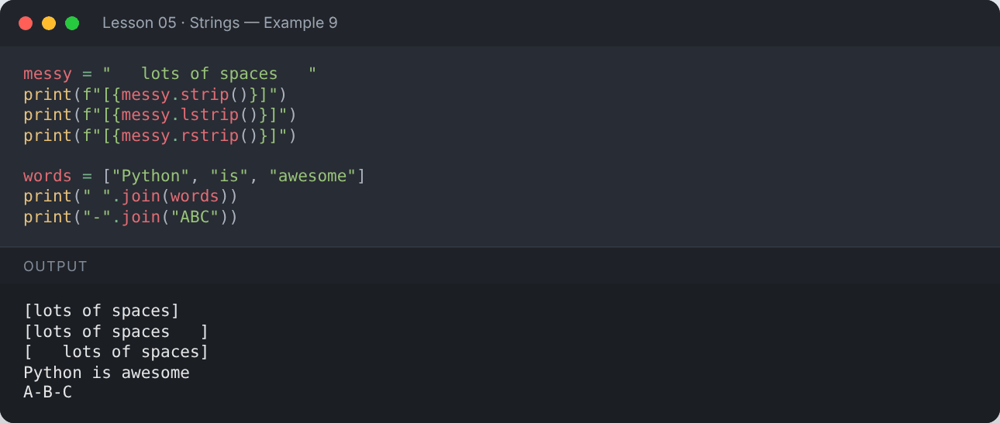

</details>

```python
file = "report.pdf"
print(file.endswith(".pdf"))
print(file.startswith("rep"))
print("12345".isdigit(), "abc".isalpha(), "abc123".isalnum(), "   ".isspace())
```

**Output:**

```text
True
True
True True True True
```

<details><summary>📸 Screenshot</summary>

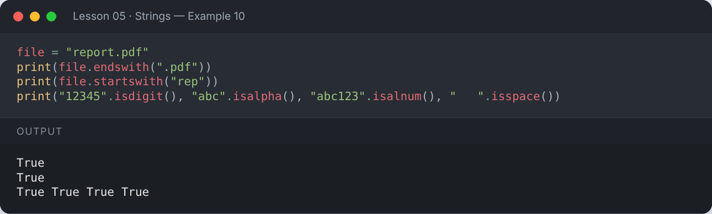

</details>

## 🔁 Looping Through a String

```python
for ch in "Hi!":
    print(ch)
```

**Output:**

```text
H
i
!
```

<details><summary>📸 Screenshot</summary>

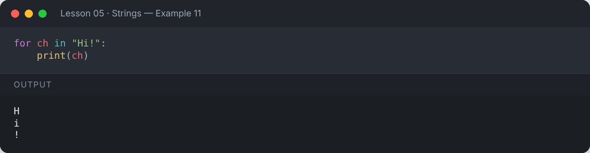

</details>

## 🧾 Formatting & Alignment

```python
name = "Ali"
print(name.center(11, "*"))
print(name.ljust(8, ".") + "|")
print(name.rjust(8, ".") + "|")
print("7".zfill(3))
```

**Output:**

```text
****Ali****
Ali.....|
.....Ali|
007
```

<details><summary>📸 Screenshot</summary>

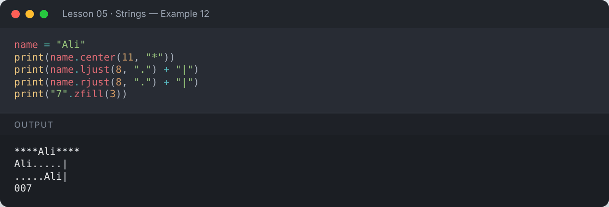

</details>

## 🔠 Characters & Unicode

```python
print(ord("A"))      # character → number
print(chr(97))       # number → character
print("مرحبا", "😊", "Python")   # Python strings support Unicode
```

**Output:**

```text
65
a
مرحبا 😊 Python
```

<details><summary>📸 Screenshot</summary>

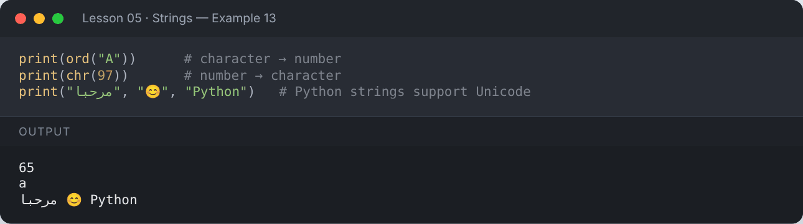

</details>

## 📌 Summary

- Strings are immutable sequences of characters.
- Index from `0`; use negative indexes to count from the end.
- Slice with `[start:stop:step]`; `[::-1]` reverses.
- Methods like `split`, `join`, `replace`, `strip` cover most daily needs.

---

## ✍️ Exercises

Try each one yourself first, then expand the solution.

**Exercise 1 — Create a string `"Hello World"` and print its first 5 characters.**

<details><summary>✅ Solution</summary>

```python
s = "Hello World"
print(s[:5])
```

**Output:**

```text
Hello
```

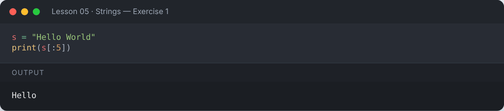

</details>

**Exercise 2 — Reverse a string using slicing.**

<details><summary>✅ Solution</summary>

```python
s = "Python"
print(s[::-1])
```

**Output:**

```text
nohtyP
```

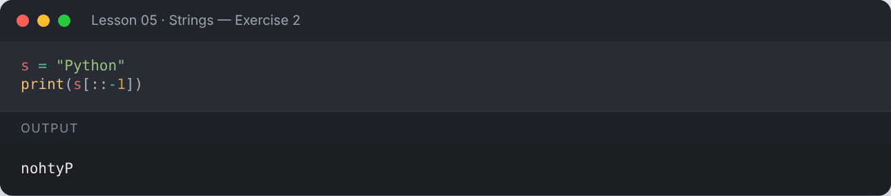

</details>

**Exercise 3 — Take a string input and count how many vowels it has.**

<details><summary>✅ Solution</summary>

```python
s = input("Enter a string: ")
vowels = "aeiouAEIOU"
count = 0
for char in s:
    if char in vowels:
        count += 1
print("Number of vowels:", count)
```

**Output:**

```text
Enter a string: Programming in Python
Number of vowels: 5
```

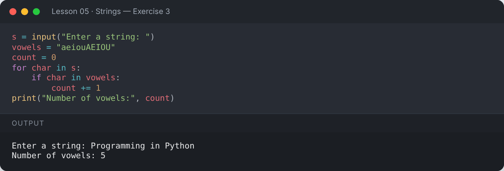

</details>

**Exercise 4 — Check whether a word is a palindrome (reads the same backwards).**

<details><summary>✅ Solution</summary>

```python
for word in ["level", "python", "Madam"]:
    w = word.lower()
    print(f"{word}: {'Palindrome' if w == w[::-1] else 'Not a palindrome'}")
```

**Output:**

```text
level: Palindrome
python: Not a palindrome
Madam: Palindrome
```

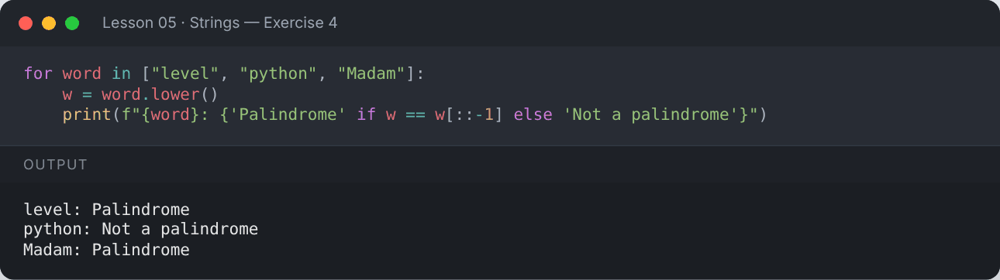

</details>

**Exercise 5 — Count the words in a sentence and print the longest word.**

<details><summary>✅ Solution</summary>

```python
sentence = "Python makes programming enjoyable for beginners"
words = sentence.split()
print("Word count:", len(words))
print("Longest word:", max(words, key=len))
```

**Output:**

```text
Word count: 6
Longest word: programming
```

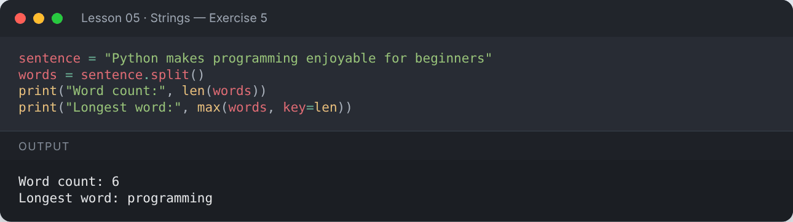

</details>

---

[⬅️ Operators & Tokens](../04-operators/README.md) · [🏠 All lessons](../../README.md) · [Conditional Statements ➡️](../06-conditional-statements/README.md)
