# Lesson 06 — Conditional Statements

> Make decisions in code with if, elif, else, nested conditions, the ternary operator and match-case.

[](https://colab.research.google.com/github/MehvishKiani/Python-beginner-guide/blob/main/lessons/06-conditional-statements/lesson.ipynb) &nbsp; 📓 [lesson.ipynb](lesson.ipynb) &nbsp; ✍️ [exercises.ipynb](exercises.ipynb)

[⬅️ Strings](../05-strings/README.md) · [🏠 All lessons](../../README.md) · [Loops ➡️](../07-loops/README.md)

---

## 🎯 Learning Objectives

- Write `if`, `if-else` and `if-elif-else` statements
- Nest conditions and combine them with `and` / `or`
- Use the one-line conditional (ternary) expression
- Use structural pattern matching with `match-case` (Python 3.10+)

## ❓ The `if` Statement

Runs a block of code **only when** a condition is `True`.

```python
if condition:
    # code runs when condition is True
```

```python
temperature = 35
if temperature > 30:
    print("It's a hot day ☀️")
```

**Output:**

```text
It's a hot day ☀️
```

<details><summary>📸 Screenshot</summary>

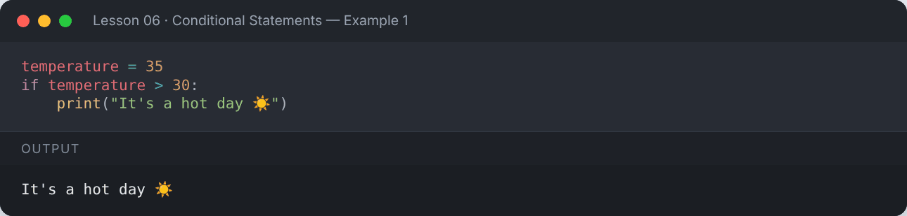

</details>

## ↔️ `if-else`

```python
age = 16
if age >= 18:
    print("You can vote")
else:
    print("You are too young to vote")
```

**Output:**

```text
You are too young to vote
```

<details><summary>📸 Screenshot</summary>

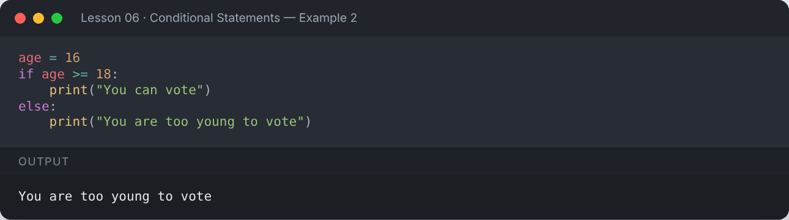

</details>

## 🪜 `if-elif-else`

Check several conditions in order — the first true one wins.

```python
marks = 78
if marks >= 90:
    grade = "A+"
elif marks >= 80:
    grade = "A"
elif marks >= 70:
    grade = "B"
elif marks >= 60:
    grade = "C"
else:
    grade = "F"
print("Marks:", marks, "→ Grade:", grade)
```

**Output:**

```text
Marks: 78 → Grade: B
```

<details><summary>📸 Screenshot</summary>

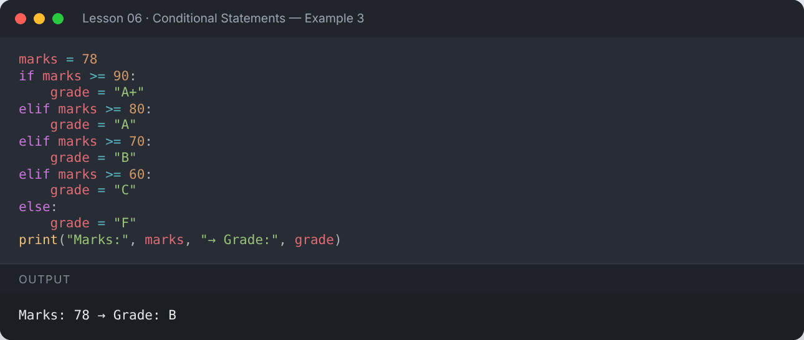

</details>

```python
var = int(input("Enter a number: "))
if var > 4:
    print("Variable is greater than 4")
elif var == 2:
    print("Variable is two")
else:
    print("Variable is not greater than 4")
```

**Output:**

```text
Enter a number: 7
Variable is greater than 4
```

<details><summary>📸 Screenshot</summary>

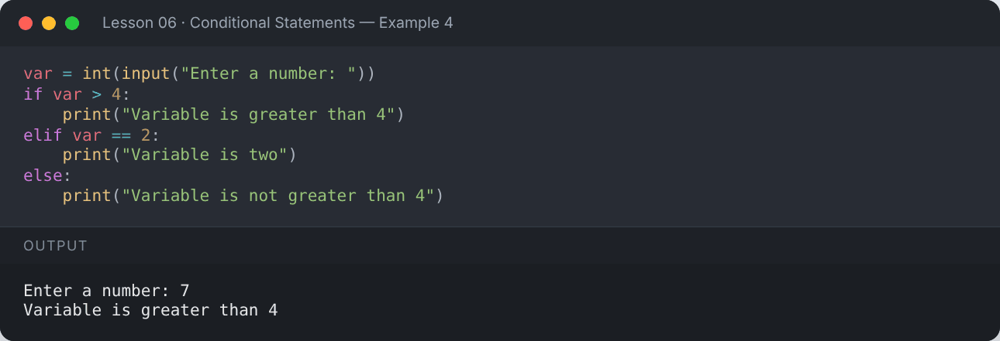

</details>

## 🪆 Nested `if`

```python
num = 15
if num > 0:
    if num % 2 == 0:
        print("Positive even number")
    else:
        print("Positive odd number")
else:
    print("Zero or negative")
```

**Output:**

```text
Positive odd number
```

<details><summary>📸 Screenshot</summary>

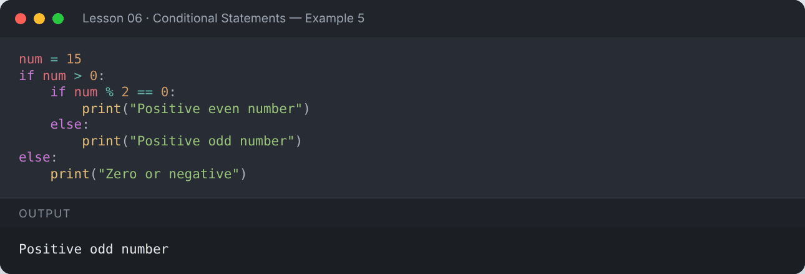

</details>

## 🔗 Combining Conditions

```python
age = 25
has_license = True
if age >= 18 and has_license:
    print("You can drive 🚗")

day = "Sunday"
if day == "Saturday" or day == "Sunday":
    print("Weekend!")

if day in ("Saturday", "Sunday"):    # cleaner with membership
    print("Still the weekend!")
```

**Output:**

```text
You can drive 🚗
Weekend!
Still the weekend!
```

<details><summary>📸 Screenshot</summary>

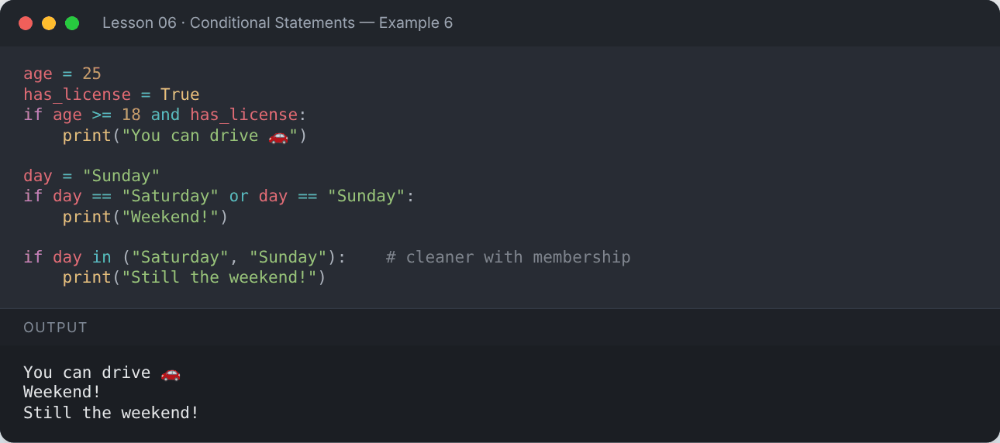

</details>

## ⚡ Ternary (Conditional) Expression

`value_if_true if condition else value_if_false`

```python
age = 20
status = "Adult" if age >= 18 else "Minor"
print(status)

is_student = True
print(f"Is Student: {'Yes' if is_student else 'No'}")
```

**Output:**

```text
Adult
Is Student: Yes
```

<details><summary>📸 Screenshot</summary>

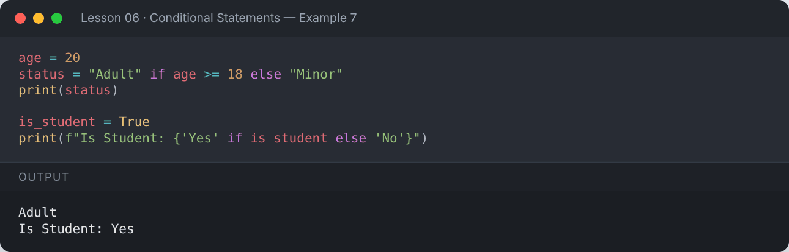

</details>

## ✅ Truthy and Falsy Values

These are treated as `False`: `False`, `None`, `0`, `0.0`, `""`, `[]`, `()`, `{}`, `set()`.
Everything else is treated as `True`.

```python
for value in [0, 1, "", "hi", [], [1], None]:
    if value:
        print(repr(value), "→ truthy")
    else:
        print(repr(value), "→ falsy")
```

**Output:**

```text
0 → falsy
1 → truthy
'' → falsy
'hi' → truthy
[] → falsy
[1] → truthy
None → falsy
```

<details><summary>📸 Screenshot</summary>

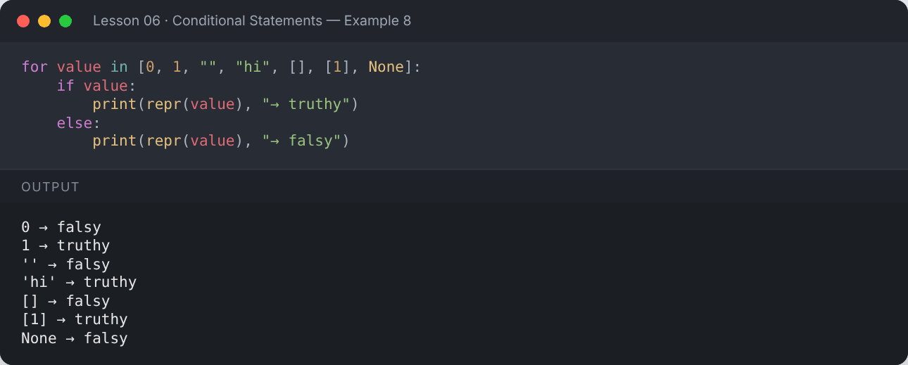

</details>

## 🧩 `match-case` (Python 3.10+)

A cleaner alternative to long `if-elif` chains.

```python
def http_status(code):
    match code:
        case 200:
            return "OK"
        case 404:
            return "Not Found"
        case 500 | 502 | 503:
            return "Server Error"
        case _:
            return "Unknown"

for c in (200, 404, 503, 999):
    print(c, "→", http_status(c))
```

**Output:**

```text
200 → OK
404 → Not Found
503 → Server Error
999 → Unknown
```

<details><summary>📸 Screenshot</summary>

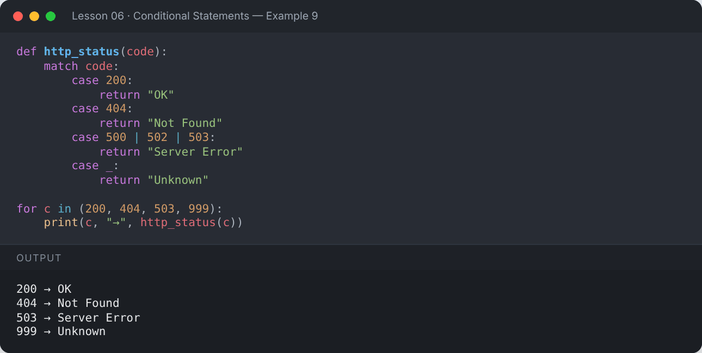

</details>

```python
def describe(point):
    match point:
        case (0, 0):
            return "Origin"
        case (x, 0):
            return f"On the x-axis at {x}"
        case (0, y):
            return f"On the y-axis at {y}"
        case (x, y):
            return f"Point at ({x}, {y})"

print(describe((0, 0)))
print(describe((5, 0)))
print(describe((3, 4)))
```

**Output:**

```text
Origin
On the x-axis at 5
Point at (3, 4)
```

<details><summary>📸 Screenshot</summary>

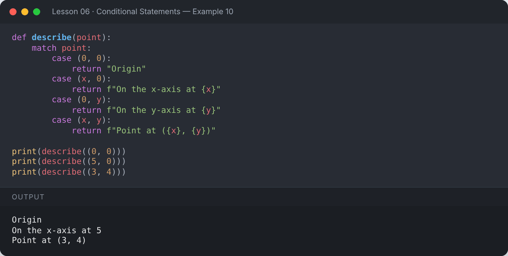

</details>

## 🚧 `pass` — an empty block placeholder

```python
x = 10
if x > 5:
    pass        # TODO: write this later
print("pass lets you leave a block empty without an error")
```

**Output:**

```text
pass lets you leave a block empty without an error
```

<details><summary>📸 Screenshot</summary>

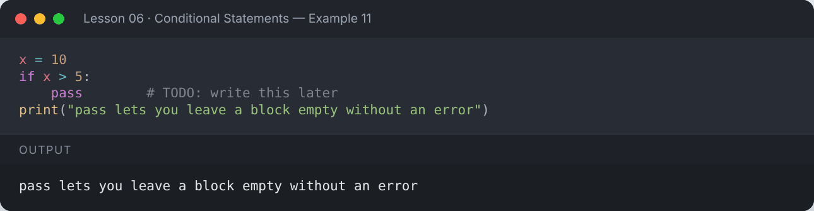

</details>

## 📌 Summary

- `if` / `elif` / `else` choose which block runs.
- Indentation defines each block.
- Use `and`, `or`, `not` and `in` to build conditions.
- `x if cond else y` is a one-line conditional.
- `match-case` handles many fixed options cleanly.

---

## ✍️ Exercises

Try each one yourself first, then expand the solution.

**Exercise 1 — Check whether a number entered by the user is even or odd.**

<details><summary>✅ Solution</summary>

```python
n = int(input("Enter a number: "))
print("Even" if n % 2 == 0 else "Odd")
```

**Output:**

```text
Enter a number: 9
Odd
```

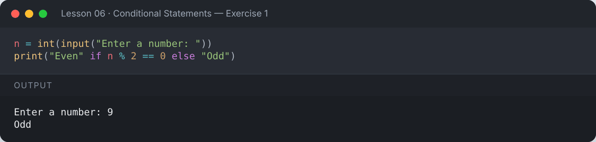

</details>

**Exercise 2 — Check whether a year is a leap year.**

<details><summary>✅ Solution</summary>

```python
for year in (1900, 2000, 2024, 2026):
    if (year % 4 == 0 and year % 100 != 0) or year % 400 == 0:
        print(year, "is a leap year")
    else:
        print(year, "is not a leap year")
```

**Output:**

```text
1900 is not a leap year
2000 is a leap year
2024 is a leap year
2026 is not a leap year
```

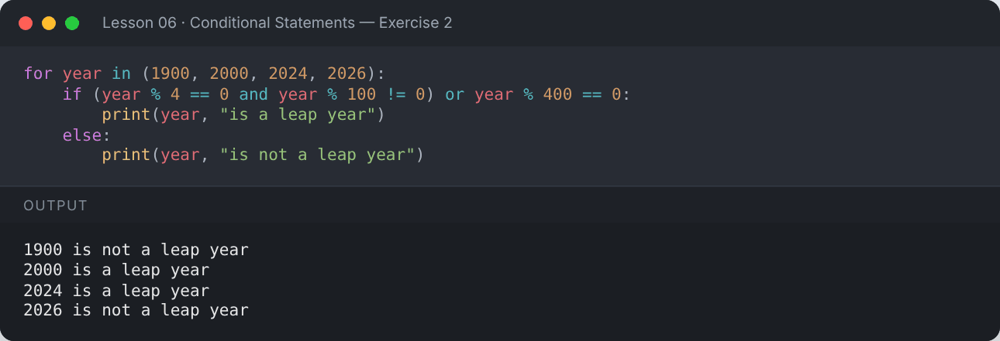

</details>

**Exercise 3 — Find the largest of three numbers.**

<details><summary>✅ Solution</summary>

```python
a, b, c = 12, 45, 27
if a >= b and a >= c:
    largest = a
elif b >= c:
    largest = b
else:
    largest = c
print("Largest:", largest)
```

**Output:**

```text
Largest: 45
```

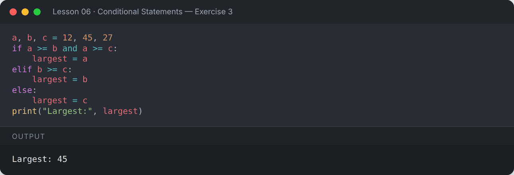

</details>

**Exercise 4 — Build a simple calculator using `match-case`.**

<details><summary>✅ Solution</summary>

```python
def calc(a, op, b):
    match op:
        case "+": return a + b
        case "-": return a - b
        case "*": return a * b
        case "/": return a / b if b != 0 else "Cannot divide by zero"
        case _: return "Invalid operator"

print(calc(8, "+", 2), calc(8, "/", 0), calc(8, "%", 2))
```

**Output:**

```text
10 Cannot divide by zero Invalid operator
```

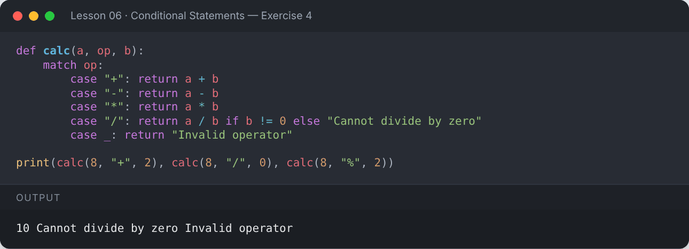

</details>

---

[⬅️ Strings](../05-strings/README.md) · [🏠 All lessons](../../README.md) · [Loops ➡️](../07-loops/README.md)
