# Lesson 07 — Loops

> Repeat work with for and while loops, range(), break, continue, else, nested loops, enumerate() and zip().

[](https://colab.research.google.com/github/MehvishKiani/Python-beginner-guide/blob/main/lessons/07-loops/lesson.ipynb) &nbsp; 📓 [lesson.ipynb](lesson.ipynb) &nbsp; ✍️ [exercises.ipynb](exercises.ipynb)

[⬅️ Conditional Statements](../06-conditional-statements/README.md) · [🏠 All lessons](../../README.md) · [Lists ➡️](../08-lists/README.md)

---

## 🎯 Learning Objectives

- Repeat code with `for` and `while`
- Generate number sequences with `range()`
- Control loops with `break`, `continue`, `pass` and `else`
- Use `enumerate()` and `zip()` like a pro

## 🔁 The `for` Loop

A `for` loop goes through each item of a sequence (string, list, tuple, range…).

```python
colors = ["red", "green", "blue"]
for color in colors:
    print(f"The color is {color}")
```

**Output:**

```text
The color is red
The color is green
The color is blue
```

<details><summary>📸 Screenshot</summary>

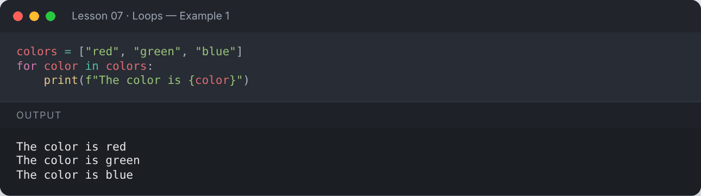

</details>

```python
for letter in "Python":
    print(letter, end=" ")
```

**Output:**

```text
P y t h o n 
```

<details><summary>📸 Screenshot</summary>

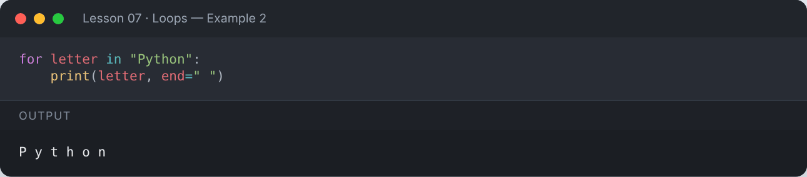

</details>

## 🔢 `range()`

| Call | Produces |
|---|---|
| `range(5)` | 0, 1, 2, 3, 4 |
| `range(2, 6)` | 2, 3, 4, 5 |
| `range(0, 10, 2)` | 0, 2, 4, 6, 8 |
| `range(5, 0, -1)` | 5, 4, 3, 2, 1 |

```python
print(list(range(5)))
print(list(range(2, 6)))
print(list(range(0, 10, 2)))
print(list(range(5, 0, -1)))
```

**Output:**

```text
[0, 1, 2, 3, 4]
[2, 3, 4, 5]
[0, 2, 4, 6, 8]
[5, 4, 3, 2, 1]
```

<details><summary>📸 Screenshot</summary>

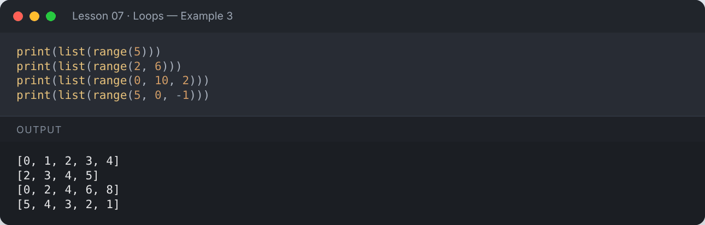

</details>

```python
for i in range(1, 6):
    print(f"5 x {i} = {5 * i}")
```

**Output:**

```text
5 x 1 = 5
5 x 2 = 10
5 x 3 = 15
5 x 4 = 20
5 x 5 = 25
```

<details><summary>📸 Screenshot</summary>

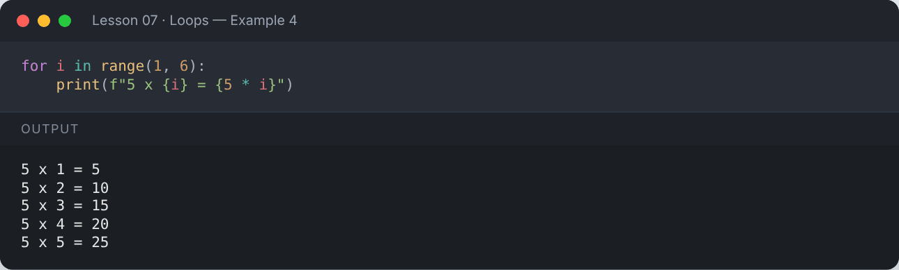

</details>

## 🔄 The `while` Loop

Repeats **as long as** a condition is `True`. Make sure the condition eventually becomes `False`, or you get an infinite loop!

```python
count = 3
while count > 0:
    print(count)
    count -= 1
print("Lift off! 🚀")
```

**Output:**

```text
3
2
1
Lift off! 🚀
```

<details><summary>📸 Screenshot</summary>

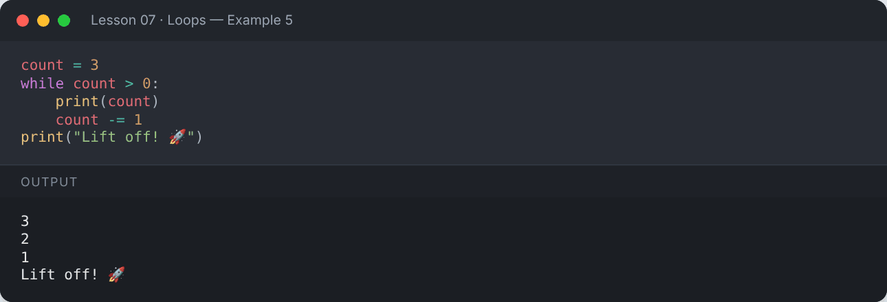

</details>

```python
i = 0
while i < 10:
    print(i, end=" ")
    i = i + 1
```

**Output:**

```text
0 1 2 3 4 5 6 7 8 9 
```

<details><summary>📸 Screenshot</summary>

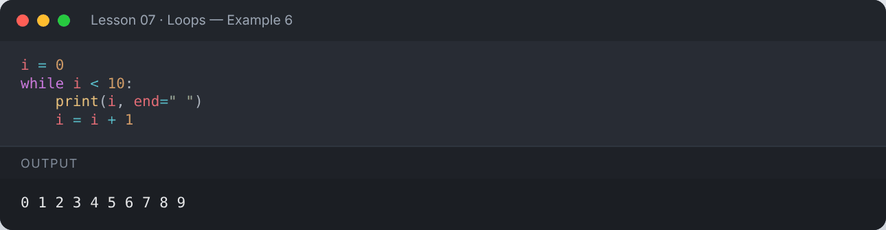

</details>

## ⛔ `break` — stop the loop early

```python
for n in range(1, 10):
    if n == 5:
        print("Found 5, stopping")
        break
    print(n)
```

**Output:**

```text
1
2
3
4
Found 5, stopping
```

<details><summary>📸 Screenshot</summary>

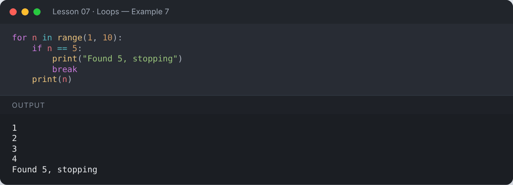

</details>

## ⏭️ `continue` — skip to the next iteration

```python
# Skip even numbers from 1 to 5
for i in range(1, 6):
    if i % 2 == 0:
        continue
    print(i)
```

**Output:**

```text
1
3
5
```

<details><summary>📸 Screenshot</summary>

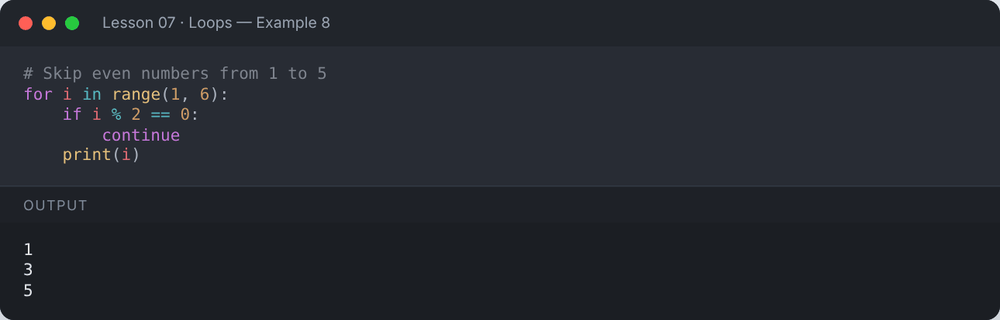

</details>

## 🧾 Loop `else`

The `else` block runs only if the loop finished **without** hitting `break`.

```python
def is_prime(n):
    for d in range(2, int(n ** 0.5) + 1):
        if n % d == 0:
            print(n, "is not prime (divisible by", d, ")")
            break
    else:
        print(n, "is prime")

is_prime(29)
is_prime(21)
```

**Output:**

```text
29 is prime
21 is not prime (divisible by 3 )
```

<details><summary>📸 Screenshot</summary>

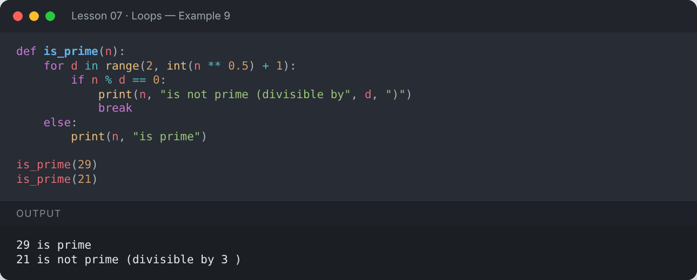

</details>

## 🪆 Nested Loops

```python
for row in range(1, 6):
    print("* " * row)
```

**Output:**

```text
* 
* * 
* * * 
* * * * 
* * * * * 
```

<details><summary>📸 Screenshot</summary>

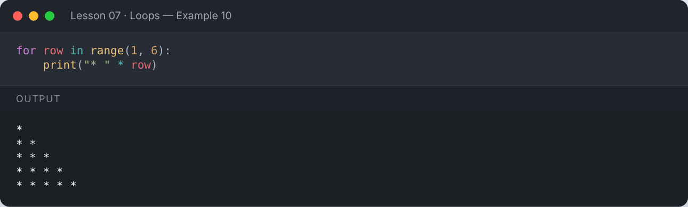

</details>

```python
for i in range(1, 4):
    for j in range(1, 4):
        print(f"{i * j:3}", end="")
    print()
```

**Output:**

```text
  1  2  3
  2  4  6
  3  6  9
```

<details><summary>📸 Screenshot</summary>


</details>

## 🏷️ `enumerate()` — index + value

```python
fruits = ["apple", "banana", "cherry"]
for index, fruit in enumerate(fruits, start=1):
    print(index, fruit)
```

**Output:**

```text
1 apple
2 banana
3 cherry
```

<details><summary>📸 Screenshot</summary>

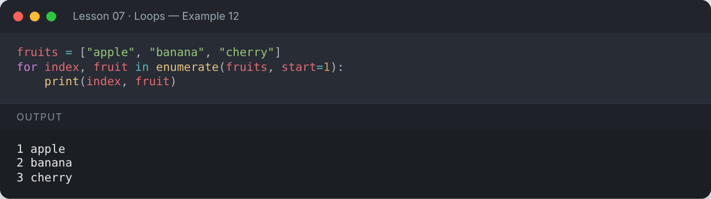

</details>

## 🤝 `zip()` — loop over several lists together

```python
names = ["Ali", "Sara", "Zain"]
scores = [85, 92, 78]
for name, score in zip(names, scores):
    print(f"{name}: {score}")
```

**Output:**

```text
Ali: 85
Sara: 92
Zain: 78
```

<details><summary>📸 Screenshot</summary>

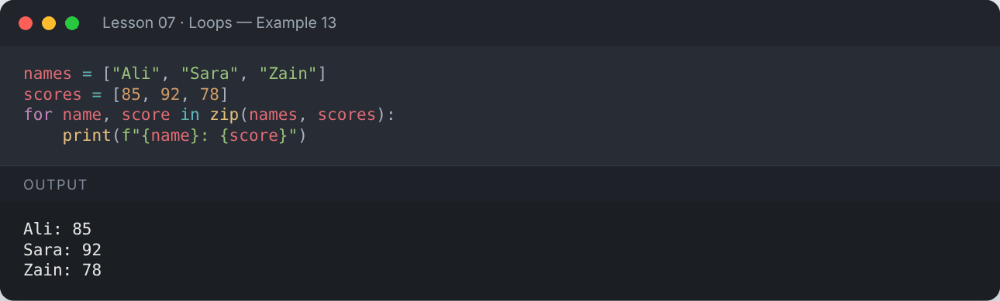

</details>

## ♾️ `while True` with `break` (input loop pattern)

```python
while True:
    text = input("Type something (or 'quit'): ")
    if text == "quit":
        print("Goodbye!")
        break
    print("You typed:", text.upper())
```

**Output:**

```text
Type something (or 'quit'): hello
You typed: HELLO
Type something (or 'quit'): python
You typed: PYTHON
Type something (or 'quit'): quit
Goodbye!
```

<details><summary>📸 Screenshot</summary>

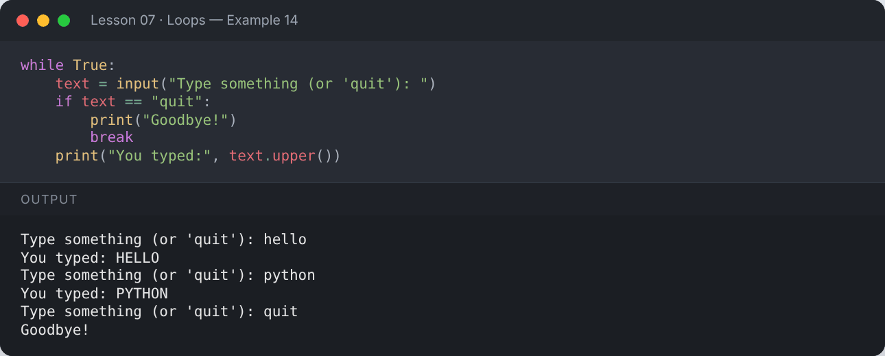

</details>

## 📌 Summary

- `for` iterates over sequences; `while` repeats while a condition holds.
- `range(start, stop, step)` generates numbers (stop excluded).
- `break` exits, `continue` skips, loop-`else` runs when no `break` happened.
- `enumerate()` gives indexes; `zip()` pairs sequences.

---

## ✍️ Exercises

Try each one yourself first, then expand the solution.

**Exercise 1 — Print the sum of numbers from 1 to 100.**

<details><summary>✅ Solution</summary>

```python
total = 0
for n in range(1, 101):
    total += n
print("Sum:", total)
```

**Output:**

```text
Sum: 5050
```

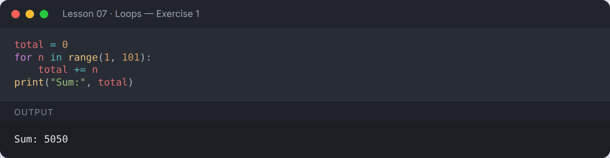

</details>

**Exercise 2 — Print the factorial of a number using a `while` loop.**

<details><summary>✅ Solution</summary>

```python
n = 6
fact = 1
i = n
while i > 1:
    fact *= i
    i -= 1
print(f"{n}! = {fact}")
```

**Output:**

```text
6! = 720
```

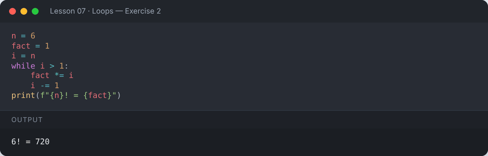

</details>

**Exercise 3 — Print the first 10 Fibonacci numbers.**

<details><summary>✅ Solution</summary>

```python
a, b = 0, 1
for _ in range(10):
    print(a, end=" ")
    a, b = b, a + b
```

**Output:**

```text
0 1 1 2 3 5 8 13 21 34 
```

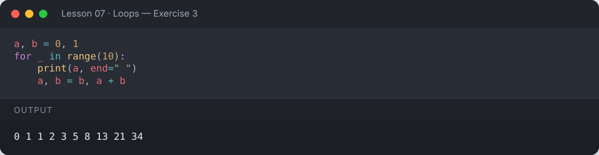

</details>

**Exercise 4 — Count the digits of a number and print its reverse.**

<details><summary>✅ Solution</summary>

```python
num = 12345
reverse, digits = 0, 0
n = num
while n > 0:
    reverse = reverse * 10 + n % 10
    n //= 10
    digits += 1
print("Digits:", digits, "| Reverse:", reverse)
```

**Output:**

```text
Digits: 5 | Reverse: 54321
```

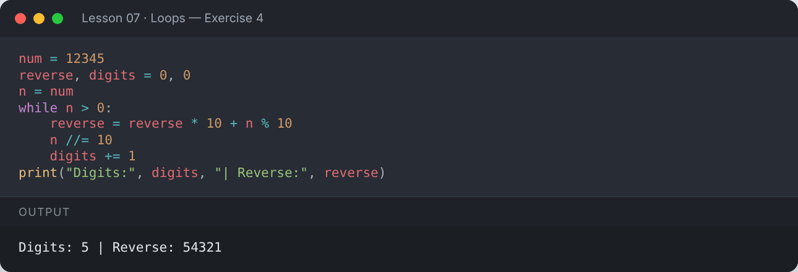

</details>

**Exercise 5 — Print all prime numbers between 1 and 50.**

<details><summary>✅ Solution</summary>

```python
primes = []
for n in range(2, 51):
    for d in range(2, int(n ** 0.5) + 1):
        if n % d == 0:
            break
    else:
        primes.append(n)
print(primes)
```

**Output:**

```text
[2, 3, 5, 7, 11, 13, 17, 19, 23, 29, 31, 37, 41, 43, 47]
```

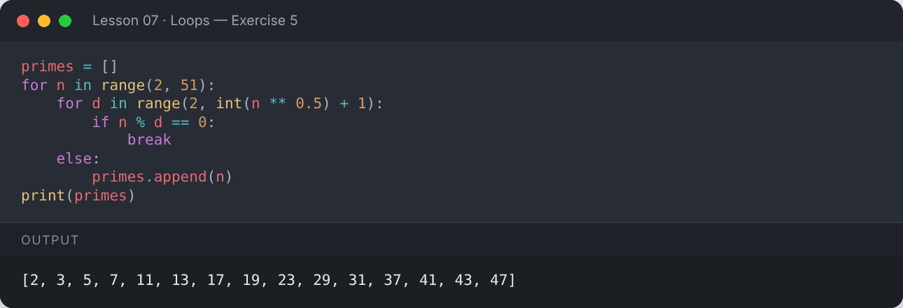

</details>

---

[⬅️ Conditional Statements](../06-conditional-statements/README.md) · [🏠 All lessons](../../README.md) · [Lists ➡️](../08-lists/README.md)
