# Lesson 08 — Lists

> Ordered, mutable collections — create, access, modify, sort and copy lists.

[](https://colab.research.google.com/github/MehvishKiani/Python-beginner-guide/blob/main/lessons/08-lists/lesson.ipynb) &nbsp; 📓 [lesson.ipynb](lesson.ipynb) &nbsp; ✍️ [exercises.ipynb](exercises.ipynb)

[⬅️ Loops](../07-loops/README.md) · [🏠 All lessons](../../README.md) · [Tuples ➡️](../09-tuples/README.md)

---

## 🎯 Learning Objectives

- Create lists and access items with indexes and slices
- Add, update and remove items
- Use built-in list methods and functions
- Understand copying and nested lists

## 📋 What is a List?

A **list** is an **ordered**, **mutable** (changeable) collection written in square brackets `[]`.
It can hold items of any type, including duplicates.

```python
fruits = ["apple", "banana", "cherry"]
mixed = [1, "two", 3.0, True, None]
empty = []
print(fruits)
print(mixed)
print(len(fruits), type(fruits))
```

**Output:**

```text
['apple', 'banana', 'cherry']
[1, 'two', 3.0, True, None]
3 <class 'list'>
```

<details><summary>📸 Screenshot</summary>

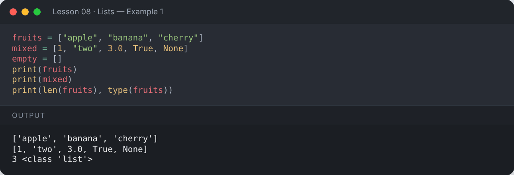

</details>

## 📍 Accessing Items

```python
fruits = ["apple", "banana", "cherry", "mango", "kiwi"]
print(fruits[0])       # first
print(fruits[-1])      # last (negative index starts from the end)
print(fruits[1:4])     # slice
print(fruits[::-1])    # reversed copy
```

**Output:**

```text
apple
kiwi
['banana', 'cherry', 'mango']
['kiwi', 'mango', 'cherry', 'banana', 'apple']
```

<details><summary>📸 Screenshot</summary>

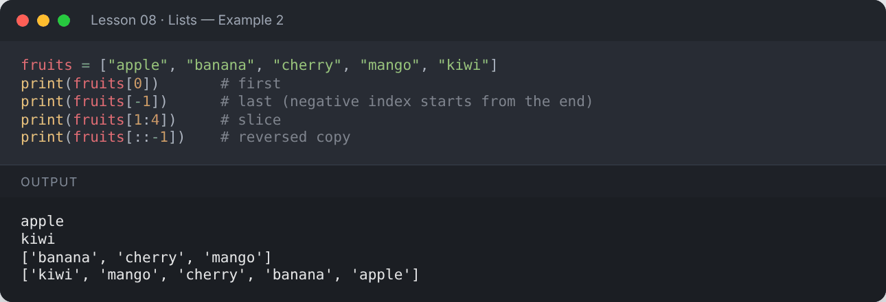

</details>

## ✏️ Changing Items

```python
fruits = ["apple", "banana", "cherry"]
fruits[1] = "blueberry"
print(fruits)
fruits[0:2] = ["grape", "melon"]
print(fruits)
```

**Output:**

```text
['apple', 'blueberry', 'cherry']
['grape', 'melon', 'cherry']
```

<details><summary>📸 Screenshot</summary>

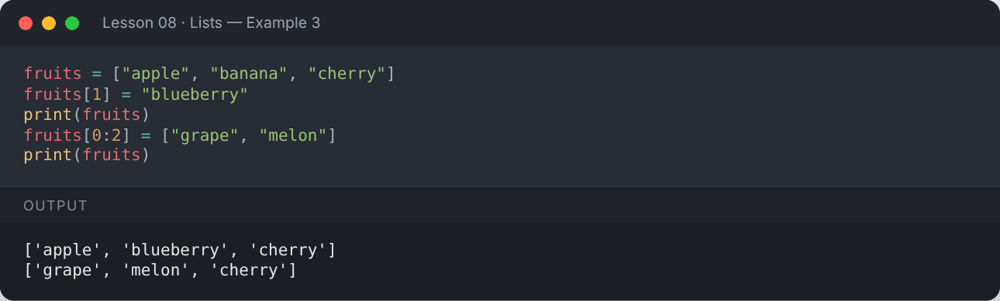

</details>

## ➕ Adding Items

```python
fruits = ["apple", "banana", "cherry"]
fruits.append("orange")             # add to the end
print("Add item to list     :", fruits)
fruits.insert(1, "kiwi")            # insert at index 1
print("Insert item at index :", fruits)
fruits.extend(["fig", "lime"])      # add many items
print("Extend list          :", fruits)
```

**Output:**

```text
Add item to list     : ['apple', 'banana', 'cherry', 'orange']
Insert item at index : ['apple', 'kiwi', 'banana', 'cherry', 'orange']
Extend list          : ['apple', 'kiwi', 'banana', 'cherry', 'orange', 'fig', 'lime']
```

<details><summary>📸 Screenshot</summary>

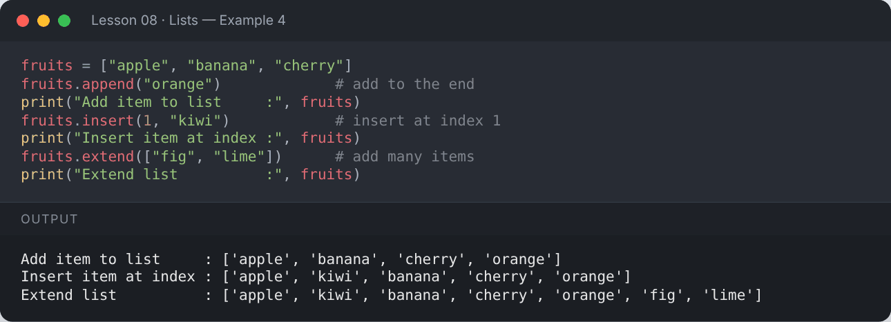

</details>

## ➖ Removing Items

```python
fruits = ["apple", "kiwi", "banana", "cherry", "orange"]
fruits.remove("banana")             # remove by value
print("Remove specific item :", fruits)
last_fruit = fruits.pop()           # remove & return last item
print("Popped               :", last_fruit, "→", fruits)
second = fruits.pop(1)              # remove by index
print("Popped index 1       :", second, "→", fruits)
del fruits[0]                       # delete by index
print("After del            :", fruits)
fruits.clear()                      # empty the list
print("Clears the list      :", fruits)
```

**Output:**

```text
Remove specific item : ['apple', 'kiwi', 'cherry', 'orange']
Popped               : orange → ['apple', 'kiwi', 'cherry']
Popped index 1       : kiwi → ['apple', 'cherry']
After del            : ['cherry']
Clears the list      : []
```

<details><summary>📸 Screenshot</summary>

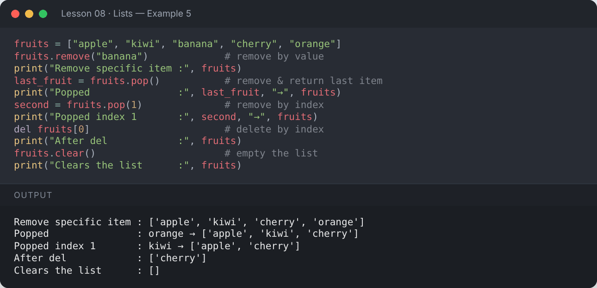

</details>

## 🔃 Sorting & Reversing

```python
fruits = ["cherry", "apple", "banana"]
fruits.sort()
print("Sorted alphabetically :", fruits)
fruits.reverse()
print("Reversed              :", fruits)

nums = [5, 2, 9, 1]
nums.sort(reverse=True)
print("Descending            :", nums)

words = ["pear", "fig", "banana"]
print("sorted() by length    :", sorted(words, key=len))   # returns a NEW list
print("Original unchanged    :", words)
```

**Output:**

```text
Sorted alphabetically : ['apple', 'banana', 'cherry']
Reversed              : ['cherry', 'banana', 'apple']
Descending            : [9, 5, 2, 1]
sorted() by length    : ['fig', 'pear', 'banana']
Original unchanged    : ['pear', 'fig', 'banana']
```

<details><summary>📸 Screenshot</summary>

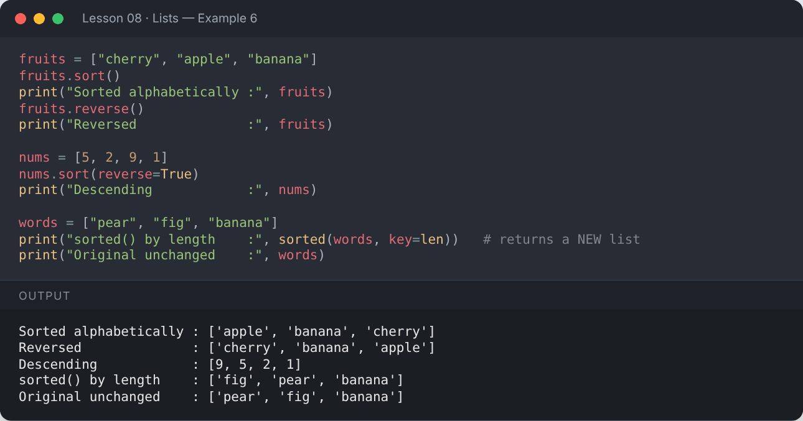

</details>

## 🔍 Searching & Counting

```python
fruits = ["apple", "banana", "apple", "cherry"]
print("Count of apple :", fruits.count("apple"))
print("Index of cherry:", fruits.index("cherry"))
print("'banana' in list:", "banana" in fruits)
```

**Output:**

```text
Count of apple : 2
Index of cherry: 3
'banana' in list: True
```

<details><summary>📸 Screenshot</summary>

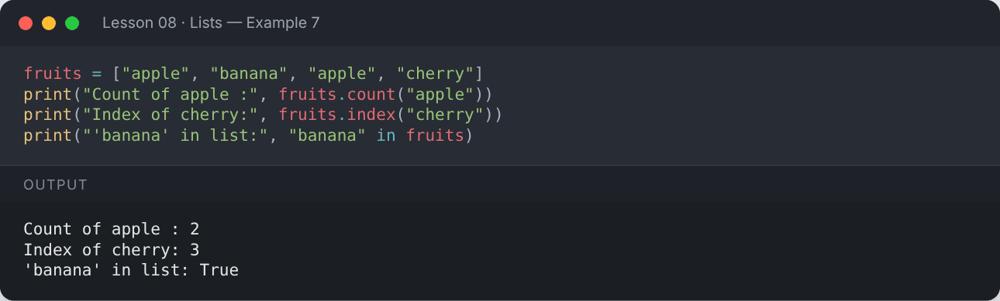

</details>

## 🧮 Useful Built-in Functions

```python
nums = [4, 8, 15, 16, 23, 42]
print("len :", len(nums))
print("sum :", sum(nums))
print("min :", min(nums))
print("max :", max(nums))
print("avg :", sum(nums) / len(nums))
```

**Output:**

```text
len : 6
sum : 108
min : 4
max : 42
avg : 18.0
```

<details><summary>📸 Screenshot</summary>

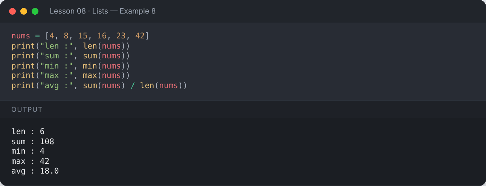

</details>

## 🔁 Looping Through a List

```python
scores = [85, 92, 78]
for i, s in enumerate(scores):
    print(f"Student {i + 1}: {s}")
```

**Output:**

```text
Student 1: 85
Student 2: 92
Student 3: 78
```

<details><summary>📸 Screenshot</summary>

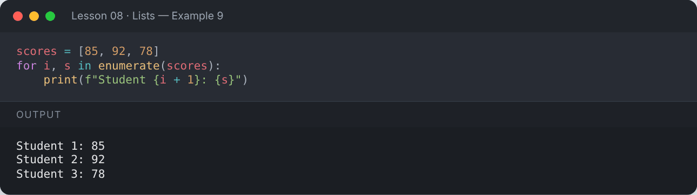

</details>

## 📑 Copying Lists

`b = a` does **not** copy — both names point to the same list. Use `.copy()`, `list()` or slicing.

```python
a = [1, 2, 3]
b = a            # same list!
c = a.copy()     # real copy
a.append(4)
print("a:", a)
print("b:", b)
print("c:", c)
```

**Output:**

```text
a: [1, 2, 3, 4]
b: [1, 2, 3, 4]
c: [1, 2, 3]
```

<details><summary>📸 Screenshot</summary>

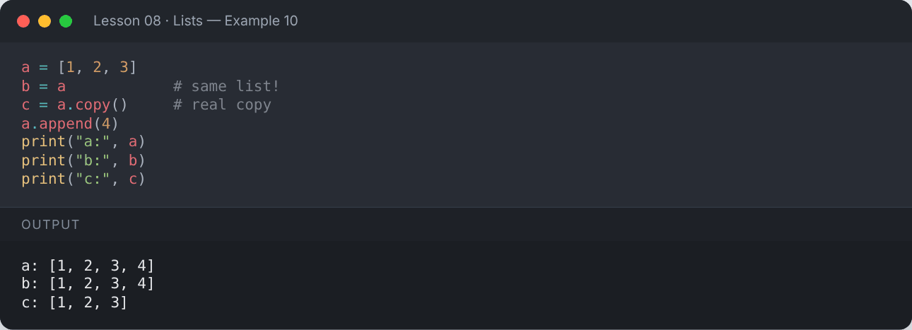

</details>

## 🧱 Nested Lists (2D lists)

```python
matrix = [
    [1, 2, 3],
    [4, 5, 6],
    [7, 8, 9],
]
print(matrix[1])        # second row
print(matrix[1][2])     # row 1, column 2
for row in matrix:
    print(row)
```

**Output:**

```text
[4, 5, 6]
6
[1, 2, 3]
[4, 5, 6]
[7, 8, 9]
```

<details><summary>📸 Screenshot</summary>

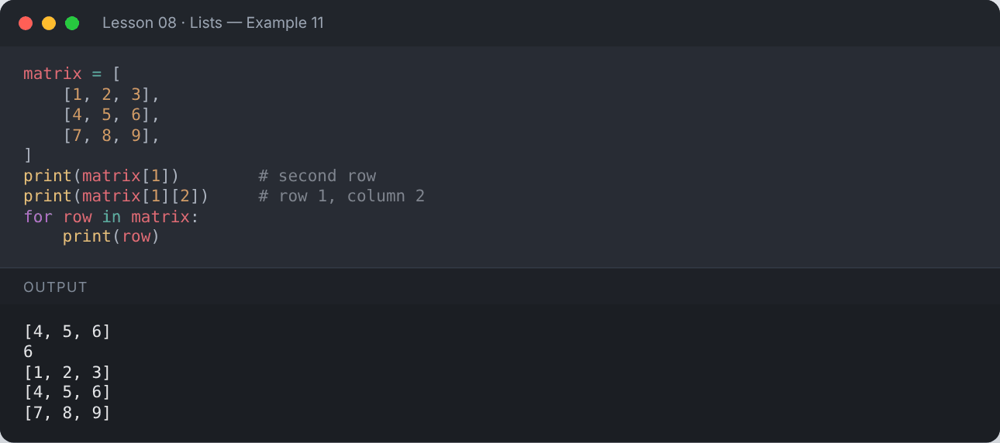

</details>

## ➕ List Operations

```python
print([1, 2] + [3, 4])     # concatenation
print(["hi"] * 3)          # repetition
print(list("abc"))         # string → list
print(list(range(5)))      # range → list
```

**Output:**

```text
[1, 2, 3, 4]
['hi', 'hi', 'hi']
['a', 'b', 'c']
[0, 1, 2, 3, 4]
```

<details><summary>📸 Screenshot</summary>

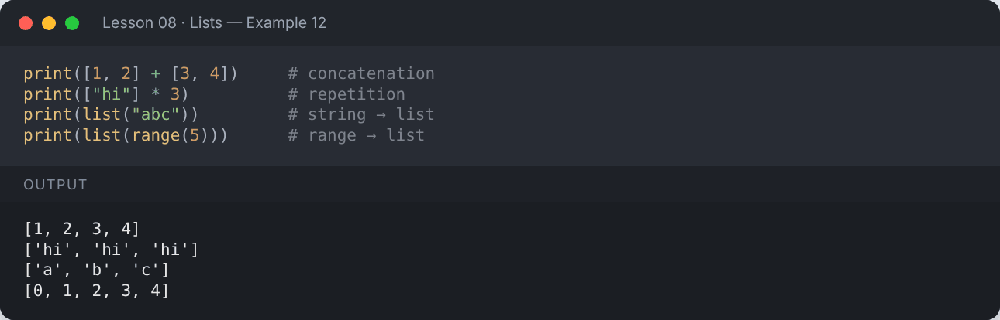

</details>

## 📌 Summary

| Method | Purpose |
|---|---|
| `append`, `insert`, `extend` | add |
| `remove`, `pop`, `del`, `clear` | remove |
| `sort`, `reverse`, `sorted()` | order |
| `index`, `count`, `in` | search |
| `copy` | duplicate |

---

## ✍️ Exercises

Try each one yourself first, then expand the solution.

**Exercise 1 — Find the second largest number in a list.**

<details><summary>✅ Solution</summary>

```python
nums = [10, 45, 32, 67, 23, 67]
unique = sorted(set(nums))
print("Second largest:", unique[-2])
```

**Output:**

```text
Second largest: 45
```

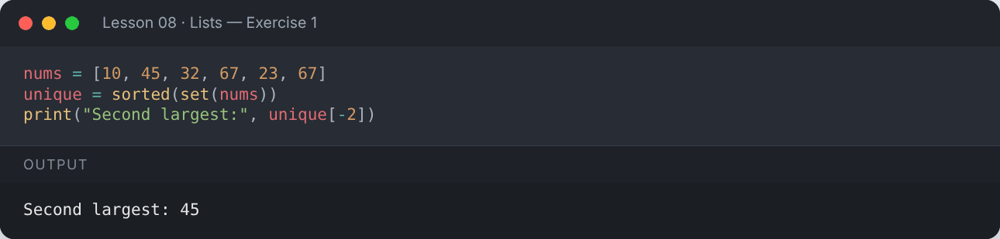

</details>

**Exercise 2 — Remove duplicates from a list while keeping the original order.**

<details><summary>✅ Solution</summary>

```python
items = [3, 1, 3, 2, 1, 5]
result = []
for x in items:
    if x not in result:
        result.append(x)
print(result)
```

**Output:**

```text
[3, 1, 2, 5]
```

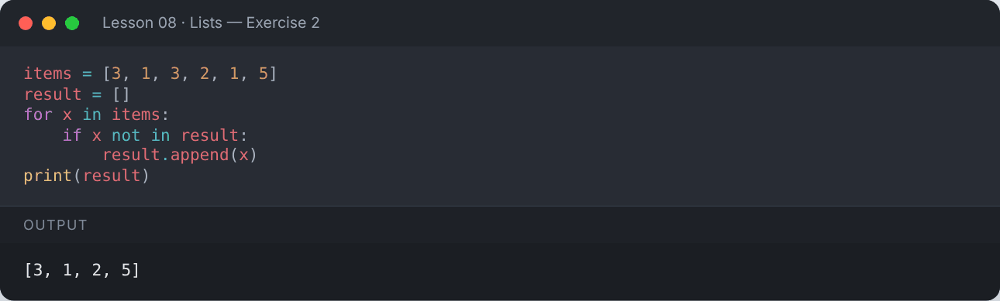

</details>

**Exercise 3 — Separate even and odd numbers into two lists.**

<details><summary>✅ Solution</summary>

```python
numbers = list(range(1, 11))
even, odd = [], []
for n in numbers:
    (even if n % 2 == 0 else odd).append(n)
print("Even:", even)
print("Odd :", odd)
```

**Output:**

```text
Even: [2, 4, 6, 8, 10]
Odd : [1, 3, 5, 7, 9]
```

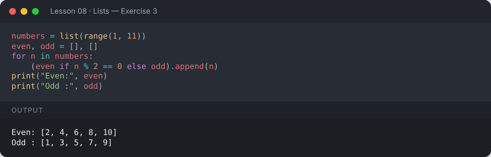

</details>

**Exercise 4 — Build a shopping list: add 3 items, remove one, then print the list sorted.**

<details><summary>✅ Solution</summary>

```python
cart = []
cart.append("milk")
cart.append("bread")
cart.append("eggs")
cart.remove("bread")
print(sorted(cart))
```

**Output:**

```text
['eggs', 'milk']
```

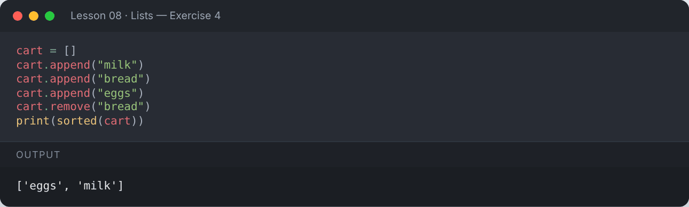

</details>

---

[⬅️ Loops](../07-loops/README.md) · [🏠 All lessons](../../README.md) · [Tuples ➡️](../09-tuples/README.md)
