# Lesson 09 — Tuples

> Ordered, immutable collections — when and why to use tuples, packing and unpacking.

[](https://colab.research.google.com/github/MehvishKiani/Python-beginner-guide/blob/main/lessons/09-tuples/lesson.ipynb) &nbsp; 📓 [lesson.ipynb](lesson.ipynb) &nbsp; ✍️ [exercises.ipynb](exercises.ipynb)

[⬅️ Lists](../08-lists/README.md) · [🏠 All lessons](../../README.md) · [Sets ➡️](../10-sets/README.md)

---

## 🎯 Learning Objectives

- Create tuples (including single-item tuples)
- Access items with indexing and slicing
- Understand immutability
- Pack and unpack values

## 📦 What is a Tuple?

A **tuple** is an **ordered**, **immutable** collection written with parentheses `()`.
Use tuples for data that should not change — like coordinates, RGB colors or days of the week.

```python
my_tuple = (1, 2, 3)
person = ("Ali", 25, "Lahore")
print(my_tuple)
print(person)
print(type(my_tuple))
```

**Output:**

```text
(1, 2, 3)
('Ali', 25, 'Lahore')
<class 'tuple'>
```

<details><summary>📸 Screenshot</summary>

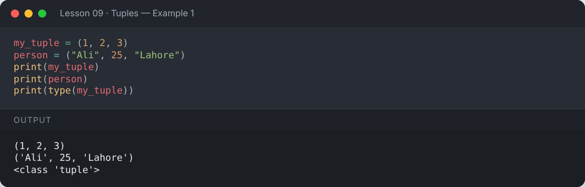

</details>

### ⚠️ Single-item tuple needs a comma

```python
not_tuple = (5)
real_tuple = (5,)
print(type(not_tuple))
print(type(real_tuple))
```

**Output:**

```text
<class 'int'>
<class 'tuple'>
```

<details><summary>📸 Screenshot</summary>

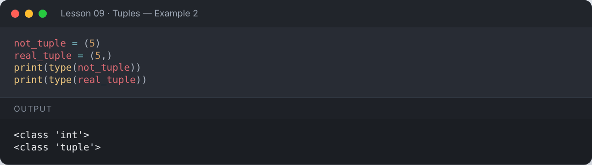

</details>

## 📍 Accessing Items

```python
my_tuple = (1, 2, 3)
print(my_tuple[0])
print(my_tuple[1])
print(my_tuple[-1])      # negative indexing
print(my_tuple[1:3])     # slicing (3 excluded)
```

**Output:**

```text
1
2
3
(2, 3)
```

<details><summary>📸 Screenshot</summary>

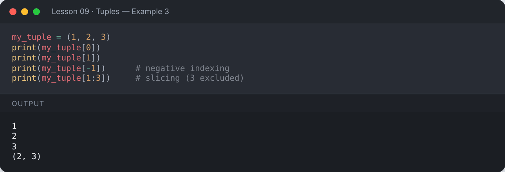

</details>

## 🔒 Tuples are Immutable

```python
my_tuple = (1, 2, 3)
my_tuple[0] = 100
```

**Output:**

```text
Traceback (most recent call last):
  ...
TypeError: 'tuple' object does not support item assignment
```

<details><summary>📸 Screenshot</summary>

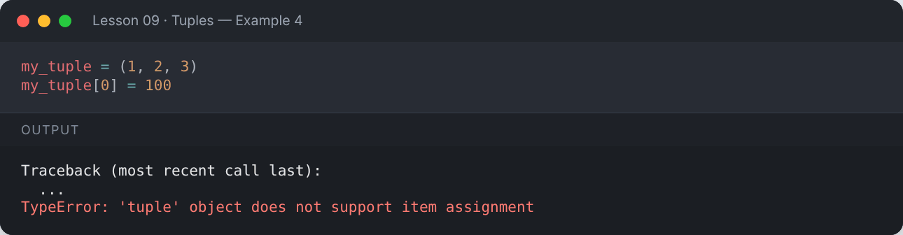

</details>

Work-around: convert to a list, change it, and convert back.

```python
t = (1, 2, 3)
temp = list(t)
temp[0] = 100
t = tuple(temp)
print(t)
```

**Output:**

```text
(100, 2, 3)
```

<details><summary>📸 Screenshot</summary>

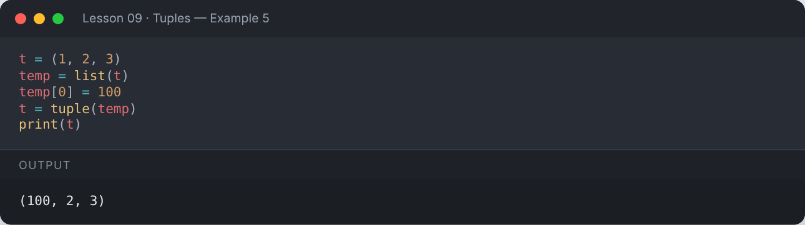

</details>

## ➕ Tuple Operations

```python
my_tuple = (1, 2, 3)
another_tuple = (4, 5)
print("Concatenate:", my_tuple + another_tuple)
print("Repeat     :", my_tuple * 2)
print("Length     :", len(my_tuple))
print("2 in tuple :", 2 in my_tuple)
print("4 in tuple :", 4 in my_tuple)
```

**Output:**

```text
Concatenate: (1, 2, 3, 4, 5)
Repeat     : (1, 2, 3, 1, 2, 3)
Length     : 3
2 in tuple : True
4 in tuple : False
```

<details><summary>📸 Screenshot</summary>

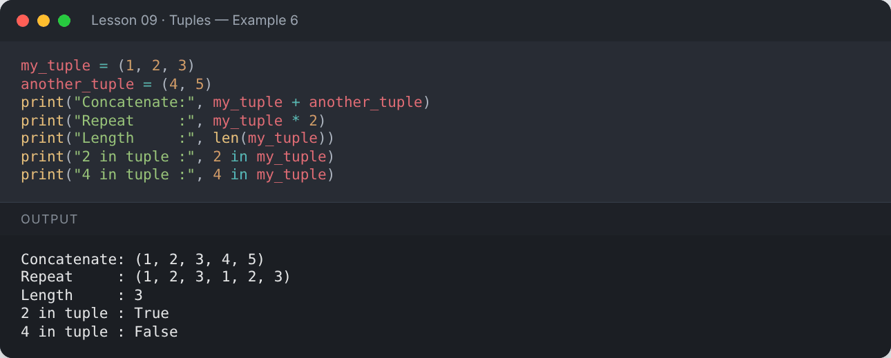

</details>

## 🛠️ Tuple Methods

Tuples have only two methods: `count()` and `index()`.

```python
t = (1, 2, 2, 3, 2)
print("Count of 2:", t.count(2))
print("Index of 3:", t.index(3))
```

**Output:**

```text
Count of 2: 3
Index of 3: 3
```

<details><summary>📸 Screenshot</summary>

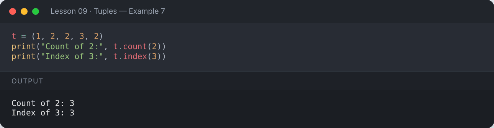

</details>

## 🎁 Packing & Unpacking

```python
point = 10, 20            # packing (parentheses optional)
x, y = point              # unpacking
print("x =", x, "y =", y)

first, *rest = (1, 2, 3, 4, 5)    # extended unpacking
print("first:", first, "rest:", rest)
```

**Output:**

```text
x = 10 y = 20
first: 1 rest: [2, 3, 4, 5]
```

<details><summary>📸 Screenshot</summary>

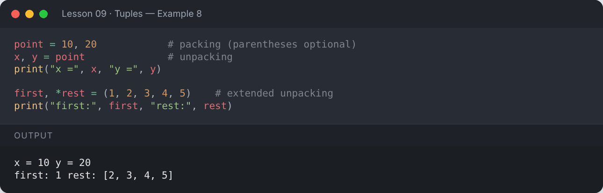

</details>

## 🪆 Nested Tuples

```python
nested_tuple = (1, (2, 3), (4, 5))
print(nested_tuple[1])
print(nested_tuple[2][0])
```

**Output:**

```text
(2, 3)
4
```

<details><summary>📸 Screenshot</summary>

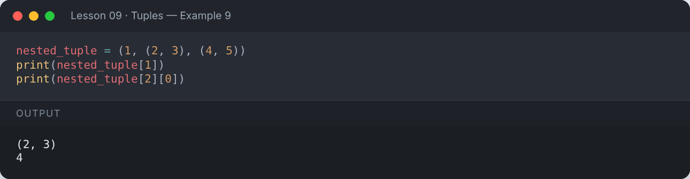

</details>

## 🔄 Converting

```python
my_list = [4, 5, 6]
print(tuple(my_list))
print(tuple("abc"))
```

**Output:**

```text
(4, 5, 6)
('a', 'b', 'c')
```

<details><summary>📸 Screenshot</summary>

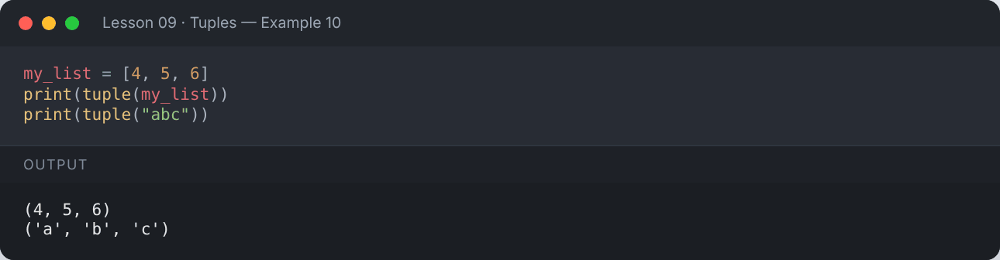

</details>

## 🆚 List vs Tuple

| | List | Tuple |
|---|---|---|
| Syntax | `[1, 2]` | `(1, 2)` |
| Mutable | ✅ Yes | ❌ No |
| Methods | many | `count`, `index` |
| Speed / memory | slower, more memory | faster, less memory |
| Dict key | ❌ | ✅ (if items are immutable) |

```python
import sys
print("List size :", sys.getsizeof([1, 2, 3, 4, 5]), "bytes")
print("Tuple size:", sys.getsizeof((1, 2, 3, 4, 5)), "bytes")
```

**Output:**

```text
List size : 104 bytes
Tuple size: 80 bytes
```

<details><summary>📸 Screenshot</summary>

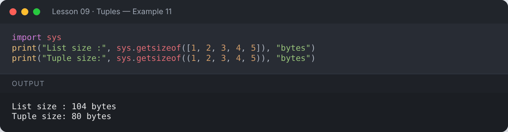

</details>

## 📌 Summary

- Tuples are ordered and immutable: `(a, b, c)`.
- A single-item tuple needs a trailing comma: `(5,)`.
- Unpack with `a, b = t` and `first, *rest = t`.

---

## ✍️ Exercises

Try each one yourself first, then expand the solution.

**Exercise 1 — Create a tuple of 5 numbers and print the sum, min and max.**

<details><summary>✅ Solution</summary>

```python
t = (12, 7, 25, 3, 18)
print("Sum:", sum(t), "Min:", min(t), "Max:", max(t))
```

**Output:**

```text
Sum: 65 Min: 3 Max: 25
```

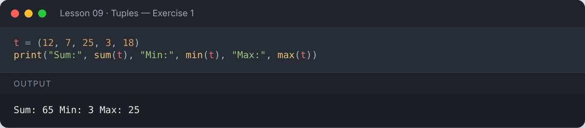

</details>

**Exercise 2 — Swap two values using tuple packing/unpacking.**

<details><summary>✅ Solution</summary>

```python
a, b = 1, 2
a, b = b, a
print(a, b)
```

**Output:**

```text
2 1
```

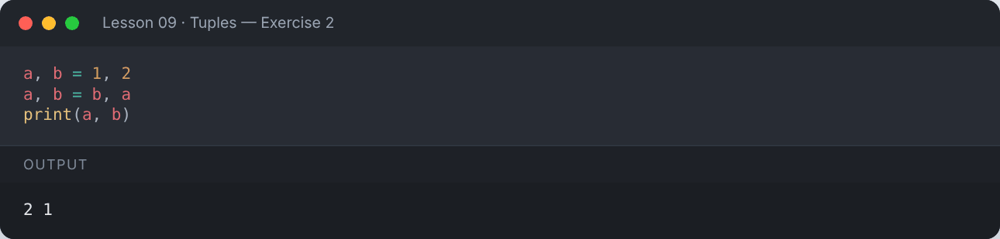

</details>

**Exercise 3 — Given a tuple of student records, print each student's name and marks.**

<details><summary>✅ Solution</summary>

```python
students = (("Ali", 88), ("Sara", 95), ("Zain", 79))
for name, marks in students:
    print(f"{name:<6} {marks}")
```

**Output:**

```text
Ali    88
Sara   95
Zain   79
```

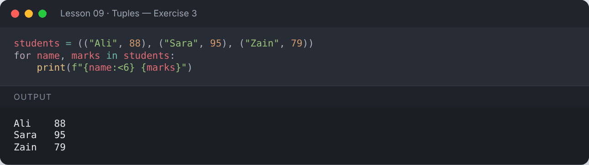

</details>

---

[⬅️ Lists](../08-lists/README.md) · [🏠 All lessons](../../README.md) · [Sets ➡️](../10-sets/README.md)
