# Lesson 10 — Sets

> Unordered collections of unique items and powerful set operations like union and intersection.

[](https://colab.research.google.com/github/MehvishKiani/Python-beginner-guide/blob/main/lessons/10-sets/lesson.ipynb) &nbsp; 📓 [lesson.ipynb](lesson.ipynb) &nbsp; ✍️ [exercises.ipynb](exercises.ipynb)

[⬅️ Tuples](../09-tuples/README.md) · [🏠 All lessons](../../README.md) · [Dictionaries ➡️](../11-dictionaries/README.md)

---

## 🎯 Learning Objectives

- Create sets and understand uniqueness
- Add and remove items
- Use union, intersection, difference and symmetric difference
- Know about `frozenset`

## 🧺 What is a Set?

A **set** is an **unordered** collection of **unique** items, written with curly braces `{}`.
Sets automatically remove duplicates and are very fast for membership tests.

```python
numbers = {1, 2, 3, 3, 2, 1}
print(numbers)            # duplicates removed
print(type(numbers))

empty = set()             # {} creates an empty DICT, not a set!
print(type(empty), type({}))
```

**Output:**

```text
{1, 2, 3}
<class 'set'>
<class 'set'> <class 'dict'>
```

<details><summary>📸 Screenshot</summary>

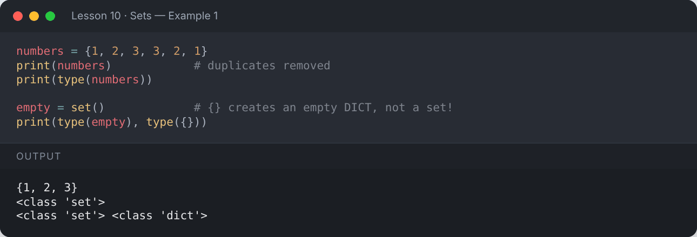

</details>

```python
names = ["Ali", "Sara", "Ali", "Zain", "Sara"]
unique_names = set(names)
print(unique_names)       # order may differ on your computer — sets are unordered
print("Unique count:", len(unique_names))
```

**Output:**

```text
{'Sara', 'Zain', 'Ali'}
Unique count: 3
```

<details><summary>📸 Screenshot</summary>

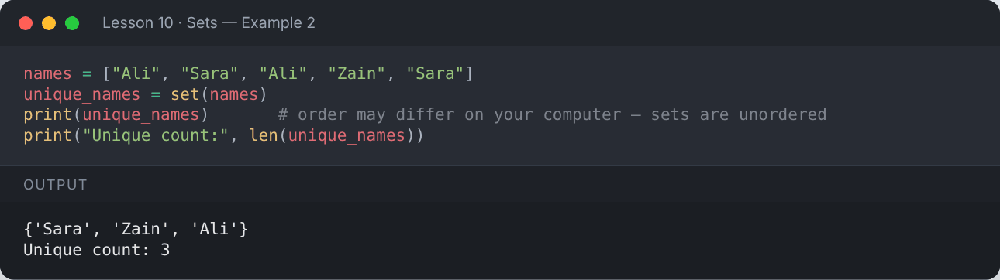

</details>

## ➕ Adding & ➖ Removing

```python
s = {1, 2, 3}
s.add(4)
print("add      :", s)
s.update([5, 6])
print("update   :", s)
s.remove(6)                 # error if missing
print("remove   :", s)
s.discard(100)              # no error if missing
print("discard  :", s)
x = s.pop()                 # removes an arbitrary item
print("pop      :", x, "→", s)
```

**Output:**

```text
add      : {1, 2, 3, 4}
update   : {1, 2, 3, 4, 5, 6}
remove   : {1, 2, 3, 4, 5}
discard  : {1, 2, 3, 4, 5}
pop      : 1 → {2, 3, 4, 5}
```

<details><summary>📸 Screenshot</summary>

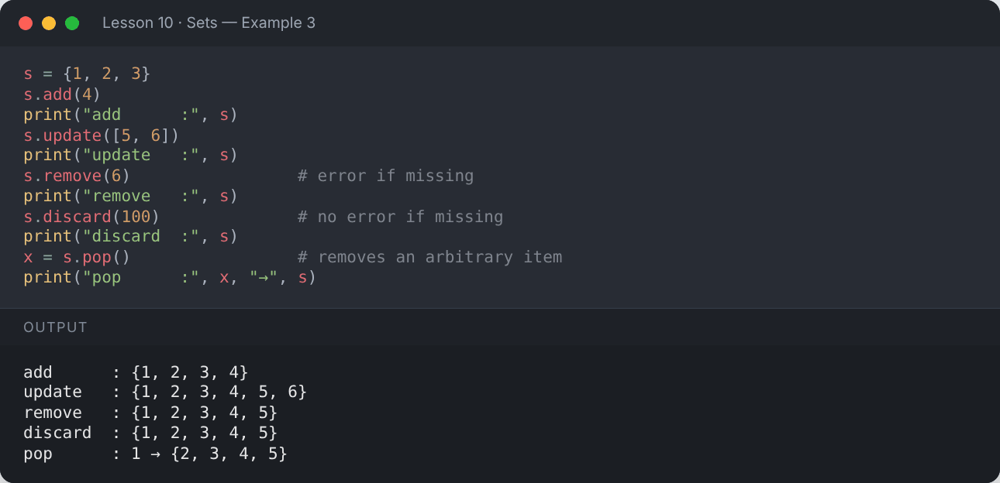

</details>

## 🔣 Set Operations

| Operation | Operator | Method |
|---|---|---|
| Union (all items) | `a \| b` | `a.union(b)` |
| Intersection (common) | `a & b` | `a.intersection(b)` |
| Difference (in a, not b) | `a - b` | `a.difference(b)` |
| Symmetric difference (not both) | `a ^ b` | `a.symmetric_difference(b)` |

```python
a = {1, 2, 3, 4}
b = {3, 4, 5, 6}
print("Union               :", a | b)
print("Intersection        :", a & b)
print("Difference a - b    :", a - b)
print("Symmetric difference:", a ^ b)
```

**Output:**

```text
Union               : {1, 2, 3, 4, 5, 6}
Intersection        : {3, 4}
Difference a - b    : {1, 2}
Symmetric difference: {1, 2, 5, 6}
```

<details><summary>📸 Screenshot</summary>

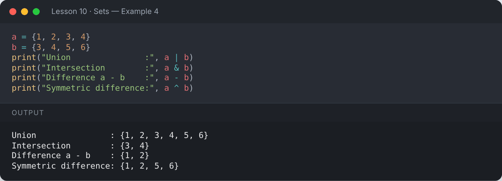

</details>

```python
python_students = {"Ali", "Sara", "Zain"}
ai_students = {"Sara", "Hina", "Zain"}
print("Both courses :", python_students.intersection(ai_students))
print("Only Python  :", python_students.difference(ai_students))
print("All students :", python_students.union(ai_students))
```

**Output:**

```text
Both courses : {'Sara', 'Zain'}
Only Python  : {'Ali'}
All students : {'Sara', 'Ali', 'Hina', 'Zain'}
```

<details><summary>📸 Screenshot</summary>

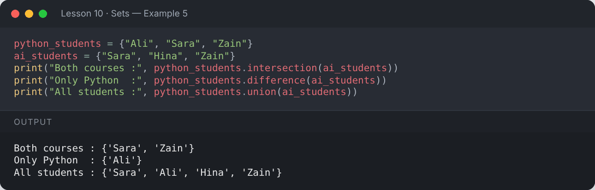

</details>

## 🧪 Subset, Superset & Disjoint

```python
a = {1, 2}
b = {1, 2, 3, 4}
print("a subset of b  :", a.issubset(b))
print("b superset of a:", b.issuperset(a))
print("disjoint       :", a.isdisjoint({7, 8}))
```

**Output:**

```text
a subset of b  : True
b superset of a: True
disjoint       : True
```

<details><summary>📸 Screenshot</summary>

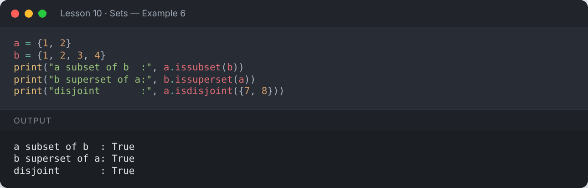

</details>

## 🧊 `frozenset` — an immutable set

```python
fs = frozenset([1, 2, 3])
print(fs)
print("Can be a dict key:", {fs: "value"})
```

**Output:**

```text
frozenset({1, 2, 3})
Can be a dict key: {frozenset({1, 2, 3}): 'value'}
```

<details><summary>📸 Screenshot</summary>

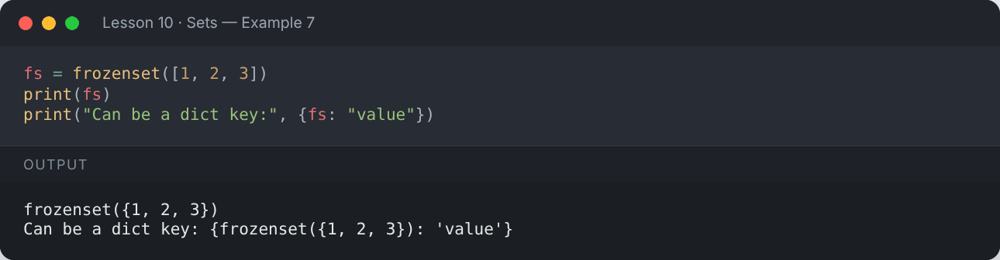

</details>

## ⚡ Why sets are fast

Checking `x in my_set` is (on average) constant time, while `x in my_list` checks every item.

```python
import time
big_list = list(range(1_000_000))
big_set = set(big_list)
t = time.perf_counter(); 999_999 in big_list; list_time = time.perf_counter() - t
t = time.perf_counter(); 999_999 in big_set;  set_time = time.perf_counter() - t
print("List lookup is slower than set lookup:", list_time > set_time)
```

**Output:**

```text
List lookup is slower than set lookup: True
```

<details><summary>📸 Screenshot</summary>

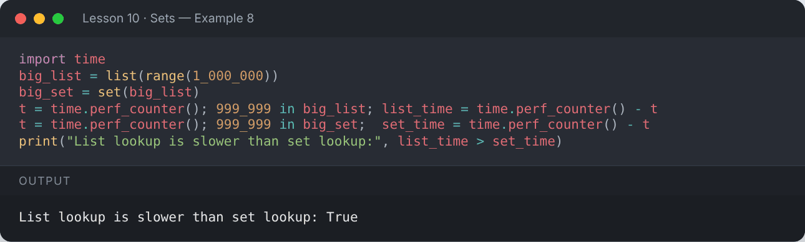

</details>

## 📌 Summary

- Sets hold unique, unordered items: `{1, 2, 3}` or `set()`.
- Use `|`, `&`, `-`, `^` for set math.
- Great for removing duplicates and fast membership tests.

---

## ✍️ Exercises

Try each one yourself first, then expand the solution.

**Exercise 1 — Find the common elements of two lists using sets.**

<details><summary>✅ Solution</summary>

```python
list1 = [1, 2, 3, 4, 5]
list2 = [4, 5, 6, 7]
print(sorted(set(list1) & set(list2)))
```

**Output:**

```text
[4, 5]
```

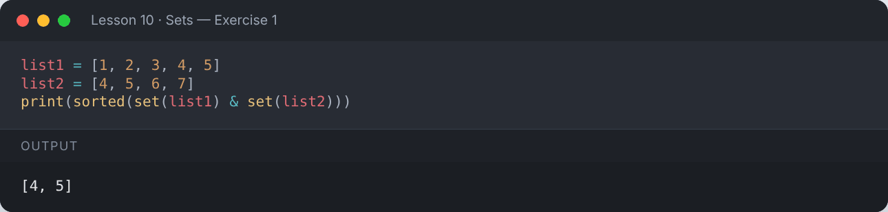

</details>

**Exercise 2 — Count the unique words in a sentence (case-insensitive).**

<details><summary>✅ Solution</summary>

```python
text = "The cat and the dog and THE bird"
words = set(text.lower().split())
print(len(words), "unique words:", sorted(words))
```

**Output:**

```text
5 unique words: ['and', 'bird', 'cat', 'dog', 'the']
```

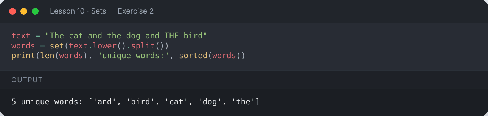

</details>

**Exercise 3 — Check whether a string uses every vowel at least once.**

<details><summary>✅ Solution</summary>

```python
sentence = "Education is the key"
print(set("aeiou").issubset(set(sentence.lower())))
```

**Output:**

```text
True
```

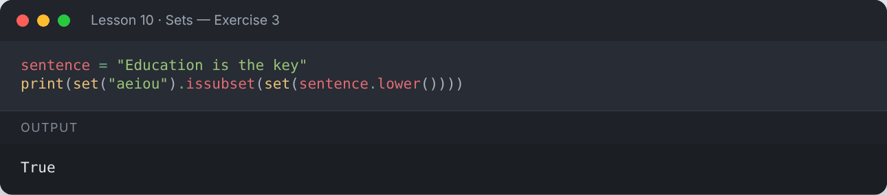

</details>

---

[⬅️ Tuples](../09-tuples/README.md) · [🏠 All lessons](../../README.md) · [Dictionaries ➡️](../11-dictionaries/README.md)
