# Lesson 11 — Dictionaries

> Store data as key-value pairs — access, update, loop through and nest dictionaries.

[](https://colab.research.google.com/github/MehvishKiani/Python-beginner-guide/blob/main/lessons/11-dictionaries/lesson.ipynb) &nbsp; 📓 [lesson.ipynb](lesson.ipynb) &nbsp; ✍️ [exercises.ipynb](exercises.ipynb)

[⬅️ Sets](../10-sets/README.md) · [🏠 All lessons](../../README.md) · [Comprehensions ➡️](../12-comprehensions/README.md)

---

## 🎯 Learning Objectives

- Create dictionaries and access values by key
- Add, update and remove key-value pairs
- Loop through keys, values and items
- Merge dictionaries and work with nested data

## 📖 What is a Dictionary?

A **dictionary** stores data as **key: value** pairs inside curly braces `{}`.
Keys must be **unique** and **immutable** (str, int, tuple…). Dictionaries keep insertion order (Python 3.7+).

```python
person = {"name": "John", "age": 30, "city": "New York"}
print(person)
print(person["name"])
print(person["age"])
print(type(person))
```

**Output:**

```text
{'name': 'John', 'age': 30, 'city': 'New York'}
John
30
<class 'dict'>
```

<details><summary>📸 Screenshot</summary>

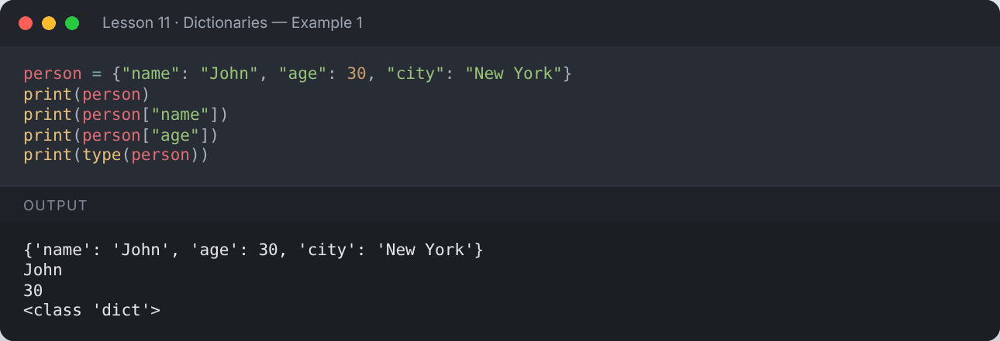

</details>

## 🔑 Keys, Values & Items

```python
person = {"name": "John", "age": 30, "city": "New York"}
print(person.keys())      # all keys
print(person.values())    # all values
print(person.items())     # all key-value pairs
```

**Output:**

```text
dict_keys(['name', 'age', 'city'])
dict_values(['John', 30, 'New York'])
dict_items([('name', 'John'), ('age', 30), ('city', 'New York')])
```

<details><summary>📸 Screenshot</summary>

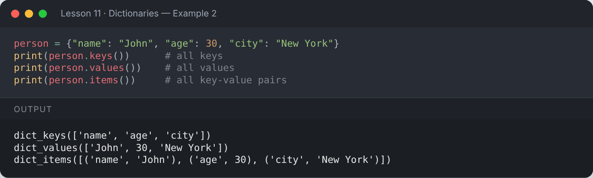

</details>

## 🛟 Safe Access with `get()`

`person["x"]` raises a `KeyError` if the key is missing; `get()` returns a default instead.

```python
person = {"name": "John"}
print(person["city"])
```

**Output:**

```text
Traceback (most recent call last):
  ...
KeyError: 'city'
```

<details><summary>📸 Screenshot</summary>

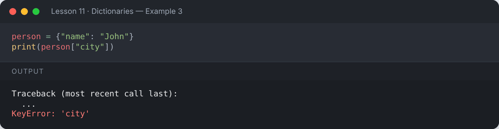

</details>

```python
person = {"name": "John"}
city = person.get("city", "Not Found")
print("Item does not exist:", city)
if "name" in person:
    print("Name exists in the dictionary.")
```

**Output:**

```text
Item does not exist: Not Found
Name exists in the dictionary.
```

<details><summary>📸 Screenshot</summary>

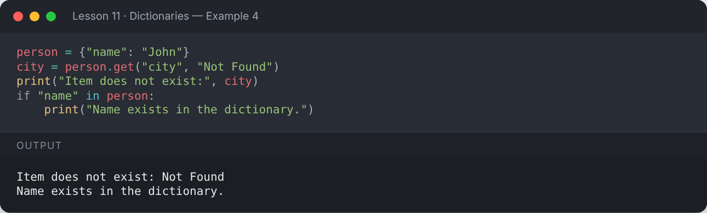

</details>

## ✏️ Adding & Updating

```python
person = {"name": "John", "age": 30, "city": "New York"}
person["job"] = "Engineer"        # add new key
print("Added  :", person)
person["age"] = 31                # update existing key
print("Updated:", person)
person.update({"hobby": "Reading", "country": "USA"})   # merge another dict
print("Merged :", person)
person.setdefault("age", 99)      # only sets if key is missing
print("setdefault keeps age:", person["age"])
```

**Output:**

```text
Added  : {'name': 'John', 'age': 30, 'city': 'New York', 'job': 'Engineer'}
Updated: {'name': 'John', 'age': 31, 'city': 'New York', 'job': 'Engineer'}
Merged : {'name': 'John', 'age': 31, 'city': 'New York', 'job': 'Engineer', 'hobby': 'Reading', 'country': 'USA'}
setdefault keeps age: 31
```

<details><summary>📸 Screenshot</summary>

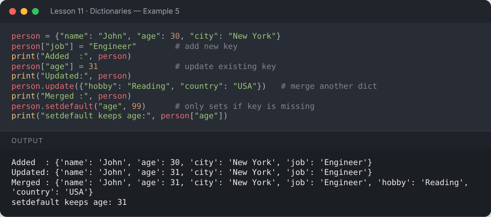

</details>

## ➖ Removing

```python
person = {"name": "John", "age": 31, "city": "New York", "job": "Engineer"}
del person["city"]
print("Remove with del :", person)
job = person.pop("job")
print("pop returned    :", job, "→", person)
last = person.popitem()           # removes the last inserted pair
print("popitem returned:", last, "→", person)
person.clear()
print("Clears the dict :", person)
```

**Output:**

```text
Remove with del : {'name': 'John', 'age': 31, 'job': 'Engineer'}
pop returned    : Engineer → {'name': 'John', 'age': 31}
popitem returned: ('age', 31) → {'name': 'John'}
Clears the dict : {}
```

<details><summary>📸 Screenshot</summary>

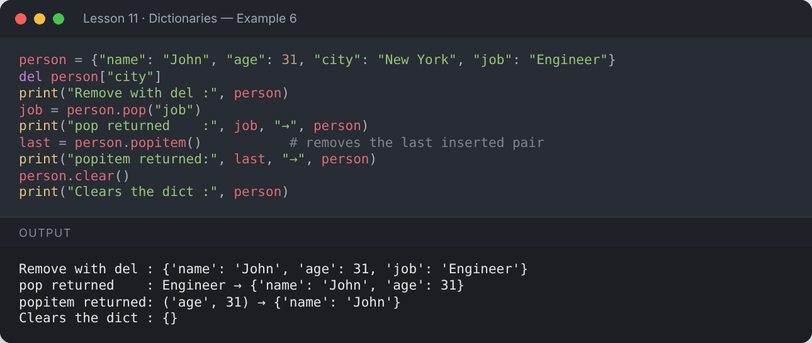

</details>

## 🔀 Merging with `|` (Python 3.9+)

```python
person = {"name": "John", "age": 30}
new_person = person | {"gender": "Male"}
print(new_person)
```

**Output:**

```text
{'name': 'John', 'age': 30, 'gender': 'Male'}
```

<details><summary>📸 Screenshot</summary>

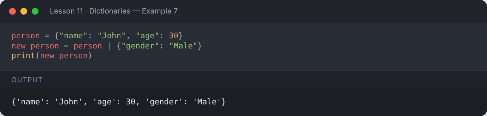

</details>

## 🔁 Looping Through a Dictionary

```python
marks = {"Math": 90, "Science": 85, "English": 78}
for subject in marks:
    print(subject)
print("---")
for subject, score in marks.items():
    print(f"{subject:<8}: {score}")
print("Average:", sum(marks.values()) / len(marks))
```

**Output:**

```text
Math
Science
English
---
Math    : 90
Science : 85
English : 78
Average: 84.33333333333333
```

<details><summary>📸 Screenshot</summary>

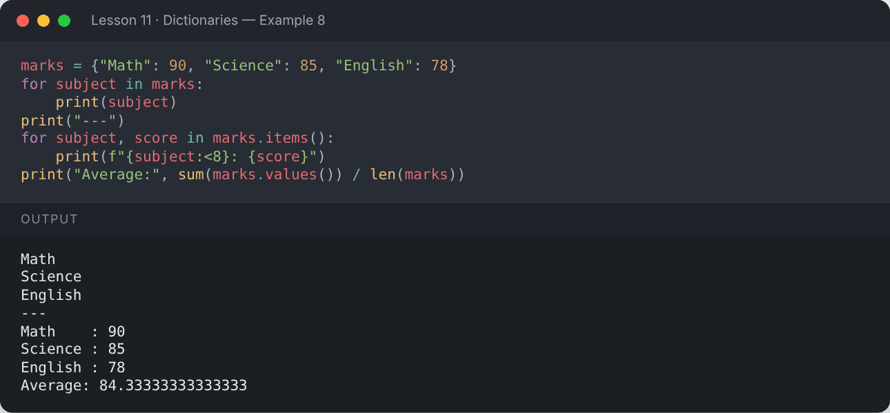

</details>

## 🪆 Nested Dictionaries

```python
students = {
    "S01": {"name": "Ali", "marks": {"math": 88, "cs": 92}},
    "S02": {"name": "Sara", "marks": {"math": 95, "cs": 89}},
}
print(students["S02"]["name"])
print(students["S01"]["marks"]["cs"])
for sid, info in students.items():
    print(sid, info["name"], "avg:", sum(info["marks"].values()) / 2)
```

**Output:**

```text
Sara
92
S01 Ali avg: 90.0
S02 Sara avg: 92.0
```

<details><summary>📸 Screenshot</summary>

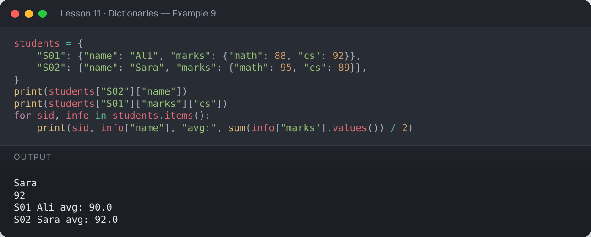

</details>

## 🏗️ Other Ways to Create Dictionaries

```python
d1 = dict(name="Ali", age=20)
d2 = dict([("a", 1), ("b", 2)])
d3 = dict.fromkeys(["x", "y", "z"], 0)
d4 = dict(zip(["one", "two"], [1, 2]))
print(d1, d2, d3, d4, sep="\n")
```

**Output:**

```text
{'name': 'Ali', 'age': 20}
{'a': 1, 'b': 2}
{'x': 0, 'y': 0, 'z': 0}
{'one': 1, 'two': 2}
```

<details><summary>📸 Screenshot</summary>

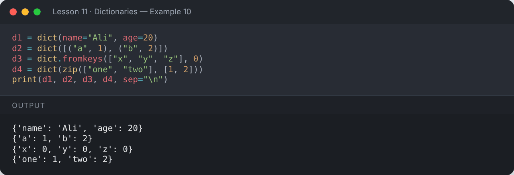

</details>

## 🔤 Counting with a Dictionary (classic pattern)

```python
text = "banana"
counts = {}
for ch in text:
    counts[ch] = counts.get(ch, 0) + 1
print(counts)
```

**Output:**

```text
{'b': 1, 'a': 3, 'n': 2}
```

<details><summary>📸 Screenshot</summary>

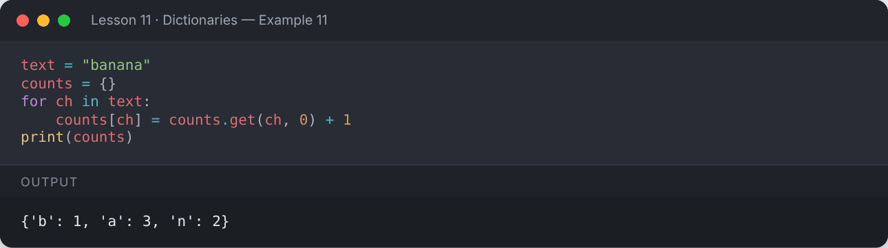

</details>

## 📌 Summary

| Task | Code |
|---|---|
| Read | `d[key]`, `d.get(key, default)` |
| Add / update | `d[key] = v`, `d.update(other)` |
| Remove | `del d[key]`, `d.pop(key)`, `d.popitem()`, `d.clear()` |
| Loop | `d.keys()`, `d.values()`, `d.items()` |
| Merge | `d1 \| d2` |

---

## ✍️ Exercises

Try each one yourself first, then expand the solution.

**Exercise 1 — Count how many times each word appears in a sentence.**

<details><summary>✅ Solution</summary>

```python
sentence = "to be or not to be"
freq = {}
for w in sentence.split():
    freq[w] = freq.get(w, 0) + 1
print(freq)
```

**Output:**

```text
{'to': 2, 'be': 2, 'or': 1, 'not': 1}
```

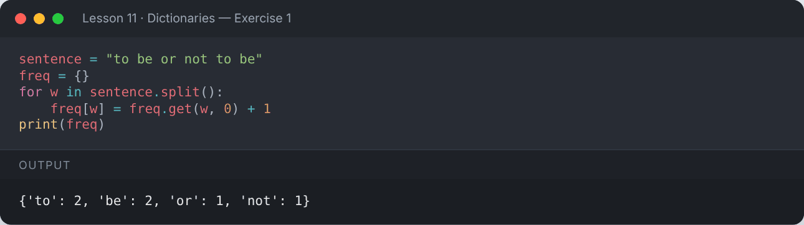

</details>

**Exercise 2 — Find the student with the highest marks.**

<details><summary>✅ Solution</summary>

```python
marks = {"Ali": 82, "Sara": 95, "Zain": 77}
top = max(marks, key=marks.get)
print(f"Top student: {top} ({marks[top]})")
```

**Output:**

```text
Top student: Sara (95)
```

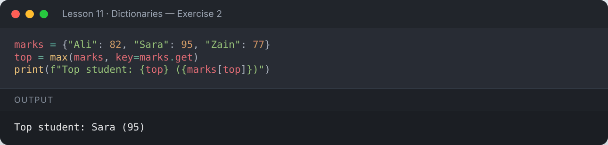

</details>

**Exercise 3 — Invert a dictionary (swap keys and values).**

<details><summary>✅ Solution</summary>

```python
codes = {"PK": "Pakistan", "UK": "United Kingdom", "US": "United States"}
inverted = {}
for k, v in codes.items():
    inverted[v] = k
print(inverted)
```

**Output:**

```text
{'Pakistan': 'PK', 'United Kingdom': 'UK', 'United States': 'US'}
```

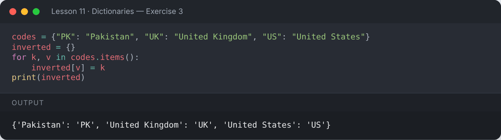

</details>

**Exercise 4 — Build a simple phone book: add two contacts, update one, delete one, and print the rest.**

<details><summary>✅ Solution</summary>

```python
phone_book = {}
phone_book["Ali"] = "0300-1111111"
phone_book["Sara"] = "0311-2222222"
phone_book["Ali"] = "0300-9999999"
del phone_book["Sara"]
print(phone_book)
```

**Output:**

```text
{'Ali': '0300-9999999'}
```

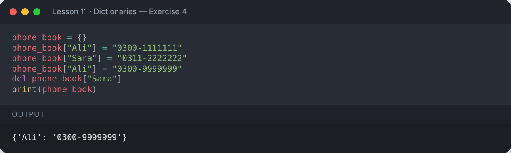

</details>

---

[⬅️ Sets](../10-sets/README.md) · [🏠 All lessons](../../README.md) · [Comprehensions ➡️](../12-comprehensions/README.md)
