# Lesson 12 — Comprehensions

> Build lists, sets and dictionaries in a single, readable line.

[](https://colab.research.google.com/github/MehvishKiani/Python-beginner-guide/blob/main/lessons/12-comprehensions/lesson.ipynb) &nbsp; 📓 [lesson.ipynb](lesson.ipynb) &nbsp; ✍️ [exercises.ipynb](exercises.ipynb)

[⬅️ Dictionaries](../11-dictionaries/README.md) · [🏠 All lessons](../../README.md) · [Functions ➡️](../13-functions/README.md)

---

## 🎯 Learning Objectives

- Write list, set and dictionary comprehensions
- Add conditions (`if`) and `if-else` inside comprehensions
- Use nested comprehensions
- Know when a normal loop is clearer

## 🧪 List Comprehension

`[expression for item in iterable if condition]`

The same task with a loop and with a comprehension:

```python
# with a loop
squares = []
for n in range(1, 6):
    squares.append(n ** 2)
print(squares)

# with a list comprehension
squares = [n ** 2 for n in range(1, 6)]
print(squares)
```

**Output:**

```text
[1, 4, 9, 16, 25]
[1, 4, 9, 16, 25]
```

<details><summary>📸 Screenshot</summary>

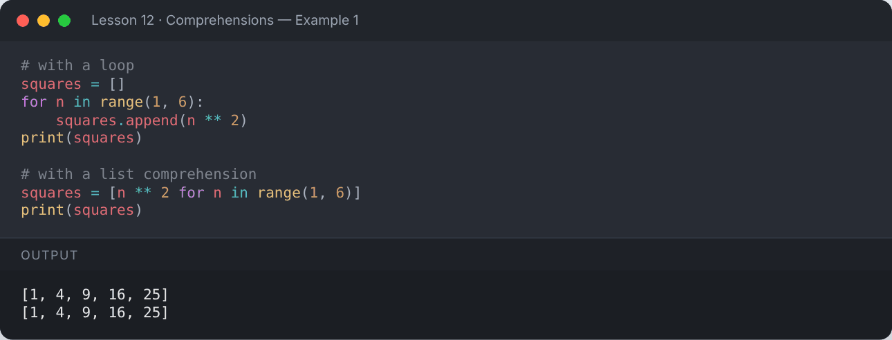

</details>

### With a condition (filter)

```python
evens = [n for n in range(1, 21) if n % 2 == 0]
print(evens)

names = ["ali", "sara", "zainab", "hina"]
long_names = [name.title() for name in names if len(name) > 3]
print(long_names)
```

**Output:**

```text
[2, 4, 6, 8, 10, 12, 14, 16, 18, 20]
['Sara', 'Zainab', 'Hina']
```

<details><summary>📸 Screenshot</summary>

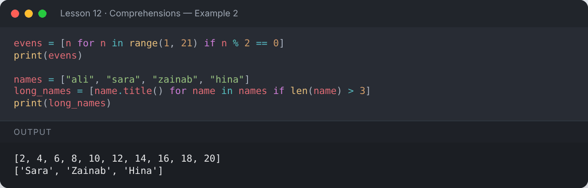

</details>

### With `if-else` (transform)

When you need `else`, the condition goes **before** `for`.

```python
labels = ["even" if n % 2 == 0 else "odd" for n in range(1, 6)]
print(labels)
```

**Output:**

```text
['odd', 'even', 'odd', 'even', 'odd']
```

<details><summary>📸 Screenshot</summary>

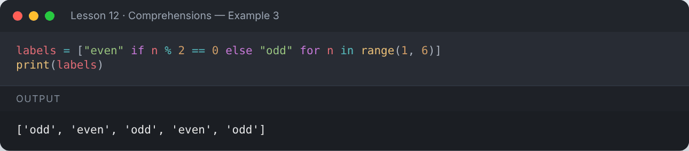

</details>

### Nested comprehension

```python
matrix = [[r * 3 + c + 1 for c in range(3)] for r in range(3)]
print(matrix)

flat = [x for row in matrix for x in row]
print("Flattened:", flat)

transposed = [[row[i] for row in matrix] for i in range(3)]
print("Transposed:", transposed)
```

**Output:**

```text
[[1, 2, 3], [4, 5, 6], [7, 8, 9]]
Flattened: [1, 2, 3, 4, 5, 6, 7, 8, 9]
Transposed: [[1, 4, 7], [2, 5, 8], [3, 6, 9]]
```

<details><summary>📸 Screenshot</summary>

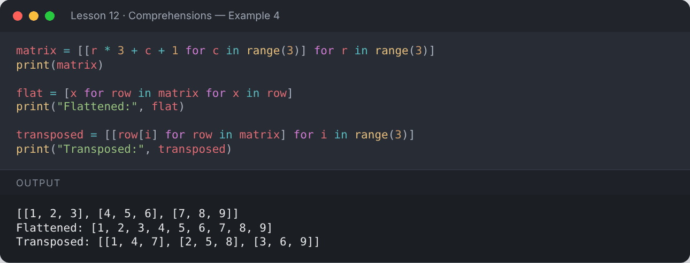

</details>

## 🧺 Set Comprehension

```python
words = ["apple", "avocado", "banana", "blueberry", "cherry"]
first_letters = {w[0] for w in words}
print(sorted(first_letters))
```

**Output:**

```text
['a', 'b', 'c']
```

<details><summary>📸 Screenshot</summary>

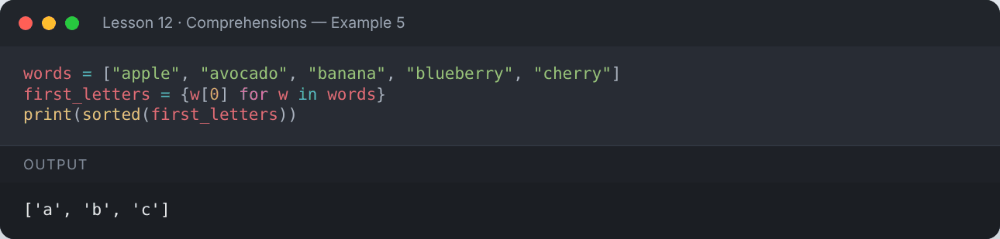

</details>

## 📖 Dictionary Comprehension

`{key_expr: value_expr for item in iterable}`

```python
squares = {n: n ** 2 for n in range(1, 6)}
print(squares)

prices = {"pen": 50, "book": 400, "bag": 1500}
discounted = {item: price * 0.9 for item, price in prices.items() if price > 100}
print(discounted)
```

**Output:**

```text
{1: 1, 2: 4, 3: 9, 4: 16, 5: 25}
{'book': 360.0, 'bag': 1350.0}
```

<details><summary>📸 Screenshot</summary>

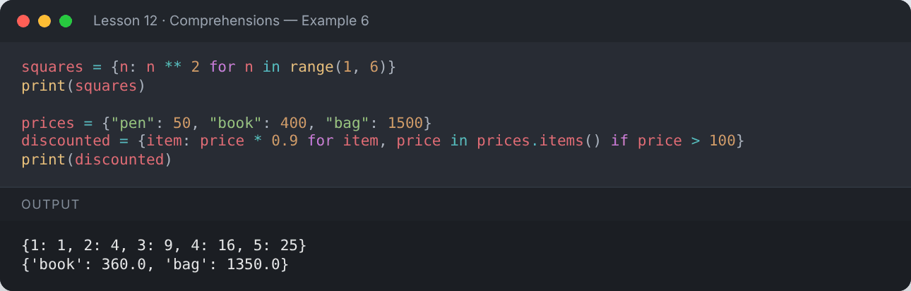

</details>

## ⚙️ Generator Expression

Same syntax with `()` — produces values lazily without building a list in memory.

```python
total = sum(n ** 2 for n in range(1, 1_000_001))
print(total)
```

**Output:**

```text
333333833333500000
```

<details><summary>📸 Screenshot</summary>

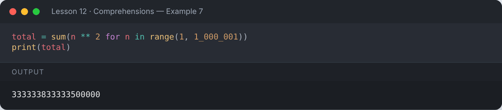

</details>

## 🤔 When NOT to use comprehensions

If the logic needs several steps, nested `if`s or side effects (like `print`), a regular loop is easier to read.
Readability always wins.

## 📌 Summary

| Type | Syntax |
|---|---|
| List | `[x for x in data if cond]` |
| Set | `{x for x in data}` |
| Dict | `{k: v for k, v in pairs}` |
| Generator | `(x for x in data)` |

---

## ✍️ Exercises

Try each one yourself first, then expand the solution.

**Exercise 1 — Create a list of cubes of odd numbers from 1 to 10.**

<details><summary>✅ Solution</summary>

```python
print([n ** 3 for n in range(1, 11) if n % 2 == 1])
```

**Output:**

```text
[1, 27, 125, 343, 729]
```

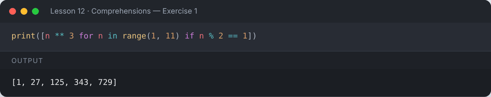

</details>

**Exercise 2 — Convert a list of temperatures in Celsius to Fahrenheit.**

<details><summary>✅ Solution</summary>

```python
celsius = [0, 25, 37, 100]
print([c * 9 / 5 + 32 for c in celsius])
```

**Output:**

```text
[32.0, 77.0, 98.6, 212.0]
```

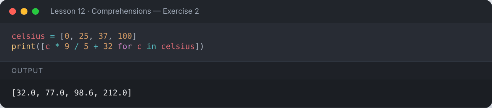

</details>

**Exercise 3 — Create a dictionary of word → length for a sentence.**

<details><summary>✅ Solution</summary>

```python
sentence = "Python comprehensions are elegant"
print({w: len(w) for w in sentence.split()})
```

**Output:**

```text
{'Python': 6, 'comprehensions': 14, 'are': 3, 'elegant': 7}
```

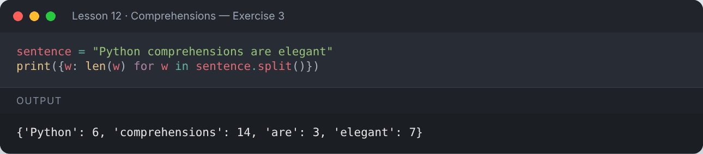

</details>

**Exercise 4 — Extract all digits from a string using a comprehension.**

<details><summary>✅ Solution</summary>

```python
text = "Order 66 shipped on 2026-10-12"
print("".join([ch for ch in text if ch.isdigit()]))
```

**Output:**

```text
6620261012
```

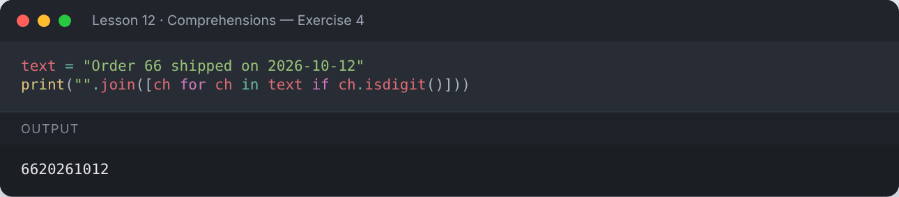

</details>

---

[⬅️ Dictionaries](../11-dictionaries/README.md) · [🏠 All lessons](../../README.md) · [Functions ➡️](../13-functions/README.md)
