# Lesson 13 — Functions

> Write reusable blocks of code with parameters, return values, default and keyword arguments, *args, **kwargs and scope.

[](https://colab.research.google.com/github/MehvishKiani/Python-beginner-guide/blob/main/lessons/13-functions/lesson.ipynb) &nbsp; 📓 [lesson.ipynb](lesson.ipynb) &nbsp; ✍️ [exercises.ipynb](exercises.ipynb)

[⬅️ Comprehensions](../12-comprehensions/README.md) · [🏠 All lessons](../../README.md) · [Lambda, map, filter & reduce ➡️](../14-lambda-map-filter-reduce/README.md)

---

## 🎯 Learning Objectives

- Define and call functions
- Use parameters, arguments and return values
- Use default, keyword, `*args` and `**kwargs` arguments
- Understand local vs global scope
- Document functions with docstrings and type hints

## 🧰 What is a Function?

A **function** is a named block of reusable code. It runs only when it is **called**.

```python
def function_name(parameters):
    """docstring"""
    # body
    return value
```

```python
def greet():
    print("Hello from a function!")

greet()
greet()
```

**Output:**

```text
Hello from a function!
Hello from a function!
```

<details><summary>📸 Screenshot</summary>

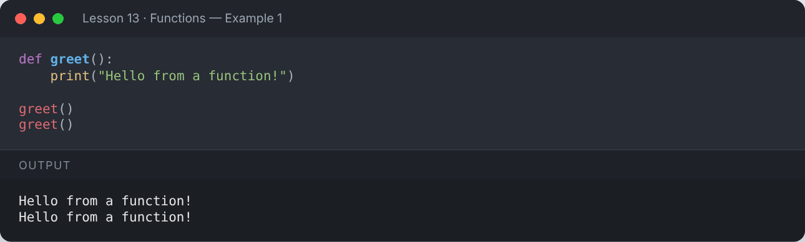

</details>

## 📥 Parameters & Arguments

**Parameters** are the names in the definition; **arguments** are the values you pass in.

```python
def greet(name):
    print(f"Hello, {name}!")

greet("Mehvish")
greet("Ali")
```

**Output:**

```text
Hello, Mehvish!
Hello, Ali!
```

<details><summary>📸 Screenshot</summary>

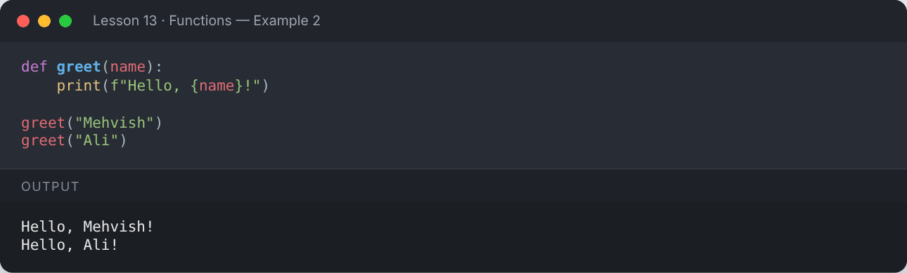

</details>

## ↩️ Return Values

```python
def average(num1, num2):
    avr = (num1 + num2) / 2
    return avr

print(average(3, 6))
result = average(10, 20)
print("Stored result:", result)
```

**Output:**

```text
4.5
Stored result: 15.0
```

<details><summary>📸 Screenshot</summary>

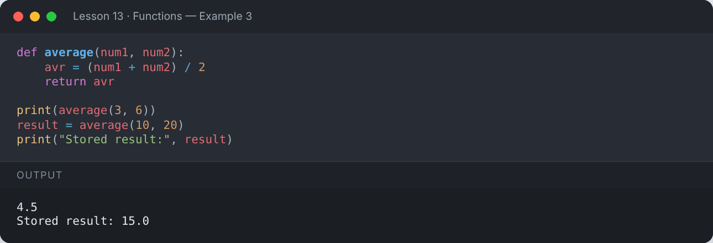

</details>

A function can return **multiple values** (as a tuple):

```python
def min_max(numbers):
    return min(numbers), max(numbers)

low, high = min_max([4, 9, 1, 7])
print("Min:", low, "Max:", high)
```

**Output:**

```text
Min: 1 Max: 9
```

<details><summary>📸 Screenshot</summary>

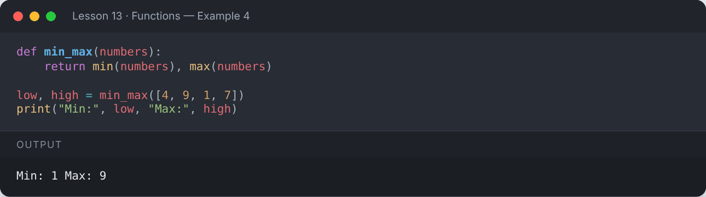

</details>

A function without `return` returns `None`:

```python
def say_hi():
    print("Hi")

value = say_hi()
print("Returned:", value)
```

**Output:**

```text
Hi
Returned: None
```

<details><summary>📸 Screenshot</summary>

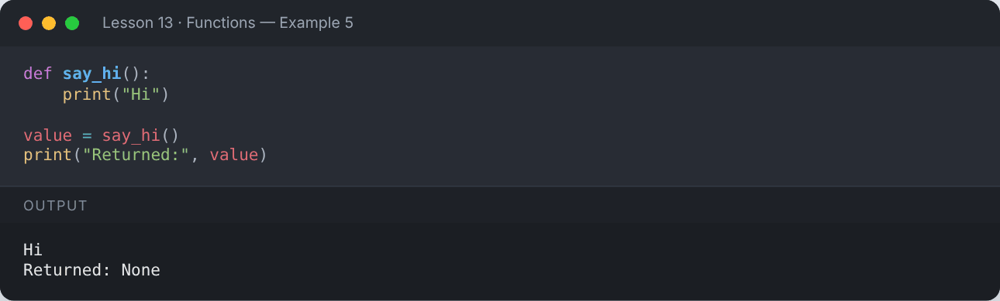

</details>

## 🎛️ Types of Arguments

### Default arguments

```python
def power(base, exponent=2):
    return base ** exponent

print(power(5))        # uses default exponent = 2
print(power(2, 10))
```

**Output:**

```text
25
1024
```

<details><summary>📸 Screenshot</summary>

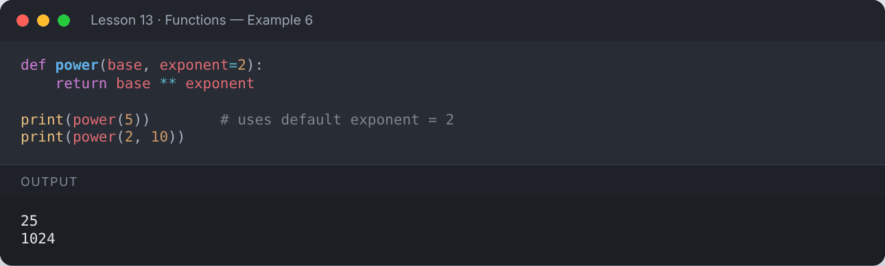

</details>

### Keyword arguments

```python
def describe(name, age, city):
    print(f"{name} is {age} years old and lives in {city}")

describe("Ali", 25, "Lahore")                     # positional
describe(city="Karachi", name="Sara", age=22)     # keyword — order doesn't matter
```

**Output:**

```text
Ali is 25 years old and lives in Lahore
Sara is 22 years old and lives in Karachi
```

<details><summary>📸 Screenshot</summary>

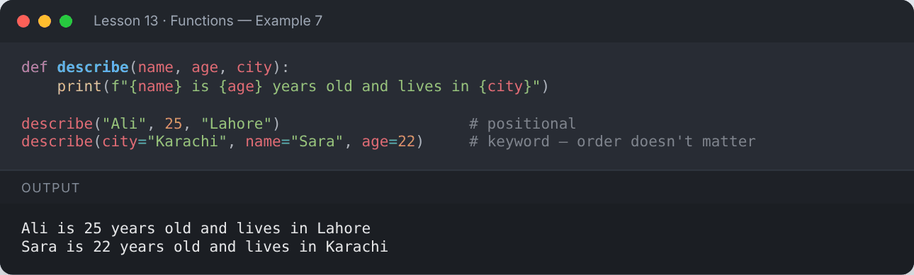

</details>

### `*args` — any number of positional arguments

```python
def total(*numbers):
    print("numbers is a", type(numbers).__name__, "→", numbers)
    return sum(numbers)

print(total(1, 2))
print(total(5, 10, 15, 20))
```

**Output:**

```text
numbers is a tuple → (1, 2)
3
numbers is a tuple → (5, 10, 15, 20)
50
```

<details><summary>📸 Screenshot</summary>

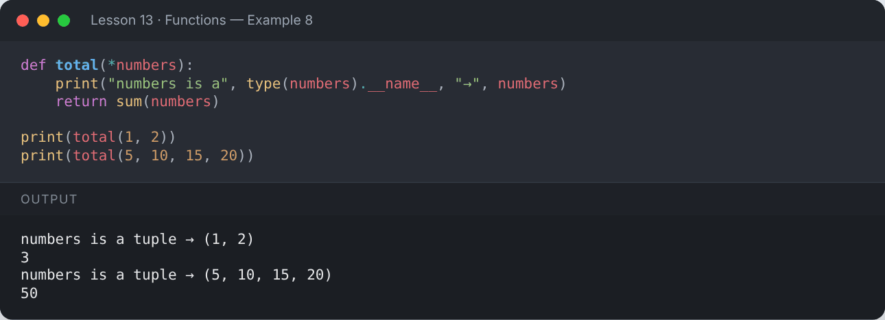

</details>

### `**kwargs` — any number of keyword arguments

```python
def profile(**info):
    for key, value in info.items():
        print(f"{key}: {value}")

profile(name="Mehvish", role="Trainer", language="Python")
```

**Output:**

```text
name: Mehvish
role: Trainer
language: Python
```

<details><summary>📸 Screenshot</summary>

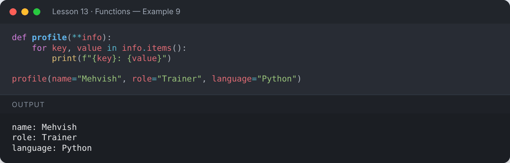

</details>

### Combining them (order matters)

`def f(positional, default=..., *args, keyword_only, **kwargs)`

```python
def order(item, qty=1, *extras, gift_wrap=False, **notes):
    print("Item:", item, "| Qty:", qty)
    print("Extras:", extras, "| Gift wrap:", gift_wrap)
    print("Notes:", notes)

order("Book", 2, "bookmark", "pen", gift_wrap=True, deliver="evening")
```

**Output:**

```text
Item: Book | Qty: 2
Extras: ('bookmark', 'pen') | Gift wrap: True
Notes: {'deliver': 'evening'}
```

<details><summary>📸 Screenshot</summary>

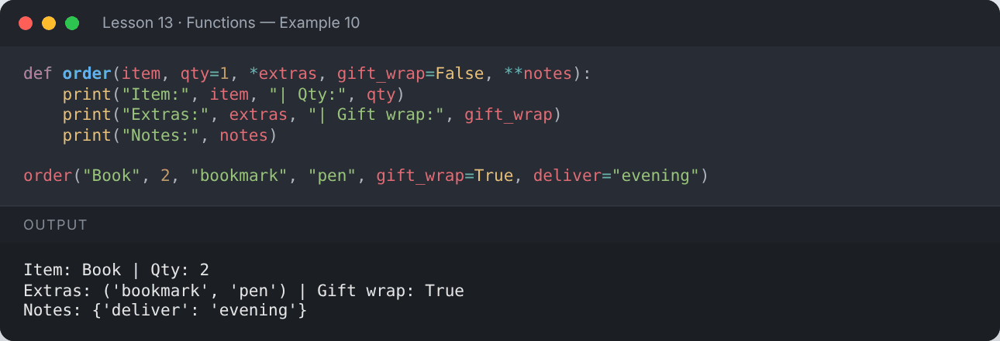

</details>

### Unpacking arguments

```python
def add(a, b, c):
    return a + b + c

nums = [1, 2, 3]
opts = {"a": 10, "b": 20, "c": 30}
print(add(*nums))
print(add(**opts))
```

**Output:**

```text
6
60
```

<details><summary>📸 Screenshot</summary>

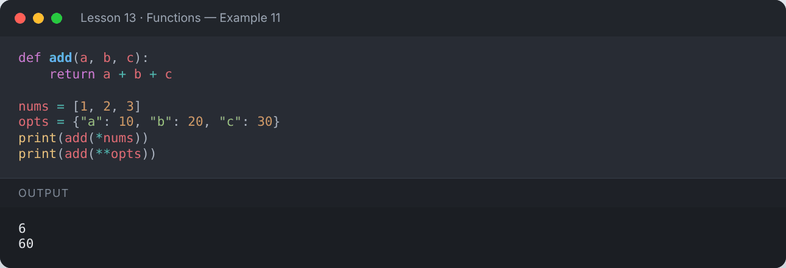

</details>

## 🌍 Scope — Local vs Global

```python
x = "global"

def show():
    x = "local"
    print("Inside :", x)

show()
print("Outside:", x)
```

**Output:**

```text
Inside : local
Outside: global
```

<details><summary>📸 Screenshot</summary>

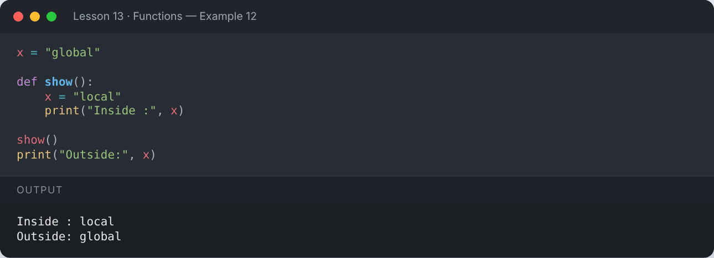

</details>

```python
counter = 0

def increment():
    global counter       # modify the global variable
    counter += 1

increment(); increment()
print("Counter:", counter)
```

**Output:**

```text
Counter: 2
```

<details><summary>📸 Screenshot</summary>

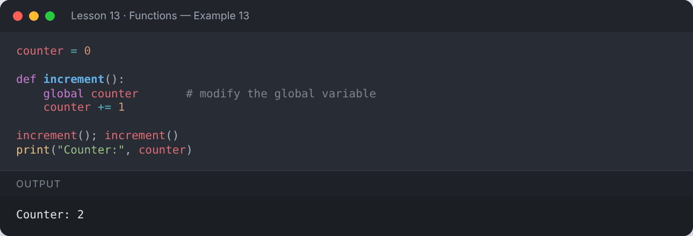

</details>

### `nonlocal` — modify a variable from the enclosing function

```python
def outer():
    count = 0
    def inner():
        nonlocal count
        count += 1
    inner(); inner(); inner()
    return count

print(outer())
```

**Output:**

```text
3
```

<details><summary>📸 Screenshot</summary>

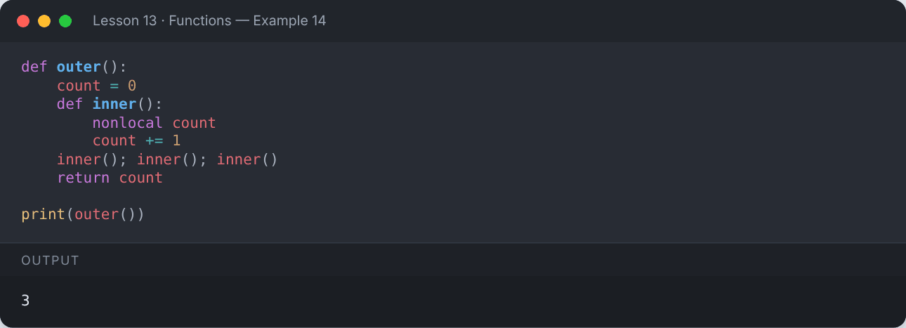

</details>

## 📝 Docstrings & Type Hints

```python
def bmi(weight_kg: float, height_m: float) -> float:
    """Return the Body Mass Index rounded to 1 decimal place."""
    return round(weight_kg / height_m ** 2, 1)

print(bmi(68, 1.72))
print(bmi.__doc__)
help(bmi)
```

**Output:**

```text
23.0
Return the Body Mass Index rounded to 1 decimal place.
Help on function bmi in module __main__:

bmi(weight_kg: float, height_m: float) -> float
    Return the Body Mass Index rounded to 1 decimal place.
```

<details><summary>📸 Screenshot</summary>

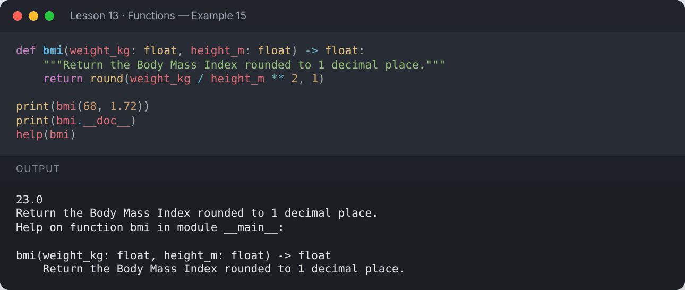

</details>

## 🧩 Functions are Objects

You can store functions in variables, lists and pass them to other functions.

```python
def shout(text):
    return text.upper() + "!"

def whisper(text):
    return text.lower() + "..."

def speak(style, message):
    return style(message)

print(speak(shout, "Hello"))
print(speak(whisper, "Hello"))
```

**Output:**

```text
HELLO!
hello...
```

<details><summary>📸 Screenshot</summary>

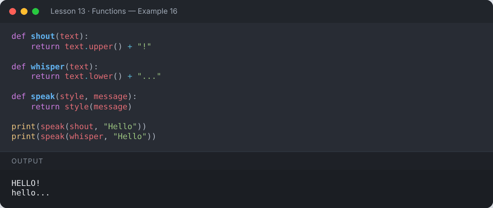

</details>

## 🧱 Built-in Functions You Already Use

`print()`, `len()`, `type()`, `input()`, `sum()`, `min()`, `max()`, `abs()`, `round()`, `sorted()`, `range()`, `enumerate()`, `zip()`, `isinstance()` …

```python
print(abs(-7), round(3.14159, 2), pow(2, 5), max([3, 8, 1]), sorted("python"))
```

**Output:**

```text
7 3.14 32 8 ['h', 'n', 'o', 'p', 't', 'y']
```

<details><summary>📸 Screenshot</summary>

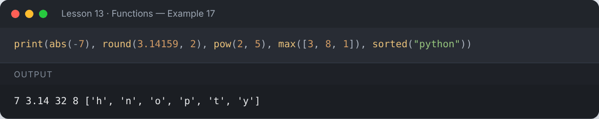

</details>

## 📌 Summary

- Define with `def`, call with `name()`.
- `return` sends a value back (default `None`).
- Default, keyword, `*args` and `**kwargs` make functions flexible.
- Variables inside a function are local unless declared `global`/`nonlocal`.
- Write docstrings and type hints for clean, professional code.

---

## ✍️ Exercises

Try each one yourself first, then expand the solution.

**Exercise 1 — Write a function that checks whether a number is prime.**

<details><summary>✅ Solution</summary>

```python
def is_prime(n: int) -> bool:
    if n < 2:
        return False
    for d in range(2, int(n ** 0.5) + 1):
        if n % d == 0:
            return False
    return True

print([n for n in range(1, 30) if is_prime(n)])
```

**Output:**

```text
[2, 3, 5, 7, 11, 13, 17, 19, 23, 29]
```

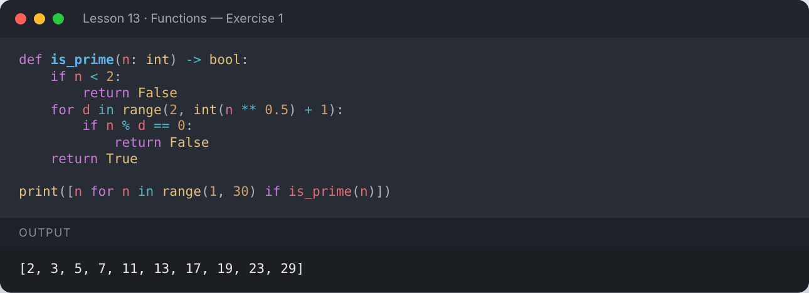

</details>

**Exercise 2 — Write a function that returns the factorial of a number.**

<details><summary>✅ Solution</summary>

```python
def factorial(n):
    result = 1
    for i in range(2, n + 1):
        result *= i
    return result

print(factorial(5), factorial(10))
```

**Output:**

```text
120 3628800
```

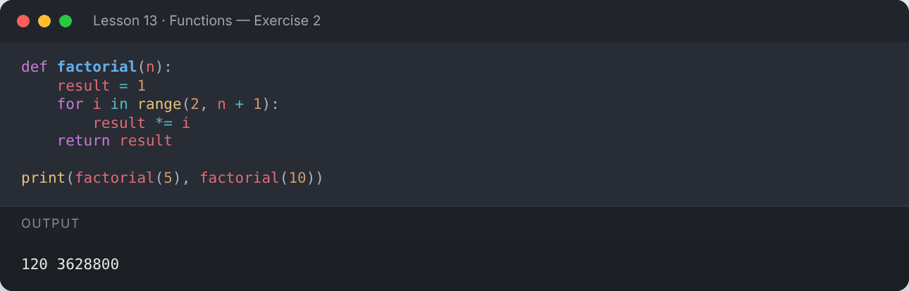

</details>

**Exercise 3 — Write a function that accepts any number of marks and returns the average and grade.**

<details><summary>✅ Solution</summary>

```python
def report(*marks):
    avg = sum(marks) / len(marks)
    grade = "A" if avg >= 80 else "B" if avg >= 65 else "C"
    return round(avg, 2), grade

print(report(78, 92, 85))
print(report(55, 60, 70))
```

**Output:**

```text
(85.0, 'A')
(61.67, 'C')
```

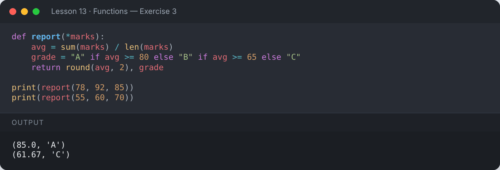

</details>

**Exercise 4 — Write a function that counts uppercase and lowercase letters in a string.**

<details><summary>✅ Solution</summary>

```python
def case_count(text):
    upper = sum(1 for c in text if c.isupper())
    lower = sum(1 for c in text if c.islower())
    return {"upper": upper, "lower": lower}

print(case_count("Hello Python World"))
```

**Output:**

```text
{'upper': 3, 'lower': 13}
```

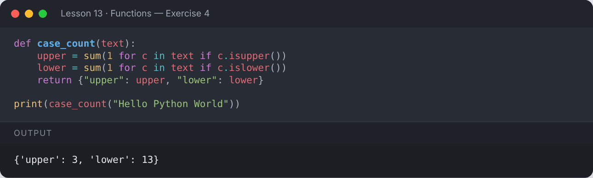

</details>

---

[⬅️ Comprehensions](../12-comprehensions/README.md) · [🏠 All lessons](../../README.md) · [Lambda, map, filter & reduce ➡️](../14-lambda-map-filter-reduce/README.md)
