# Lesson 14 — Lambda, map, filter & reduce

> Small anonymous functions and the functional tools that work with them.

[](https://colab.research.google.com/github/MehvishKiani/Python-beginner-guide/blob/main/lessons/14-lambda-map-filter-reduce/lesson.ipynb) &nbsp; 📓 [lesson.ipynb](lesson.ipynb) &nbsp; ✍️ [exercises.ipynb](exercises.ipynb)

[⬅️ Functions](../13-functions/README.md) · [🏠 All lessons](../../README.md) · [Recursion ➡️](../15-recursion/README.md)

---

## 🎯 Learning Objectives

- Write `lambda` (anonymous) functions
- Transform data with `map()`
- Select data with `filter()`
- Combine data with `functools.reduce()`
- Sort with a custom `key`

## λ Lambda Functions

`lambda arguments: expression` — a one-line function without a name.

```python
square = lambda x: x ** 2
add = lambda a, b: a + b
print(square(6))
print(add(3, 4))

# equivalent normal function
def square_fn(x):
    return x ** 2
print(square_fn(6))
```

**Output:**

```text
36
7
36
```

<details><summary>📸 Screenshot</summary>

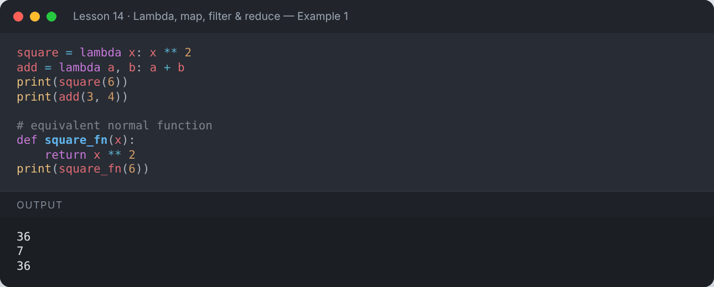

</details>

```python
is_even = lambda n: "Even" if n % 2 == 0 else "Odd"
print(is_even(7), is_even(10))
```

**Output:**

```text
Odd Even
```

<details><summary>📸 Screenshot</summary>

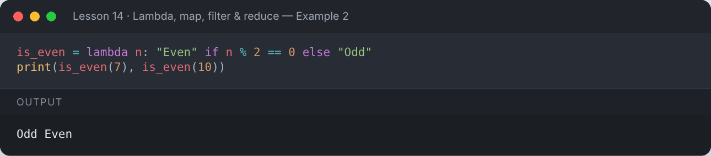

</details>

## 🗺️ `map(function, iterable)`

Applies a function to **every** item.

```python
numbers = [1, 2, 3, 4, 5]
doubled = list(map(lambda x: x * 2, numbers))
print(doubled)

names = ["ali", "sara", "zain"]
print(list(map(str.title, names)))

a = [1, 2, 3]
b = [10, 20, 30]
print(list(map(lambda x, y: x + y, a, b)))
```

**Output:**

```text
[2, 4, 6, 8, 10]
['Ali', 'Sara', 'Zain']
[11, 22, 33]
```

<details><summary>📸 Screenshot</summary>

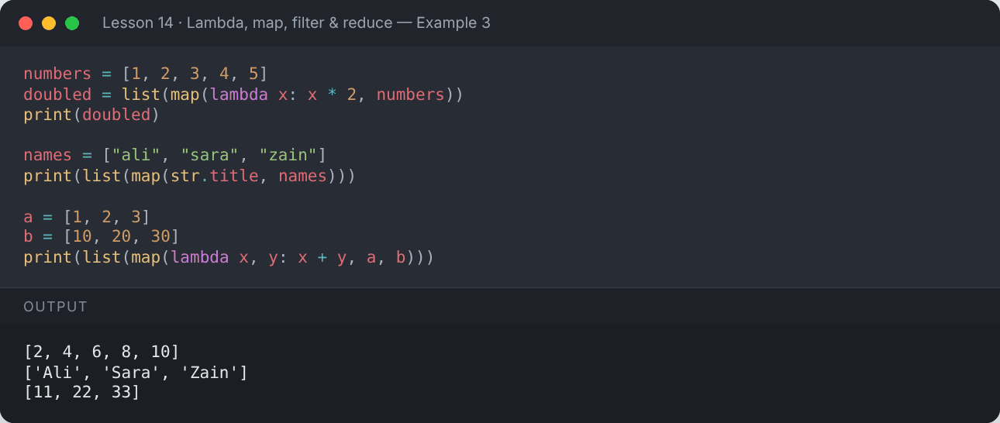

</details>

## 🔍 `filter(function, iterable)`

Keeps only items for which the function returns `True`.

```python
numbers = range(1, 21)
evens = list(filter(lambda x: x % 2 == 0, numbers))
print(evens)

words = ["python", "", "ai", "", "data"]
print(list(filter(None, words)))   # None removes falsy values
```

**Output:**

```text
[2, 4, 6, 8, 10, 12, 14, 16, 18, 20]
['python', 'ai', 'data']
```

<details><summary>📸 Screenshot</summary>

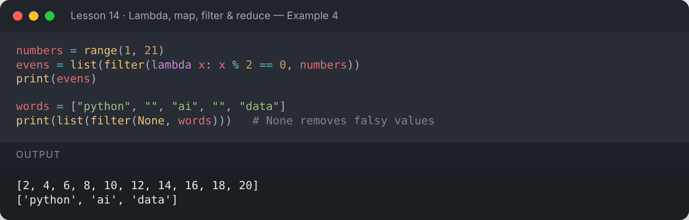

</details>

## ➗ `reduce(function, iterable)`

Repeatedly combines items into a single value. It lives in the `functools` module.

```python
from functools import reduce

numbers = [1, 2, 3, 4, 5]
total = reduce(lambda acc, x: acc + x, numbers)
product = reduce(lambda acc, x: acc * x, numbers)
largest = reduce(lambda a, b: a if a > b else b, numbers)
print("Sum:", total, "| Product:", product, "| Largest:", largest)
```

**Output:**

```text
Sum: 15 | Product: 120 | Largest: 5
```

<details><summary>📸 Screenshot</summary>

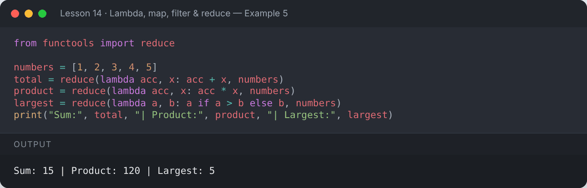

</details>

## 🔃 Sorting with `key=lambda`

```python
students = [("Ali", 82), ("Sara", 95), ("Zain", 77)]
print(sorted(students, key=lambda s: s[1]))                 # by marks
print(sorted(students, key=lambda s: s[1], reverse=True))   # highest first

words = ["banana", "Kiwi", "apple", "Cherry"]
print(sorted(words, key=str.lower))
print(max(students, key=lambda s: s[1]))
```

**Output:**

```text
[('Zain', 77), ('Ali', 82), ('Sara', 95)]
[('Sara', 95), ('Ali', 82), ('Zain', 77)]
['apple', 'banana', 'Cherry', 'Kiwi']
('Sara', 95)
```

<details><summary>📸 Screenshot</summary>

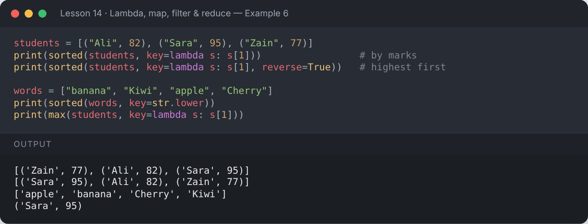

</details>

## 🧩 Chaining them together

```python
from functools import reduce
nums = range(1, 11)
result = reduce(lambda a, b: a + b,
                map(lambda x: x ** 2,
                    filter(lambda x: x % 2 == 0, nums)))
print("Sum of squares of even numbers 1-10:", result)

# The same with a comprehension — often more readable
print(sum(x ** 2 for x in nums if x % 2 == 0))
```

**Output:**

```text
Sum of squares of even numbers 1-10: 220
220
```

<details><summary>📸 Screenshot</summary>

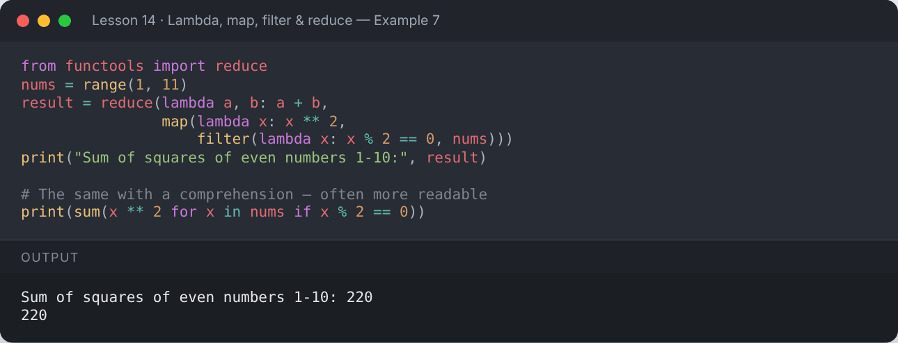

</details>

## 📌 Summary

- `lambda` is for short, throw-away functions.
- `map` transforms, `filter` selects, `reduce` combines.
- `sorted(..., key=lambda ...)` sorts by any rule.
- Comprehensions are often a clearer alternative to `map`/`filter`.

---

## ✍️ Exercises

Try each one yourself first, then expand the solution.

**Exercise 1 — Use `map` to convert a list of strings to integers.**

<details><summary>✅ Solution</summary>

```python
print(list(map(int, ["10", "20", "30"])))
```

**Output:**

```text
[10, 20, 30]
```

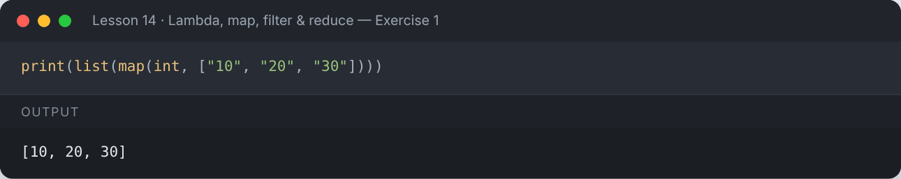

</details>

**Exercise 2 — Use `filter` to keep words longer than 4 letters.**

<details><summary>✅ Solution</summary>

```python
words = ["code", "python", "loop", "lambda", "map"]
print(list(filter(lambda w: len(w) > 4, words)))
```

**Output:**

```text
['python', 'lambda']
```

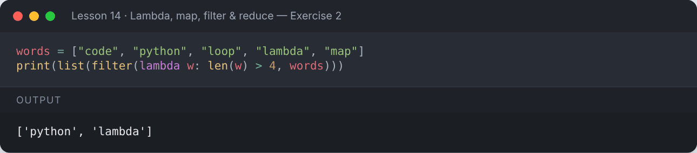

</details>

**Exercise 3 — Sort a list of dictionaries by age.**

<details><summary>✅ Solution</summary>

```python
people = [{"name": "Ali", "age": 30}, {"name": "Sara", "age": 22}, {"name": "Zain", "age": 27}]
for p in sorted(people, key=lambda p: p["age"]):
    print(p["name"], p["age"])
```

**Output:**

```text
Sara 22
Zain 27
Ali 30
```

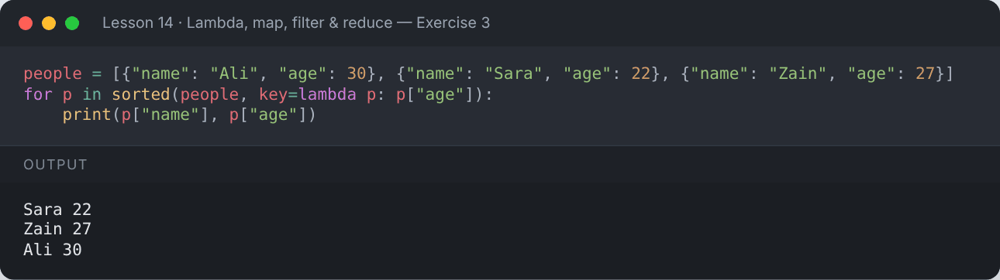

</details>

**Exercise 4 — Use `reduce` to find the longest word in a list.**

<details><summary>✅ Solution</summary>

```python
from functools import reduce
words = ["data", "science", "machine", "learning"]
print(reduce(lambda a, b: a if len(a) >= len(b) else b, words))
```

**Output:**

```text
learning
```

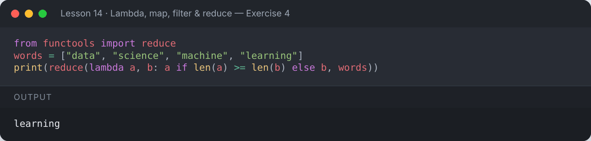

</details>

---

[⬅️ Functions](../13-functions/README.md) · [🏠 All lessons](../../README.md) · [Recursion ➡️](../15-recursion/README.md)
