# Lesson 15 — Recursion

> Functions that call themselves — base cases, recursive cases and when to use them.

[](https://colab.research.google.com/github/MehvishKiani/Python-beginner-guide/blob/main/lessons/15-recursion/lesson.ipynb) &nbsp; 📓 [lesson.ipynb](lesson.ipynb) &nbsp; ✍️ [exercises.ipynb](exercises.ipynb)

[⬅️ Lambda, map, filter & reduce](../14-lambda-map-filter-reduce/README.md) · [🏠 All lessons](../../README.md) · [Modules & Packages ➡️](../16-modules-and-packages/README.md)

---

## 🎯 Learning Objectives

- Understand how a recursive function works
- Always write a base case
- Solve classic problems recursively
- Know recursion limits and memoization

## 🔁 What is Recursion?

A **recursive function** calls itself to solve a smaller version of the same problem.
Every recursive function needs:

1. **Base case** — when to stop
2. **Recursive case** — call itself with a smaller input

```python
def countdown(n):
    if n == 0:                 # base case
        print("Done!")
        return
    print(n)
    countdown(n - 1)           # recursive case

countdown(3)
```

**Output:**

```text
3
2
1
Done!
```

<details><summary>📸 Screenshot</summary>

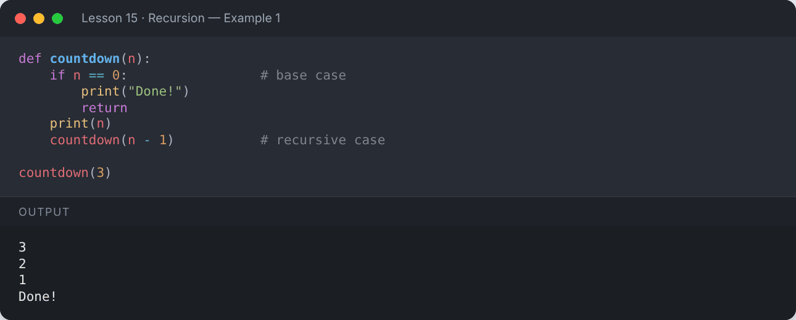

</details>

## 🧮 Factorial

`n! = n × (n-1)!` and `0! = 1`

```python
def factorial(n):
    if n <= 1:
        return 1
    return n * factorial(n - 1)

print(factorial(5))
```

**Output:**

```text
120
```

<details><summary>📸 Screenshot</summary>

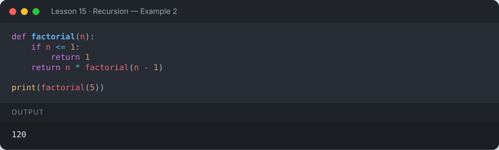

</details>

### Tracing the calls

```python
def factorial_trace(n, depth=0):
    print("  " * depth + f"factorial({n})")
    if n <= 1:
        return 1
    result = n * factorial_trace(n - 1, depth + 1)
    print("  " * depth + f"→ returns {result}")
    return result

factorial_trace(4)
```

**Output:**

```text
factorial(4)
  factorial(3)
    factorial(2)
      factorial(1)
    → returns 2
  → returns 6
→ returns 24
24
```

<details><summary>📸 Screenshot</summary>

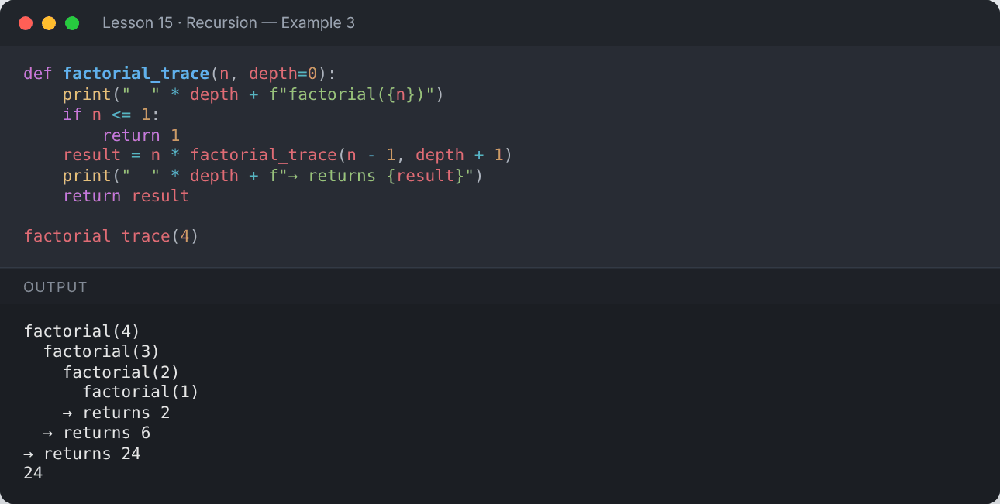

</details>

## 🐚 Fibonacci

```python
def fib(n):
    if n < 2:
        return n
    return fib(n - 1) + fib(n - 2)

print([fib(i) for i in range(10)])
```

**Output:**

```text
[0, 1, 1, 2, 3, 5, 8, 13, 21, 34]
```

<details><summary>📸 Screenshot</summary>

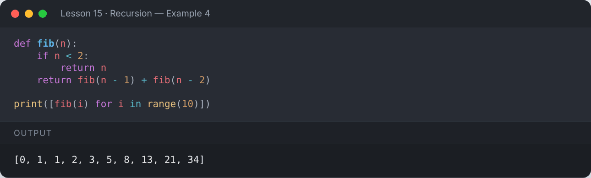

</details>

## ⚡ Memoization with `lru_cache`

Plain recursive Fibonacci recomputes the same values again and again. Caching makes it fast.

```python
from functools import lru_cache

@lru_cache(maxsize=None)
def fast_fib(n):
    if n < 2:
        return n
    return fast_fib(n - 1) + fast_fib(n - 2)

print(fast_fib(100))
```

**Output:**

```text
354224848179261915075
```

<details><summary>📸 Screenshot</summary>

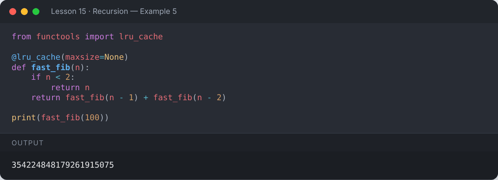

</details>

## 📚 More Examples

```python
def sum_digits(n):
    return n if n < 10 else n % 10 + sum_digits(n // 10)

def reverse(s):
    return s if len(s) <= 1 else reverse(s[1:]) + s[0]

def flatten(items):
    result = []
    for x in items:
        if isinstance(x, list):
            result.extend(flatten(x))
        else:
            result.append(x)
    return result

print(sum_digits(98765))
print(reverse("recursion"))
print(flatten([1, [2, [3, 4]], [5, [6, [7]]]]))
```

**Output:**

```text
35
noisrucer
[1, 2, 3, 4, 5, 6, 7]
```

<details><summary>📸 Screenshot</summary>

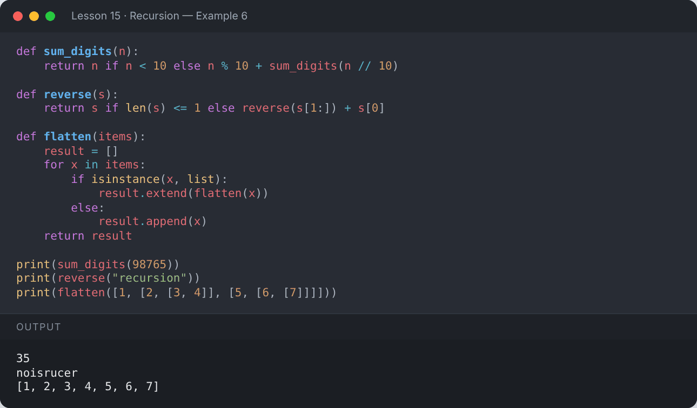

</details>

```python
def binary_search(arr, target, low=0, high=None):
    if high is None:
        high = len(arr) - 1
    if low > high:
        return -1
    mid = (low + high) // 2
    if arr[mid] == target:
        return mid
    if arr[mid] < target:
        return binary_search(arr, target, mid + 1, high)
    return binary_search(arr, target, low, mid - 1)

data = [3, 8, 15, 23, 42, 57, 91]
print("Index of 42:", binary_search(data, 42))
print("Index of 5 :", binary_search(data, 5))
```

**Output:**

```text
Index of 42: 4
Index of 5 : -1
```

<details><summary>📸 Screenshot</summary>

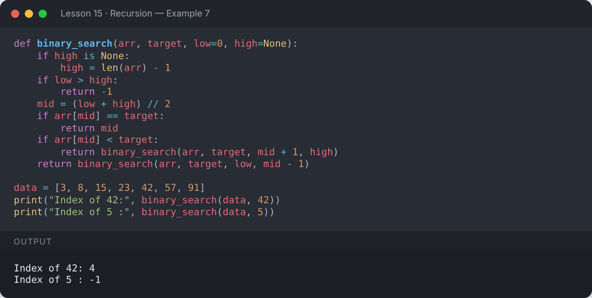

</details>

## 🚧 Recursion Limit

Python stops very deep recursion to protect memory (default limit ≈ 1000).

```python
import sys
print("Recursion limit:", sys.getrecursionlimit())
```

**Output:**

```text
Recursion limit: 1000
```

<details><summary>📸 Screenshot</summary>

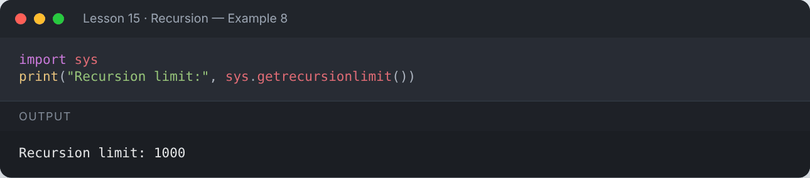

</details>

```python
def no_base_case(n):
    return no_base_case(n + 1)     # never stops!

no_base_case(1)
```

**Output:**

```text
Traceback (most recent call last):
  ...
RecursionError: maximum recursion depth exceeded
```

<details><summary>📸 Screenshot</summary>

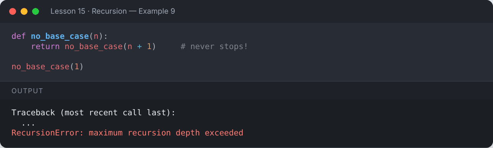

</details>

## 📌 Summary

- Recursion = function calling itself with a smaller problem.
- **Always** define a base case.
- Use `@lru_cache` to avoid repeated work.
- For very deep problems, a loop is often safer.

---

## ✍️ Exercises

Try each one yourself first, then expand the solution.

**Exercise 1 — Write a recursive function to compute `a` to the power `b`.**

<details><summary>✅ Solution</summary>

```python
def power(a, b):
    return 1 if b == 0 else a * power(a, b - 1)

print(power(2, 10))
```

**Output:**

```text
1024
```

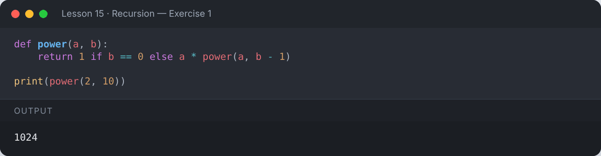

</details>

**Exercise 2 — Recursively check whether a string is a palindrome.**

<details><summary>✅ Solution</summary>

```python
def is_palindrome(s):
    if len(s) <= 1:
        return True
    return s[0] == s[-1] and is_palindrome(s[1:-1])

print(is_palindrome("racecar"), is_palindrome("python"))
```

**Output:**

```text
True False
```

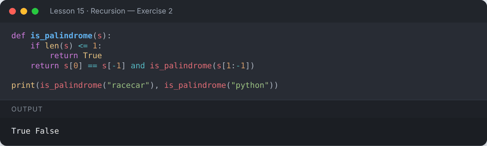

</details>

**Exercise 3 — Recursively find the sum of a list.**

<details><summary>✅ Solution</summary>

```python
def list_sum(nums):
    return 0 if not nums else nums[0] + list_sum(nums[1:])

print(list_sum([5, 10, 15, 20]))
```

**Output:**

```text
50
```

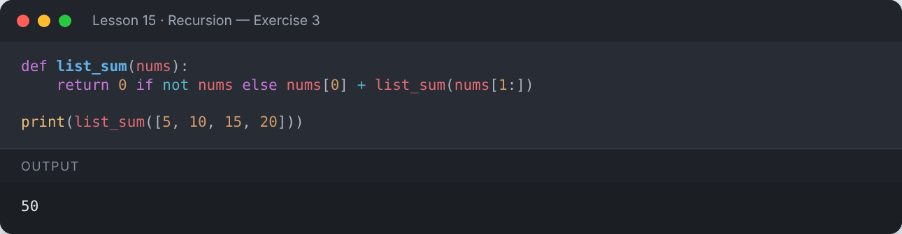

</details>

**Exercise 4 — Solve the Tower of Hanoi for 3 disks.**

<details><summary>✅ Solution</summary>

```python
def hanoi(n, source, target, helper):
    if n == 1:
        print(f"Move disk 1 from {source} to {target}")
        return
    hanoi(n - 1, source, helper, target)
    print(f"Move disk {n} from {source} to {target}")
    hanoi(n - 1, helper, target, source)

hanoi(3, "A", "C", "B")
```

**Output:**

```text
Move disk 1 from A to C
Move disk 2 from A to B
Move disk 1 from C to B
Move disk 3 from A to C
Move disk 1 from B to A
Move disk 2 from B to C
Move disk 1 from A to C
```

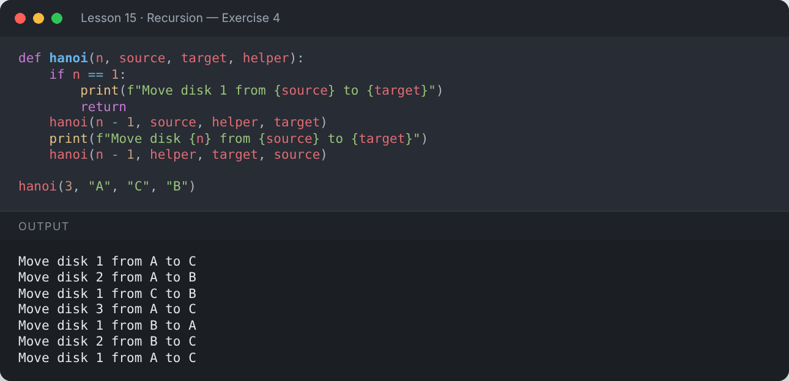

</details>

---

[⬅️ Lambda, map, filter & reduce](../14-lambda-map-filter-reduce/README.md) · [🏠 All lessons](../../README.md) · [Modules & Packages ➡️](../16-modules-and-packages/README.md)
