# Lesson 16 — Modules & Packages

> Organise code into modules, import from the standard library, create your own module and install packages with pip.

[](https://colab.research.google.com/github/MehvishKiani/Python-beginner-guide/blob/main/lessons/16-modules-and-packages/lesson.ipynb) &nbsp; 📓 [lesson.ipynb](lesson.ipynb) &nbsp; ✍️ [exercises.ipynb](exercises.ipynb)

[⬅️ Recursion](../15-recursion/README.md) · [🏠 All lessons](../../README.md) · [Exception Handling ➡️](../17-exception-handling/README.md)

---

## 🎯 Learning Objectives

- Import modules in different ways
- Explore popular standard-library modules
- Create and import your own module
- Understand packages, `__name__ == "__main__"`, `pip` and virtual environments

## 📦 What is a Module?

A **module** is simply a `.py` file containing functions, classes and variables.
A **package** is a folder of modules (traditionally with an `__init__.py` file).

## 📥 Ways to Import

```python
import math
print(math.sqrt(16))

from math import pi, factorial
print(pi, factorial(5))

import math as m
print(m.ceil(4.2), m.floor(4.8))

from random import randint as rnd
print("randint imported as rnd:", callable(rnd))
```

**Output:**

```text
4.0
3.141592653589793 120
5 4
randint imported as rnd: True
```

<details><summary>📸 Screenshot</summary>

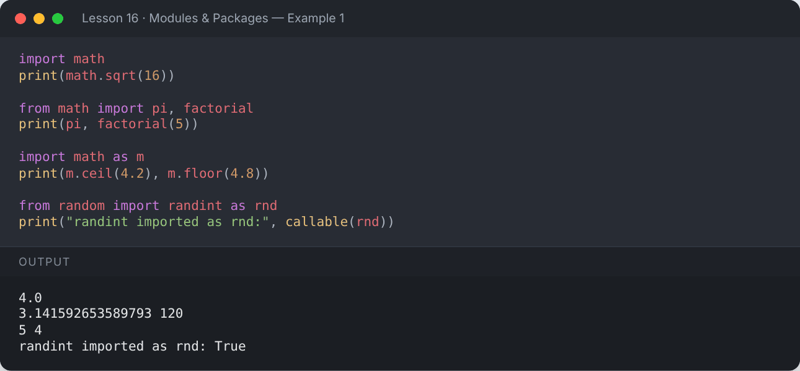

</details>

> Avoid `from module import *` — it hides where names come from.

## 🔍 Exploring a Module

```python
import math
print([name for name in dir(math) if not name.startswith("_")][:15])
```

**Output:**

```text
['acos', 'acosh', 'asin', 'asinh', 'atan', 'atan2', 'atanh', 'cbrt', 'ceil', 'comb', 'copysign', 'cos', 'cosh', 'degrees', 'dist']
```

<details><summary>📸 Screenshot</summary>

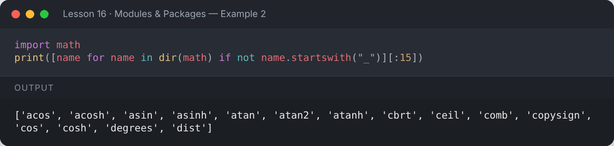

</details>

## 🧰 Popular Standard-Library Modules

### `math`

```python
import math
print("sqrt(81)  :", math.sqrt(81))
print("pow(2, 8) :", math.pow(2, 8))
print("gcd(48,18):", math.gcd(48, 18))
print("log10(1000):", math.log10(1000))
print("sin(90°)  :", math.sin(math.radians(90)))
print("pi, e     :", round(math.pi, 4), round(math.e, 4))
```

**Output:**

```text
sqrt(81)  : 9.0
pow(2, 8) : 256.0
gcd(48,18): 6
log10(1000): 3.0
sin(90°)  : 1.0
pi, e     : 3.1416 2.7183
```

<details><summary>📸 Screenshot</summary>

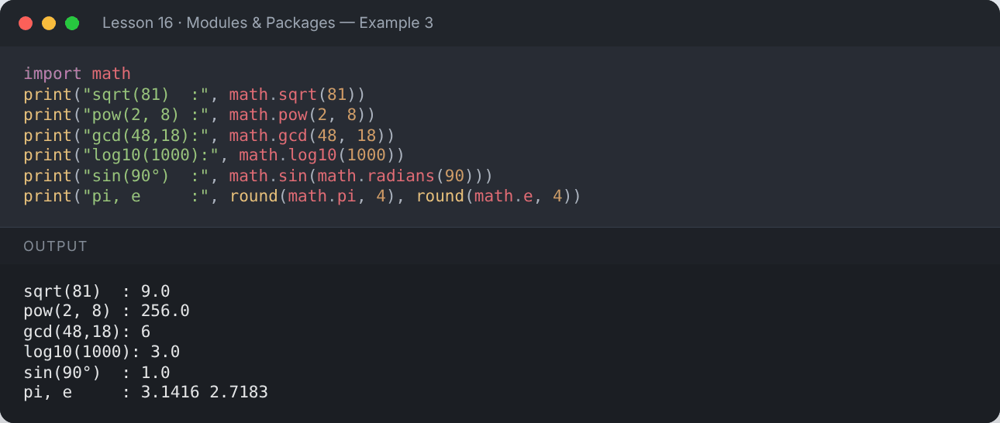

</details>

### `random`

```python
import random
random.seed(42)                     # makes the results repeatable
print("random()        :", random.random())
print("randint(1, 6)   :", random.randint(1, 6))
print("choice          :", random.choice(["rock", "paper", "scissors"]))
cards = [1, 2, 3, 4, 5]
random.shuffle(cards)
print("shuffle         :", cards)
print("sample(3)       :", random.sample(range(1, 50), 3))
```

**Output:**

```text
random()        : 0.6394267984578837
randint(1, 6)   : 1
choice          : scissors
shuffle         : [4, 5, 1, 2, 3]
sample(3)       : [48, 7, 44]
```

<details><summary>📸 Screenshot</summary>

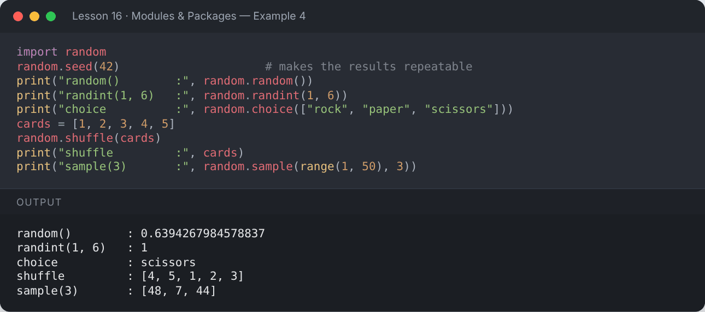

</details>

### `datetime`

```python
from datetime import date, datetime, timedelta
d = date(2026, 10, 12)
print("Date      :", d)
print("Weekday   :", d.strftime("%A"))
print("+30 days  :", d + timedelta(days=30))
dt = datetime(2026, 10, 12, 14, 30)
print("Formatted :", dt.strftime("%d %B %Y, %I:%M %p"))
print("Parsed    :", datetime.strptime("25/12/2026", "%d/%m/%Y").date())
```

**Output:**

```text
Date      : 2026-10-12
Weekday   : Monday
+30 days  : 2026-11-11
Formatted : 12 October 2026, 02:30 PM
Parsed    : 2026-12-25
```

<details><summary>📸 Screenshot</summary>

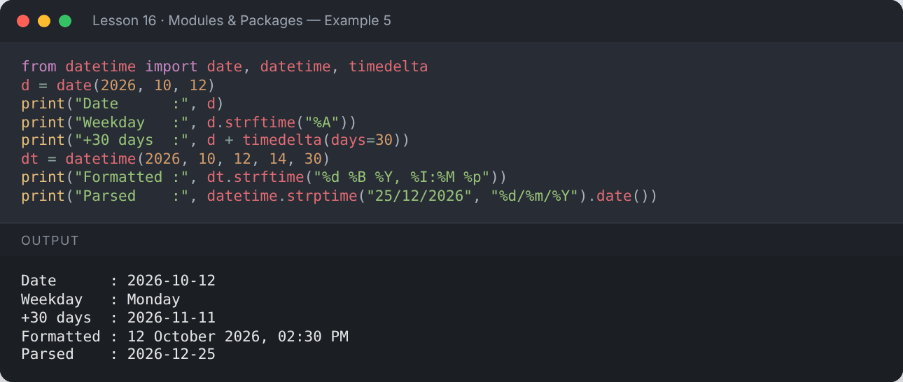

</details>

### `os` and `sys`

```python
import os, sys
print("Python version:", sys.version.split()[0])
print("Path separator:", os.sep)
print("Current folder exists:", os.path.exists(os.getcwd()))
print("Join paths:", os.path.join("data", "files", "report.csv"))
```

**Output:**

```text
Python version: 3.13.16
Path separator: /
Current folder exists: True
Join paths: data/files/report.csv
```

<details><summary>📸 Screenshot</summary>

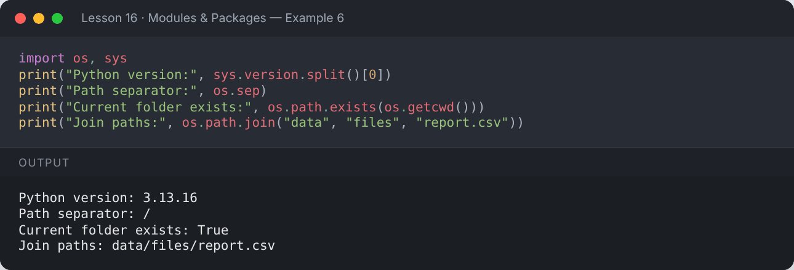

</details>

### `collections`

```python
from collections import Counter, defaultdict, namedtuple, deque

print(Counter("mississippi").most_common(2))

groups = defaultdict(list)
for name in ["Ali", "Amna", "Bilal", "Bushra", "Sara"]:
    groups[name[0]].append(name)
print(dict(groups))

Point = namedtuple("Point", ["x", "y"])
p = Point(3, 4)
print(p, p.x)

q = deque([1, 2, 3])
q.appendleft(0); q.append(4)
print(q)
```

**Output:**

```text
[('i', 4), ('s', 4)]
{'A': ['Ali', 'Amna'], 'B': ['Bilal', 'Bushra'], 'S': ['Sara']}
Point(x=3, y=4) 3
deque([0, 1, 2, 3, 4])
```

<details><summary>📸 Screenshot</summary>

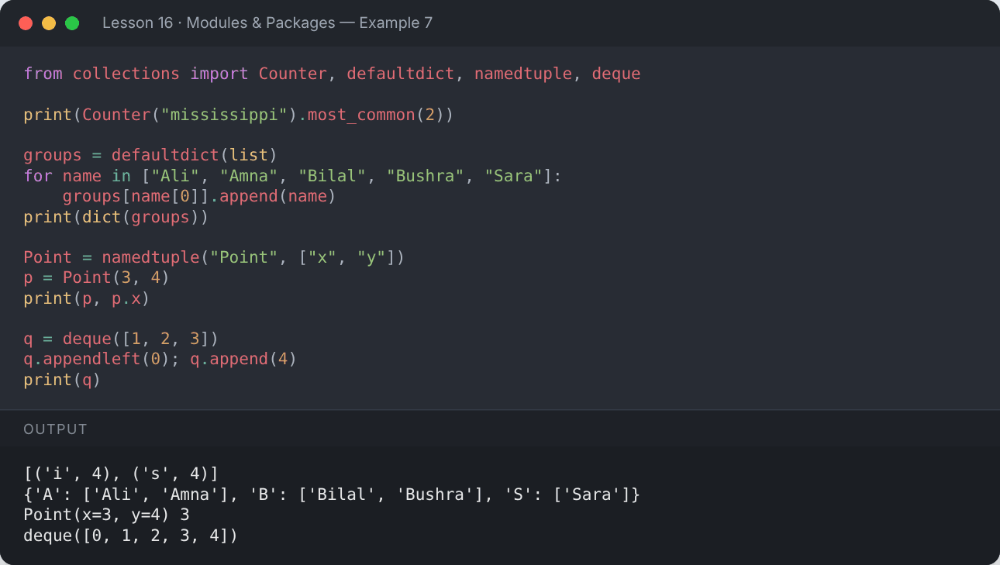

</details>

## 🛠️ Creating Your Own Module

Save functions in a file, e.g. `mytools.py`, then import it from another file in the same folder.

```python
code = '''"""mytools — a tiny helper module."""

PI = 3.14159

def area_of_circle(r):
    return PI * r * r

def greet(name):
    return f"Hello, {name}!"

if __name__ == "__main__":
    print("Running mytools directly")
'''
with open("mytools.py", "w") as f:
    f.write(code)
print("mytools.py created")
```

**Output:**

```text
mytools.py created
```

<details><summary>📸 Screenshot</summary>

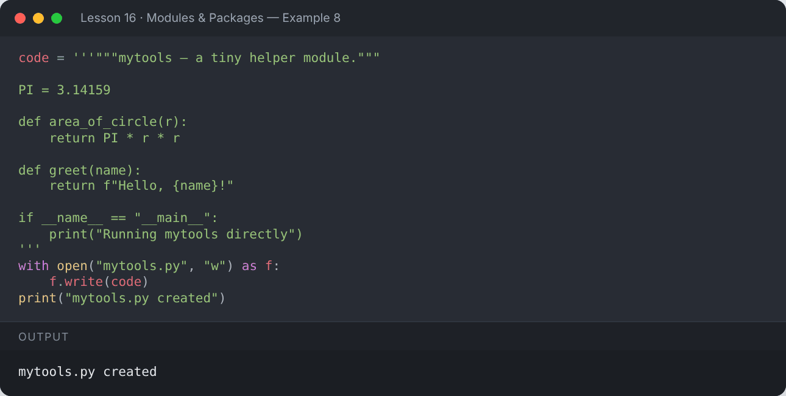

</details>

```python
import mytools
print(mytools.greet("Mehvish"))
print(mytools.area_of_circle(2))
print(mytools.__doc__)
```

**Output:**

```text
Hello, Mehvish!
12.56636
mytools — a tiny helper module.
```

<details><summary>📸 Screenshot</summary>

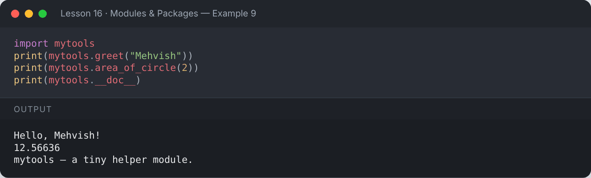

</details>

### `if __name__ == "__main__":`

Code inside this block runs only when the file is executed **directly** (`python mytools.py`), not when it is imported.
That's why `"Running mytools directly"` was **not** printed above.

```python
print("In this notebook, __name__ is:", __name__)
print("Inside the module, __name__ is:", mytools.__name__)
```

**Output:**

```text
In this notebook, __name__ is: __main__
Inside the module, __name__ is: mytools
```

<details><summary>📸 Screenshot</summary>

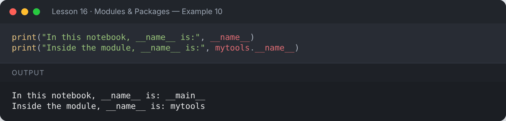

</details>

## 📁 Packages

```
shapes/
├── __init__.py
├── circle.py
└── square.py
```

```python
import os
os.makedirs("shapes", exist_ok=True)
open("shapes/__init__.py", "w").write('from .circle import area as circle_area\n')
open("shapes/circle.py", "w").write('def area(r):\n    return round(3.14159 * r * r, 2)\n')
open("shapes/square.py", "w").write('def area(s):\n    return s * s\n')

from shapes import circle_area
from shapes.square import area as square_area
print("Circle:", circle_area(3))
print("Square:", square_area(4))
```

**Output:**

```text
Circle: 28.27
Square: 16
```

<details><summary>📸 Screenshot</summary>

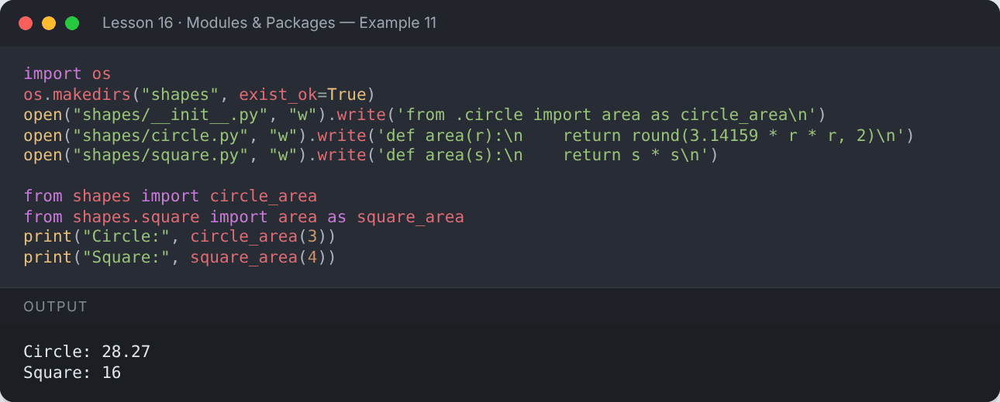

</details>

## 🌐 Installing Packages with `pip`

Third-party packages come from [PyPI](https://pypi.org/). Run these in a **terminal**:

```bash
pip install requests          # install
pip install numpy==2.1.0      # specific version
pip list                      # what's installed
pip freeze > requirements.txt # save dependencies
pip install -r requirements.txt
pip uninstall requests
```

## 🧪 Virtual Environments

Keep each project's packages separate:

```bash
python -m venv .venv
# Windows:      .venv\Scripts\activate
# macOS/Linux:  source .venv/bin/activate
pip install -r requirements.txt
deactivate
```

## 📌 Summary

- `import x`, `from x import y`, `import x as z`.
- The standard library covers math, randomness, dates, files, OS, collections and much more.
- Any `.py` file is a module; a folder of modules is a package.
- Use `pip` + virtual environments for third-party packages.

---

## ✍️ Exercises

Try each one yourself first, then expand the solution.

**Exercise 1 — Use `random` to simulate rolling two dice 5 times (use a seed).**

<details><summary>✅ Solution</summary>

```python
import random
random.seed(7)
for roll in range(1, 6):
    d1, d2 = random.randint(1, 6), random.randint(1, 6)
    print(f"Roll {roll}: {d1} + {d2} = {d1 + d2}")
```

**Output:**

```text
Roll 1: 3 + 2 = 5
Roll 2: 4 + 6 = 10
Roll 3: 1 + 1 = 2
Roll 4: 5 + 1 = 6
Roll 5: 3 + 5 = 8
```

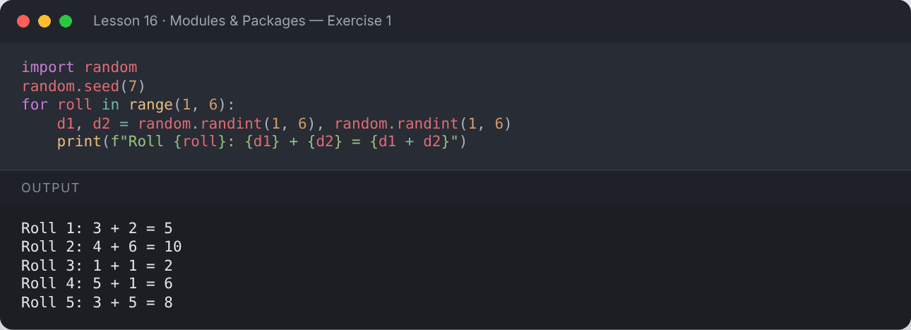

</details>

**Exercise 2 — Calculate your age in days from a birth date using `datetime`.**

<details><summary>✅ Solution</summary>

```python
from datetime import date
birth = date(2004, 3, 15)
today = date(2026, 10, 12)
print("Age in days:", (today - birth).days)
```

**Output:**

```text
Age in days: 8246
```

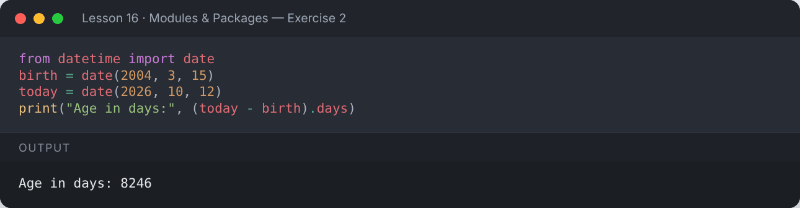

</details>

**Exercise 3 — Use `math` to compute the hypotenuse of a right triangle with sides 3 and 4.**

<details><summary>✅ Solution</summary>

```python
import math
print(math.hypot(3, 4))
```

**Output:**

```text
5.0
```

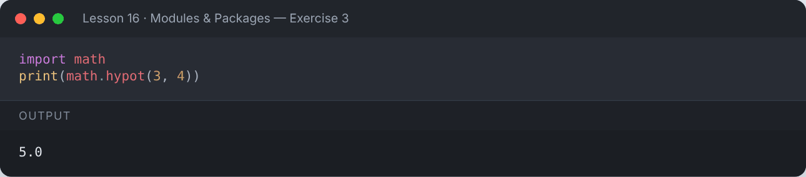

</details>

**Exercise 4 — Use `Counter` to find the 3 most common letters in a sentence.**

<details><summary>✅ Solution</summary>

```python
from collections import Counter
text = "python programming is powerful"
print(Counter(text.replace(" ", "")).most_common(3))
```

**Output:**

```text
[('p', 3), ('o', 3), ('r', 3)]
```

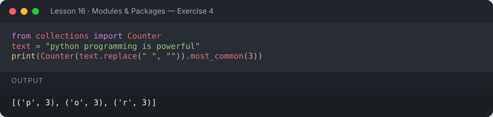

</details>

---

[⬅️ Recursion](../15-recursion/README.md) · [🏠 All lessons](../../README.md) · [Exception Handling ➡️](../17-exception-handling/README.md)
