# Lesson 17 — Exception Handling

> Handle errors gracefully with try, except, else and finally — and raise your own exceptions.

[](https://colab.research.google.com/github/MehvishKiani/Python-beginner-guide/blob/main/lessons/17-exception-handling/lesson.ipynb) &nbsp; 📓 [lesson.ipynb](lesson.ipynb) &nbsp; ✍️ [exercises.ipynb](exercises.ipynb)

[⬅️ Modules & Packages](../16-modules-and-packages/README.md) · [🏠 All lessons](../../README.md) · [File Handling ➡️](../18-file-handling/README.md)

---

## 🎯 Learning Objectives

- Tell the difference between syntax errors and exceptions
- Catch exceptions with `try` / `except`
- Use `else` and `finally`
- Raise exceptions and create custom exception classes

## 💥 Errors vs Exceptions

- **Syntax errors** — the code is not valid Python, so it can't run at all.
- **Exceptions** — errors that happen **while** the program runs.

| Exception | When it happens |
|---|---|
| `ZeroDivisionError` | dividing by zero |
| `ValueError` | right type, wrong value — `int("abc")` |
| `TypeError` | wrong type — `"5" + 5` |
| `IndexError` | list index out of range |
| `KeyError` | missing dictionary key |
| `FileNotFoundError` | file does not exist |
| `NameError` | variable is not defined |
| `AttributeError` | object has no such attribute |

```python
result = 10 / 0
```

**Output:**

```text
Traceback (most recent call last):
  ...
ZeroDivisionError: division by zero
```

<details><summary>📸 Screenshot</summary>

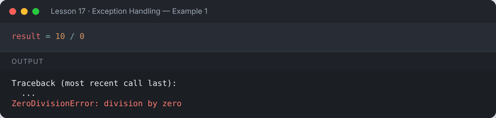

</details>

```python
print("Age: " + 25)
```

**Output:**

```text
Traceback (most recent call last):
  ...
TypeError: can only concatenate str (not "int") to str
```

<details><summary>📸 Screenshot</summary>

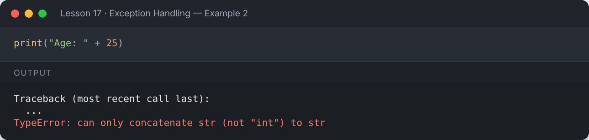

</details>

## 🛡️ `try` / `except`

```python
try:
    result = 10 / 0
except ZeroDivisionError:
    print("You can't divide by zero!")
print("Program continues normally ✅")
```

**Output:**

```text
You can't divide by zero!
Program continues normally ✅
```

<details><summary>📸 Screenshot</summary>

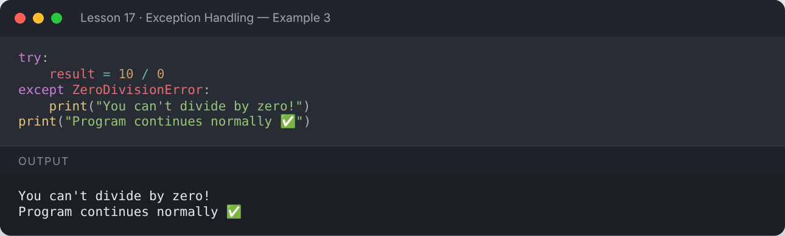

</details>

### Catching specific exceptions

```python
def safe_divide(a, b):
    try:
        return a / b
    except ZeroDivisionError:
        return "Error: division by zero"
    except TypeError:
        return "Error: numbers only"

print(safe_divide(10, 2))
print(safe_divide(10, 0))
print(safe_divide(10, "x"))
```

**Output:**

```text
5.0
Error: division by zero
Error: numbers only
```

<details><summary>📸 Screenshot</summary>

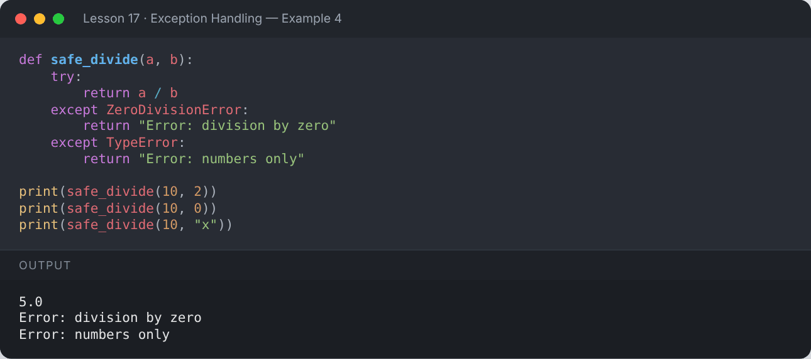

</details>

### Accessing the error message & catching several at once

```python
for value in ["42", "abc", None]:
    try:
        print(int(value) * 2)
    except (ValueError, TypeError) as e:
        print(f"{type(e).__name__}: {e}")
```

**Output:**

```text
84
ValueError: invalid literal for int() with base 10: 'abc'
TypeError: int() argument must be a string, a bytes-like object or a real number, not 'NoneType'
```

<details><summary>📸 Screenshot</summary>

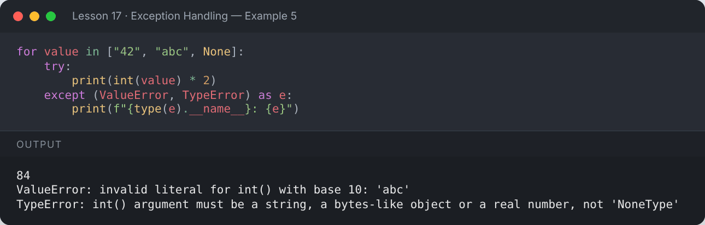

</details>

## ✅ `else` and 🧹 `finally`

- `else` runs if **no** exception happened.
- `finally` **always** runs — perfect for clean-up (closing files, connections).

```python
def read_number(text):
    try:
        n = int(text)
    except ValueError:
        print(f"'{text}' is not a number")
    else:
        print(f"Converted successfully: {n}")
    finally:
        print("— finished checking —")

read_number("15")
read_number("fifteen")
```

**Output:**

```text
Converted successfully: 15
— finished checking —
'fifteen' is not a number
— finished checking —
```

<details><summary>📸 Screenshot</summary>

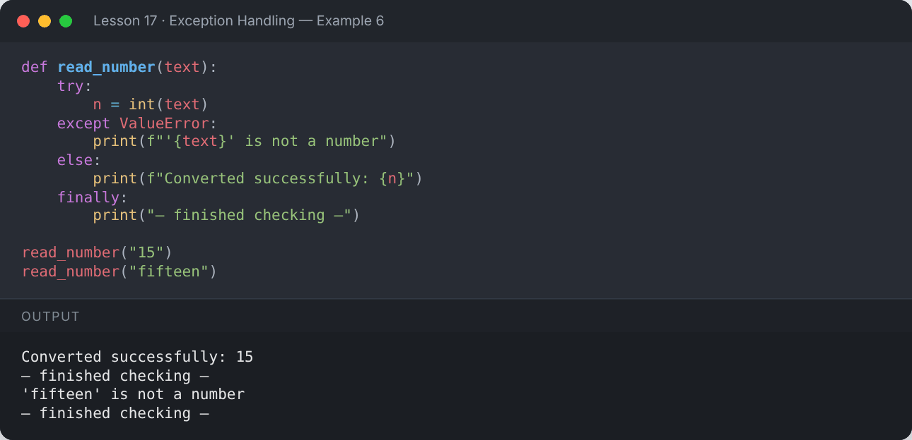

</details>

## 🔁 Input validation loop

```python
while True:
    try:
        age = int(input("Enter your age: "))
        if age < 0:
            print("Age cannot be negative")
            continue
        break
    except ValueError:
        print("Please enter a whole number")
print("Your age is", age)
```

**Output:**

```text
Enter your age: abc
Please enter a whole number
Enter your age: -5
Age cannot be negative
Enter your age: 21
Your age is 21
```

<details><summary>📸 Screenshot</summary>

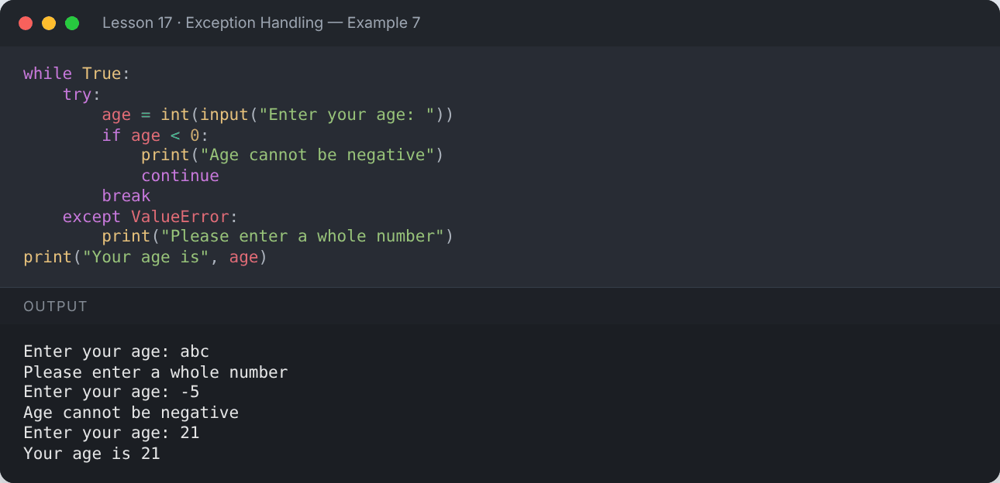

</details>

## 🚨 Raising Exceptions — `raise`

```python
def withdraw(balance, amount):
    if amount <= 0:
        raise ValueError("Amount must be positive")
    if amount > balance:
        raise ValueError(f"Insufficient funds: balance is {balance}")
    return balance - amount

for amt in (500, -10, 5000):
    try:
        print("New balance:", withdraw(1000, amt))
    except ValueError as e:
        print("Error:", e)
```

**Output:**

```text
New balance: 500
Error: Amount must be positive
Error: Insufficient funds: balance is 1000
```

<details><summary>📸 Screenshot</summary>

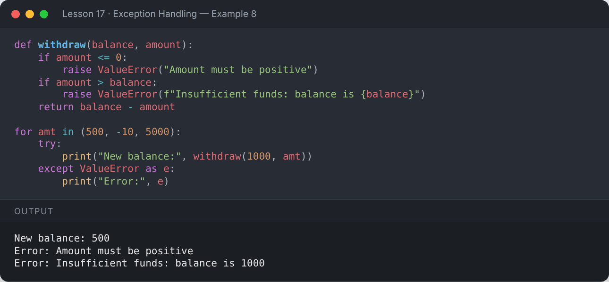

</details>

## 🧩 Custom Exceptions

```python
class InvalidMarksError(Exception):
    """Raised when marks are outside 0–100."""
    def __init__(self, marks):
        super().__init__(f"Marks must be between 0 and 100, got {marks}")
        self.marks = marks

def set_marks(m):
    if not 0 <= m <= 100:
        raise InvalidMarksError(m)
    return m

try:
    set_marks(120)
except InvalidMarksError as e:
    print("Custom error caught:", e)
```

**Output:**

```text
Custom error caught: Marks must be between 0 and 100, got 120
```

<details><summary>📸 Screenshot</summary>

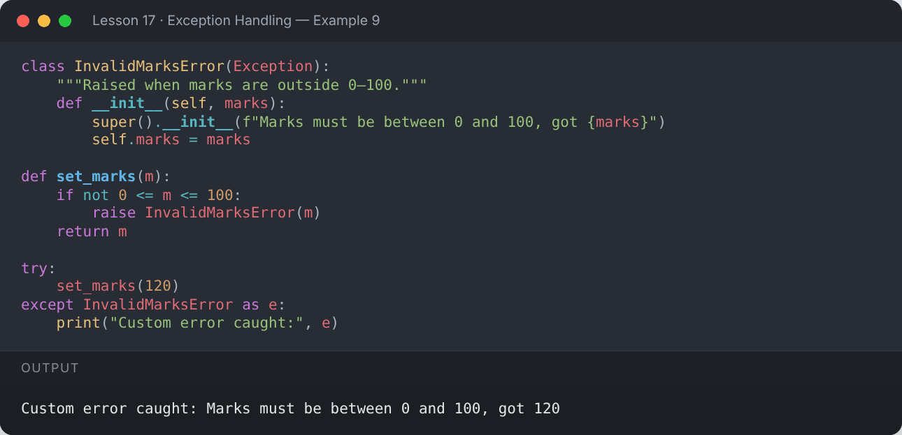

</details>

## ✔️ `assert` — quick sanity checks (for debugging)

```python
def average(nums):
    assert len(nums) > 0, "List must not be empty"
    return sum(nums) / len(nums)

print(average([2, 4, 6]))
average([])
```

**Output:**

```text
4.0
Traceback (most recent call last):
  ...
AssertionError: List must not be empty
```

<details><summary>📸 Screenshot</summary>

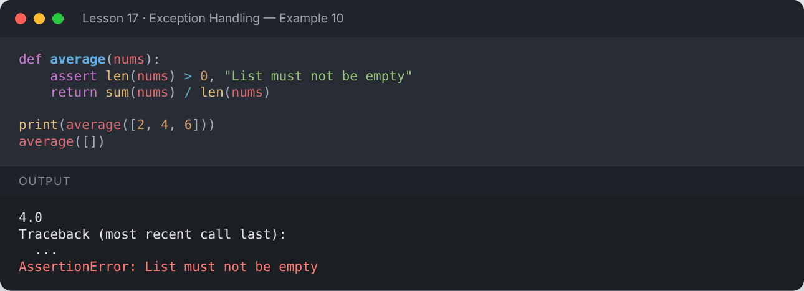

</details>

## 🌳 Exception Hierarchy (partial)

```
BaseException
 └── Exception
      ├── ArithmeticError → ZeroDivisionError
      ├── LookupError     → IndexError, KeyError
      ├── ValueError
      ├── TypeError
      └── OSError         → FileNotFoundError
```

Catching a parent class catches its children too:

```python
try:
    [1, 2, 3][10]
except LookupError as e:
    print("Caught by parent class:", type(e).__name__)
```

**Output:**

```text
Caught by parent class: IndexError
```

<details><summary>📸 Screenshot</summary>

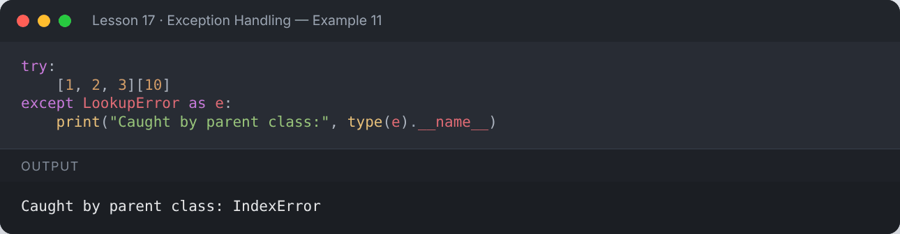

</details>

## 📌 Summary

- Wrap risky code in `try`, handle it in `except`.
- Catch **specific** exceptions — avoid bare `except:`.
- `else` = success path, `finally` = always runs.
- `raise` your own errors; subclass `Exception` for custom ones.

---

## ✍️ Exercises

Try each one yourself first, then expand the solution.

**Exercise 1 — Ask the user for two numbers and divide them, handling bad input and division by zero.**

<details><summary>✅ Solution</summary>

```python
try:
    a = float(input("Numerator: "))
    b = float(input("Denominator: "))
    print("Result:", a / b)
except ValueError:
    print("Please enter numbers only")
except ZeroDivisionError:
    print("Denominator cannot be zero")
```

**Output:**

```text
Numerator: 20
Denominator: 0
Denominator cannot be zero
```

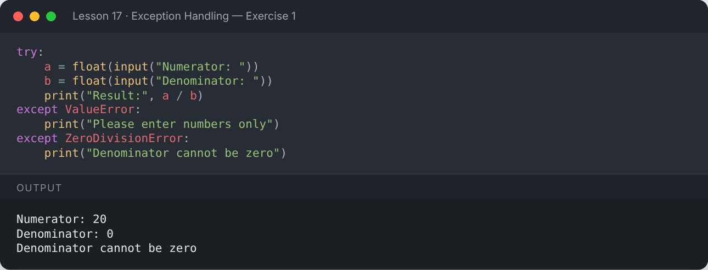

</details>

**Exercise 2 — Safely get an item from a list by index; return `None` if out of range.**

<details><summary>✅ Solution</summary>

```python
def safe_get(items, i):
    try:
        return items[i]
    except IndexError:
        return None

print(safe_get([10, 20, 30], 1), safe_get([10, 20, 30], 7))
```

**Output:**

```text
20 None
```

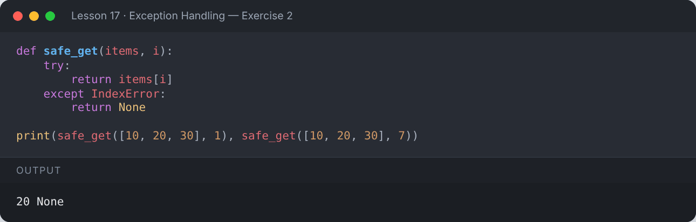

</details>

**Exercise 3 — Create a custom `NegativeNumberError` and use it in a square-root function.**

<details><summary>✅ Solution</summary>

```python
import math

class NegativeNumberError(Exception):
    pass

def square_root(x):
    if x < 0:
        raise NegativeNumberError("Cannot take the square root of a negative number")
    return math.sqrt(x)

for n in (49, -4):
    try:
        print(square_root(n))
    except NegativeNumberError as e:
        print("Error:", e)
```

**Output:**

```text
7.0
Error: Cannot take the square root of a negative number
```

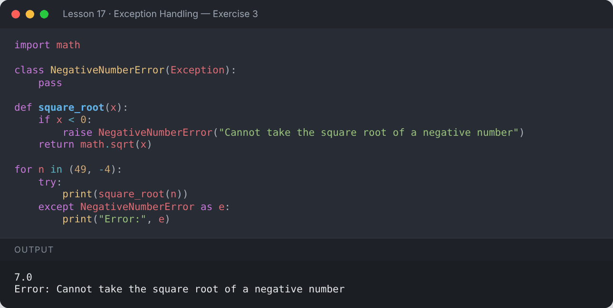

</details>

---

[⬅️ Modules & Packages](../16-modules-and-packages/README.md) · [🏠 All lessons](../../README.md) · [File Handling ➡️](../18-file-handling/README.md)
