# Lesson 18 — File Handling

> Read and write text, CSV and JSON files safely with open(), the with statement and pathlib.

[](https://colab.research.google.com/github/MehvishKiani/Python-beginner-guide/blob/main/lessons/18-file-handling/lesson.ipynb) &nbsp; 📓 [lesson.ipynb](lesson.ipynb) &nbsp; ✍️ [exercises.ipynb](exercises.ipynb)

[⬅️ Exception Handling](../17-exception-handling/README.md) · [🏠 All lessons](../../README.md) · [OOP — Classes & Objects ➡️](../19-oop-classes-and-objects/README.md)

---

## 🎯 Learning Objectives

- Open files in different modes
- Read and write text files with `with`
- Work with CSV and JSON files
- Manage files and folders with `os` and `pathlib`

## 📂 File Modes

| Mode | Meaning |
|---|---|
| `"r"` | read (default) — error if file doesn't exist |
| `"w"` | write — creates the file or **overwrites** it |
| `"a"` | append — adds to the end |
| `"x"` | create — error if the file already exists |
| `"r+"` | read and write |
| `"b"` | binary mode, e.g. `"rb"`, `"wb"` |

## ✍️ Writing a File

The `with` statement closes the file automatically — even if an error happens.

```python
with open("notes.txt", "w", encoding="utf-8") as file:
    file.write("Python File Handling\n")
    file.write("Line 2: writing files is easy\n")
    file.writelines(["Line 3\n", "Line 4\n"])
print("File written ✅")
```

**Output:**

```text
File written ✅
```

<details><summary>📸 Screenshot</summary>

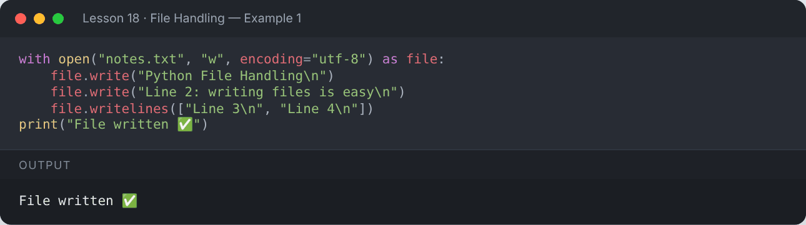

</details>

## 📖 Reading a File

```python
with open("notes.txt", "r", encoding="utf-8") as file:
    content = file.read()          # whole file as one string
print(content)
```

**Output:**

```text
Python File Handling
Line 2: writing files is easy
Line 3
Line 4
```

<details><summary>📸 Screenshot</summary>

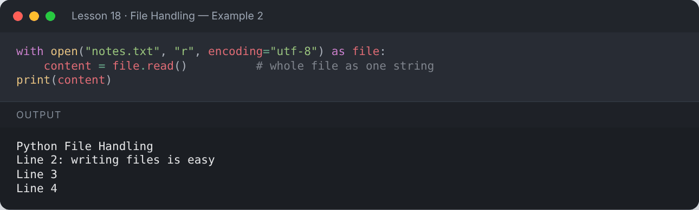

</details>

```python
with open("notes.txt", encoding="utf-8") as file:
    for line_no, line in enumerate(file, start=1):   # line by line (memory friendly)
        print(line_no, line.strip())
```

**Output:**

```text
1 Python File Handling
2 Line 2: writing files is easy
3 Line 3
4 Line 4
```

<details><summary>📸 Screenshot</summary>

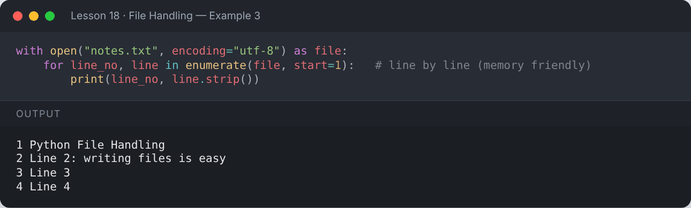

</details>

```python
with open("notes.txt", encoding="utf-8") as file:
    first = file.readline()        # one line
    rest = file.readlines()        # list of remaining lines
print("First line:", first.strip())
print("Remaining :", rest)
```

**Output:**

```text
First line: Python File Handling
Remaining : ['Line 2: writing files is easy\n', 'Line 3\n', 'Line 4\n']
```

<details><summary>📸 Screenshot</summary>

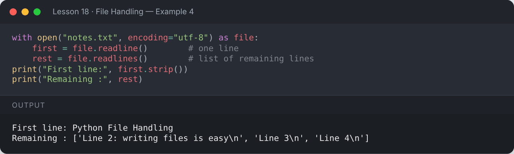

</details>

## ➕ Appending

```python
with open("notes.txt", "a", encoding="utf-8") as file:
    file.write("Line 5: appended later\n")

with open("notes.txt", encoding="utf-8") as file:
    print(file.read())
```

**Output:**

```text
Python File Handling
Line 2: writing files is easy
Line 3
Line 4
Line 5: appended later
```

<details><summary>📸 Screenshot</summary>

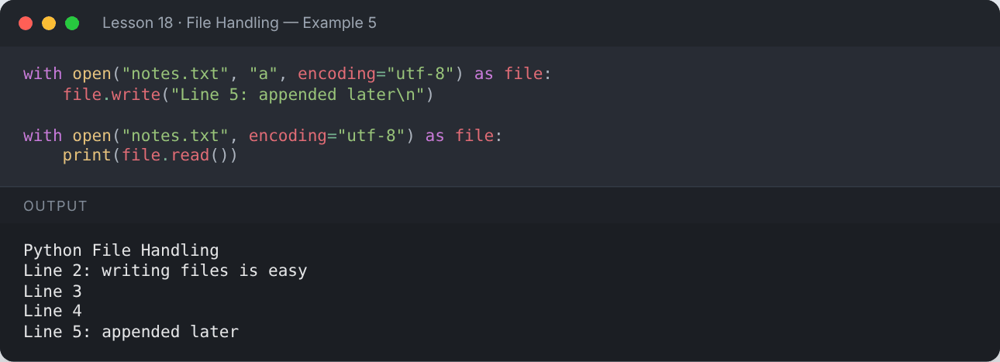

</details>

## 🧭 File Pointer — `tell()` and `seek()`

```python
with open("notes.txt", encoding="utf-8") as f:
    print(f.read(6))
    print("Position:", f.tell())
    f.seek(0)
    print("After seek(0):", f.read(6))
```

**Output:**

```text
Python
Position: 6
After seek(0): Python
```

<details><summary>📸 Screenshot</summary>

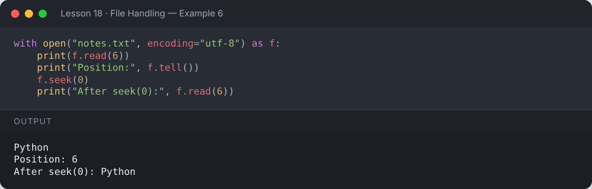

</details>

## ❗ Handling a Missing File

```python
try:
    with open("does_not_exist.txt") as f:
        print(f.read())
except FileNotFoundError as e:
    print("Oops:", e)
```

**Output:**

```text
Oops: [Errno 2] No such file or directory: 'does_not_exist.txt'
```

<details><summary>📸 Screenshot</summary>

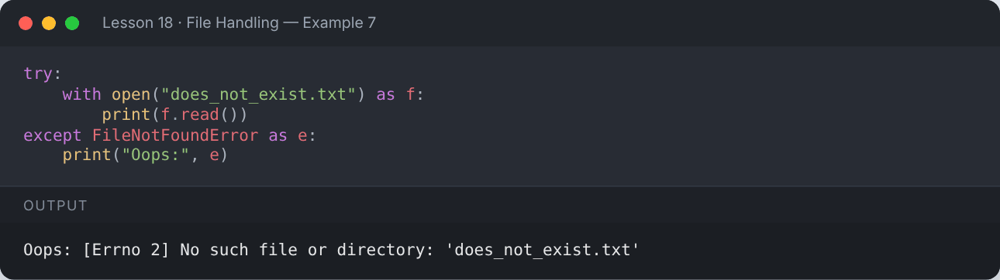

</details>

## 📊 CSV Files

```python
import csv

students = [
    ["name", "age", "grade"],
    ["Ali", 20, "A"],
    ["Sara", 21, "B"],
    ["Zain", 19, "A"],
]
with open("students.csv", "w", newline="", encoding="utf-8") as f:
    csv.writer(f).writerows(students)

with open("students.csv", encoding="utf-8") as f:
    for row in csv.reader(f):
        print(row)
```

**Output:**

```text
['name', 'age', 'grade']
['Ali', '20', 'A']
['Sara', '21', 'B']
['Zain', '19', 'A']
```

<details><summary>📸 Screenshot</summary>

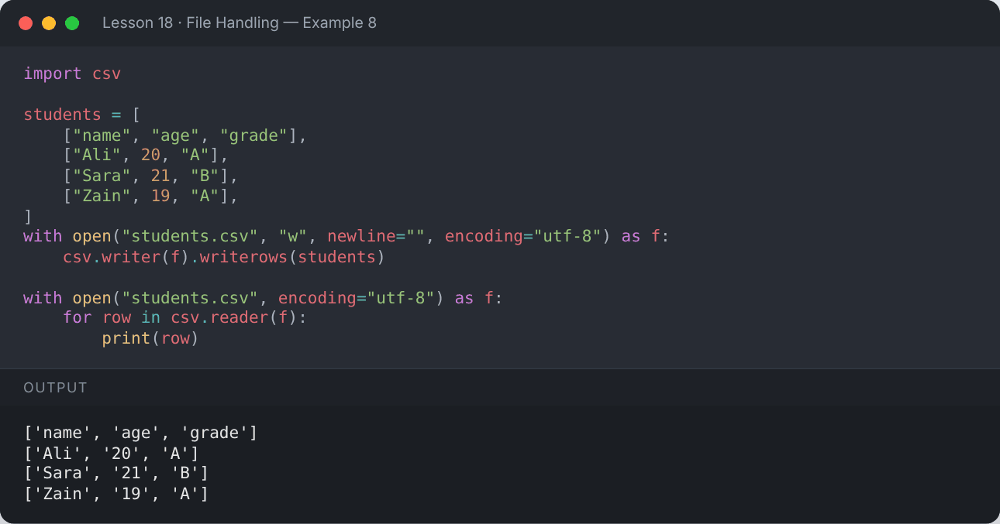

</details>

```python
import csv
with open("students.csv", encoding="utf-8") as f:
    for row in csv.DictReader(f):          # each row becomes a dict
        print(f"{row['name']} (age {row['age']}) got {row['grade']}")
```

**Output:**

```text
Ali (age 20) got A
Sara (age 21) got B
Zain (age 19) got A
```

<details><summary>📸 Screenshot</summary>

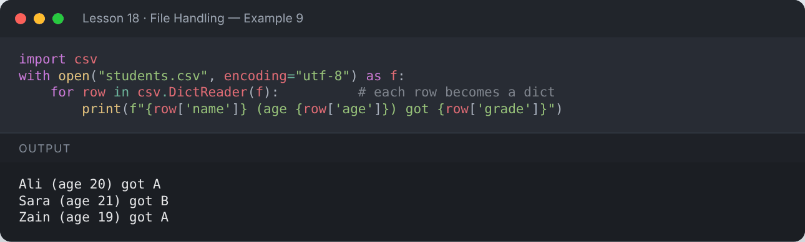

</details>

## 🧾 JSON Files

```python
import json

profile = {"name": "Mehvish", "skills": ["Python", "ML", "SQL"], "active": True}
with open("profile.json", "w", encoding="utf-8") as f:
    json.dump(profile, f, indent=2)

with open("profile.json", encoding="utf-8") as f:
    loaded = json.load(f)
print(loaded)
print(loaded["skills"][0])
print(json.dumps(profile))       # dict → JSON string
```

**Output:**

```text
{'name': 'Mehvish', 'skills': ['Python', 'ML', 'SQL'], 'active': True}
Python
{"name": "Mehvish", "skills": ["Python", "ML", "SQL"], "active": true}
```

<details><summary>📸 Screenshot</summary>

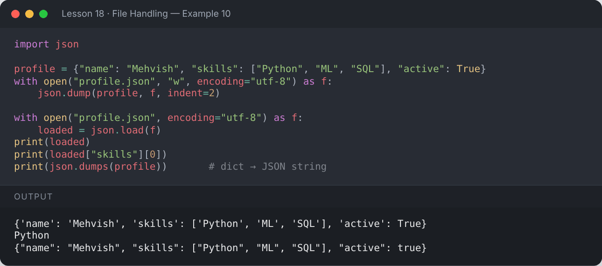

</details>

## 🗂️ Files & Folders with `pathlib` (modern) and `os`

```python
from pathlib import Path

folder = Path("reports")
folder.mkdir(exist_ok=True)
(folder / "jan.txt").write_text("January report")
(folder / "feb.txt").write_text("February report")

for p in sorted(folder.glob("*.txt")):
    print(p.name, "|", p.stem, "|", p.suffix, "|", p.read_text())

print("Exists:", Path("notes.txt").exists())
print("Size  :", Path("notes.txt").stat().st_size, "bytes")
```

**Output:**

```text
feb.txt | feb | .txt | February report
jan.txt | jan | .txt | January report
Exists: True
Size  : 88 bytes
```

<details><summary>📸 Screenshot</summary>

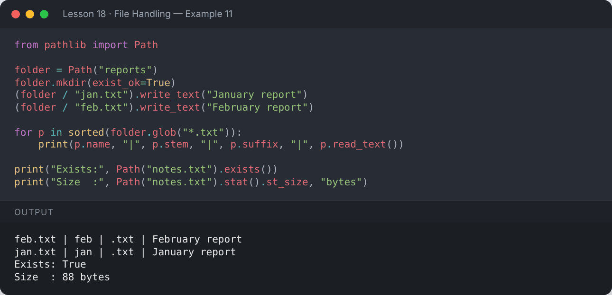

</details>

```python
import os
os.rename("notes.txt", "notes_backup.txt")
print("Renamed:", os.path.exists("notes_backup.txt"))
os.remove("notes_backup.txt")
print("Deleted:", not os.path.exists("notes_backup.txt"))
```

**Output:**

```text
Renamed: True
Deleted: True
```

<details><summary>📸 Screenshot</summary>

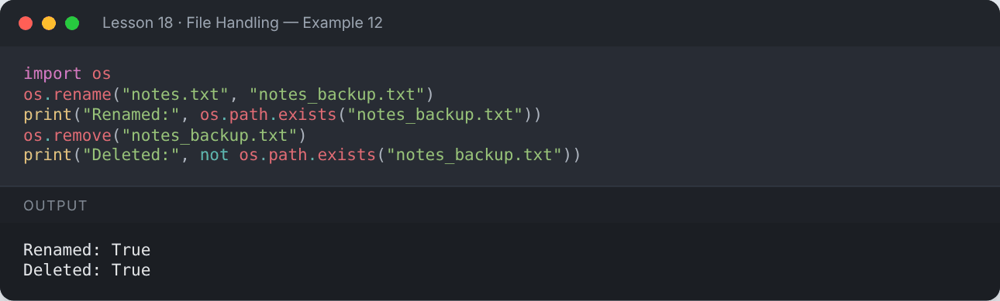

</details>

## 📌 Summary

- Always use `with open(...) as f:` — it closes the file for you.
- `"w"` overwrites, `"a"` appends, `"r"` reads.
- Use `csv` for spreadsheets and `json` for structured data.
- `pathlib.Path` is the modern way to handle paths.

---

## ✍️ Exercises

Try each one yourself first, then expand the solution.

**Exercise 1 — Write 5 numbers to a file (one per line), then read them back and print their sum.**

<details><summary>✅ Solution</summary>

```python
with open("numbers.txt", "w") as f:
    for n in [10, 20, 30, 40, 50]:
        f.write(f"{n}\n")

with open("numbers.txt") as f:
    print("Sum:", sum(int(line) for line in f))
```

**Output:**

```text
Sum: 150
```

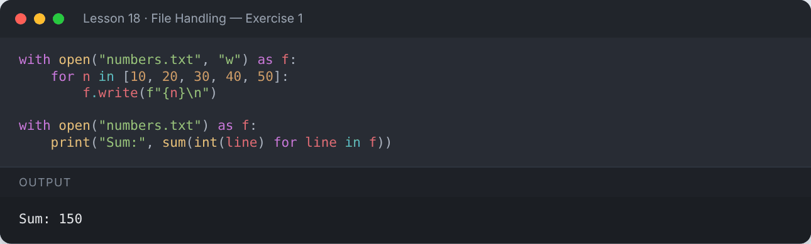

</details>

**Exercise 2 — Count the lines, words and characters in a file.**

<details><summary>✅ Solution</summary>

```python
text = "Python is easy.\nFiles are fun.\nKeep practicing!\n"
with open("sample.txt", "w") as f:
    f.write(text)

with open("sample.txt") as f:
    data = f.read()
print("Lines:", data.count("\n"), "| Words:", len(data.split()), "| Characters:", len(data))
```

**Output:**

```text
Lines: 3 | Words: 8 | Characters: 48
```

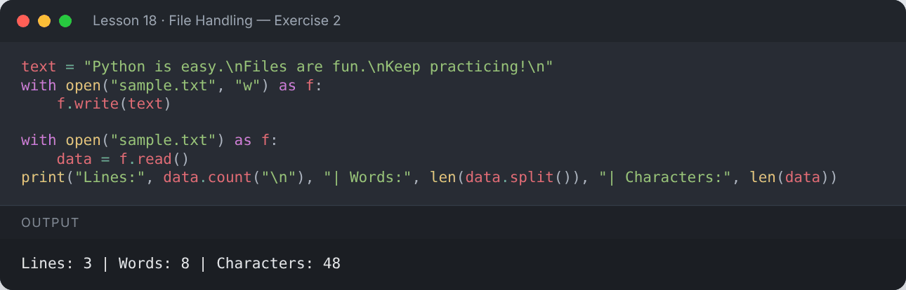

</details>

**Exercise 3 — Save a list of dictionaries to JSON and find the average marks after loading.**

<details><summary>✅ Solution</summary>

```python
import json
records = [{"name": "Ali", "marks": 80}, {"name": "Sara", "marks": 92}]
with open("records.json", "w") as f:
    json.dump(records, f)
with open("records.json") as f:
    data = json.load(f)
print("Average:", sum(r["marks"] for r in data) / len(data))
```

**Output:**

```text
Average: 86.0
```

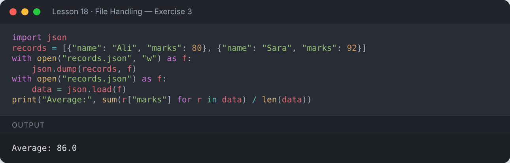

</details>

---

[⬅️ Exception Handling](../17-exception-handling/README.md) · [🏠 All lessons](../../README.md) · [OOP — Classes & Objects ➡️](../19-oop-classes-and-objects/README.md)
