# Lesson 19 — OOP — Classes & Objects

> Model real-world things with classes: attributes, methods, constructors and the self keyword.

[](https://colab.research.google.com/github/MehvishKiani/Python-beginner-guide/blob/main/lessons/19-oop-classes-and-objects/lesson.ipynb) &nbsp; 📓 [lesson.ipynb](lesson.ipynb) &nbsp; ✍️ [exercises.ipynb](exercises.ipynb)

[⬅️ File Handling](../18-file-handling/README.md) · [🏠 All lessons](../../README.md) · [OOP — Inheritance & Polymorphism ➡️](../20-oop-inheritance-and-polymorphism/README.md)

---

## 🎯 Learning Objectives

- Understand classes, objects and the 4 pillars of OOP
- Define a class with `__init__` and methods
- Tell instance attributes from class attributes
- Print objects nicely with `__str__` and `__repr__`

## 🧱 What is Object-Oriented Programming?

**OOP** organises code around **objects** — bundles of data (**attributes**) and behaviour (**methods**).

- A **class** is a blueprint (e.g. *Car design*).
- An **object** (instance) is a thing built from the blueprint (e.g. *your red Toyota*).

**The 4 pillars:** Encapsulation · Inheritance · Polymorphism · Abstraction (covered in the next lessons).

## 🏗️ Defining a Class

```python
class Dog:
    pass

my_dog = Dog()
print(my_dog)
print(type(my_dog))
```

**Output:**

```text
<__main__.Dog object at 0x7fd952c0b230>
<class '__main__.Dog'>
```

<details><summary>📸 Screenshot</summary>

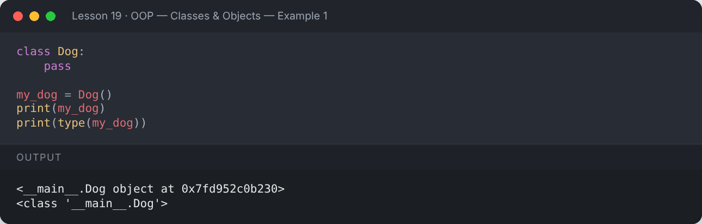

</details>

## 🔧 The Constructor — `__init__` and `self`

`__init__` runs automatically when an object is created. `self` refers to **the current object**.

```python
class Student:
    def __init__(self, name, age, gpa):
        self.name = name          # instance attributes
        self.age = age
        self.gpa = gpa

s1 = Student("Mehvish", 22, 3.44)
s2 = Student("Ali", 21, 3.10)
print(s1.name, s1.age, s1.gpa)
print(s2.name, s2.age, s2.gpa)
```

**Output:**

```text
Mehvish 22 3.44
Ali 21 3.1
```

<details><summary>📸 Screenshot</summary>

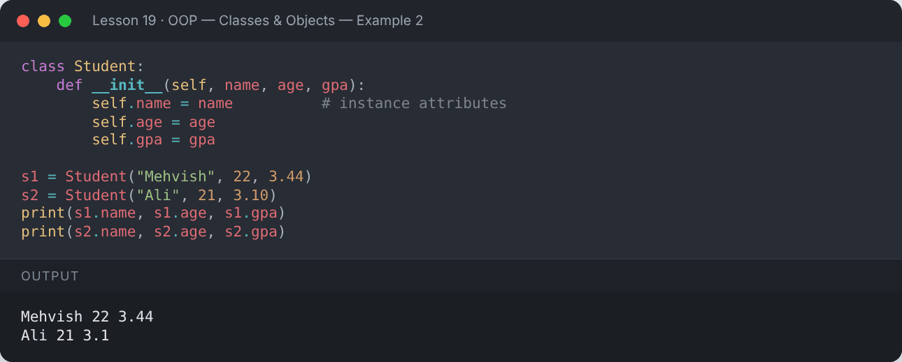

</details>

## ⚙️ Methods — functions inside a class

```python
class Student:
    def __init__(self, name, marks):
        self.name = name
        self.marks = marks

    def average(self):
        return sum(self.marks) / len(self.marks)

    def grade(self):
        avg = self.average()
        return "A" if avg >= 80 else "B" if avg >= 65 else "C"

    def report(self):
        print(f"{self.name}: average {self.average():.1f}, grade {self.grade()}")

Student("Sara", [88, 92, 79]).report()
Student("Zain", [60, 72, 58]).report()
```

**Output:**

```text
Sara: average 86.3, grade A
Zain: average 63.3, grade C
```

<details><summary>📸 Screenshot</summary>

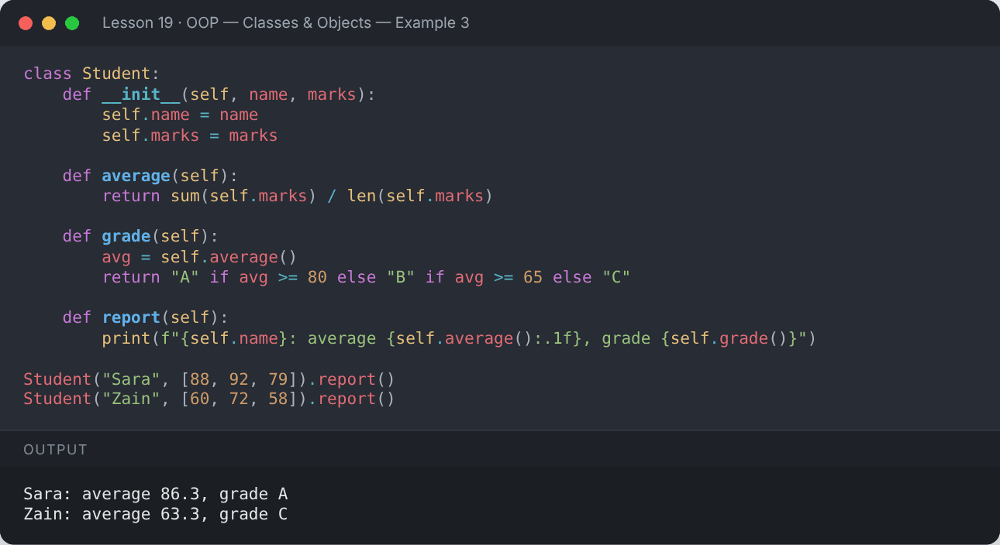

</details>

## ✏️ Changing Attributes

```python
class Car:
    def __init__(self, brand, speed=0):
        self.brand = brand
        self.speed = speed

    def accelerate(self, amount):
        self.speed += amount
        return self.speed

car = Car("Toyota")
car.accelerate(30)
car.accelerate(20)
print(car.brand, "speed:", car.speed)
car.color = "red"           # add a new attribute on the fly
print(vars(car))
```

**Output:**

```text
Toyota speed: 50
{'brand': 'Toyota', 'speed': 50, 'color': 'red'}
```

<details><summary>📸 Screenshot</summary>

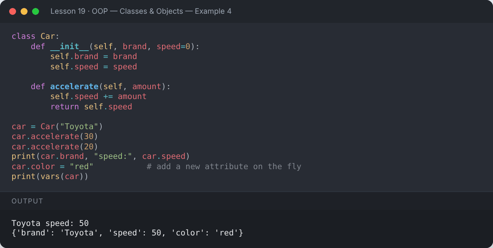

</details>

## 🏷️ Class Attributes vs Instance Attributes

- **Class attribute** — shared by all objects.
- **Instance attribute** — unique to each object.

```python
class Employee:
    company = "PyCorp"          # class attribute
    count = 0

    def __init__(self, name, salary):
        self.name = name        # instance attributes
        self.salary = salary
        Employee.count += 1

e1 = Employee("Ali", 50000)
e2 = Employee("Sara", 65000)
print(e1.company, e2.company)
print("Employees created:", Employee.count)
Employee.company = "NewCo"
print(e1.company, e2.company)
```

**Output:**

```text
PyCorp PyCorp
Employees created: 2
NewCo NewCo
```

<details><summary>📸 Screenshot</summary>

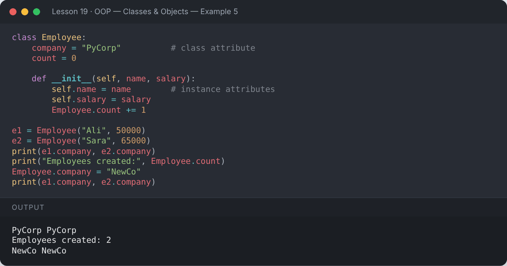

</details>

## 🖨️ `__str__` and `__repr__`

- `__str__` → friendly text for users (`print(obj)`)
- `__repr__` → unambiguous text for developers

```python
class Book:
    def __init__(self, title, author, pages):
        self.title = title
        self.author = author
        self.pages = pages

    def __str__(self):
        return f"'{self.title}' by {self.author}"

    def __repr__(self):
        return f"Book({self.title!r}, {self.author!r}, {self.pages})"

b = Book("Python Basics", "M. Kiani", 250)
print(b)
print(repr(b))
print([b])
```

**Output:**

```text
'Python Basics' by M. Kiani
Book('Python Basics', 'M. Kiani', 250)
[Book('Python Basics', 'M. Kiani', 250)]
```

<details><summary>📸 Screenshot</summary>

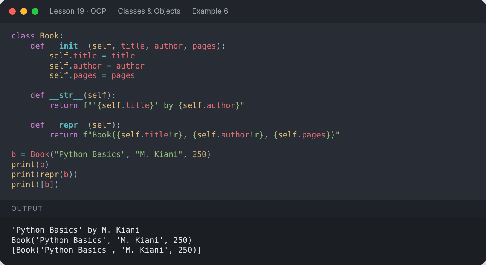

</details>

## 🔍 Useful Built-ins for Objects

```python
class Phone:
    def __init__(self, model):
        self.model = model

p = Phone("Pixel")
print(isinstance(p, Phone))
print(hasattr(p, "model"), hasattr(p, "price"))
print(getattr(p, "model"))
setattr(p, "price", 120000)
print(p.price)
```

**Output:**

```text
True
True False
Pixel
120000
```

<details><summary>📸 Screenshot</summary>

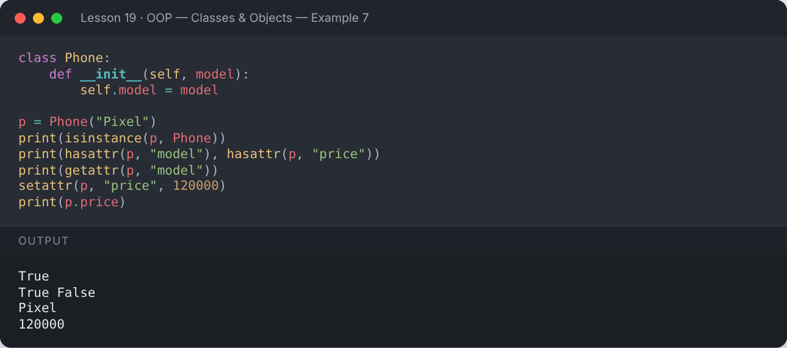

</details>

## 🏦 Complete Example — Bank Account

```python
class BankAccount:
    bank_name = "Python Bank"

    def __init__(self, owner, balance=0):
        self.owner = owner
        self.balance = balance
        self.history = []

    def deposit(self, amount):
        self.balance += amount
        self.history.append(f"+{amount}")

    def withdraw(self, amount):
        if amount > self.balance:
            print("❌ Insufficient balance")
            return
        self.balance -= amount
        self.history.append(f"-{amount}")

    def __str__(self):
        return f"{self.owner} | Balance: Rs {self.balance:,} | History: {self.history}"

acc = BankAccount("Mehvish", 1000)
acc.deposit(5000)
acc.withdraw(2500)
acc.withdraw(10000)
print(acc)
```

**Output:**

```text
❌ Insufficient balance
Mehvish | Balance: Rs 3,500 | History: ['+5000', '-2500']
```

<details><summary>📸 Screenshot</summary>

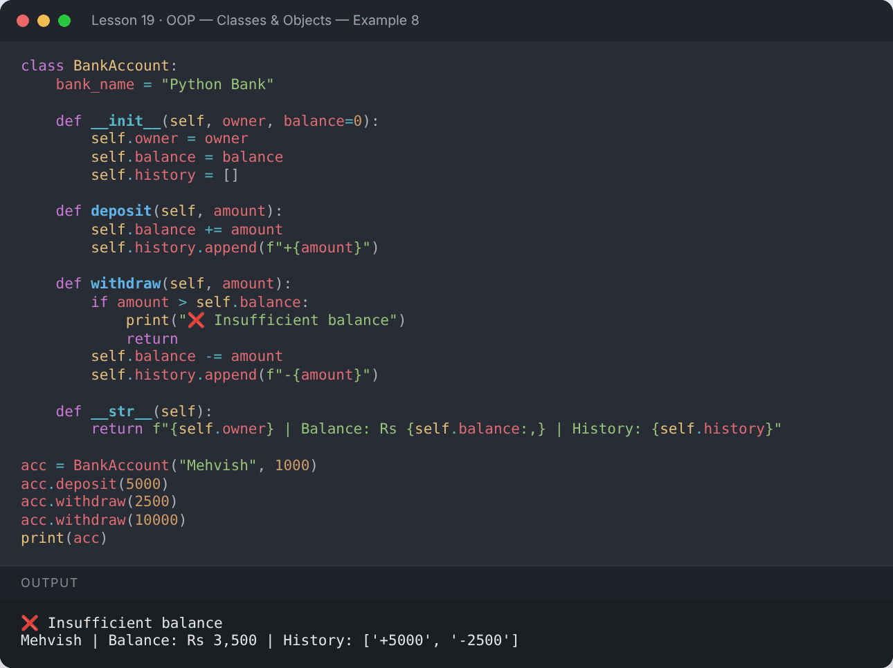

</details>

## 📌 Summary

- `class` defines a blueprint; calling it creates objects.
- `__init__` sets up attributes; `self` is the current object.
- Class attributes are shared; instance attributes are per-object.
- Implement `__str__` / `__repr__` for readable objects.

---

## ✍️ Exercises

Try each one yourself first, then expand the solution.

**Exercise 1 — Create a `Rectangle` class with `area()` and `perimeter()` methods.**

<details><summary>✅ Solution</summary>

```python
class Rectangle:
    def __init__(self, length, width):
        self.length = length
        self.width = width

    def area(self):
        return self.length * self.width

    def perimeter(self):
        return 2 * (self.length + self.width)

r = Rectangle(5, 3)
print("Area:", r.area(), "| Perimeter:", r.perimeter())
```

**Output:**

```text
Area: 15 | Perimeter: 16
```

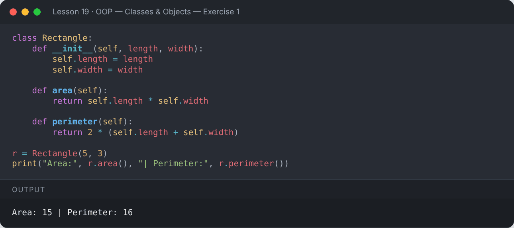

</details>

**Exercise 2 — Create a `Circle` class with a class attribute `pi` and a method for its area.**

<details><summary>✅ Solution</summary>

```python
class Circle:
    pi = 3.14159

    def __init__(self, radius):
        self.radius = radius

    def area(self):
        return round(Circle.pi * self.radius ** 2, 2)

print(Circle(7).area())
```

**Output:**

```text
153.94
```

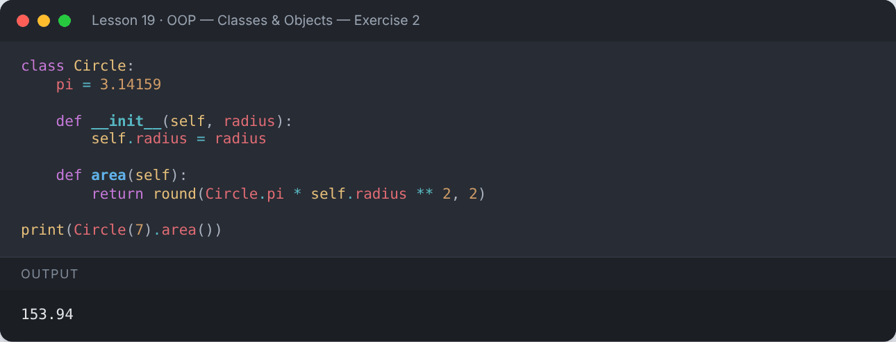

</details>

**Exercise 3 — Create a `Counter` class that counts how many objects were created.**

<details><summary>✅ Solution</summary>

```python
class Counter:
    created = 0
    def __init__(self):
        Counter.created += 1

for _ in range(4):
    Counter()
print("Objects created:", Counter.created)
```

**Output:**

```text
Objects created: 4
```

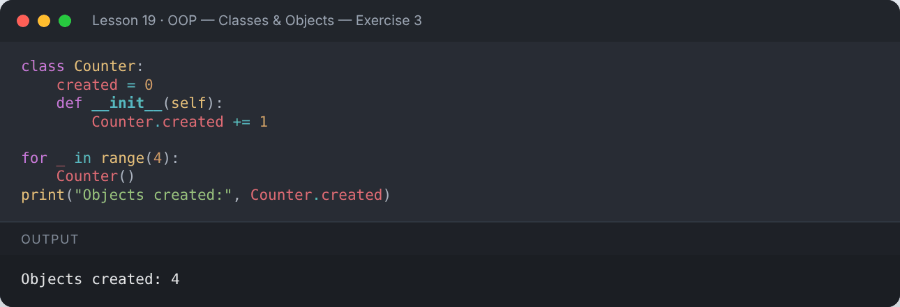

</details>

---

[⬅️ File Handling](../18-file-handling/README.md) · [🏠 All lessons](../../README.md) · [OOP — Inheritance & Polymorphism ➡️](../20-oop-inheritance-and-polymorphism/README.md)
