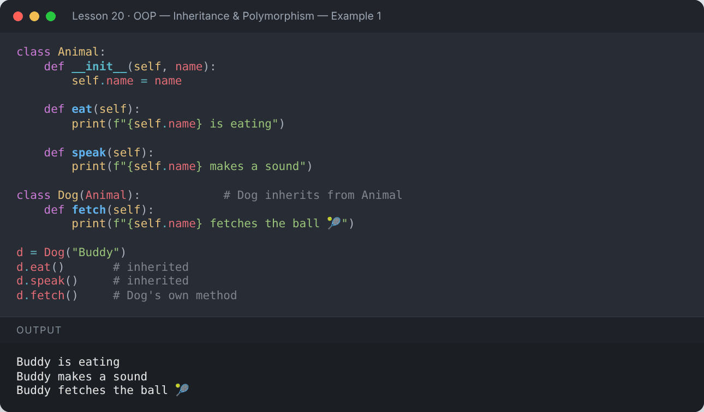
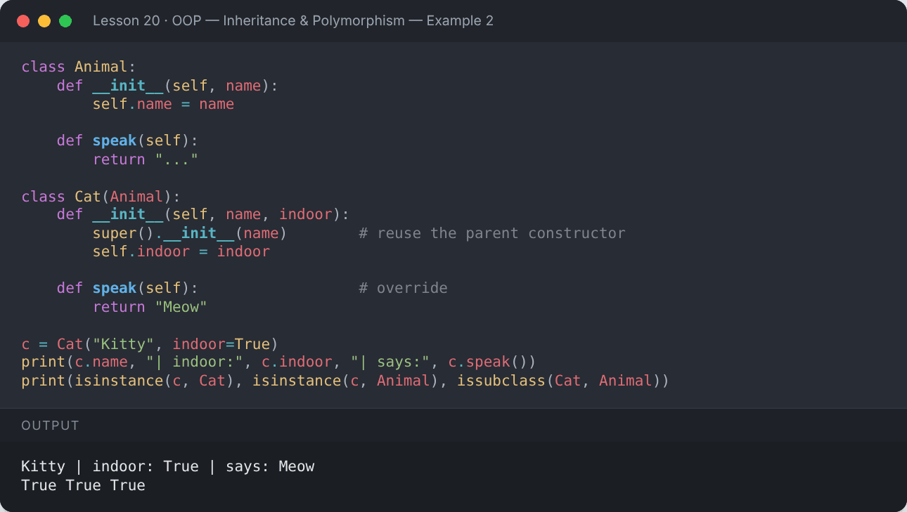
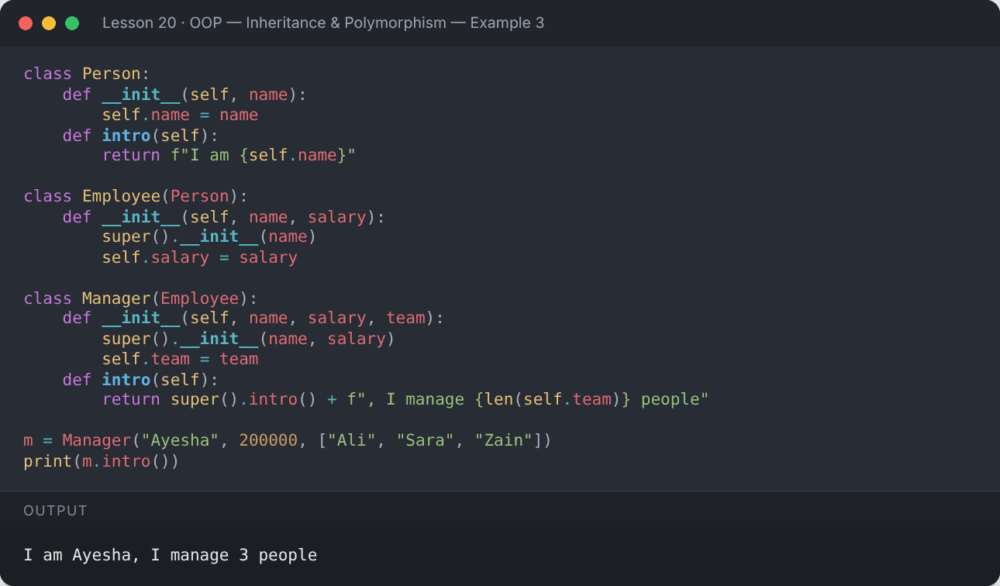
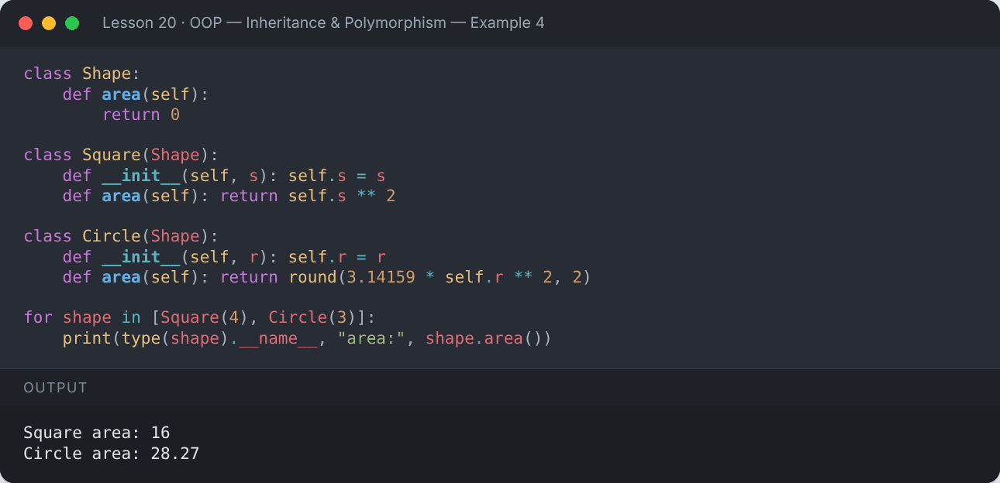
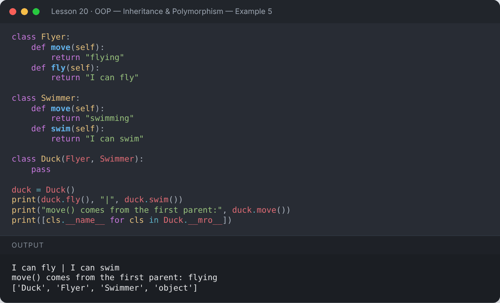
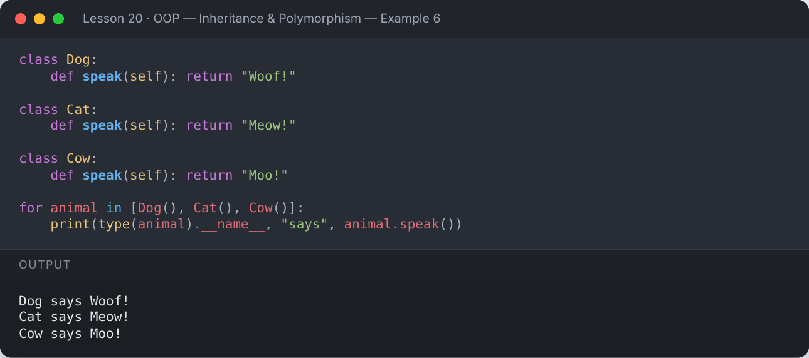
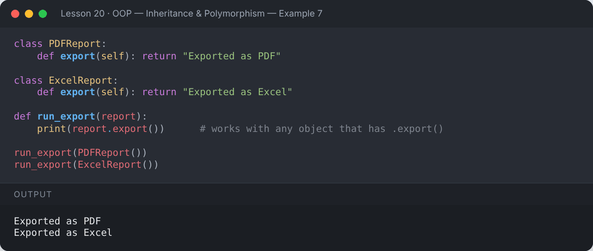
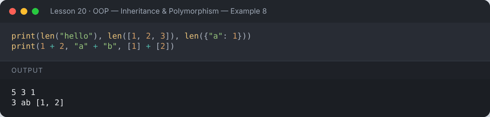
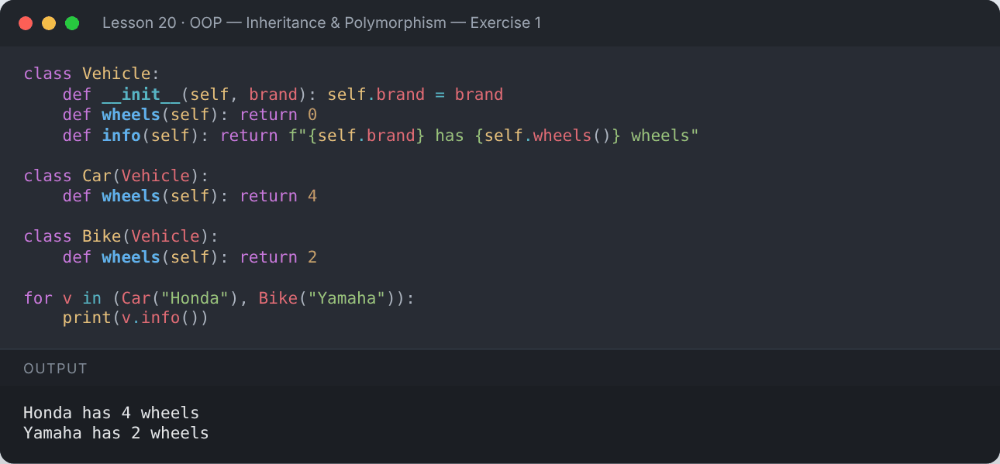
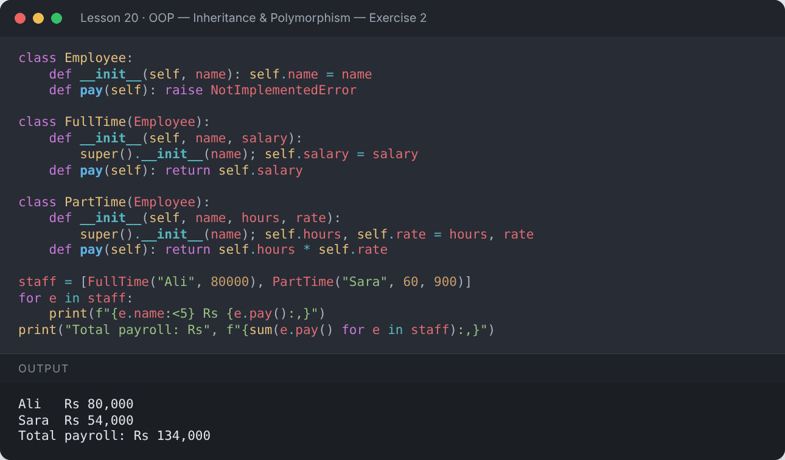

# Lesson 20 — OOP — Inheritance & Polymorphism

> Reuse code with inheritance, extend it with super(), and write flexible code with polymorphism.

[](https://colab.research.google.com/github/MehvishKiani/Python-beginner-guide/blob/main/lessons/20-oop-inheritance-and-polymorphism/lesson.ipynb) &nbsp; 📓 [lesson.ipynb](lesson.ipynb) &nbsp; ✍️ [exercises.ipynb](exercises.ipynb)

[⬅️ OOP — Classes & Objects](../19-oop-classes-and-objects/README.md) · [🏠 All lessons](../../README.md) · [OOP — Encapsulation, Abstraction & Magic Methods ➡️](../21-oop-advanced/README.md)

---

## 🎯 Learning Objectives

- Create child classes that inherit from parent classes
- Override methods and call the parent with `super()`
- Know the types of inheritance (single, multilevel, hierarchical, multiple)
- Understand the Method Resolution Order (MRO)
- Apply polymorphism and duck typing

## 👪 Inheritance

A **child class** inherits attributes and methods from a **parent class**, then adds or changes what it needs.

```python
class Animal:
    def __init__(self, name):
        self.name = name

    def eat(self):
        print(f"{self.name} is eating")

    def speak(self):
        print(f"{self.name} makes a sound")

class Dog(Animal):            # Dog inherits from Animal
    def fetch(self):
        print(f"{self.name} fetches the ball 🎾")

d = Dog("Buddy")
d.eat()       # inherited
d.speak()     # inherited
d.fetch()     # Dog's own method
```

**Output:**

```text
Buddy is eating
Buddy makes a sound
Buddy fetches the ball 🎾
```

<details><summary>📸 Screenshot</summary>



</details>

## 🔁 Method Overriding & `super()`

```python
class Animal:
    def __init__(self, name):
        self.name = name

    def speak(self):
        return "..."

class Cat(Animal):
    def __init__(self, name, indoor):
        super().__init__(name)        # reuse the parent constructor
        self.indoor = indoor

    def speak(self):                  # override
        return "Meow"

c = Cat("Kitty", indoor=True)
print(c.name, "| indoor:", c.indoor, "| says:", c.speak())
print(isinstance(c, Cat), isinstance(c, Animal), issubclass(Cat, Animal))
```

**Output:**

```text
Kitty | indoor: True | says: Meow
True True True
```

<details><summary>📸 Screenshot</summary>



</details>

## 🌳 Types of Inheritance

### Multilevel

```python
class Person:
    def __init__(self, name):
        self.name = name
    def intro(self):
        return f"I am {self.name}"

class Employee(Person):
    def __init__(self, name, salary):
        super().__init__(name)
        self.salary = salary

class Manager(Employee):
    def __init__(self, name, salary, team):
        super().__init__(name, salary)
        self.team = team
    def intro(self):
        return super().intro() + f", I manage {len(self.team)} people"

m = Manager("Ayesha", 200000, ["Ali", "Sara", "Zain"])
print(m.intro())
```

**Output:**

```text
I am Ayesha, I manage 3 people
```

<details><summary>📸 Screenshot</summary>



</details>

### Hierarchical (one parent, many children)

```python
class Shape:
    def area(self):
        return 0

class Square(Shape):
    def __init__(self, s): self.s = s
    def area(self): return self.s ** 2

class Circle(Shape):
    def __init__(self, r): self.r = r
    def area(self): return round(3.14159 * self.r ** 2, 2)

for shape in [Square(4), Circle(3)]:
    print(type(shape).__name__, "area:", shape.area())
```

**Output:**

```text
Square area: 16
Circle area: 28.27
```

<details><summary>📸 Screenshot</summary>



</details>

### Multiple inheritance & MRO

```python
class Flyer:
    def move(self):
        return "flying"
    def fly(self):
        return "I can fly"

class Swimmer:
    def move(self):
        return "swimming"
    def swim(self):
        return "I can swim"

class Duck(Flyer, Swimmer):
    pass

duck = Duck()
print(duck.fly(), "|", duck.swim())
print("move() comes from the first parent:", duck.move())
print([cls.__name__ for cls in Duck.__mro__])
```

**Output:**

```text
I can fly | I can swim
move() comes from the first parent: flying
['Duck', 'Flyer', 'Swimmer', 'object']
```

<details><summary>📸 Screenshot</summary>



</details>

## 🎭 Polymorphism

"Many forms" — the **same method name** behaves differently depending on the object.

```python
class Dog:
    def speak(self): return "Woof!"

class Cat:
    def speak(self): return "Meow!"

class Cow:
    def speak(self): return "Moo!"

for animal in [Dog(), Cat(), Cow()]:
    print(type(animal).__name__, "says", animal.speak())
```

**Output:**

```text
Dog says Woof!
Cat says Meow!
Cow says Moo!
```

<details><summary>📸 Screenshot</summary>



</details>

### Duck typing

*"If it walks like a duck and quacks like a duck, it's a duck."* Python cares about **what an object can do**, not its type.

```python
class PDFReport:
    def export(self): return "Exported as PDF"

class ExcelReport:
    def export(self): return "Exported as Excel"

def run_export(report):
    print(report.export())      # works with any object that has .export()

run_export(PDFReport())
run_export(ExcelReport())
```

**Output:**

```text
Exported as PDF
Exported as Excel
```

<details><summary>📸 Screenshot</summary>



</details>

### Built-in polymorphism

```python
print(len("hello"), len([1, 2, 3]), len({"a": 1}))
print(1 + 2, "a" + "b", [1] + [2])
```

**Output:**

```text
5 3 1
3 ab [1, 2]
```

<details><summary>📸 Screenshot</summary>



</details>

## 📌 Summary

- `class Child(Parent):` inherits everything from `Parent`.
- Override methods to change behaviour; use `super()` to reuse the parent's version.
- Python supports single, multilevel, hierarchical and multiple inheritance (resolved by the MRO).
- Polymorphism lets one interface work with many object types.

---

## ✍️ Exercises

Try each one yourself first, then expand the solution.

**Exercise 1 — Create a `Vehicle` parent and `Car` / `Bike` children that override `wheels()`.**

<details><summary>✅ Solution</summary>

```python
class Vehicle:
    def __init__(self, brand): self.brand = brand
    def wheels(self): return 0
    def info(self): return f"{self.brand} has {self.wheels()} wheels"

class Car(Vehicle):
    def wheels(self): return 4

class Bike(Vehicle):
    def wheels(self): return 2

for v in (Car("Honda"), Bike("Yamaha")):
    print(v.info())
```

**Output:**

```text
Honda has 4 wheels
Yamaha has 2 wheels
```



</details>

**Exercise 2 — Build a payroll where `FullTime` and `PartTime` employees calculate pay differently.**

<details><summary>✅ Solution</summary>

```python
class Employee:
    def __init__(self, name): self.name = name
    def pay(self): raise NotImplementedError

class FullTime(Employee):
    def __init__(self, name, salary):
        super().__init__(name); self.salary = salary
    def pay(self): return self.salary

class PartTime(Employee):
    def __init__(self, name, hours, rate):
        super().__init__(name); self.hours, self.rate = hours, rate
    def pay(self): return self.hours * self.rate

staff = [FullTime("Ali", 80000), PartTime("Sara", 60, 900)]
for e in staff:
    print(f"{e.name:<5} Rs {e.pay():,}")
print("Total payroll: Rs", f"{sum(e.pay() for e in staff):,}")
```

**Output:**

```text
Ali   Rs 80,000
Sara  Rs 54,000
Total payroll: Rs 134,000
```



</details>

---

[⬅️ OOP — Classes & Objects](../19-oop-classes-and-objects/README.md) · [🏠 All lessons](../../README.md) · [OOP — Encapsulation, Abstraction & Magic Methods ➡️](../21-oop-advanced/README.md)
