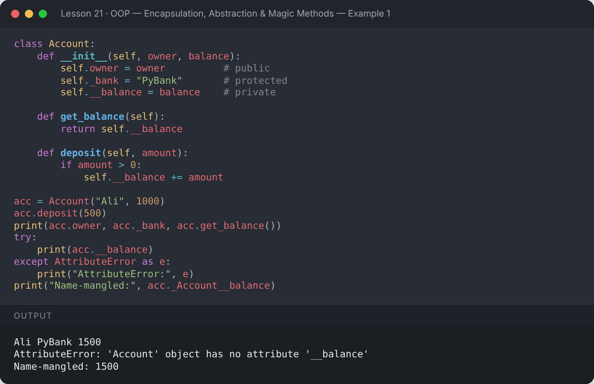
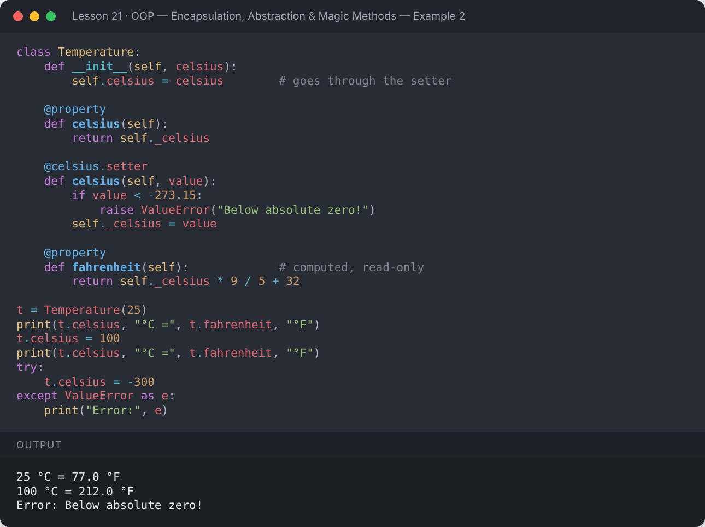
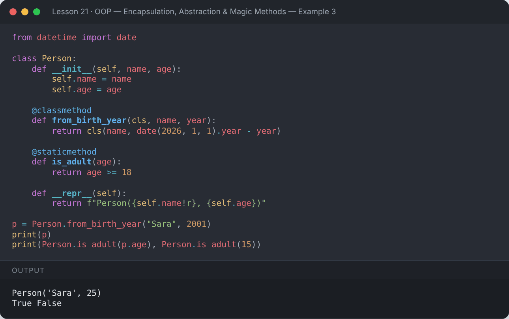
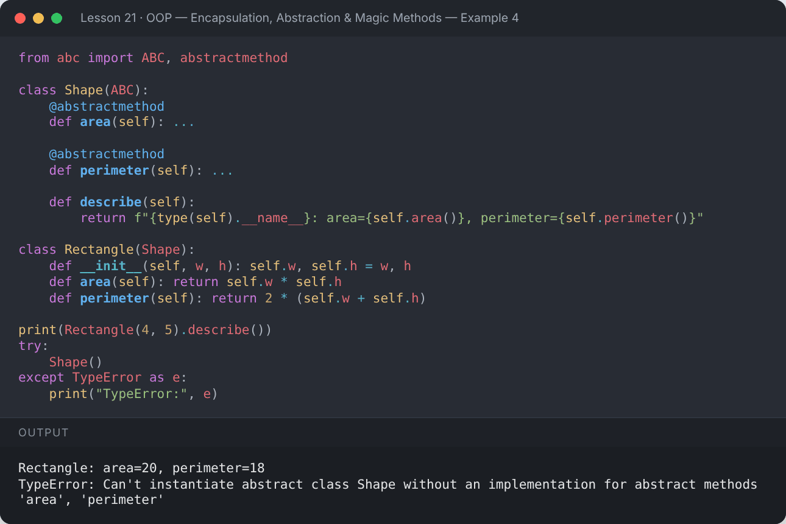
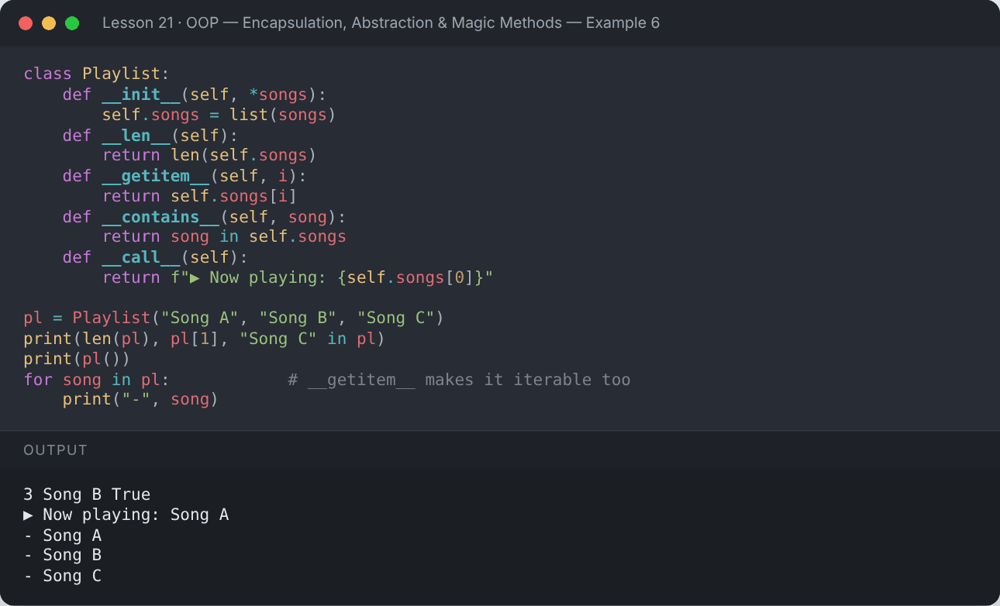
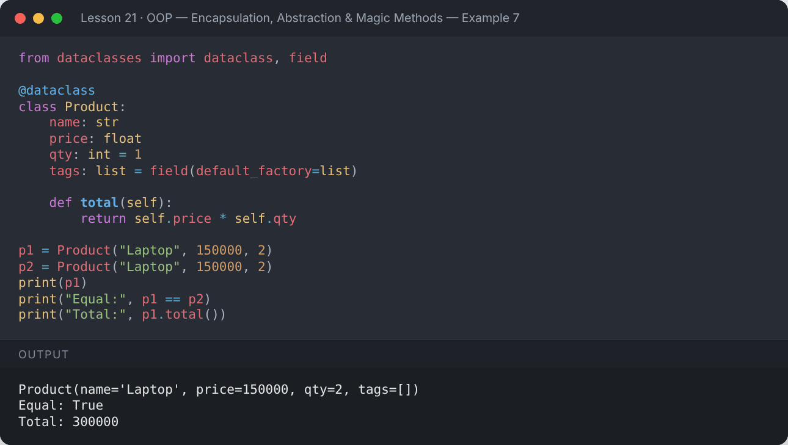
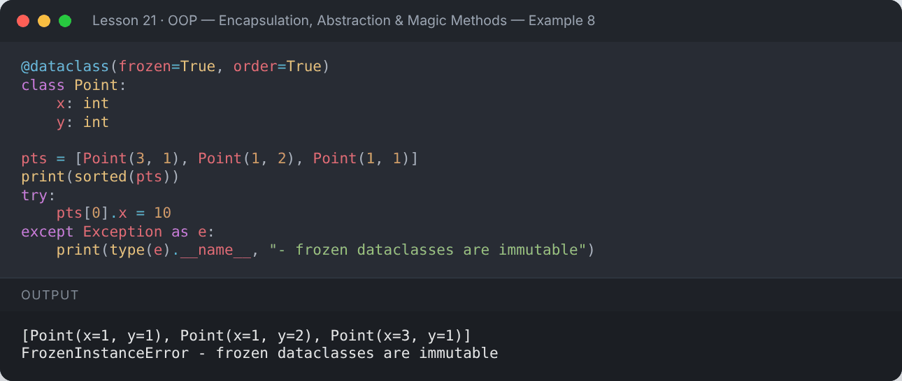
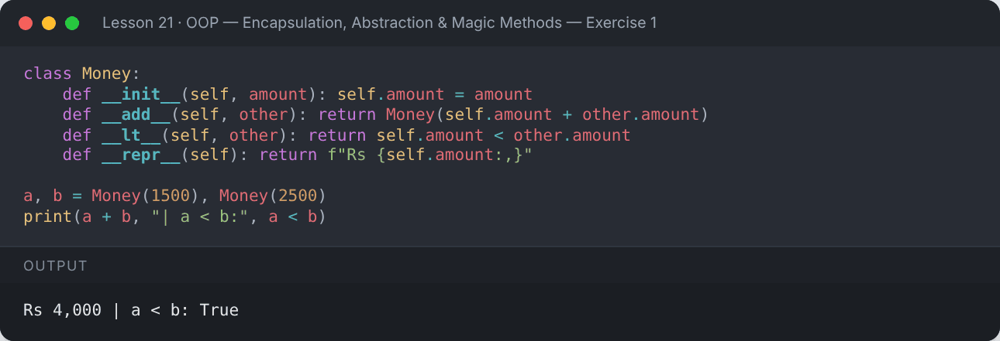
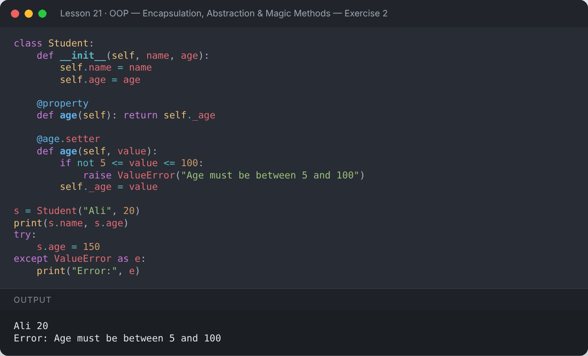
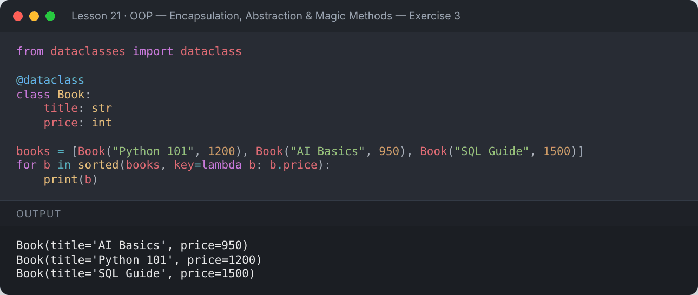

# Lesson 21 — OOP — Encapsulation, Abstraction & Magic Methods

> Protect data, design abstract classes, use @property, class/static methods, dunder methods and dataclasses.

[](https://colab.research.google.com/github/MehvishKiani/Python-beginner-guide/blob/main/lessons/21-oop-advanced/lesson.ipynb) &nbsp; 📓 [lesson.ipynb](lesson.ipynb) &nbsp; ✍️ [exercises.ipynb](exercises.ipynb)

[⬅️ OOP — Inheritance & Polymorphism](../20-oop-inheritance-and-polymorphism/README.md) · [🏠 All lessons](../../README.md) · [Iterators & Generators ➡️](../22-iterators-and-generators/README.md)

---

## 🎯 Learning Objectives

- Encapsulate data with public, protected and private attributes
- Use `@property` for getters and setters
- Write `@classmethod` and `@staticmethod`
- Create abstract base classes
- Overload operators with magic (dunder) methods
- Use `@dataclass` to remove boilerplate

## 🔐 Encapsulation

| Naming | Meaning |
|---|---|
| `name` | public — use freely |
| `_name` | protected — "internal, please don't touch" (convention) |
| `__name` | private — name-mangled to `_ClassName__name` |

```python
class Account:
    def __init__(self, owner, balance):
        self.owner = owner          # public
        self._bank = "PyBank"       # protected
        self.__balance = balance    # private

    def get_balance(self):
        return self.__balance

    def deposit(self, amount):
        if amount > 0:
            self.__balance += amount

acc = Account("Ali", 1000)
acc.deposit(500)
print(acc.owner, acc._bank, acc.get_balance())
try:
    print(acc.__balance)
except AttributeError as e:
    print("AttributeError:", e)
print("Name-mangled:", acc._Account__balance)
```

**Output:**

```text
Ali PyBank 1500
AttributeError: 'Account' object has no attribute '__balance'
Name-mangled: 1500
```

<details><summary>📸 Screenshot</summary>



</details>

## 🏷️ `@property` — Pythonic getters & setters

```python
class Temperature:
    def __init__(self, celsius):
        self.celsius = celsius        # goes through the setter

    @property
    def celsius(self):
        return self._celsius

    @celsius.setter
    def celsius(self, value):
        if value < -273.15:
            raise ValueError("Below absolute zero!")
        self._celsius = value

    @property
    def fahrenheit(self):             # computed, read-only
        return self._celsius * 9 / 5 + 32

t = Temperature(25)
print(t.celsius, "°C =", t.fahrenheit, "°F")
t.celsius = 100
print(t.celsius, "°C =", t.fahrenheit, "°F")
try:
    t.celsius = -300
except ValueError as e:
    print("Error:", e)
```

**Output:**

```text
25 °C = 77.0 °F
100 °C = 212.0 °F
Error: Below absolute zero!
```

<details><summary>📸 Screenshot</summary>



</details>

## 🧰 `@classmethod` and `@staticmethod`

| Type | First argument | Use for |
|---|---|---|
| Instance method | `self` | working with one object |
| `@classmethod` | `cls` | alternative constructors, class-level data |
| `@staticmethod` | none | utility functions that belong to the class |

```python
from datetime import date

class Person:
    def __init__(self, name, age):
        self.name = name
        self.age = age

    @classmethod
    def from_birth_year(cls, name, year):
        return cls(name, date(2026, 1, 1).year - year)

    @staticmethod
    def is_adult(age):
        return age >= 18

    def __repr__(self):
        return f"Person({self.name!r}, {self.age})"

p = Person.from_birth_year("Sara", 2001)
print(p)
print(Person.is_adult(p.age), Person.is_adult(15))
```

**Output:**

```text
Person('Sara', 25)
True False
```

<details><summary>📸 Screenshot</summary>



</details>

## 🎨 Abstraction — Abstract Base Classes

An **abstract class** defines *what* methods children must have, without saying *how*. It cannot be instantiated.

```python
from abc import ABC, abstractmethod

class Shape(ABC):
    @abstractmethod
    def area(self): ...

    @abstractmethod
    def perimeter(self): ...

    def describe(self):
        return f"{type(self).__name__}: area={self.area()}, perimeter={self.perimeter()}"

class Rectangle(Shape):
    def __init__(self, w, h): self.w, self.h = w, h
    def area(self): return self.w * self.h
    def perimeter(self): return 2 * (self.w + self.h)

print(Rectangle(4, 5).describe())
try:
    Shape()
except TypeError as e:
    print("TypeError:", e)
```

**Output:**

```text
Rectangle: area=20, perimeter=18
TypeError: Can't instantiate abstract class Shape without an implementation for abstract methods 'area', 'perimeter'
```

<details><summary>📸 Screenshot</summary>



</details>

## ✨ Magic (Dunder) Methods & Operator Overloading

| Method | Triggered by |
|---|---|
| `__init__` | creating an object |
| `__str__`, `__repr__` | `print()`, `repr()` |
| `__len__` | `len(obj)` |
| `__add__`, `__sub__`, `__mul__` | `+`, `-`, `*` |
| `__eq__`, `__lt__` | `==`, `<` |
| `__getitem__` | `obj[i]` |
| `__contains__` | `x in obj` |
| `__call__` | `obj()` |

```python
class Vector:
    def __init__(self, x, y):
        self.x, self.y = x, y

    def __add__(self, other):
        return Vector(self.x + other.x, self.y + other.y)

    def __mul__(self, k):
        return Vector(self.x * k, self.y * k)

    def __eq__(self, other):
        return (self.x, self.y) == (other.x, other.y)

    def __abs__(self):
        return (self.x ** 2 + self.y ** 2) ** 0.5

    def __repr__(self):
        return f"Vector({self.x}, {self.y})"

v1, v2 = Vector(2, 3), Vector(1, 1)
print(v1 + v2)
print(v1 * 3)
print(v1 == Vector(2, 3))
print(abs(Vector(3, 4)))
```

**Output:**

```text
Vector(3, 4)
Vector(6, 9)
True
5.0
```

<details><summary>📸 Screenshot</summary>


</details>

```python
class Playlist:
    def __init__(self, *songs):
        self.songs = list(songs)
    def __len__(self):
        return len(self.songs)
    def __getitem__(self, i):
        return self.songs[i]
    def __contains__(self, song):
        return song in self.songs
    def __call__(self):
        return f"▶ Now playing: {self.songs[0]}"

pl = Playlist("Song A", "Song B", "Song C")
print(len(pl), pl[1], "Song C" in pl)
print(pl())
for song in pl:            # __getitem__ makes it iterable too
    print("-", song)
```

**Output:**

```text
3 Song B True
▶ Now playing: Song A
- Song A
- Song B
- Song C
```

<details><summary>📸 Screenshot</summary>



</details>

## 📦 Data Classes (`@dataclass`)

Automatically generates `__init__`, `__repr__` and `__eq__` for classes that mainly store data.

```python
from dataclasses import dataclass, field

@dataclass
class Product:
    name: str
    price: float
    qty: int = 1
    tags: list = field(default_factory=list)

    def total(self):
        return self.price * self.qty

p1 = Product("Laptop", 150000, 2)
p2 = Product("Laptop", 150000, 2)
print(p1)
print("Equal:", p1 == p2)
print("Total:", p1.total())
```

**Output:**

```text
Product(name='Laptop', price=150000, qty=2, tags=[])
Equal: True
Total: 300000
```

<details><summary>📸 Screenshot</summary>



</details>

```python
@dataclass(frozen=True, order=True)
class Point:
    x: int
    y: int

pts = [Point(3, 1), Point(1, 2), Point(1, 1)]
print(sorted(pts))
try:
    pts[0].x = 10
except Exception as e:
    print(type(e).__name__, "- frozen dataclasses are immutable")
```

**Output:**

```text
[Point(x=1, y=1), Point(x=1, y=2), Point(x=3, y=1)]
FrozenInstanceError - frozen dataclasses are immutable
```

<details><summary>📸 Screenshot</summary>



</details>

## 📌 Summary

- Encapsulation: `_protected`, `__private`, and `@property` for controlled access.
- `@classmethod` gets the class (`cls`); `@staticmethod` gets nothing.
- Abstract classes (`ABC` + `@abstractmethod`) define required methods.
- Dunder methods make your objects work with operators and built-ins.
- `@dataclass` = less boilerplate for data-holding classes.

---

## ✍️ Exercises

Try each one yourself first, then expand the solution.

**Exercise 1 — Create a `Money` class that supports `+` and comparison with `<`.**

<details><summary>✅ Solution</summary>

```python
class Money:
    def __init__(self, amount): self.amount = amount
    def __add__(self, other): return Money(self.amount + other.amount)
    def __lt__(self, other): return self.amount < other.amount
    def __repr__(self): return f"Rs {self.amount:,}"

a, b = Money(1500), Money(2500)
print(a + b, "| a < b:", a < b)
```

**Output:**

```text
Rs 4,000 | a < b: True
```



</details>

**Exercise 2 — Use `@property` to validate that a `Student` age is between 5 and 100.**

<details><summary>✅ Solution</summary>

```python
class Student:
    def __init__(self, name, age):
        self.name = name
        self.age = age

    @property
    def age(self): return self._age

    @age.setter
    def age(self, value):
        if not 5 <= value <= 100:
            raise ValueError("Age must be between 5 and 100")
        self._age = value

s = Student("Ali", 20)
print(s.name, s.age)
try:
    s.age = 150
except ValueError as e:
    print("Error:", e)
```

**Output:**

```text
Ali 20
Error: Age must be between 5 and 100
```



</details>

**Exercise 3 — Create a `@dataclass` `Book` and sort a list of books by price.**

<details><summary>✅ Solution</summary>

```python
from dataclasses import dataclass

@dataclass
class Book:
    title: str
    price: int

books = [Book("Python 101", 1200), Book("AI Basics", 950), Book("SQL Guide", 1500)]
for b in sorted(books, key=lambda b: b.price):
    print(b)
```

**Output:**

```text
Book(title='AI Basics', price=950)
Book(title='Python 101', price=1200)
Book(title='SQL Guide', price=1500)
```



</details>

---

[⬅️ OOP — Inheritance & Polymorphism](../20-oop-inheritance-and-polymorphism/README.md) · [🏠 All lessons](../../README.md) · [Iterators & Generators ➡️](../22-iterators-and-generators/README.md)
