# Lesson 22 — Iterators & Generators

> How for-loops really work, building your own iterators, and memory-efficient generators with yield.

[](https://colab.research.google.com/github/MehvishKiani/Python-beginner-guide/blob/main/lessons/22-iterators-and-generators/lesson.ipynb) &nbsp; 📓 [lesson.ipynb](lesson.ipynb) &nbsp; ✍️ [exercises.ipynb](exercises.ipynb)

[⬅️ OOP — Encapsulation, Abstraction & Magic Methods](../21-oop-advanced/README.md) · [🏠 All lessons](../../README.md) · [Decorators & Context Managers ➡️](../23-decorators-and-context-managers/README.md)

---

## 🎯 Learning Objectives

- Understand iterables vs iterators
- Use `iter()` and `next()`
- Build a custom iterator class
- Write generator functions with `yield`
- Use generator expressions and `itertools`

## 🔄 Iterable vs Iterator

- **Iterable** — anything you can loop over (list, str, dict, file…). Has `__iter__()`.
- **Iterator** — an object that produces the next value with `__next__()` and remembers its position.

A `for` loop calls `iter()` on the iterable, then `next()` until `StopIteration`.

```python
colors = ["red", "green", "blue"]
it = iter(colors)
print(next(it))
print(next(it))
print(next(it))
try:
    next(it)
except StopIteration:
    print("StopIteration — the iterator is exhausted")
```

**Output:**

```text
red
green
blue
StopIteration — the iterator is exhausted
```

<details><summary>📸 Screenshot</summary>

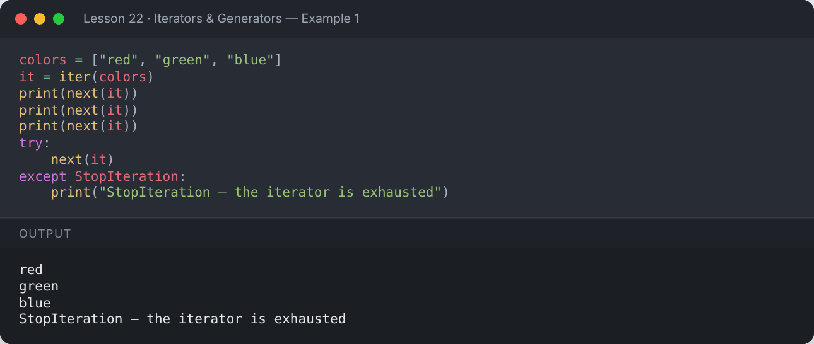

</details>

## 🛠️ Custom Iterator Class

```python
class Countdown:
    def __init__(self, start):
        self.current = start

    def __iter__(self):
        return self

    def __next__(self):
        if self.current <= 0:
            raise StopIteration
        value = self.current
        self.current -= 1
        return value

for n in Countdown(5):
    print(n, end=" ")
```

**Output:**

```text
5 4 3 2 1 
```

<details><summary>📸 Screenshot</summary>

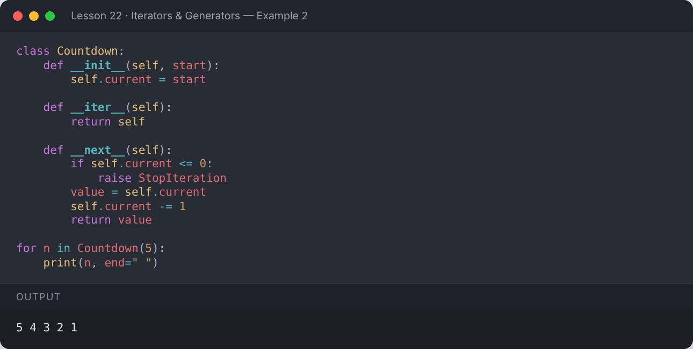

</details>

## ⚡ Generators — `yield`

A **generator function** uses `yield` instead of `return`. It pauses after each `yield` and resumes on the next call — values are produced **one at a time**, on demand.

```python
def countdown(n):
    while n > 0:
        yield n
        n -= 1

gen = countdown(3)
print(gen)
print(next(gen), next(gen), next(gen))
print(list(countdown(5)))
```

**Output:**

```text
<generator object countdown at 0x7fd95332dd80>
3 2 1
[5, 4, 3, 2, 1]
```

<details><summary>📸 Screenshot</summary>

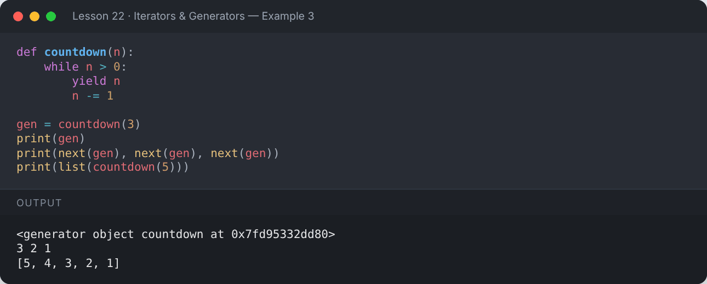

</details>

```python
def show_pauses():
    print("Step 1")
    yield "A"
    print("Step 2")
    yield "B"
    print("Step 3")

for value in show_pauses():
    print("Got:", value)
```

**Output:**

```text
Step 1
Got: A
Step 2
Got: B
Step 3
```

<details><summary>📸 Screenshot</summary>

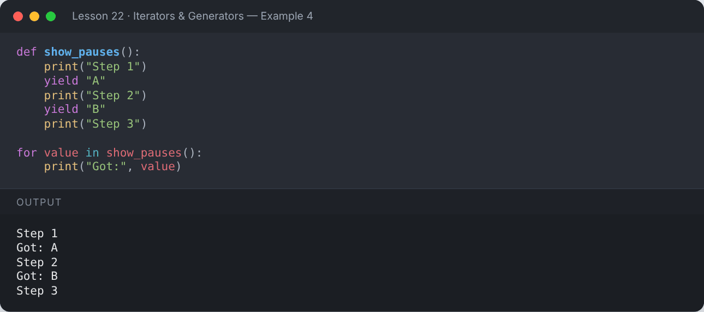

</details>

### Infinite generator

```python
def fibonacci():
    a, b = 0, 1
    while True:
        yield a
        a, b = b, a + b

fib = fibonacci()
print([next(fib) for _ in range(12)])
```

**Output:**

```text
[0, 1, 1, 2, 3, 5, 8, 13, 21, 34, 55, 89]
```

<details><summary>📸 Screenshot</summary>

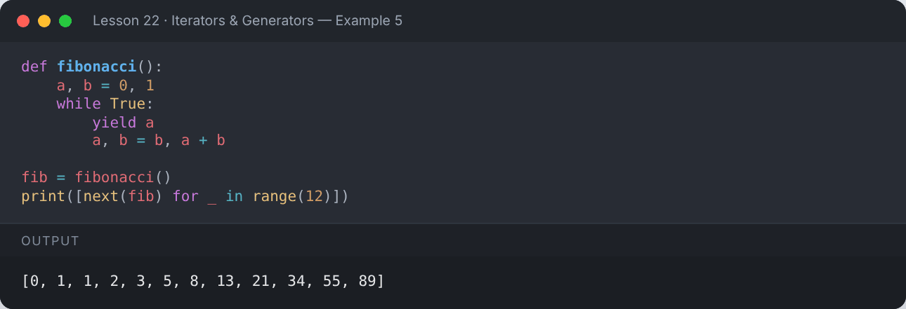

</details>

### Generator pipeline

```python
def read_lines():
    data = ["10", "x", "25", "", "40", "abc", "5"]
    for line in data:
        yield line

def only_numbers(lines):
    for line in lines:
        if line.isdigit():
            yield int(line)

def doubled(nums):
    for n in nums:
        yield n * 2

print(list(doubled(only_numbers(read_lines()))))
```

**Output:**

```text
[20, 50, 80, 10]
```

<details><summary>📸 Screenshot</summary>

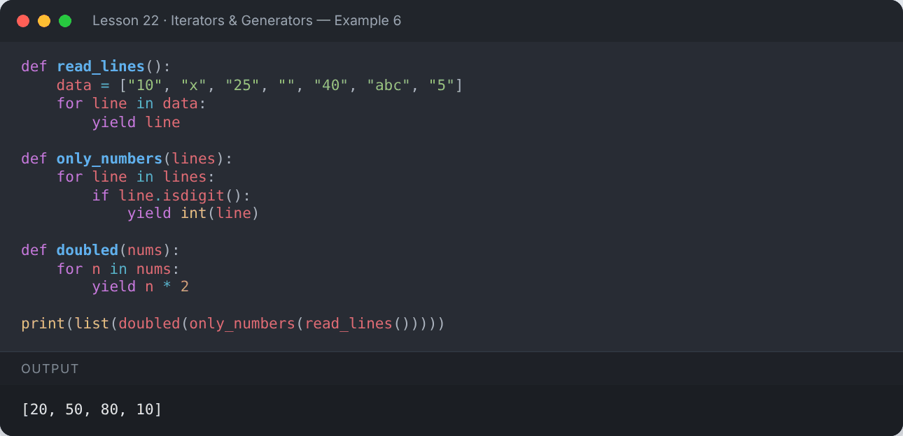

</details>

## 💾 Memory: List vs Generator

```python
import sys
big_list = [x * x for x in range(1_000_000)]
big_gen = (x * x for x in range(1_000_000))
print("List     :", sys.getsizeof(big_list), "bytes")
print("Generator:", sys.getsizeof(big_gen), "bytes")
print("Same sum :", sum(big_list) == sum(big_gen))
```

**Output:**

```text
List     : 8448728 bytes
Generator: 200 bytes
Same sum : True
```

<details><summary>📸 Screenshot</summary>

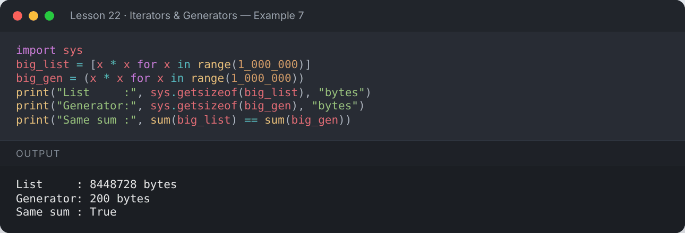

</details>

## ↪️ `yield from`

```python
def chain(*iterables):
    for it in iterables:
        yield from it

print(list(chain([1, 2], (3, 4), "ab")))
```

**Output:**

```text
[1, 2, 3, 4, 'a', 'b']
```

<details><summary>📸 Screenshot</summary>

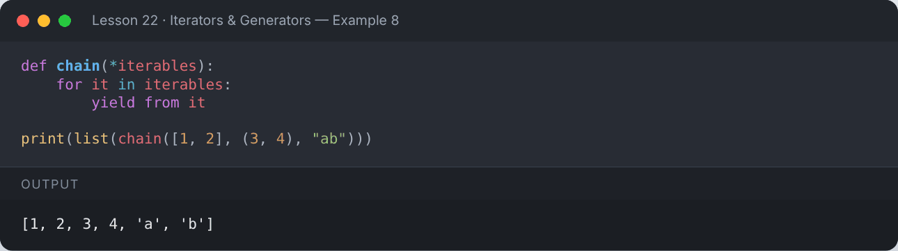

</details>

## 🧰 `itertools` Highlights

```python
import itertools as it

print(list(it.islice(it.count(10, 5), 4)))          # 10, 15, 20, 25
print(list(it.islice(it.cycle("AB"), 5)))
print(list(it.chain([1, 2], [3])))
print(list(it.combinations("ABC", 2)))
print(list(it.permutations([1, 2, 3], 2)))
print(list(it.product("ab", [0, 1])))
print(list(it.accumulate([1, 2, 3, 4])))
for key, group in it.groupby("aaabbc"):
    print(key, list(group))
```

**Output:**

```text
[10, 15, 20, 25]
['A', 'B', 'A', 'B', 'A']
[1, 2, 3]
[('A', 'B'), ('A', 'C'), ('B', 'C')]
[(1, 2), (1, 3), (2, 1), (2, 3), (3, 1), (3, 2)]
[('a', 0), ('a', 1), ('b', 0), ('b', 1)]
[1, 3, 6, 10]
a ['a', 'a', 'a']
b ['b', 'b']
c ['c']
```

<details><summary>📸 Screenshot</summary>

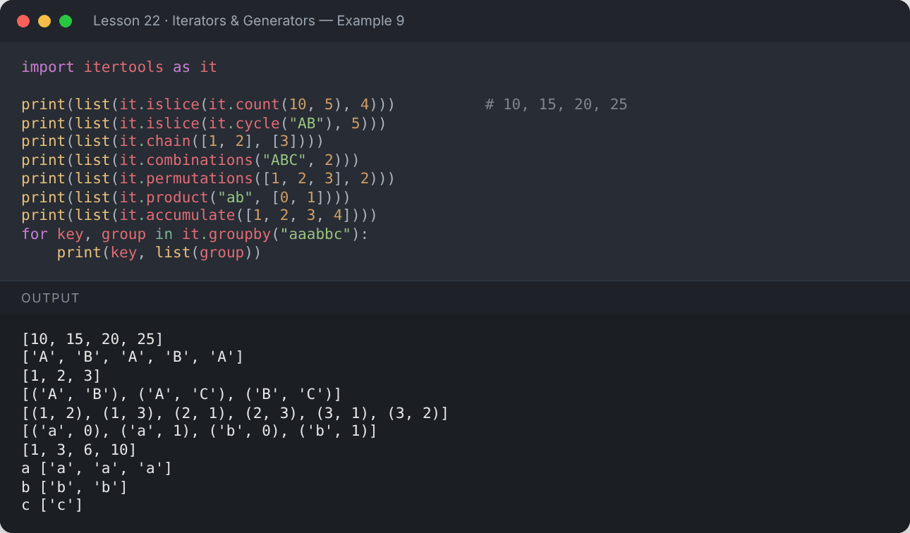

</details>

## 📌 Summary

- `for` uses `iter()` + `next()` under the hood.
- Custom iterators implement `__iter__` and `__next__`.
- Generators (`yield`) produce values lazily — perfect for large or infinite data.
- `itertools` provides fast building blocks for iteration.

---

## ✍️ Exercises

Try each one yourself first, then expand the solution.

**Exercise 1 — Write a generator that yields even numbers up to `n`.**

<details><summary>✅ Solution</summary>

```python
def evens(n):
    for i in range(0, n + 1, 2):
        yield i

print(list(evens(20)))
```

**Output:**

```text
[0, 2, 4, 6, 8, 10, 12, 14, 16, 18, 20]
```

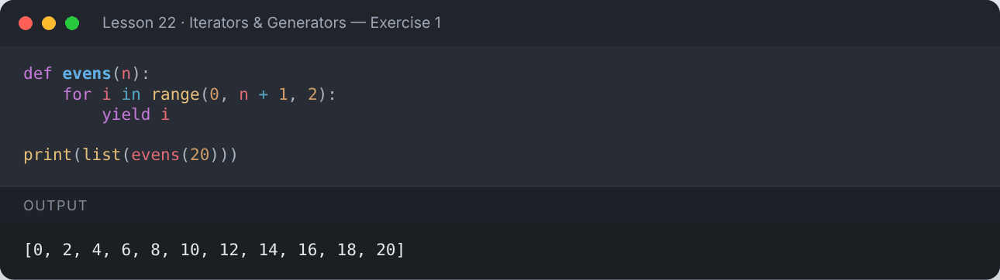

</details>

**Exercise 2 — Write a generator that yields the squares of numbers from a list, then take the first 3.**

<details><summary>✅ Solution</summary>

```python
def squares(nums):
    for n in nums:
        yield n * n

g = squares([3, 5, 7, 9])
print([next(g) for _ in range(3)])
```

**Output:**

```text
[9, 25, 49]
```

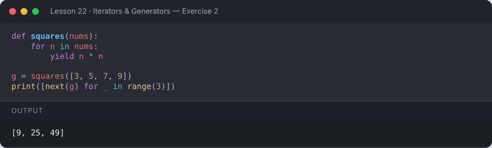

</details>

**Exercise 3 — Create an iterator class `Repeater(word, times)`.**

<details><summary>✅ Solution</summary>

```python
class Repeater:
    def __init__(self, word, times):
        self.word, self.times = word, times
    def __iter__(self):
        self.count = 0
        return self
    def __next__(self):
        if self.count >= self.times:
            raise StopIteration
        self.count += 1
        return f"{self.count}: {self.word}"

for line in Repeater("Python", 3):
    print(line)
```

**Output:**

```text
1: Python
2: Python
3: Python
```

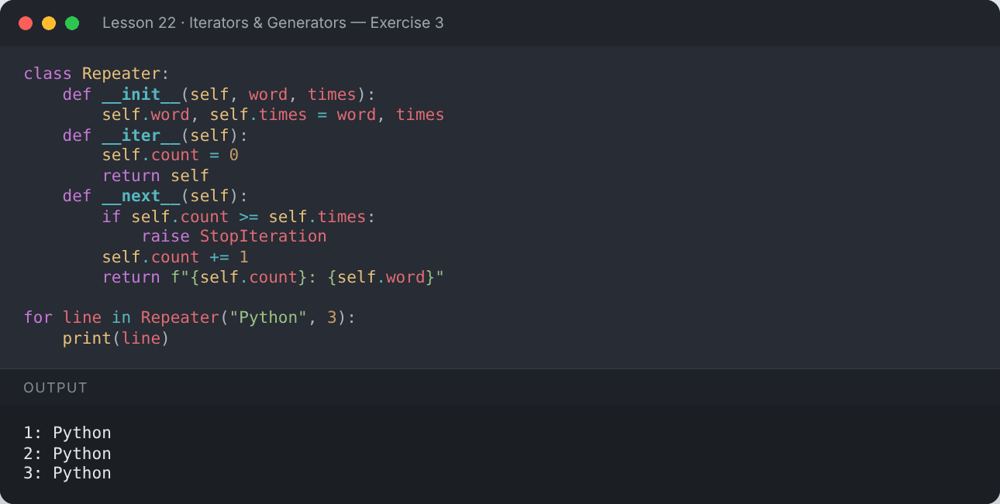

</details>

---

[⬅️ OOP — Encapsulation, Abstraction & Magic Methods](../21-oop-advanced/README.md) · [🏠 All lessons](../../README.md) · [Decorators & Context Managers ➡️](../23-decorators-and-context-managers/README.md)
