# Lesson 23 — Decorators & Context Managers

> Wrap functions with extra behaviour using decorators, and manage resources cleanly with the with statement.

[](https://colab.research.google.com/github/MehvishKiani/Python-beginner-guide/blob/main/lessons/23-decorators-and-context-managers/lesson.ipynb) &nbsp; 📓 [lesson.ipynb](lesson.ipynb) &nbsp; ✍️ [exercises.ipynb](exercises.ipynb)

[⬅️ Iterators & Generators](../22-iterators-and-generators/README.md) · [🏠 All lessons](../../README.md) · [Regular Expressions ➡️](../24-regular-expressions/README.md)

---

## 🎯 Learning Objectives

- Understand closures (functions inside functions)
- Write decorators with and without arguments
- Preserve function metadata with `functools.wraps`
- Build context managers with classes and `contextlib`

## 🔒 Closures

An inner function that **remembers** variables from the outer function — even after the outer function has finished.

```python
def make_multiplier(n):
    def multiply(x):
        return x * n          # remembers n
    return multiply

double = make_multiplier(2)
triple = make_multiplier(3)
print(double(10), triple(10))
```

**Output:**

```text
20 30
```

<details><summary>📸 Screenshot</summary>

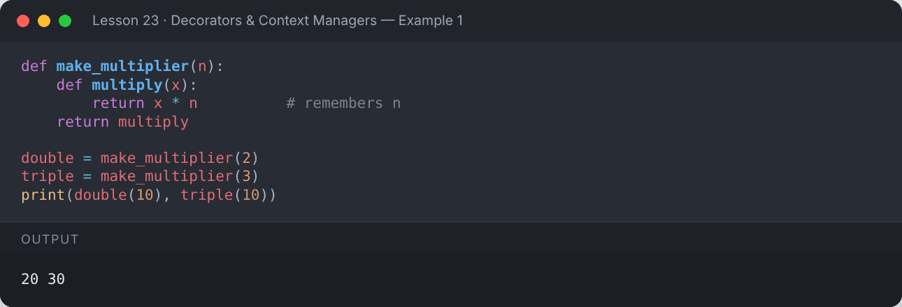

</details>

## 🎀 Decorators

A **decorator** is a function that takes a function and returns a new function with extra behaviour.
`@decorator` above a function is shorthand for `func = decorator(func)`.

```python
def announce(func):
    def wrapper():
        print("▶ Before the function runs")
        func()
        print("■ After the function runs")
    return wrapper

@announce
def say_hello():
    print("Hello!")

say_hello()
```

**Output:**

```text
▶ Before the function runs
Hello!
■ After the function runs
```

<details><summary>📸 Screenshot</summary>

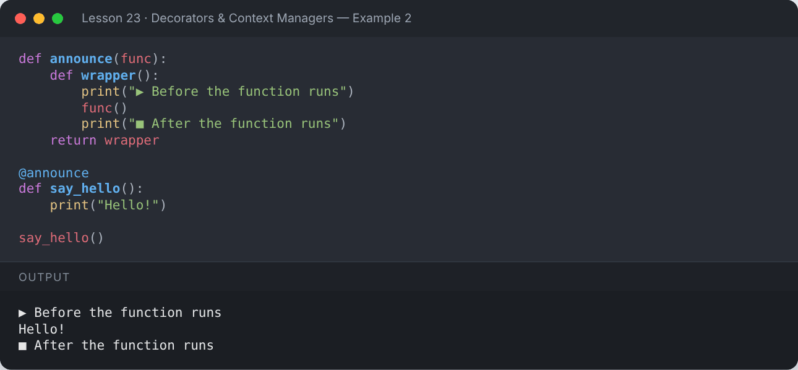

</details>

### Decorators for functions with arguments + `functools.wraps`

```python
import functools

def logger(func):
    @functools.wraps(func)                 # keeps the original name & docstring
    def wrapper(*args, **kwargs):
        print(f"Calling {func.__name__}{args} {kwargs or ''}")
        result = func(*args, **kwargs)
        print(f"{func.__name__} returned {result}")
        return result
    return wrapper

@logger
def add(a, b):
    """Add two numbers."""
    return a + b

add(3, 4)
print("Name kept:", add.__name__, "| Doc kept:", add.__doc__)
```

**Output:**

```text
Calling add(3, 4) 
add returned 7
Name kept: add | Doc kept: Add two numbers.
```

<details><summary>📸 Screenshot</summary>

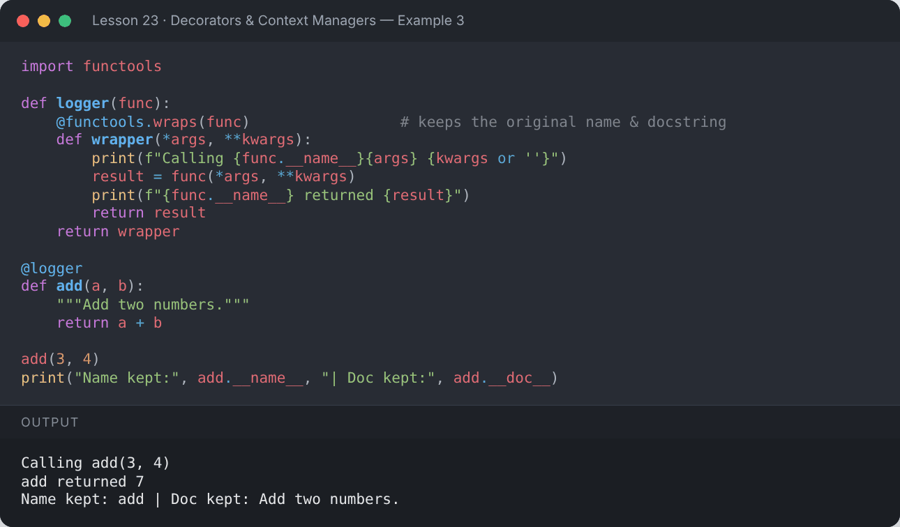

</details>

### Practical decorator — timing

```python
import time, functools

def timer(func):
    @functools.wraps(func)
    def wrapper(*args, **kwargs):
        start = time.perf_counter()
        result = func(*args, **kwargs)
        elapsed = time.perf_counter() - start
        print(f"{func.__name__} took {'less than 1 second' if elapsed < 1 else f'{elapsed:.2f}s'}")
        return result
    return wrapper

@timer
def slow_sum(n):
    return sum(range(n))

print(slow_sum(1_000_000))
```

**Output:**

```text
slow_sum took less than 1 second
499999500000
```

<details><summary>📸 Screenshot</summary>

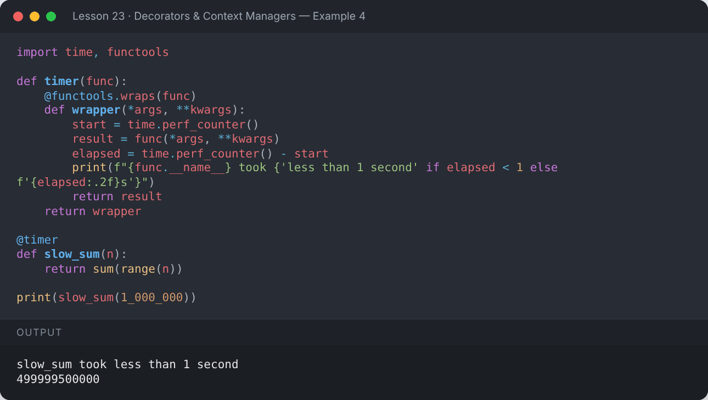

</details>

### Decorators with arguments

```python
import functools

def repeat(times):
    def decorator(func):
        @functools.wraps(func)
        def wrapper(*args, **kwargs):
            for _ in range(times):
                func(*args, **kwargs)
        return wrapper
    return decorator

@repeat(times=3)
def cheer(name):
    print(f"Go {name}! 🎉")

cheer("Python")
```

**Output:**

```text
Go Python! 🎉
Go Python! 🎉
Go Python! 🎉
```

<details><summary>📸 Screenshot</summary>

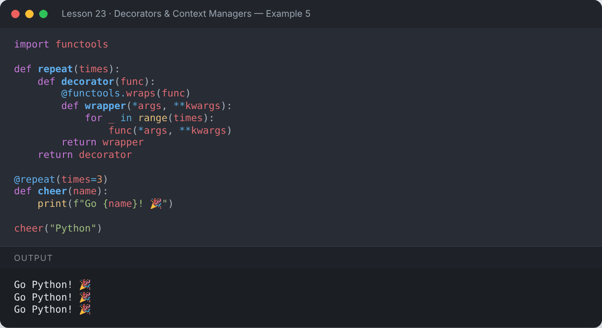

</details>

### Stacking decorators & a validation example

```python
import functools

def require_positive(func):
    @functools.wraps(func)
    def wrapper(*args):
        if any(a <= 0 for a in args):
            return "❌ All arguments must be positive"
        return func(*args)
    return wrapper

def uppercase_result(func):
    @functools.wraps(func)
    def wrapper(*args):
        return str(func(*args)).upper()
    return wrapper

@uppercase_result
@require_positive
def area_label(w, h):
    return f"area is {w * h} sq units"

print(area_label(4, 5))
print(area_label(-1, 5))
```

**Output:**

```text
AREA IS 20 SQ UNITS
❌ ALL ARGUMENTS MUST BE POSITIVE
```

<details><summary>📸 Screenshot</summary>

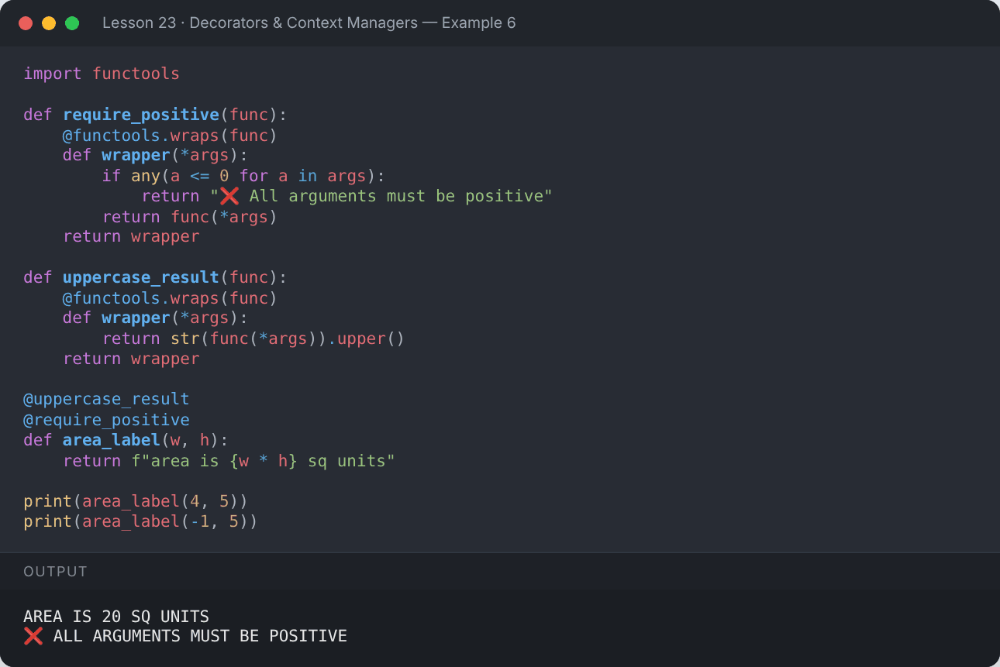

</details>

### Built-in decorators you have already met

`@property`, `@classmethod`, `@staticmethod`, `@dataclass`, `@functools.lru_cache`, `@abstractmethod`.

## 🚪 Context Managers — the `with` statement

A context manager sets something up and **guarantees** clean-up, even if an error happens.
You've used one already: `with open(...) as f:`.

### Class-based (`__enter__` / `__exit__`)

```python
class Timer:
    def __enter__(self):
        import time
        self.start = time.perf_counter()
        print("⏱️ Timer started")
        return self

    def __exit__(self, exc_type, exc, tb):
        import time
        self.elapsed = time.perf_counter() - self.start
        print("⏱️ Timer stopped")
        return False        # don't swallow exceptions

with Timer() as t:
    total = sum(range(100_000))
print("Total:", total, "| measured:", t.elapsed > 0)
```

**Output:**

```text
⏱️ Timer started
⏱️ Timer stopped
Total: 4999950000 | measured: True
```

<details><summary>📸 Screenshot</summary>

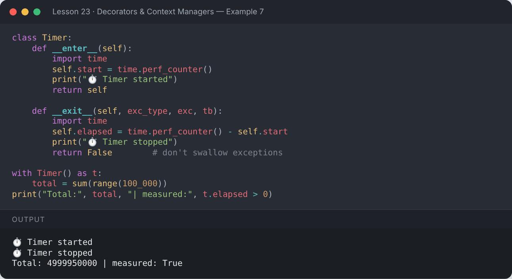

</details>

### Generator-based with `@contextmanager`

```python
from contextlib import contextmanager

@contextmanager
def tag(name):
    print(f"<{name}>")
    try:
        yield
    finally:
        print(f"</{name}>")

with tag("html"):
    with tag("body"):
        print("  Hello, context managers!")
```

**Output:**

```text
<html>
<body>
  Hello, context managers!
</body>
</html>
```

<details><summary>📸 Screenshot</summary>

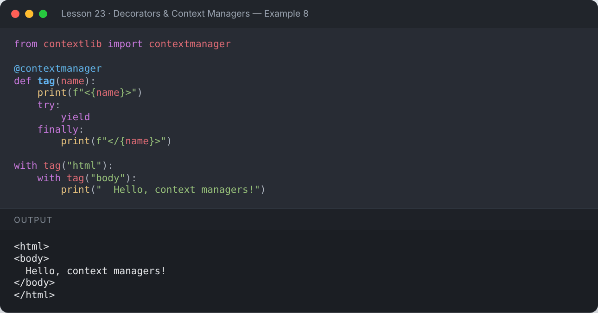

</details>

```python
from contextlib import contextmanager

@contextmanager
def safe_block(label):
    try:
        yield
    except Exception as e:
        print(f"[{label}] handled {type(e).__name__}: {e}")

with safe_block("division"):
    print(10 / 0)
print("Program keeps running ✅")
```

**Output:**

```text
[division] handled ZeroDivisionError: division by zero
Program keeps running ✅
```

<details><summary>📸 Screenshot</summary>

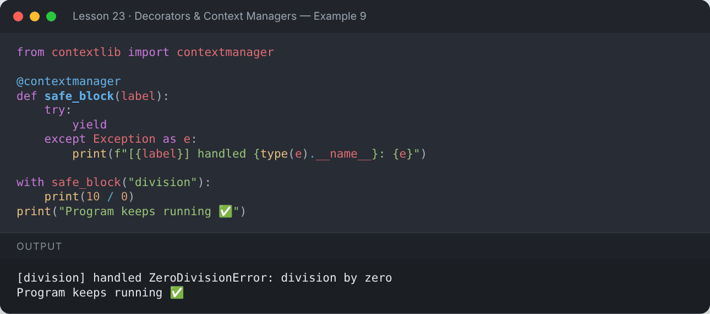

</details>

```python
from contextlib import suppress
import os
with suppress(FileNotFoundError):
    os.remove("file_that_does_not_exist.txt")
print("No crash — the error was suppressed")
```

**Output:**

```text
No crash — the error was suppressed
```

<details><summary>📸 Screenshot</summary>

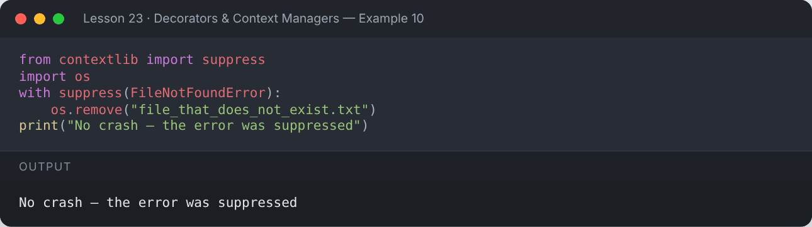

</details>

## 📌 Summary

- Closures remember variables from their enclosing scope.
- Decorators wrap functions: `@decorator`; use `functools.wraps`.
- A decorator with arguments needs an extra outer function.
- Context managers (`with`) guarantee setup/clean-up via `__enter__`/`__exit__` or `@contextmanager`.

---

## ✍️ Exercises

Try each one yourself first, then expand the solution.

**Exercise 1 — Write a decorator `@count_calls` that counts how many times a function is called.**

<details><summary>✅ Solution</summary>

```python
import functools

def count_calls(func):
    @functools.wraps(func)
    def wrapper(*args, **kwargs):
        wrapper.calls += 1
        return func(*args, **kwargs)
    wrapper.calls = 0
    return wrapper

@count_calls
def ping():
    return "pong"

for _ in range(5):
    ping()
print("ping was called", ping.calls, "times")
```

**Output:**

```text
ping was called 5 times
```

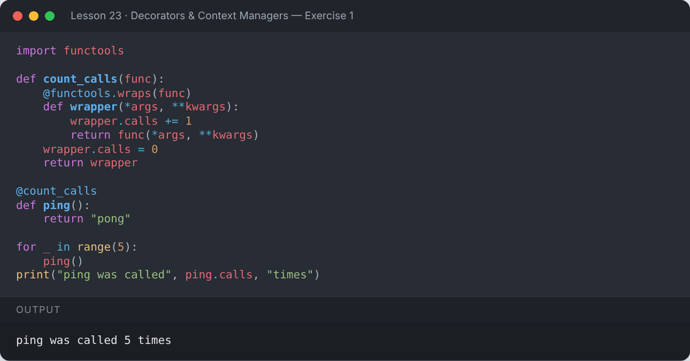

</details>

**Exercise 2 — Write a decorator that converts the returned string to title case.**

<details><summary>✅ Solution</summary>

```python
def title_case(func):
    def wrapper(*args, **kwargs):
        return func(*args, **kwargs).title()
    return wrapper

@title_case
def welcome(name):
    return f"welcome to the python course, {name}"

print(welcome("mehvish"))
```

**Output:**

```text
Welcome To The Python Course, Mehvish
```

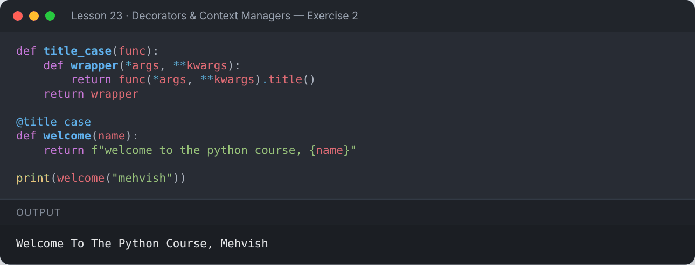

</details>

**Exercise 3 — Create a context manager that changes into a folder and always changes back.**

<details><summary>✅ Solution</summary>

```python
import os
from contextlib import contextmanager

@contextmanager
def working_dir(path):
    old = os.getcwd()
    os.makedirs(path, exist_ok=True)
    os.chdir(path)
    try:
        yield
    finally:
        os.chdir(old)

start = os.getcwd()
with working_dir("temp_folder"):
    print("Inside :", os.path.basename(os.getcwd()))
print("Back to start:", os.getcwd() == start)
```

**Output:**

```text
Inside : temp_folder
Back to start: True
```

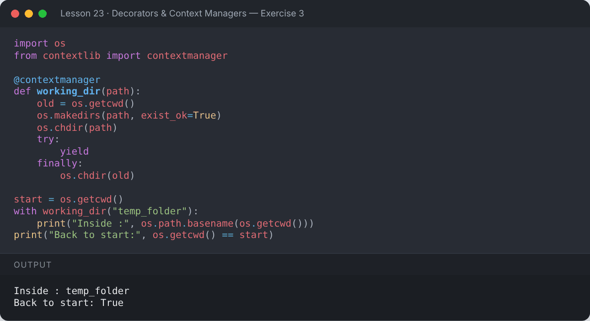

</details>

---

[⬅️ Iterators & Generators](../22-iterators-and-generators/README.md) · [🏠 All lessons](../../README.md) · [Regular Expressions ➡️](../24-regular-expressions/README.md)
