# Lesson 24 — Regular Expressions

> Search, validate and extract text patterns with Python's re module.

[](https://colab.research.google.com/github/MehvishKiani/Python-beginner-guide/blob/main/lessons/24-regular-expressions/lesson.ipynb) &nbsp; 📓 [lesson.ipynb](lesson.ipynb) &nbsp; ✍️ [exercises.ipynb](exercises.ipynb)

[⬅️ Decorators & Context Managers](../23-decorators-and-context-managers/README.md) · [🏠 All lessons](../../README.md) · [Pythonic Code & Best Practices ➡️](../25-pythonic-code-and-best-practices/README.md)

---

## 🎯 Learning Objectives

- Use `re.search`, `re.match`, `re.findall`, `re.sub`, `re.split`
- Write patterns with character classes, quantifiers and anchors
- Capture groups and named groups
- Validate common formats (email, phone, dates)

## 🔎 What is a Regular Expression?

A **regex** is a mini-language for describing text patterns. Always write patterns as **raw strings** `r"..."` so backslashes work.

| Pattern | Matches |
|---|---|
| `.` | any character except newline |
| `\d` / `\D` | digit / non-digit |
| `\w` / `\W` | word char (letter, digit, `_`) / non-word |
| `\s` / `\S` | whitespace / non-whitespace |
| `[abc]`, `[a-z]`, `[^0-9]` | character sets |
| `^` / `$` | start / end of string |
| `*` `+` `?` | 0+, 1+, 0 or 1 |
| `{n}` `{n,m}` | exactly n / between n and m |
| `( )` | group |
| `\|` | OR |

## 🧰 Main Functions

```python
import re
text = "My phone is 0300-1234567 and my office is 051-9876543"

print(re.search(r"\d{4}-\d{7}", text).group())   # first match anywhere
print(re.match(r"My", text) is not None)          # match only at the start
print(re.findall(r"\d+", text))                   # all matches as a list
print(re.sub(r"\d", "X", "PIN: 4321"))            # replace
print(re.split(r"[,;\s]+", "a, b;c  d"))          # split on a pattern
```

**Output:**

```text
0300-1234567
True
['0300', '1234567', '051', '9876543']
PIN: XXXX
['a', 'b', 'c', 'd']
```

<details><summary>📸 Screenshot</summary>

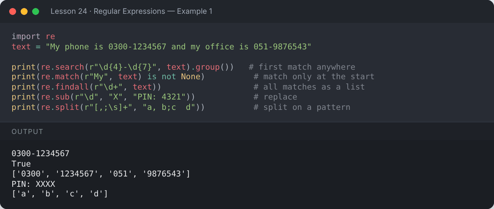

</details>

```python
import re
for m in re.finditer(r"\b\w{5,}\b", "Python makes regex simple and powerful"):
    print(f"'{m.group()}' at position {m.start()}-{m.end()}")
```

**Output:**

```text
'Python' at position 0-6
'makes' at position 7-12
'regex' at position 13-18
'simple' at position 19-25
'powerful' at position 30-38
```

<details><summary>📸 Screenshot</summary>

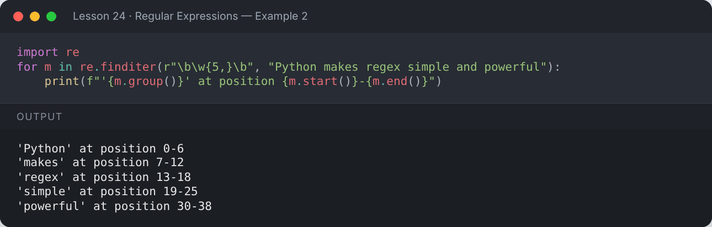

</details>

## 🎯 Groups

```python
import re
date = "Today is 2026-10-12."
m = re.search(r"(\d{4})-(\d{2})-(\d{2})", date)
print("Full :", m.group(0))
print("Year :", m.group(1), "| Month:", m.group(2), "| Day:", m.group(3))
print("All  :", m.groups())
```

**Output:**

```text
Full : 2026-10-12
Year : 2026 | Month: 10 | Day: 12
All  : ('2026', '10', '12')
```

<details><summary>📸 Screenshot</summary>

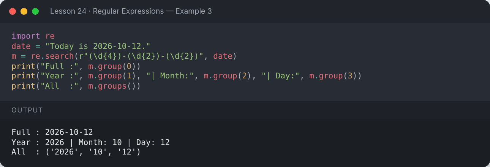

</details>

```python
import re
m = re.search(r"(?P<user>[\w.]+)@(?P<domain>[\w.]+)", "Contact: mehvish.kiani@example.com")
print(m.group("user"), "|", m.group("domain"))
print(m.groupdict())
```

**Output:**

```text
mehvish.kiani | example.com
{'user': 'mehvish.kiani', 'domain': 'example.com'}
```

<details><summary>📸 Screenshot</summary>

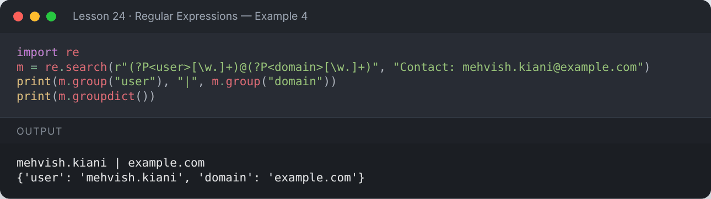

</details>

## ✅ Validation Examples

```python
import re
EMAIL = r"^[\w.+-]+@[\w-]+\.[\w.-]+$"
for email in ["ali@gmail.com", "sara.k@uni.edu.pk", "bad@email", "no-at-sign.com"]:
    print(f"{email:<20} → {'valid' if re.fullmatch(EMAIL, email) else 'invalid'}")
```

**Output:**

```text
ali@gmail.com        → valid
sara.k@uni.edu.pk    → valid
bad@email            → invalid
no-at-sign.com       → invalid
```

<details><summary>📸 Screenshot</summary>

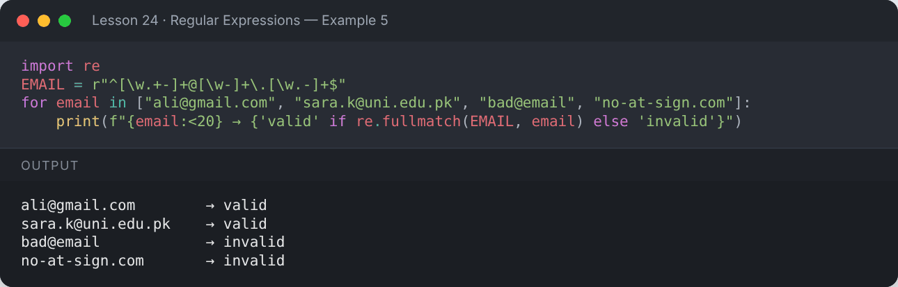

</details>

```python
import re
PHONE = r"03\d{2}-?\d{7}"
for phone in ["0300-1234567", "03111234567", "1234-567"]:
    print(f"{phone:<14} → {'valid' if re.fullmatch(PHONE, phone) else 'invalid'}")
```

**Output:**

```text
0300-1234567   → valid
03111234567    → valid
1234-567       → invalid
```

<details><summary>📸 Screenshot</summary>

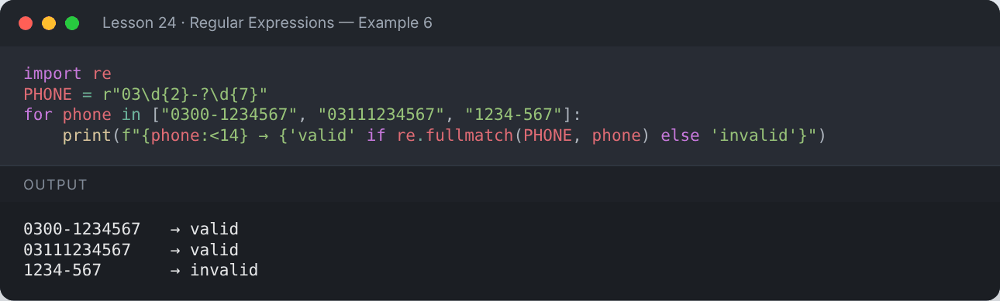

</details>

```python
import re
def strong_password(pw):
    checks = [r".{8,}", r"[A-Z]", r"[a-z]", r"\d", r"[^\w\s]"]
    return all(re.search(c, pw) for c in checks)

for pw in ["hello", "Hello123", "Hello@123"]:
    print(f"{pw:<10} strong: {strong_password(pw)}")
```

**Output:**

```text
hello      strong: False
Hello123   strong: False
Hello@123  strong: True
```

<details><summary>📸 Screenshot</summary>

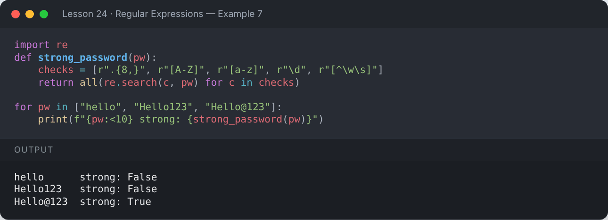

</details>

## 🚩 Flags & Compiled Patterns

```python
import re
print(re.findall(r"python", "Python PYTHON python", flags=re.IGNORECASE))

hashtag = re.compile(r"#(\w+)")
post = "Learning #Python and #DataScience with #AI"
print(hashtag.findall(post))
```

**Output:**

```text
['Python', 'PYTHON', 'python']
['Python', 'DataScience', 'AI']
```

<details><summary>📸 Screenshot</summary>

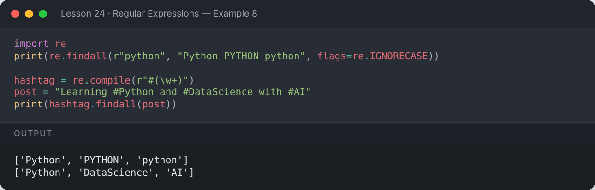

</details>

```python
import re
log = """2026-10-12 ERROR Disk full
2026-10-12 INFO  Started
2026-10-13 ERROR Timeout"""
print(re.findall(r"^(\S+) ERROR (.+)$", log, flags=re.MULTILINE))
```

**Output:**

```text
[('2026-10-12', 'Disk full'), ('2026-10-13', 'Timeout')]
```

<details><summary>📸 Screenshot</summary>

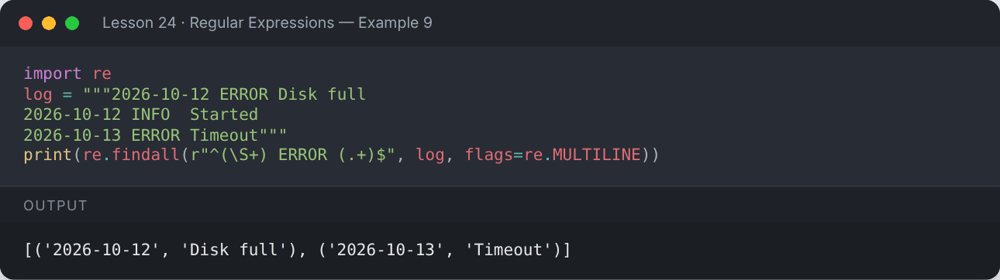

</details>

## 📌 Summary

- `search` finds the first match, `findall` finds all, `sub` replaces, `split` splits.
- Use raw strings `r"..."`, groups `( )` and named groups `(?P<name>...)`.
- `re.fullmatch` is perfect for validation.
- Compile patterns you reuse with `re.compile`.

---

## ✍️ Exercises

Try each one yourself first, then expand the solution.

**Exercise 1 — Extract all email addresses from a paragraph.**

<details><summary>✅ Solution</summary>

```python
import re
para = "Email ali@site.com or sara@uni.edu for info, not admin@ or @nobody."
print(re.findall(r"[\w.+-]+@[\w-]+\.[\w.]+", para))
```

**Output:**

```text
['ali@site.com', 'sara@uni.edu']
```

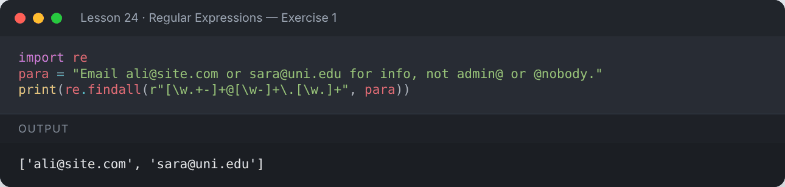

</details>

**Exercise 2 — Replace multiple spaces with a single space.**

<details><summary>✅ Solution</summary>

```python
import re
print(re.sub(r"\s+", " ", "Too    many     spaces   here"))
```

**Output:**

```text
Too many spaces here
```

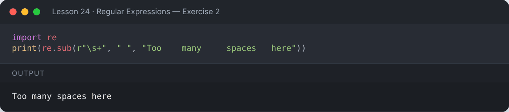

</details>

**Exercise 3 — Convert dates from `DD/MM/YYYY` to `YYYY-MM-DD`.**

<details><summary>✅ Solution</summary>

```python
import re
text = "Exams: 15/11/2026 and 02/12/2026"
print(re.sub(r"(\d{2})/(\d{2})/(\d{4})", r"\3-\2-\1", text))
```

**Output:**

```text
Exams: 2026-11-15 and 2026-12-02
```

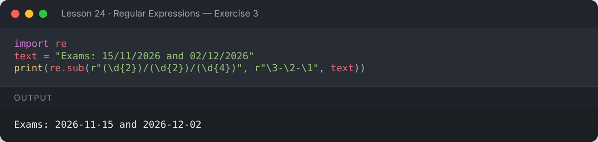

</details>

---

[⬅️ Decorators & Context Managers](../23-decorators-and-context-managers/README.md) · [🏠 All lessons](../../README.md) · [Pythonic Code & Best Practices ➡️](../25-pythonic-code-and-best-practices/README.md)
