# Lesson 25 — Pythonic Code & Best Practices

> Type hints, PEP 8, handy built-ins, unpacking, the walrus operator, debugging and testing basics.

[](https://colab.research.google.com/github/MehvishKiani/Python-beginner-guide/blob/main/lessons/25-pythonic-code-and-best-practices/lesson.ipynb) &nbsp; 📓 [lesson.ipynb](lesson.ipynb) &nbsp; ✍️ [exercises.ipynb](exercises.ipynb)

[⬅️ Regular Expressions](../24-regular-expressions/README.md) · [🏠 All lessons](../../README.md) · [Concurrency Basics — Threads & Async ➡️](../26-concurrency-basics/README.md)

---

## 🎯 Learning Objectives

- Write clean code that follows **PEP 8**
- Add type hints to functions
- Use Pythonic idioms: unpacking, `any`/`all`, `enumerate`, `zip`, the walrus operator
- Debug with f-string `=` and test with `assert` / `unittest`

## 📏 PEP 8 — The Python Style Guide

| Rule | ✅ Good | ❌ Bad |
|---|---|---|
| Variables & functions | `total_marks`, `get_user()` | `TotalMarks`, `getUser()` |
| Classes | `StudentRecord` | `student_record` |
| Constants | `MAX_SIZE = 100` | `maxsize = 100` |
| Indentation | 4 spaces | tabs / 2 spaces |
| Spaces around operators | `x = a + b` | `x=a+b` |
| Line length | ≤ 79–99 characters | very long lines |
| Imports | one per line, at the top | `import os, sys` in the middle |

Tools that do this for you: **black** (formatter), **ruff** / **flake8** (linters).

## 🧘 The Zen of Python

```python
import this
```

**Output:**

```text
The Zen of Python, by Tim Peters

Beautiful is better than ugly.
Explicit is better than implicit.
Simple is better than complex.
Complex is better than complicated.
Flat is better than nested.
Sparse is better than dense.
Readability counts.
Special cases aren't special enough to break the rules.
Although practicality beats purity.
Errors should never pass silently.
Unless explicitly silenced.
In the face of ambiguity, refuse the temptation to guess.
There should be one-- and preferably only one --obvious way to do it.
Although that way may not be obvious at first unless you're Dutch.
Now is better than never.
Although never is often better than *right* now.
If the implementation is hard to explain, it's a bad idea.
If the implementation is easy to explain, it may be a good idea.
Namespaces are one honking great idea -- let's do more of those!
```

<details><summary>📸 Screenshot</summary>

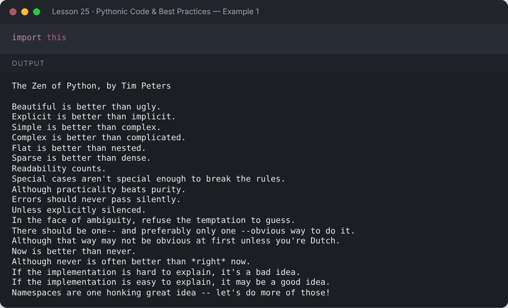

</details>

## 🏷️ Type Hints

Type hints document what a function expects and returns. They don't change how the code runs, but editors and tools like **mypy** use them to catch bugs.

```python
from typing import Optional

def full_name(first: str, last: str, middle: Optional[str] = None) -> str:
    parts = [first, middle, last] if middle else [first, last]
    return " ".join(parts)

def average(scores: list[float]) -> float:
    return sum(scores) / len(scores)

def lookup(table: dict[str, int], key: str) -> int | None:
    return table.get(key)

print(full_name("Mehvish", "Kiani"))
print(average([3.5, 4.0, 3.2]))
print(lookup({"a": 1}, "b"))
print(full_name.__annotations__)
```

**Output:**

```text
Mehvish Kiani
3.5666666666666664
None
{'first': <class 'str'>, 'last': <class 'str'>, 'middle': typing.Optional[str], 'return': <class 'str'>}
```

<details><summary>📸 Screenshot</summary>

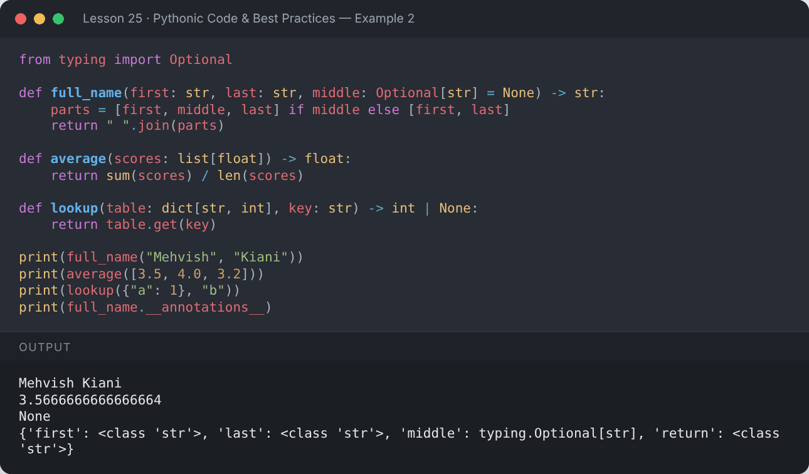

</details>

## 📦 Unpacking Tricks

```python
first, *middle, last = [1, 2, 3, 4, 5]
print(first, middle, last)

a, (b, c) = 1, (2, 3)
print(a, b, c)

merged_list = [*[1, 2], *[3, 4]]
merged_dict = {**{"x": 1}, **{"y": 2}}
print(merged_list, merged_dict)
```

**Output:**

```text
1 [2, 3, 4] 5
1 2 3
[1, 2, 3, 4] {'x': 1, 'y': 2}
```

<details><summary>📸 Screenshot</summary>

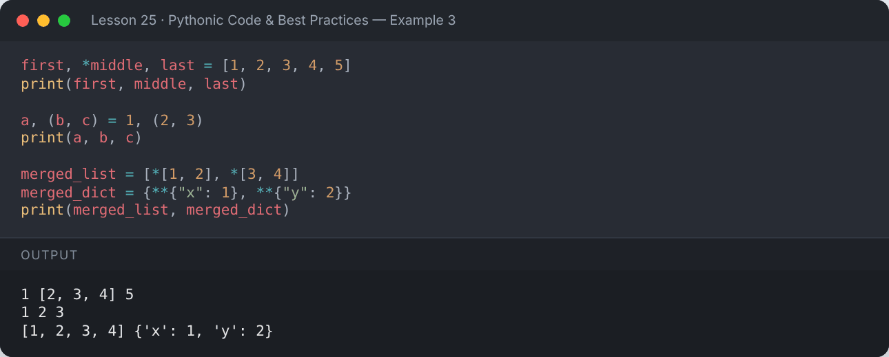

</details>

## ✅ `any()` and `all()`

```python
marks = [78, 92, 45, 88]
print("Anyone failed (<50)?", any(m < 50 for m in marks))
print("Everyone passed?   ", all(m >= 50 for m in marks))
```

**Output:**

```text
Anyone failed (<50)? True
Everyone passed?    False
```

<details><summary>📸 Screenshot</summary>

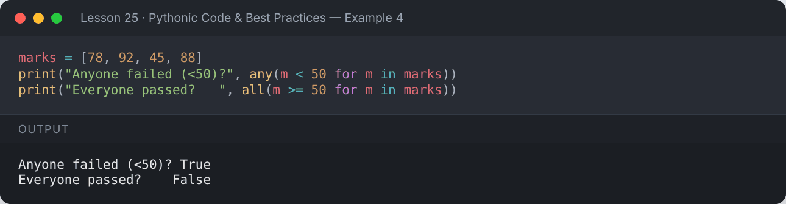

</details>

## 🦭 The Walrus Operator `:=` (Python 3.8+)

Assign a value **inside** an expression.

```python
data = [4, 8, 15, 16, 23, 42]
if (n := len(data)) > 5:
    print(f"List is long ({n} items)")

values = [y for x in data if (y := x * 2) > 20]
print(values)
```

**Output:**

```text
List is long (6 items)
[30, 32, 46, 84]
```

<details><summary>📸 Screenshot</summary>

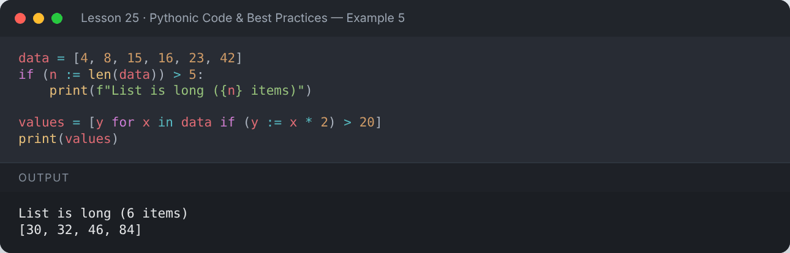

</details>

## 🧠 Pythonic Idioms

| Instead of… | Write… |
|---|---|
| `for i in range(len(items)):` | `for i, item in enumerate(items):` |
| `if x == True:` | `if x:` |
| `if len(items) == 0:` | `if not items:` |
| `temp = a; a = b; b = temp` | `a, b = b, a` |
| `if x == 1 or x == 2 or x == 3:` | `if x in (1, 2, 3):` |
| manual string concatenation in loops | `"".join(parts)` |
| opening files without closing | `with open(...) as f:` |

```python
items = ["pen", "book", "bag"]
prices = [50, 400, 1500]

for i, (item, price) in enumerate(zip(items, prices), start=1):
    print(f"{i}. {item:<5} Rs {price}")

catalog = dict(zip(items, prices))
cheapest = min(catalog, key=catalog.get)
print("Cheapest:", cheapest)
```

**Output:**

```text
1. pen   Rs 50
2. book  Rs 400
3. bag   Rs 1500
Cheapest: pen
```

<details><summary>📸 Screenshot</summary>

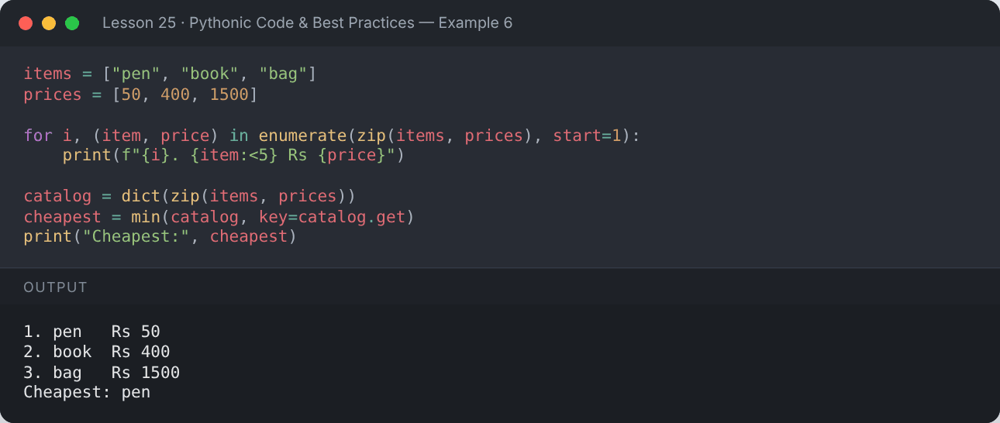

</details>

## 🐞 Debugging Tips

- f-string debugging: `f"{variable=}"` prints the name **and** the value
- `breakpoint()` opens the interactive debugger (`pdb`)
- Read tracebacks **bottom-up**: the last line is the actual error

```python
width, height = 12, 7
area = width * height
print(f"{width=}, {height=}, {area=}")
```

**Output:**

```text
width=12, height=7, area=84
```

<details><summary>📸 Screenshot</summary>

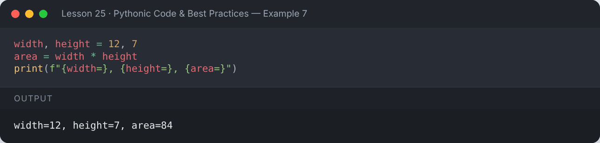

</details>

## 🧪 Testing Basics

```python
def is_even(n: int) -> bool:
    return n % 2 == 0

# quick checks with assert
assert is_even(4)
assert not is_even(7)
print("All asserts passed ✅")
```

**Output:**

```text
All asserts passed ✅
```

<details><summary>📸 Screenshot</summary>

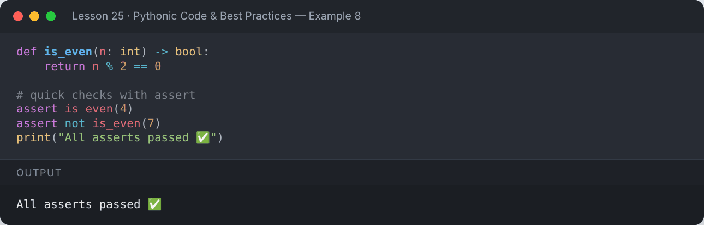

</details>

```python
import unittest

def add(a, b):
    return a + b

class TestAdd(unittest.TestCase):
    def test_integers(self):
        self.assertEqual(add(2, 3), 5)

    def test_strings(self):
        self.assertEqual(add("Py", "thon"), "Python")

    def test_negative(self):
        self.assertEqual(add(-1, -1), -2)

suite = unittest.TestLoader().loadTestsFromTestCase(TestAdd)
result = unittest.TextTestRunner(verbosity=2, stream=__import__("sys").stdout).run(suite)
```

**Output:**

```text
test_integers (__main__.TestAdd.test_integers) ... ok
test_negative (__main__.TestAdd.test_negative) ... ok
test_strings (__main__.TestAdd.test_strings) ... ok

----------------------------------------------------------------------
Ran 3 tests in 0.000s

OK
```

<details><summary>📸 Screenshot</summary>

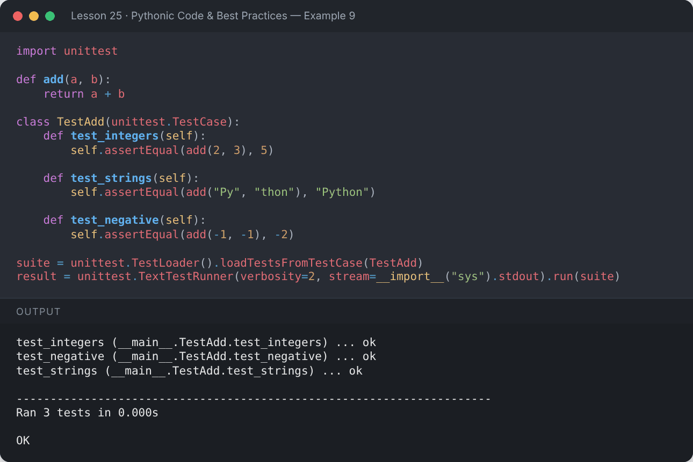

</details>

> In real projects, save tests in `test_*.py` files and run them with `python -m unittest` or **pytest**.

## 🗂️ Professional Project Layout

```
my_project/
├── .venv/               # virtual environment (not committed)
├── src/my_project/
│   ├── __init__.py
│   └── main.py
├── tests/
│   └── test_main.py
├── requirements.txt
├── README.md
└── .gitignore
```

## 📌 Summary

- Follow PEP 8; let **black** and **ruff** do the boring work.
- Add type hints and docstrings to public functions.
- Prefer idioms: `enumerate`, `zip`, unpacking, `any`/`all`, comprehensions.
- Test your code — start with `assert`, grow into `unittest`/`pytest`.

---

## ✍️ Exercises

Try each one yourself first, then expand the solution.

**Exercise 1 — Rewrite this un-Pythonic code: loop with `range(len(names))` to print `index: name`.**

<details><summary>✅ Solution</summary>

```python
names = ["Ali", "Sara", "Zain"]
for i, name in enumerate(names):
    print(f"{i}: {name}")
```

**Output:**

```text
0: Ali
1: Sara
2: Zain
```

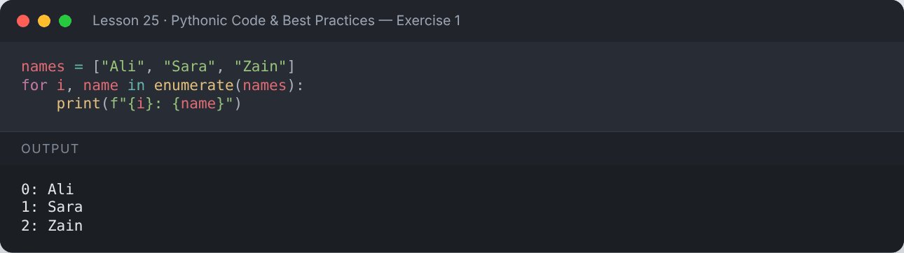

</details>

**Exercise 2 — Add type hints to a function that returns the percentage of a score.**

<details><summary>✅ Solution</summary>

```python
def percentage(obtained: float, total: float) -> float:
    return round(obtained / total * 100, 2)

print(percentage(437, 500))
```

**Output:**

```text
87.4
```

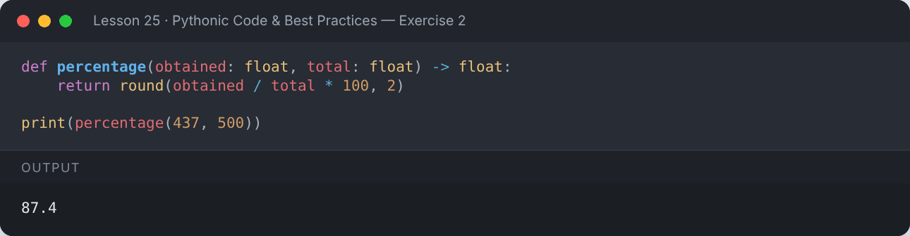

</details>

**Exercise 3 — Check whether all words in a list are lowercase, and whether any word contains a digit.**

<details><summary>✅ Solution</summary>

```python
words = ["python", "code", "ai2", "data"]
print("All lowercase:", all(w.islower() for w in words))
print("Any digit    :", any(ch.isdigit() for w in words for ch in w))
```

**Output:**

```text
All lowercase: True
Any digit    : True
```

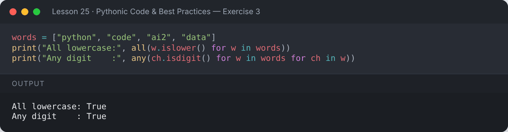

</details>

---

[⬅️ Regular Expressions](../24-regular-expressions/README.md) · [🏠 All lessons](../../README.md) · [Concurrency Basics — Threads & Async ➡️](../26-concurrency-basics/README.md)
