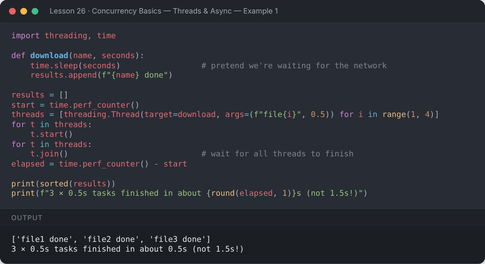
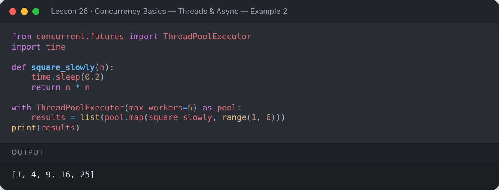
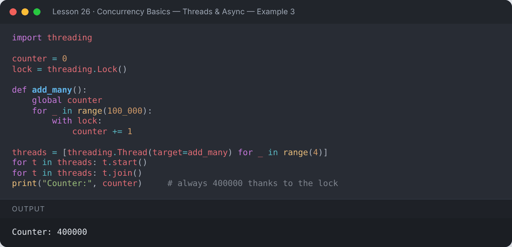
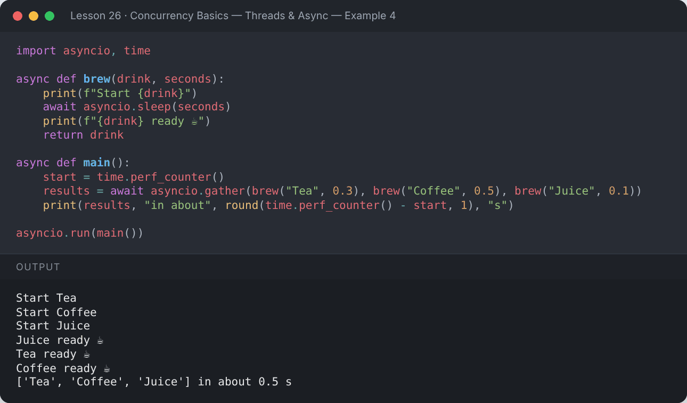
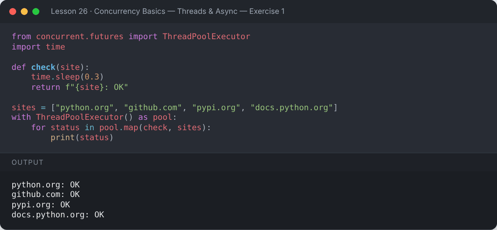
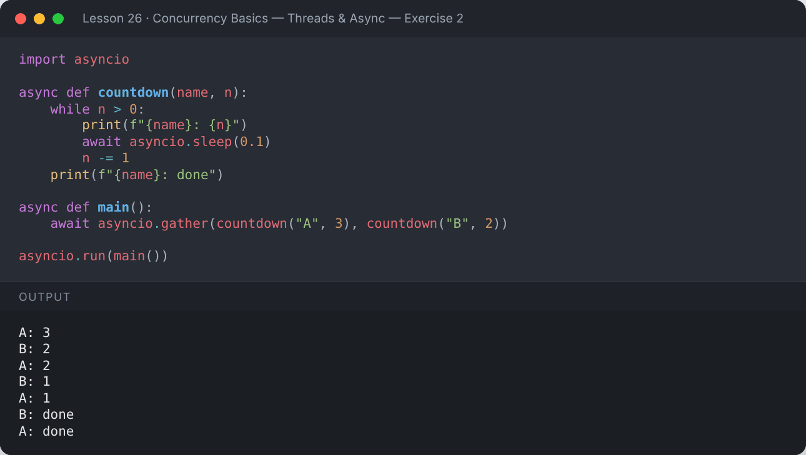

# Lesson 26 — Concurrency Basics — Threads & Async

> Do several things at once with threading, concurrent.futures and asyncio.

[](https://colab.research.google.com/github/MehvishKiani/Python-beginner-guide/blob/main/lessons/26-concurrency-basics/lesson.ipynb) &nbsp; 📓 [lesson.ipynb](lesson.ipynb) &nbsp; ✍️ [exercises.ipynb](exercises.ipynb)

[⬅️ Pythonic Code & Best Practices](../25-pythonic-code-and-best-practices/README.md) · [🏠 All lessons](../../README.md) · [Mini Projects ➡️](../27-mini-projects/README.md)

---

## 🎯 Learning Objectives

- Know the difference between concurrency and parallelism
- Run tasks in threads with `threading` and `ThreadPoolExecutor`
- Protect shared data with a `Lock`
- Write simple `async` / `await` code with `asyncio`

## 🧵 Concurrency vs Parallelism

| | Concurrency | Parallelism |
|---|---|---|
| Idea | dealing with many tasks by switching between them | running many tasks at the **same instant** |
| Python tools | `threading`, `asyncio` | `multiprocessing` |
| Best for | **I/O-bound** work: downloads, files, APIs, waiting | **CPU-bound** work: heavy calculations |

## 🧵 Threads with `threading`

```python
import threading, time

def download(name, seconds):
    time.sleep(seconds)                 # pretend we're waiting for the network
    results.append(f"{name} done")

results = []
start = time.perf_counter()
threads = [threading.Thread(target=download, args=(f"file{i}", 0.5)) for i in range(1, 4)]
for t in threads:
    t.start()
for t in threads:
    t.join()                            # wait for all threads to finish
elapsed = time.perf_counter() - start

print(sorted(results))
print(f"3 × 0.5s tasks finished in about {round(elapsed, 1)}s (not 1.5s!)")
```

**Output:**

```text
['file1 done', 'file2 done', 'file3 done']
3 × 0.5s tasks finished in about 0.5s (not 1.5s!)
```

<details><summary>📸 Screenshot</summary>



</details>

## 🏊 `ThreadPoolExecutor` — the easy way

```python
from concurrent.futures import ThreadPoolExecutor
import time

def square_slowly(n):
    time.sleep(0.2)
    return n * n

with ThreadPoolExecutor(max_workers=5) as pool:
    results = list(pool.map(square_slowly, range(1, 6)))
print(results)
```

**Output:**

```text
[1, 4, 9, 16, 25]
```

<details><summary>📸 Screenshot</summary>



</details>

## 🔐 Race Conditions & `Lock`

When threads change shared data at the same time, updates can be lost. A `Lock` lets only one thread in at a time.

```python
import threading

counter = 0
lock = threading.Lock()

def add_many():
    global counter
    for _ in range(100_000):
        with lock:
            counter += 1

threads = [threading.Thread(target=add_many) for _ in range(4)]
for t in threads: t.start()
for t in threads: t.join()
print("Counter:", counter)     # always 400000 thanks to the lock
```

**Output:**

```text
Counter: 400000
```

<details><summary>📸 Screenshot</summary>



</details>

## ⚡ `asyncio` — `async` & `await`

`async def` defines a **coroutine**. `await` pauses it while waiting, letting other coroutines run — all in a single thread.

```python
import asyncio, time

async def brew(drink, seconds):
    print(f"Start {drink}")
    await asyncio.sleep(seconds)
    print(f"{drink} ready ☕")
    return drink

async def main():
    start = time.perf_counter()
    results = await asyncio.gather(brew("Tea", 0.3), brew("Coffee", 0.5), brew("Juice", 0.1))
    print(results, "in about", round(time.perf_counter() - start, 1), "s")

asyncio.run(main())
```

**Output:**

```text
Start Tea
Start Coffee
Start Juice
Juice ready ☕
Tea ready ☕
Coffee ready ☕
['Tea', 'Coffee', 'Juice'] in about 0.5 s
```

<details><summary>📸 Screenshot</summary>



</details>

> 💡 In **Jupyter / Colab** an event loop is already running, so use `await main()` in a cell instead of `asyncio.run(main())`.

## 🖥️ Multiprocessing (CPU-bound work)

Because of the **GIL** (Global Interpreter Lock), threads don't speed up heavy calculations. Use processes instead — save this as a `.py` file and run it:

```python
from multiprocessing import Pool

def heavy(n):
    return sum(i * i for i in range(n))

if __name__ == "__main__":          # required for multiprocessing
    with Pool() as pool:
        print(pool.map(heavy, [10_000_000] * 4))
```

## 📌 Summary

- I/O-bound → `threading` / `ThreadPoolExecutor` / `asyncio`.
- CPU-bound → `multiprocessing`.
- Protect shared data with `Lock`.
- `async def` + `await` + `asyncio.gather` run many waits at once.

---

## ✍️ Exercises

Try each one yourself first, then expand the solution.

**Exercise 1 — Use `ThreadPoolExecutor` to "check" 4 websites concurrently (simulate with `sleep`).**

<details><summary>✅ Solution</summary>

```python
from concurrent.futures import ThreadPoolExecutor
import time

def check(site):
    time.sleep(0.3)
    return f"{site}: OK"

sites = ["python.org", "github.com", "pypi.org", "docs.python.org"]
with ThreadPoolExecutor() as pool:
    for status in pool.map(check, sites):
        print(status)
```

**Output:**

```text
python.org: OK
github.com: OK
pypi.org: OK
docs.python.org: OK
```



</details>

**Exercise 2 — Write an async countdown that runs two timers at the same time.**

<details><summary>✅ Solution</summary>

```python
import asyncio

async def countdown(name, n):
    while n > 0:
        print(f"{name}: {n}")
        await asyncio.sleep(0.1)
        n -= 1
    print(f"{name}: done")

async def main():
    await asyncio.gather(countdown("A", 3), countdown("B", 2))

asyncio.run(main())
```

**Output:**

```text
A: 3
B: 2
A: 2
B: 1
A: 1
B: done
A: done
```



</details>

---

[⬅️ Pythonic Code & Best Practices](../25-pythonic-code-and-best-practices/README.md) · [🏠 All lessons](../../README.md) · [Mini Projects ➡️](../27-mini-projects/README.md)
