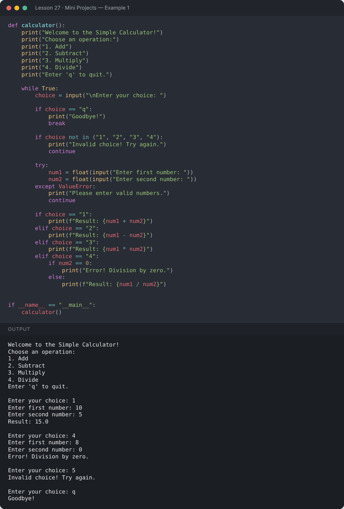
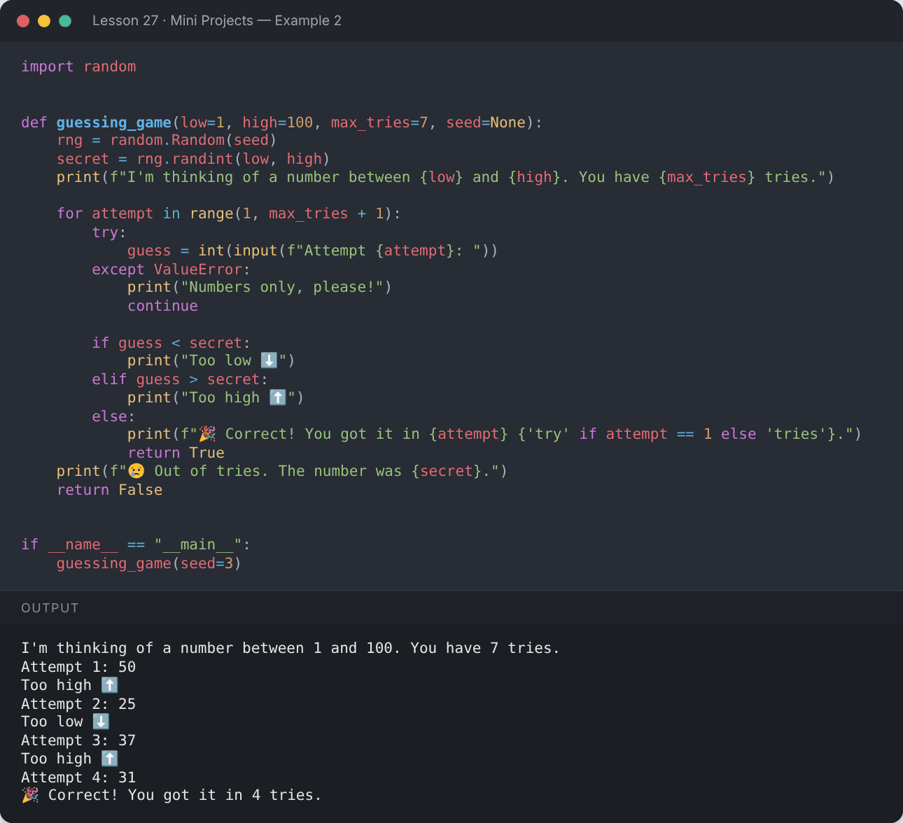
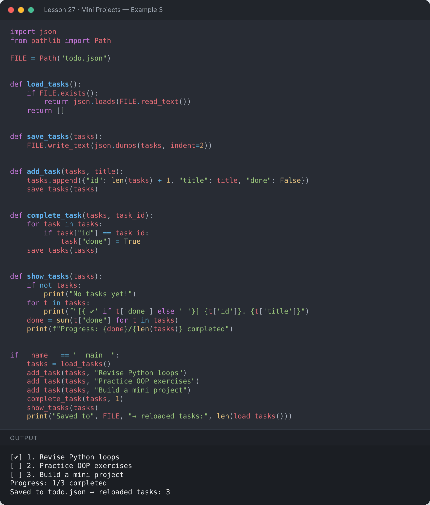
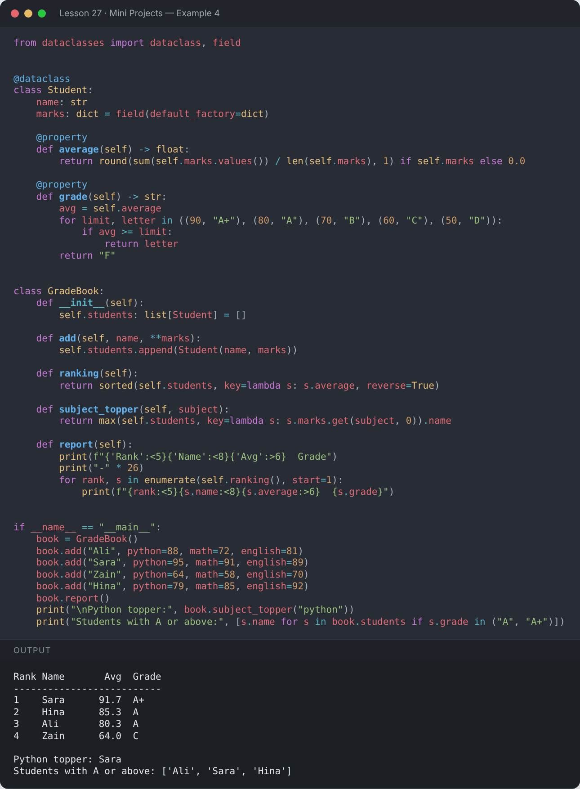
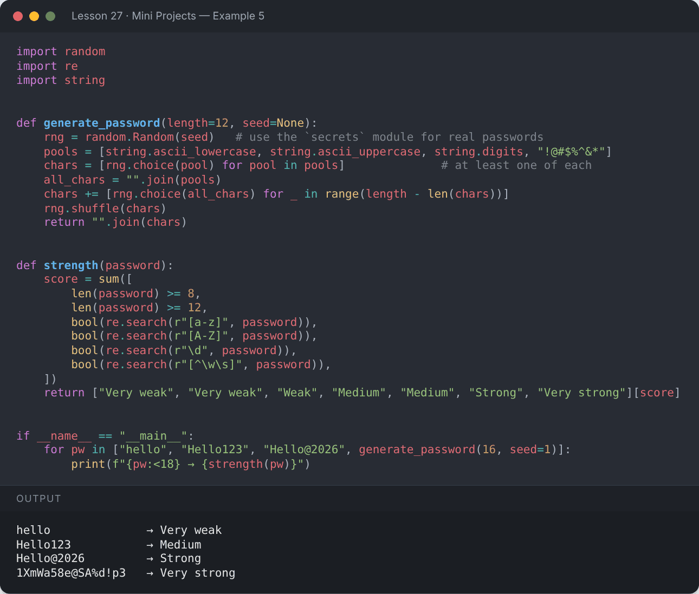

# Lesson 27 — Mini Projects

> Put everything together — five beginner-friendly projects that combine the concepts from all lessons.

[](https://colab.research.google.com/github/MehvishKiani/Python-beginner-guide/blob/main/lessons/27-mini-projects/lesson.ipynb) &nbsp; 📓 [lesson.ipynb](lesson.ipynb)

[⬅️ Concurrency Basics — Threads & Async](../26-concurrency-basics/README.md) · [🏠 All lessons](../../README.md)

---

## 🎯 What you'll build

| # | Project | Concepts used |
|---|---|---|
| 1 | Simple Calculator | functions, loops, conditions, exceptions, input |
| 2 | Number Guessing Game | `random`, while loops, conditions |
| 3 | To-Do List Manager | lists, dicts, JSON file handling, functions |
| 4 | Student Grade Manager | classes, dataclasses, comprehensions, sorting |
| 5 | Password Generator & Checker | `random`/`secrets`, strings, regex |

Each project is also available as a standalone script in the [`projects/`](../../projects) folder — run it with `python projects/<name>.py`.

*(The outputs below use sample inputs so you can see the program in action.)*

## 🧮 Project 1 — Simple Calculator

```python
def calculator():
    print("Welcome to the Simple Calculator!")
    print("Choose an operation:")
    print("1. Add")
    print("2. Subtract")
    print("3. Multiply")
    print("4. Divide")
    print("Enter 'q' to quit.")

    while True:
        choice = input("\nEnter your choice: ")

        if choice == "q":
            print("Goodbye!")
            break

        if choice not in ("1", "2", "3", "4"):
            print("Invalid choice! Try again.")
            continue

        try:
            num1 = float(input("Enter first number: "))
            num2 = float(input("Enter second number: "))
        except ValueError:
            print("Please enter valid numbers.")
            continue

        if choice == "1":
            print(f"Result: {num1 + num2}")
        elif choice == "2":
            print(f"Result: {num1 - num2}")
        elif choice == "3":
            print(f"Result: {num1 * num2}")
        elif choice == "4":
            if num2 == 0:
                print("Error! Division by zero.")
            else:
                print(f"Result: {num1 / num2}")


if __name__ == "__main__":
    calculator()
```

**Output:**

```text
Welcome to the Simple Calculator!
Choose an operation:
1. Add
2. Subtract
3. Multiply
4. Divide
Enter 'q' to quit.

Enter your choice: 1
Enter first number: 10
Enter second number: 5
Result: 15.0

Enter your choice: 4
Enter first number: 8
Enter second number: 0
Error! Division by zero.

Enter your choice: 5
Invalid choice! Try again.

Enter your choice: q
Goodbye!
```

<details><summary>📸 Screenshot</summary>



</details>

## 🎲 Project 2 — Number Guessing Game

```python
import random


def guessing_game(low=1, high=100, max_tries=7, seed=None):
    rng = random.Random(seed)
    secret = rng.randint(low, high)
    print(f"I'm thinking of a number between {low} and {high}. You have {max_tries} tries.")

    for attempt in range(1, max_tries + 1):
        try:
            guess = int(input(f"Attempt {attempt}: "))
        except ValueError:
            print("Numbers only, please!")
            continue

        if guess < secret:
            print("Too low ⬇️")
        elif guess > secret:
            print("Too high ⬆️")
        else:
            print(f"🎉 Correct! You got it in {attempt} {'try' if attempt == 1 else 'tries'}.")
            return True
    print(f"😢 Out of tries. The number was {secret}.")
    return False


if __name__ == "__main__":
    guessing_game(seed=3)
```

**Output:**

```text
I'm thinking of a number between 1 and 100. You have 7 tries.
Attempt 1: 50
Too high ⬆️
Attempt 2: 25
Too low ⬇️
Attempt 3: 37
Too high ⬆️
Attempt 4: 31
🎉 Correct! You got it in 4 tries.
```

<details><summary>📸 Screenshot</summary>



</details>

## ✅ Project 3 — To-Do List Manager (saved to JSON)

```python
import json
from pathlib import Path

FILE = Path("todo.json")


def load_tasks():
    if FILE.exists():
        return json.loads(FILE.read_text())
    return []


def save_tasks(tasks):
    FILE.write_text(json.dumps(tasks, indent=2))


def add_task(tasks, title):
    tasks.append({"id": len(tasks) + 1, "title": title, "done": False})
    save_tasks(tasks)


def complete_task(tasks, task_id):
    for task in tasks:
        if task["id"] == task_id:
            task["done"] = True
    save_tasks(tasks)


def show_tasks(tasks):
    if not tasks:
        print("No tasks yet!")
    for t in tasks:
        print(f"[{'✔' if t['done'] else ' '}] {t['id']}. {t['title']}")
    done = sum(t["done"] for t in tasks)
    print(f"Progress: {done}/{len(tasks)} completed")


if __name__ == "__main__":
    tasks = load_tasks()
    add_task(tasks, "Revise Python loops")
    add_task(tasks, "Practice OOP exercises")
    add_task(tasks, "Build a mini project")
    complete_task(tasks, 1)
    show_tasks(tasks)
    print("Saved to", FILE, "→ reloaded tasks:", len(load_tasks()))
```

**Output:**

```text
[✔] 1. Revise Python loops
[ ] 2. Practice OOP exercises
[ ] 3. Build a mini project
Progress: 1/3 completed
Saved to todo.json → reloaded tasks: 3
```

<details><summary>📸 Screenshot</summary>



</details>

## 🎓 Project 4 — Student Grade Manager

```python
from dataclasses import dataclass, field


@dataclass
class Student:
    name: str
    marks: dict = field(default_factory=dict)

    @property
    def average(self) -> float:
        return round(sum(self.marks.values()) / len(self.marks), 1) if self.marks else 0.0

    @property
    def grade(self) -> str:
        avg = self.average
        for limit, letter in ((90, "A+"), (80, "A"), (70, "B"), (60, "C"), (50, "D")):
            if avg >= limit:
                return letter
        return "F"


class GradeBook:
    def __init__(self):
        self.students: list[Student] = []

    def add(self, name, **marks):
        self.students.append(Student(name, marks))

    def ranking(self):
        return sorted(self.students, key=lambda s: s.average, reverse=True)

    def subject_topper(self, subject):
        return max(self.students, key=lambda s: s.marks.get(subject, 0)).name

    def report(self):
        print(f"{'Rank':<5}{'Name':<8}{'Avg':>6}  Grade")
        print("-" * 26)
        for rank, s in enumerate(self.ranking(), start=1):
            print(f"{rank:<5}{s.name:<8}{s.average:>6}  {s.grade}")


if __name__ == "__main__":
    book = GradeBook()
    book.add("Ali", python=88, math=72, english=81)
    book.add("Sara", python=95, math=91, english=89)
    book.add("Zain", python=64, math=58, english=70)
    book.add("Hina", python=79, math=85, english=92)
    book.report()
    print("\nPython topper:", book.subject_topper("python"))
    print("Students with A or above:", [s.name for s in book.students if s.grade in ("A", "A+")])
```

**Output:**

```text
Rank Name       Avg  Grade
--------------------------
1    Sara      91.7  A+
2    Hina      85.3  A
3    Ali       80.3  A
4    Zain      64.0  C

Python topper: Sara
Students with A or above: ['Ali', 'Sara', 'Hina']
```

<details><summary>📸 Screenshot</summary>



</details>

## 🔐 Project 5 — Password Generator & Strength Checker

```python
import random
import re
import string


def generate_password(length=12, seed=None):
    rng = random.Random(seed)   # use the `secrets` module for real passwords
    pools = [string.ascii_lowercase, string.ascii_uppercase, string.digits, "!@#$%^&*"]
    chars = [rng.choice(pool) for pool in pools]              # at least one of each
    all_chars = "".join(pools)
    chars += [rng.choice(all_chars) for _ in range(length - len(chars))]
    rng.shuffle(chars)
    return "".join(chars)


def strength(password):
    score = sum([
        len(password) >= 8,
        len(password) >= 12,
        bool(re.search(r"[a-z]", password)),
        bool(re.search(r"[A-Z]", password)),
        bool(re.search(r"\d", password)),
        bool(re.search(r"[^\w\s]", password)),
    ])
    return ["Very weak", "Very weak", "Weak", "Medium", "Medium", "Strong", "Very strong"][score]


if __name__ == "__main__":
    for pw in ["hello", "Hello123", "Hello@2026", generate_password(16, seed=1)]:
        print(f"{pw:<18} → {strength(pw)}")
```

**Output:**

```text
hello              → Very weak
Hello123           → Medium
Hello@2026         → Strong
1XmWa58e@SA%d!p3   → Very strong
```

<details><summary>📸 Screenshot</summary>



</details>

## 🚀 Ideas for Your Next Projects

- 🌦️ Weather app using a public API (`requests`)
- 📒 Contact book with SQLite (`sqlite3`)
- 🧾 Expense tracker that exports to CSV
- 🕹️ Rock-Paper-Scissors or Tic-Tac-Toe
- 📊 Data analysis of a CSV with **pandas** and **matplotlib**
- 🌐 A small website with **Flask** or **FastAPI**

---

[⬅️ Concurrency Basics — Threads & Async](../26-concurrency-basics/README.md) · [🏠 All lessons](../../README.md)
